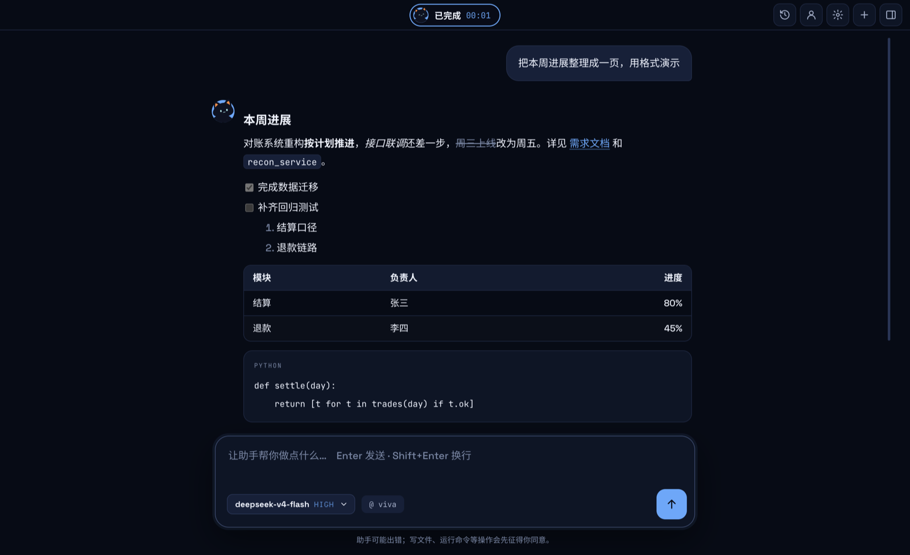
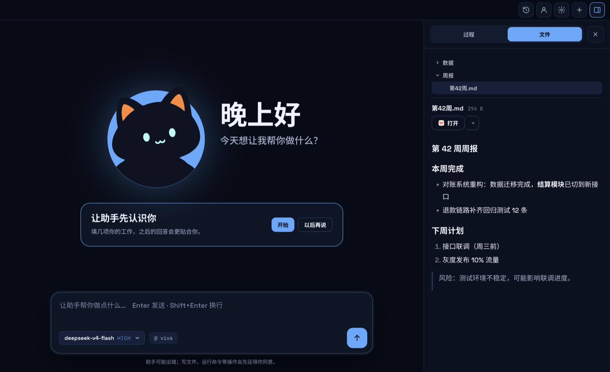

<div align="center">


# Viva

**住在桌面上的 AI 助手。** 它帮你读文件、整理资料、写东西、跑命令；每一步都看得见，动手之前先问你。

[](https://github.com/JNS0724/Viva/releases)
[](#下载安装)
[](LICENSE)

[下载](https://github.com/JNS0724/Viva/releases) · [功能说明](docs/features.md) · [开发](docs/development.md)



</div>

> Viva 是个人项目，不是 DeepSeek 的官方产品。它基于 DeepSeek 开源的 [DeepSeek Harness](https://github.com/deepseek-ai/deepseek-harness)（dsh），可以连接 DeepSeek，也可以连接兼容 OpenAI 或 Anthropic 接口的其他模型。

## 亮点

### Viva 岛

窗口在后台时，屏幕顶部会出现一座小岛：助手在做什么、要你确认什么，一眼就能看到，也可以直接在岛上点「允许」。在任何程序里按 `⌘⇧Space`（Windows 上是 `Ctrl+Shift+Space`）就能提问，也可以把文件拖给猫。岛可以拖到屏幕上任意位置。


### 先问你，再动手

写文件、运行命令之前，会弹出一张确认卡片，写明要做什么。思考过程和每一次工具调用都收在右侧的「过程」里，随时可以查看。


### 预览工作区里的文件

在「文件」页浏览工作区：Markdown、代码、CSV 表格、图片都能直接预览。文件被改动后预览自动刷新，也可以选用别的应用打开。



### 还有

- **记得你**：说一句「记住……」，或者让它在对话中自己学。它记下的内容都在「关于你」里，可以查看、修改和恢复。
- **说一句就能接入工具**：比如「帮我接入 GitHub」「把刚才的做法存成 skill」。需要密钥时，在对话里的卡片中填写，密钥加密保存在本机，不会交给模型。
- **不确定就先问**：回答取决于你没说的信息（地点、时间、对象……）时，它会先问你，不会乱猜。
- **历史对话**：全文搜索、置顶、导出 Markdown；重新打开旧对话，可以接着聊。

## 下载安装

从 [Releases](https://github.com/JNS0724/Viva/releases) 下载：

| 平台 | 文件 |
|---|---|
| macOS（Apple 芯片） | `Viva-x.y.z-mac-arm64.dmg` |
| Windows（x64） | `Viva-x.y.z-win-x64-setup.exe` |

安装包没有签名，第一次打开要多一步：

- **macOS**：把 Viva 拖进「应用程序」，然后右键点 Viva →「打开」→「打开」。如果提示「已损坏」，在终端运行 `xattr -dr com.apple.quarantine /Applications/Viva.app`。
- **Windows**：出现「Windows 已保护你的电脑」时，点「更多信息」→「仍要运行」。

## 快速开始

1. 打开 Viva，点首页的「连接模型」，填入 [DeepSeek API key](https://platform.deepseek.com/api_keys)，也可以在设置里添加其他模型。
2. 在输入框里说你要做什么，比如「把工作区里的周报整理成一份摘要」。
3. 需要写文件或运行命令时，看清确认卡片上写的内容，再点「允许」。

## 隐私与安全

- **key 加密保存**：key 用系统钥匙串加密（macOS 钥匙串 / Windows DPAPI），只保存在本机，界面上只显示最后 4 位。
- **只起草，不发送**：发送邮件或消息的工具会被拦下，起草好的内容交给你自己发。
- **数据在本机**：对话、记忆和历史记录都保存在本机，Viva 没有自己的服务器。只有在调用模型、使用联网工具或你接入的服务时才会联网。对话内容在本机以明文保存。

## 从源码运行

需要 Node.js：

```bash
npm install
npm start      # 启动应用
npm test       # 运行测试
```

打包、测试和内嵌 dsh 的细节，见 [docs/development.md](docs/development.md)。

## 文档

- [功能说明](docs/features.md)：Viva 岛、文件、模型、记忆、历史对话等功能的细节
- [开发、打包与测试](docs/development.md)
- [架构](docs/architecture.md)：Viva 如何在 dsh 的插件体系上分层
- [记忆方案](docs/memory.md)

## 许可证

Viva 以 [MIT 许可证](LICENSE) 发布。

安装包里还带有第三方软件，各自遵循自己的许可证，大部分是 MIT、Apache-2.0、BSD 或 ISC，DeepSeek Harness 是 MIT。完整清单、许可证原文和源码获取方式见应用里的 `THIRD_PARTY_NOTICES.txt`，同一份也附在每个 Release 里。其中：

- **Electron 和 Chromium**：许可文件随应用一起分发（`LICENSE.electron.txt`、`LICENSES.chromium.html`）。
- **LibreOffice（MPL-2.0）**：声明里写明了源码仓库和提交，补丁随包附带。
- **libvips（LGPL-3.0）**：独立的动态库，可以替换；声明里写明了版本和源码地址。

也可以在 [Issues](https://github.com/JNS0724/Viva/issues) 里索取以上源码。
