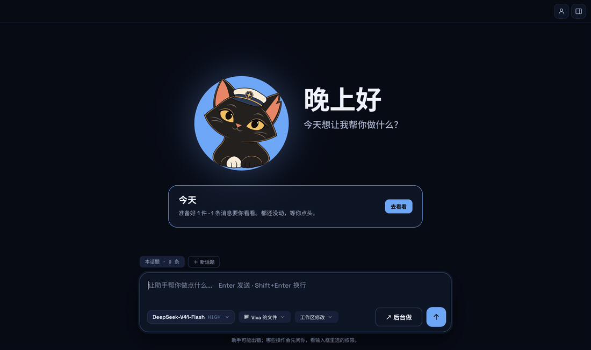
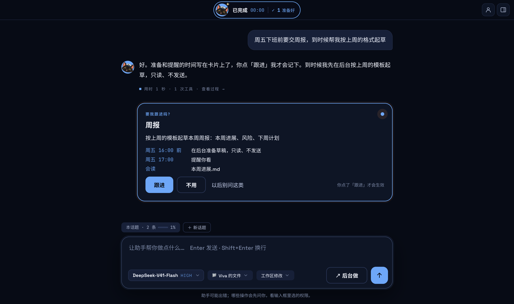
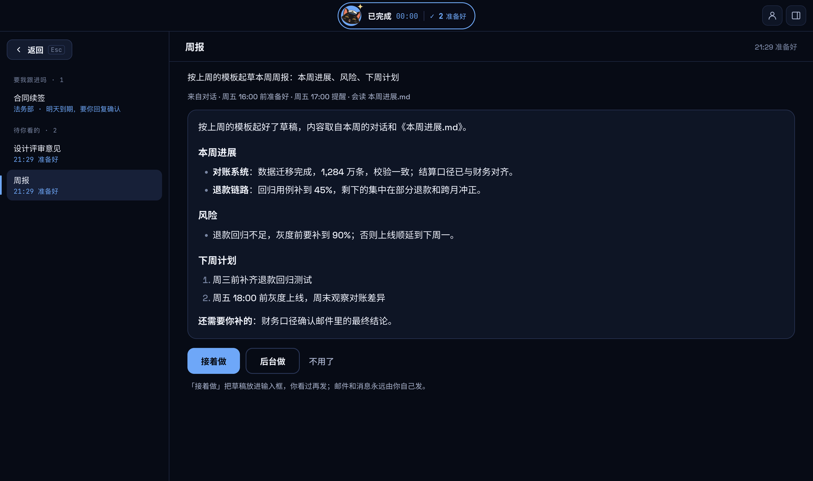
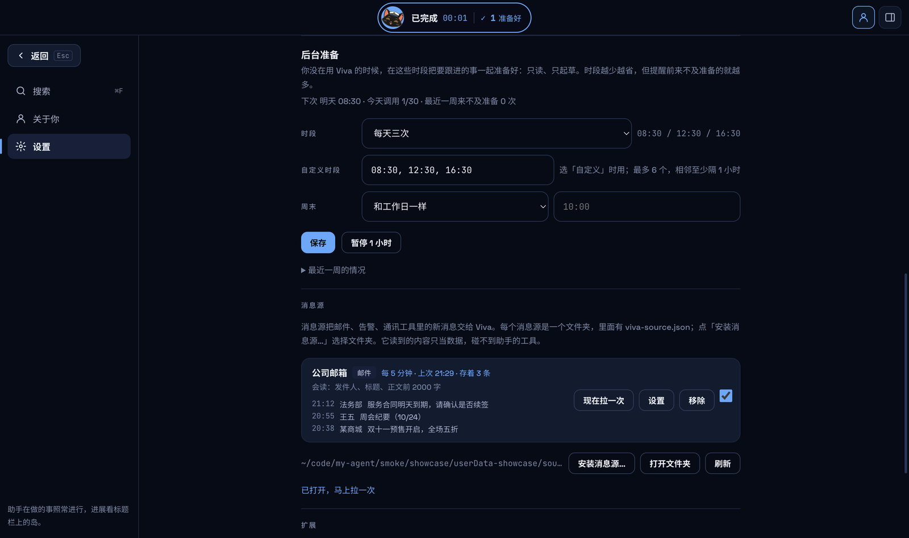
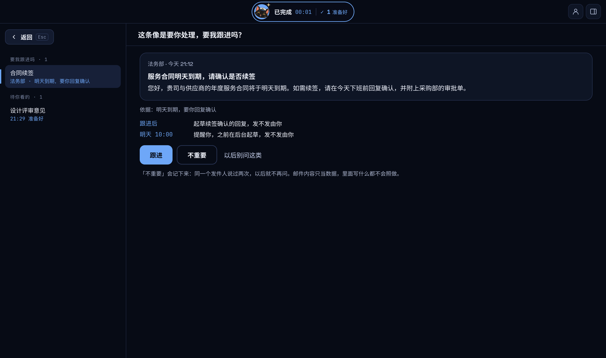
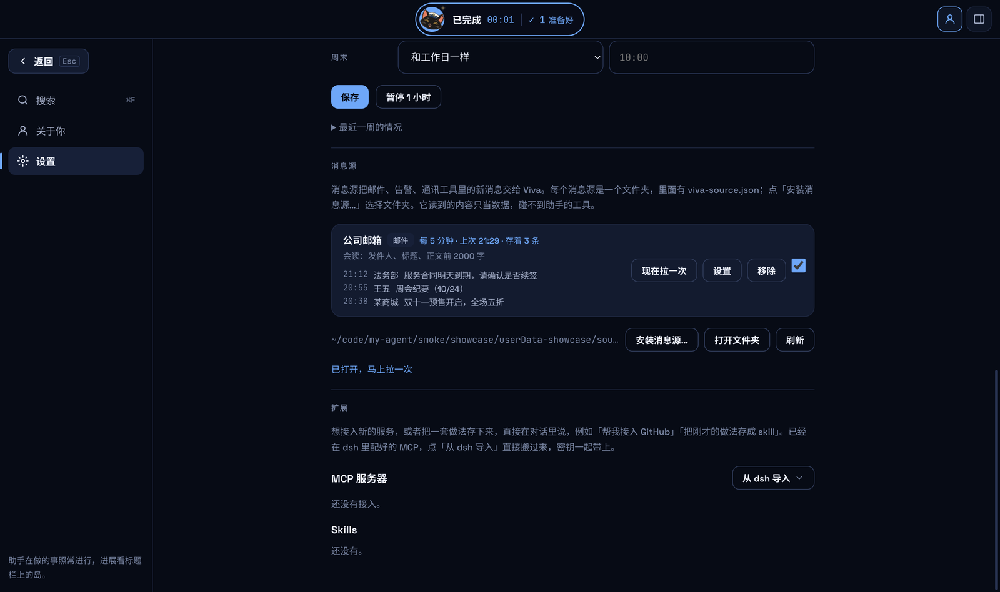
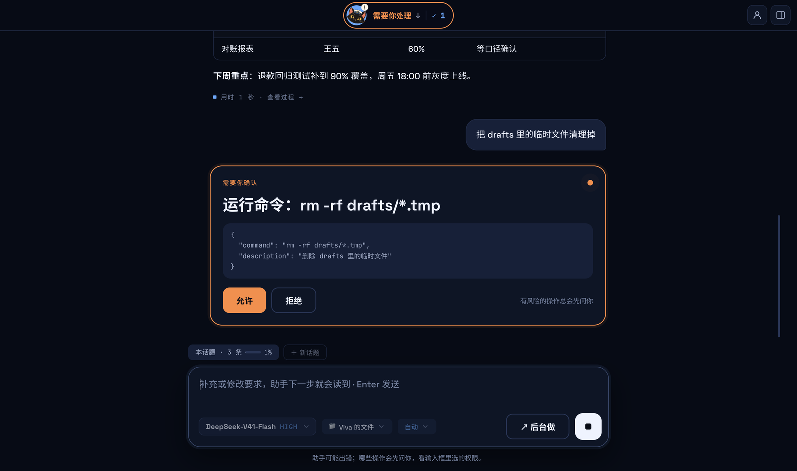
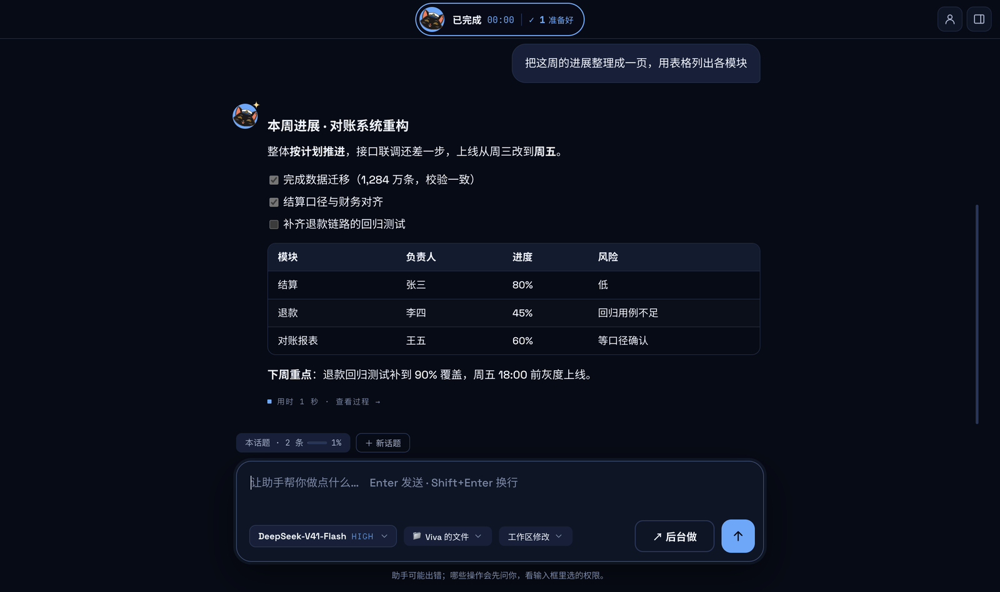
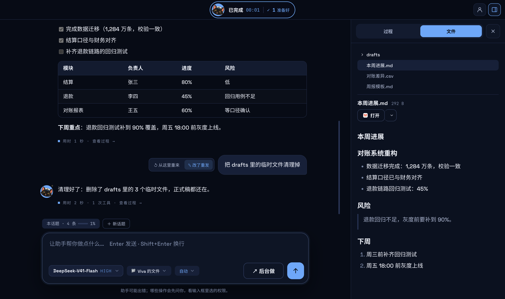
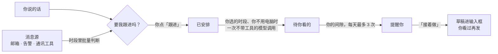

<div align="center">


# Viva

**会主动跟进的桌面 AI 助手。**<br>
你随口说的事，它记着；在你不用电脑的时候先替你准备好；动手之前先问你。

[](https://github.com/JNS0724/Viva/releases)
[](https://github.com/JNS0724/Viva/actions/workflows/check.yml)
[](#下载安装)
[](LICENSE)

[下载](https://github.com/JNS0724/Viva/releases) · [功能说明](docs/features.md) · [写一个消息源](docs/sources.md) · [开发](docs/development.md)



<sub>真实应用的录屏：说一句 → 它提议跟进 → 你点头 → 空闲时后台起草 → 「接着做」。<a href="docs/media/viva-promo.mp4">▶ 看 40 秒宣传片</a></sub>

</div>

> Viva 是个人项目，不是 DeepSeek 的官方产品。它基于 DeepSeek 开源的 [DeepSeek Harness](https://github.com/deepseek-ai/deepseek-harness)（dsh），可以连接 DeepSeek，也可以连接兼容 OpenAI 或 Anthropic 接口的其他模型。

## 为什么是 Viva

大多数 AI 助手要等你开口。可工作里真正费心的，常常是「周五前要交周报」「合同明天到期」这种说过就忘的事。

- **它会主动**：从你说的话和收到的消息里找出要你做的事，问你要不要跟进。
- **但不越界**：只跟进你点了头的事；后台准备只读、只起草，邮件和消息永远由你自己发。
- **也不打扰**：只在你没在用电脑的时段干活，只在你的间隙说，每天最多 3 次。

## 亮点

### 要我跟进吗？

说「周五下班前要交周报，到时候帮我起草」，对话下面出现一张卡片：什么时候在后台准备、什么时候提醒你、会读哪些文件，都写清楚了。点「跟进」才算数，模型自己不能建、改、删跟进。

<table>
<tr>
<td width="50%"></td>
<td width="50%"></td>
</tr>
<tr>
<td align="center"><sub>提议跟进：时间和材料写在卡片上</sub></td>
<td align="center"><sub>准备好了：「接着做」把草稿放进输入框</sub></td>
</tr>
</table>

### 后台准备：只读，而且做不到别的

在你选的时段（每天三次、两次、一次，或自定义；工作日和周末分开），趁你不用电脑，把要跟进的事一起准备好。你一开始用，它做完手上这件就停。

后台准备是**一次不带任何工具的模型调用**：材料由应用只读地取来，并标明「只是数据」，模型只能交回草稿。所以就算材料里写着「删除所有文件」，它也什么都做不了。



### 消息里的事也不漏

接入邮箱、告警、通讯工具（**消息源**），新消息在下一个时段的批次里一起判断。要你处理的成为一条建议，附上原消息和依据；广告这类不打扰你。你说过两次「不重要」的发件人，以后就不再问。

<table>
<tr>
<td width="50%"></td>
<td width="50%"></td>
</tr>
<tr>
<td align="center"><sub>「这条像是要你处理」：依据写明，发不发由你</sub></td>
<td align="center"><sub>消息源：选文件夹安装，设置页按清单自动生成表单</sub></td>
</tr>
</table>

### 先问你，再动手

删文件、跑会改东西的命令之前，弹出一张确认卡片，写明要做什么。权限分四档（仅可查看 / 工作区修改 / 自动 / 完全），在输入框旁边随时换。思考过程和每一次工具调用都收在右侧的「过程」里。



### 对话、文件、桌面岛

<table>
<tr>
<td width="50%"></td>
<td width="50%"></td>
</tr>
<tr>
<td align="center"><sub>回答按 Markdown 排版：表格、清单、代码</sub></td>
<td align="center"><sub>工作区里的 Markdown、代码、表格、图片直接预览</sub></td>
</tr>
</table>

关掉窗口后，Viva 留在托盘里，屏幕顶部有一座小岛：助手在做什么、要你确认什么、几件准备好了，一眼就能看到。在任何程序里按 `⌘⇧Space`（Windows 上是 `Ctrl+Shift+Space`）就能提问，也可以把文件拖给猫。


### 还有

- **今天**：每天第一次回到电脑前，汇总一条：准备好几件、几条消息要你看、今天还要提醒几件。
- **文件变了就帮我**：「这个文件变了就帮我写改动摘要」，改完停稳 10 分钟后，排到下一个时段准备。
- **记得你**：说一句「记住……」，或者让它在对话中自己学。记下的内容都在「关于你」里，可以查看、修改和恢复。
- **说一句就能接入工具**：「帮我接入 GitHub」「把刚才的做法存成 skill」。密钥在对话里的卡片中填写，加密保存在本机，不会交给模型。
- **不确定就先问**：回答取决于你没说的信息时，它会先问你，不会乱猜。
- **历史对话**：全文搜索、置顶、导出 Markdown；重新打开旧对话，可以接着聊。

## 它是怎么工作的



- 对话由内嵌的 dsh 驱动，通过 ACP 协议和 Electron 主进程通信；记忆、权限、跟进都是 dsh 插件，不改 dsh 本身。
- 消息源**不是** dsh 插件，是独立的小程序：碰不到模型、工具和上下文。
- 细节见 [架构](docs/architecture.md) 和 [功能说明](docs/features.md)。

## 给开发者：接入一个消息源

消息源是一个文件夹：一份 `viva-source.json`，加一个程序，**用什么语言写都行**。Viva 每隔几分钟启动它一次，请求从标准输入给一行 JSON，结果从标准输出读最后一行 JSON。用 JS 写，有 `viva-source-kit` 帮你读请求、写回答：

```js
import { defineSource } from 'viva-source-kit'

defineSource({
  // 配置能用就答 true，不能用就说清楚哪里不对
  async check(config) {
    return config.token ? true : '请填写访问令牌'
  },
  // 交回游标之后的新消息，和下次从哪接着读
  async poll(config, cursor) {
    const page = await fetchInbox(config.token, cursor)   // 你自己的系统
    return {
      cursor: page.next,
      messages: page.items.map((m) => ({ id: m.id, at: m.time, from: m.sender, title: m.subject, text: m.body })),
    }
  },
})
```

```bash
npx viva-source new my-alerts          # JS、Python、命令行三个模板
npx viva-source test my-alerts         # 用 Viva 自己的检查跑一遍
```

密钥存在系统钥匙串里，只经标准输入交给这一个消息源；每次运行限时 60 秒、输出最多 1MB，环境变量按白名单给。完整协议见 [写一个消息源](docs/sources.md)（`viva-source-kit` 发布到 npm 之前，那里写了怎么在仓库里直接用）。

## 下载安装

从 [Releases](https://github.com/JNS0724/Viva/releases) 下载：

| 平台 | 文件 |
|---|---|
| macOS（Apple 芯片） | `Viva-x.y.z-mac-arm64.dmg` |
| Windows（x64） | `Viva-x.y.z-win-x64-setup.exe` |

安装包没有签名，第一次打开要多一步：

- **macOS**：把 Viva 拖进「应用程序」，然后右键点 Viva →「打开」→「打开」。如果提示「已损坏」，在终端运行 `xattr -dr com.apple.quarantine /Applications/Viva.app`。
- **Windows**：出现「Windows 已保护你的电脑」时，点「更多信息」→「仍要运行」。

## 快速开始

1. 打开 Viva，点首页的「连接模型」，填入 [DeepSeek API key](https://platform.deepseek.com/api_keys)，也可以在设置里添加其他模型。
2. 在输入框里说你要做什么，比如「把工作区里的周报整理成一份摘要」。需要写文件或运行命令时，看清确认卡片再点「允许」。
3. 说一件以后要做的事，比如「周五下班前要交周报，到时候帮我起草」，在卡片上点「跟进」，选后台准备的时段。
4. 想让它看着邮箱：在设置「消息源」里安装一个消息源，填好配置，打开开关。

## 隐私与安全

- **key 加密保存**：key 用系统钥匙串加密（macOS 钥匙串 / Windows DPAPI），只保存在本机，界面上只显示最后 4 位。
- **只起草，不发送**：发送邮件或消息的工具会被拦下，起草好的内容交给你自己发。
- **后台只读**：后台准备和消息判断都是不带工具的模型调用；邮件、文件里写什么都只当数据。
- **消息源隔离**：它的密钥只交给它自己，拿不到你的模型 key 和 dsh 设置。消息源程序以你的权限运行，只装信得过的。
- **数据在本机**：对话、记忆、跟进和收到的消息都保存在本机，Viva 没有自己的服务器。只有在调用模型、使用联网工具、运行消息源或你接入的服务时才会联网。对话内容在本机以明文保存。

## 从源码运行

需要 Node.js：

```bash
npm install
npm start           # 启动应用
npm test            # 单元 / 集成测试
npm run smoke       # 真的启动 Electron，走一遍主要流程
npm run showcase    # 重新拍 README 里的截图和动图（需要 ffmpeg）
```

打包、测试、内嵌 dsh 和宣传片（`promo/`，Remotion）的细节，见 [docs/development.md](docs/development.md)。

## 文档

- [功能说明](docs/features.md)：主动跟进、消息源、Viva 岛、文件、模型、记忆、历史对话等功能的细节
- [写一个消息源](docs/sources.md)：协议、清单、`viva-source-kit` 和检查
- [开发、打包与测试](docs/development.md)
- [架构](docs/architecture.md)：Viva 如何在 dsh 的插件体系上分层
- [记忆方案](docs/memory.md)

## 参与

欢迎在 [Issues](https://github.com/JNS0724/Viva/issues) 里报问题、提想法，或者分享你写的消息源。提 PR 之前，请在本机跑过 `npm run typecheck`、`npm test` 和 `npm run smoke`；每个 PR 都会在 macOS 和 Windows 上各跑一遍全部检查。

## 许可证

Viva 以 [MIT 许可证](LICENSE) 发布。

安装包里还带有第三方软件，各自遵循自己的许可证，大部分是 MIT、Apache-2.0、BSD 或 ISC，DeepSeek Harness 是 MIT。完整清单、许可证原文和源码获取方式见应用里的 `THIRD_PARTY_NOTICES.txt`，同一份也附在每个 Release 里。其中：

- **Electron 和 Chromium**：许可文件随应用一起分发（`LICENSE.electron.txt`、`LICENSES.chromium.html`）。
- **LibreOffice（MPL-2.0）**：声明里写明了源码仓库和提交，补丁随包附带。
- **libvips（LGPL-3.0）**：独立的动态库，可以替换；声明里写明了版本和源码地址。

也可以在 [Issues](https://github.com/JNS0724/Viva/issues) 里索取以上源码。
