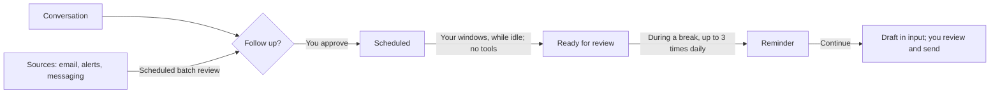

<div align="center">


# Viva

**A desktop AI assistant that follows up.**<br>
It remembers what you mention, prepares work while you are away, and asks before taking action.

[English](README.md) · [简体中文](README.zh-CN.md)

[](https://github.com/JNS0724/Viva/releases)
[](https://github.com/JNS0724/Viva/actions/workflows/check.yml)
[](#download-and-install)
[](LICENSE)

[Download](https://github.com/JNS0724/Viva/releases) · [Features](docs/features.md) · [Build a source](docs/sources.md) · [Development](docs/development.md)


<sub>Real app recording: ask → review a follow-up → approve → draft while idle → continue.</sub>
</div>

> Viva is a personal project, not an official DeepSeek product. It uses the open-source [DeepSeek Harness](https://github.com/deepseek-ai/deepseek-harness) (dsh). Connect DeepSeek or models with OpenAI-compatible or Anthropic-compatible APIs.
>
> Existing demonstration images and video show the Chinese interface. Settings → Language changes the interface independently of your conversation language.

<a id="40-秒看懂-viva"></a>
## Viva in 40 seconds

https://github.com/user-attachments/assets/14a56fd5-5b57-40f5-b02c-e2868b5dbf91

## Why Viva?

Most assistants wait for a request. Work often requires remembering things you mention and then forget: “the weekly report is due Friday” or “the contract expires tomorrow.”

- **Proactive:** identifies possible follow-ups in conversations and incoming messages, then asks whether you want them tracked.
- **Within your boundaries:** follows up only after approval. Background preparation reads and drafts; you send emails and messages yourself.
- **Considerate:** prepares while you are away and brings things up during a break, at most three times daily.

## Highlights

### Would you like me to follow up?

Say “My weekly report is due before I leave on Friday; help me draft it then.” A card shows when preparation will happen, when you will be reminded, and which files will be read. Nothing is scheduled until you click **Follow up**. The model cannot create, change, or delete follow-ups itself.

| Review the proposal | Review prepared work |
|---|---|
|  |  |

### Read-only background preparation

Choose three, two, or one windows daily, or customize them separately for weekdays and weekends. While you are not using the computer, Viva prepares follow-ups together. When you return, it finishes the current item and stops.

Preparation is **one model call without tools**. The app reads materials and labels them as data; the model can only return a draft. A file saying “delete everything” cannot give this call permission or tools to delete files.


### Keep up with incoming messages

Connect email, alerts, or messaging through **sources**. New messages are reviewed together in the next window. Items needing attention become suggestions with the original message and a reason. Advertising does not prompt you. Mark a sender’s messages unimportant twice and Viva stops asking about that sender.

| Evidence for a suggestion | Source configuration |
|---|---|
|  |  |

### Review actions before they run

Confirmation cards explain actions that require approval. Choose **Read only**, **Workspace write**, **Automatic**, or **Full access** beside the input. The selected level determines when approval is required. Thoughts and tool calls appear in Activity.


### Conversations, files, and the desktop island

| Markdown conversations | File previews |
|---|---|
|  |  |

Closing the window leaves Viva in the tray. The desktop island shows work, approvals, and prepared drafts. Press `⌘⇧Space` on macOS or `Ctrl+Shift+Space` on Windows from any app to ask a question, or drop files onto the cat.


### More

- **Ask about email:** “Any emails today?” refreshes the source and reads the results.
- **Today:** the first time you return each day, get one summary of drafts, messages, and reminders.
- **Watch a file:** after ten quiet minutes following a change, preparation is queued for the next window.
- **Remember you:** say “Remember…” or let Viva learn in conversation. View, edit, delete, or restore memories in About you.
- **Connect tools through conversation:** ask to connect GitHub or save a workflow as a skill. Secrets go in a dedicated card, are encrypted locally, and are not given to the model.
- **Ask when uncertain:** if a missing detail changes the answer, the assistant asks instead of guessing.
- **History:** full-text search, pins, Markdown export, and continuation of earlier conversations.

## How it works



Embedded dsh powers conversations over ACP with Electron’s main process. Memory, permissions, and follow-ups are dsh plugins; Viva does not modify dsh. Sources are separate programs, not dsh plugins, and do not receive the model, tools, or conversation context. See [Architecture](docs/architecture.md) and [Features](docs/features.md).

## Build a source

A source is a folder with `viva-source.json` and a program written in any language. Viva starts it periodically, sends one JSON line on stdin, and reads the last JSON line on stdout. JavaScript sources can use `viva-source-kit`:

```js
import { defineSource } from 'viva-source-kit'

defineSource({
  async check(config) {
    return config.token ? true : 'Enter an access token'
  },
  async poll(config, cursor) {
    const page = await fetchInbox(config.token, cursor) // Your own system
    return {
      cursor: page.next,
      messages: page.items.map((m) => ({ id: m.id, at: m.time, from: m.sender, title: m.subject, text: m.body })),
    }
  },
})
```

```bash
npx viva-source new my-alerts       # JS, Python, or command template
npx viva-source test my-alerts      # Viva’s own validation
```

Secrets are encrypted using the system keychain and passed only to that source on stdin. Each run has a 60-second timeout, a 1 MB output limit, and an allowlisted environment. [Sources](docs/sources.md) documents the protocol and repository usage before npm publication.

<a id="下载安装"></a>
## Download and install

Download from [Releases](https://github.com/JNS0724/Viva/releases):

| Platform | File |
|---|---|
| macOS (Apple silicon) | `Viva-x.y.z-mac-arm64.dmg` |
| Windows (x64) | `Viva-x.y.z-win-x64-setup.exe` |

Installers are unsigned. First launch may require an extra step:

- **macOS:** drag Viva to Applications, then right-click → Open → Open. If reported as damaged, run `xattr -dr com.apple.quarantine /Applications/Viva.app` in Terminal.
- **Windows:** if “Windows protected your PC” appears, choose More info → Run anyway.

## Quick start

1. Open Connect a model and enter a [DeepSeek API key](https://platform.deepseek.com/api_keys), or add another provider in Settings.
2. Ask for help, such as summarizing weekly reports. Review approval cards before allowing actions.
3. Mention a future task, accept its follow-up card, and choose preparation windows.
4. To monitor a mailbox, install a source in Settings → Sources, configure it, and enable it.
5. Choose Follow system, 简体中文, or English in Settings → Language. Existing profiles retain Chinese on upgrade. Switching language does not translate history or restart the assistant.

## Privacy and safety

- **Encrypted keys:** macOS Keychain or Windows DPAPI encrypts keys locally; the UI shows only the last four characters.
- **Draft, never send:** sending email or messages is blocked; you send the prepared content yourself.
- **Read-only preparation:** preparation and message review have no tools. File and email contents are data.
- **Source isolation:** sources receive their own credentials, not model keys or dsh settings. They still run with your OS permissions; install only sources you trust.
- **Local data:** conversations, memories, follow-ups, and received messages stay locally. Viva has no server. Model calls, network tools, sources, and connected services use the network. Conversation history is plaintext locally.

## Run from source

Requires Node.js:

```bash
npm install
npm start                # Start the app
npm test                 # Unit and integration tests
npm run smoke            # Real Electron workflow checks
npm run smoke:language   # Language and desktop-island checks
npm run showcase         # Recreate README captures (requires ffmpeg)
```

See [Development](docs/development.md) for packaging, tests, embedded dsh, and the Remotion video in `promo/`.

## Documentation

- [Features](docs/features.md)
- [Sources](docs/sources.md)
- [Development, packaging, and testing](docs/development.md)
- [Architecture](docs/architecture.md)
- [Memory design](docs/memory.md)
- [Background task query tools](docs/background-task-tools.md)

## Contributing

Report issues, suggest ideas, or share sources in [Issues](https://github.com/JNS0724/Viva/issues). Before a PR, run `npm run typecheck`, `npm test`, and `npm run smoke`. PR checks run on macOS and Windows.

## License

Viva is [MIT-licensed](LICENSE). Bundled third-party software retains its own licenses, mostly MIT, Apache-2.0, BSD, or ISC. DeepSeek Harness is MIT-licensed. `THIRD_PARTY_NOTICES.txt`, included in the app and each release, lists licenses and source locations:

- **Electron and Chromium:** `LICENSE.electron.txt` and `LICENSES.chromium.html` ship with the app.
- **LibreOffice (MPL-2.0):** notices identify the repository and revision; patches ship with the package.
- **libvips (LGPL-3.0):** a replaceable dynamic library; notices identify its version and source.

You can also request sources through [Issues](https://github.com/JNS0724/Viva/issues).

## Internationalization

Choose Follow system, Simplified Chinese, or English in Settings → Language. New profiles follow the system; existing profiles keep Chinese. Switching does not restart the session or rewrite conversation content. See [Internationalization](docs/internationalization.md) for maintenance and validation. Existing demo screenshots and recordings use Chinese.
