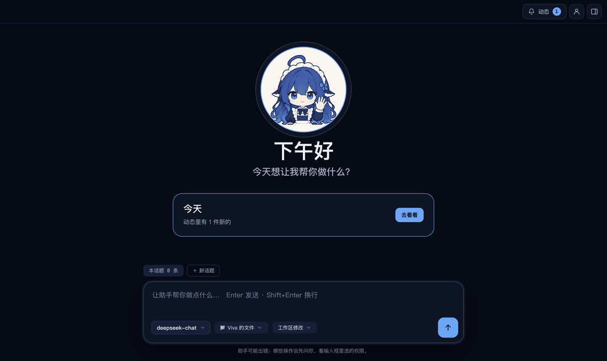
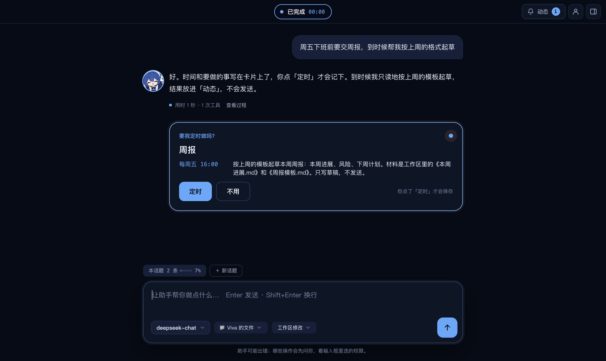
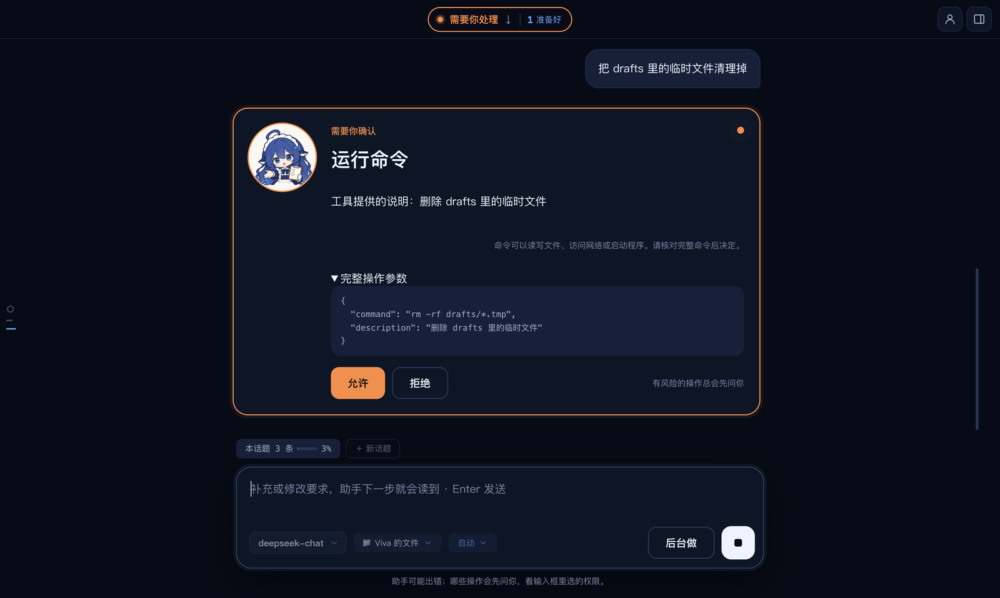
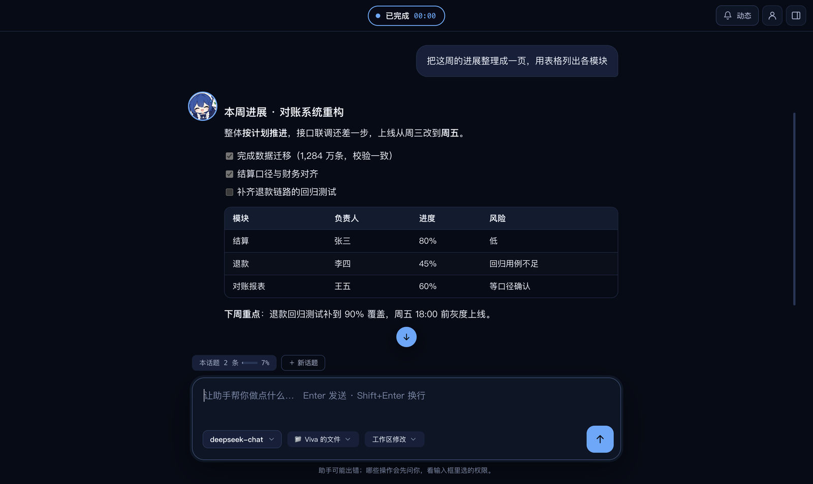
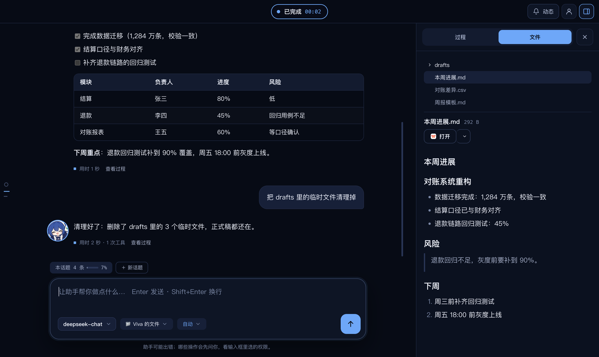
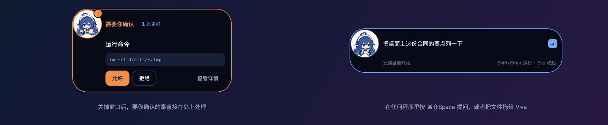
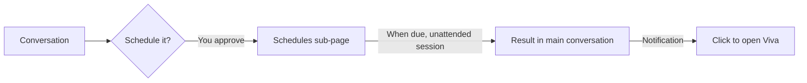

<div align="center">


# Viva

**A desktop AI assistant that follows up.**<br>
It remembers what you mention, does it when it is due and brings the result back to your conversation, and asks before taking action.

[English](README.md) · [简体中文](README.zh-CN.md)

[](https://github.com/JNS0724/Viva/releases)
[](https://github.com/JNS0724/Viva/actions/workflows/check.yml)
[](#download-and-install)
[](LICENSE)

[Download](https://github.com/JNS0724/Viva/releases) · [Features](docs/features.md) · [Development](docs/development.md)



<sub>Real app recording (earlier UI): ask → review a schedule → approve. Current builds deliver due results straight into the main conversation.</sub>
</div>

> Viva is a personal project, not an official DeepSeek product. It uses the open-source [DeepSeek Harness](https://github.com/deepseek-ai/deepseek-harness) (dsh). Connect DeepSeek or models with OpenAI-compatible or Anthropic-compatible APIs.
>
> Existing demonstration images show the Chinese interface. Settings → Language changes the interface independently of your conversation language.

## Why Viva?

Most assistants wait for a request. Work often requires remembering things you mention and then forget: “the weekly report is due Friday” or “the contract expires tomorrow.”

- **Proactive:** hears what you will need later in a conversation, then asks whether to schedule it.
- **Within your boundaries:** schedules only what you approve. A scheduled run works at the permission level you picked, and does nothing that would need your approval while nobody is there.
- **Just ask:** schedule, change, pause, or delete by saying so in the conversation.

## Highlights

### Shall I schedule it?

Say “My weekly report is due before I leave on Friday; help me draft it then.” The model writes what to do as a prompt, and a card shows when it runs and what it will do. Nothing is saved until you click **Schedule**. Times can be once, daily, weekly, or cron. To change, pause, or delete one later, just say so in the conversation.



### Runs when due, reports to the conversation

When it is due, the prompt runs in an unattended session of its own, at the permission level you picked; what that level would ask approval for is refused, without waiting for you, since nobody is there. The answer comes straight back into the main conversation, with a desktop notification that brings Viva to the front when clicked. Runs missed while the computer slept or Viva was closed happen at the next launch, once per due time.

Saved schedules live in the **Schedules** sub-page alongside Background and About you, where you can view, pause, resume, or delete them.

### Review actions before they run

Confirmation cards explain actions that require approval. Choose **Read only**, **Workspace write**, **Automatic**, or **Full access** beside the input. The selected level determines when approval is required. Thoughts and tool calls appear in Activity.



### Conversations, files, and the desktop island

| Markdown conversations | File previews |
|---|---|
|  |  |

Closing the window leaves Viva in the tray, and the desktop island shows ongoing work and approvals. Press `⌘⇧Space` on macOS or `Ctrl+Shift+Space` on Windows from any app to ask a question, or drop files onto her.



### More

- **Today:** the home page's Today card counts the schedules still to run today; click it to open Schedules.
- **Remember you:** say “Remember…” or let Viva learn in conversation. View, edit, delete, or restore memories in About you.
- **Connect tools through conversation:** ask to connect GitHub or save a workflow as a skill. Secrets go in a dedicated card, are encrypted locally, and are not given to the model.
- **Ask when uncertain:** if a missing detail changes the answer, the assistant asks instead of guessing.
- **History:** full-text search, pins, Markdown export, and continuation of earlier conversations.

## How it works



Embedded dsh powers conversations over ACP. It runs as a child of Viva's backend process, which keeps the history, background tasks and schedules; the Electron main process only handles the desktop. Memory, permissions and the tools the model uses for tasks and schedules are dsh plugins; Viva does not modify dsh. Schedule times use dsh's `dsh-schedule`. See [System design](docs/system-design.md) and [Features](docs/features.md).

<a id="下载安装"></a>
## Download and install

Download from [Releases](https://github.com/JNS0724/Viva/releases):

| Platform | File |
|---|---|
| macOS (Apple silicon) | `Viva-x.y.z-mac-arm64.dmg` |
| Windows (x64) | `Viva-x.y.z-win-x64-setup.exe` |

Installers are unsigned. First launch may require an extra step:

- **macOS:** drag Viva to Applications, then right-click → Open → Open. If reported as damaged, run `xattr -dr com.apple.quarantine /Applications/Viva.app` in Terminal.
- **Windows:** if “Windows protected your PC” appears, choose More info → Run anyway.

## Quick start

1. Open Connect a model and enter a [DeepSeek API key](https://platform.deepseek.com/api_keys), or add another provider in Settings.
2. Ask for help, such as summarizing weekly reports. Review approval cards before allowing actions.
3. Mention a future task and click **Schedule** on its card. When it is due, the result comes straight back to the main conversation.
5. Choose Follow system, 简体中文, or English in Settings → Language. Existing profiles retain Chinese on upgrade. Switching language does not translate history or restart the assistant.

## Privacy and safety

- **Encrypted keys:** macOS Keychain or Windows DPAPI encrypts keys locally; the UI shows only the last four characters.
- **dsh's permission levels:** what the assistant may do without asking is dsh's level you pick (Read only, Workspace changes, Auto, Full); Viva adds no rules of its own. A scheduled run has nobody to ask, so what its level would ask about is refused.
- **Local data:** conversations, memories, tasks, and schedules stay locally. Viva has no server. Model calls, network tools, and connected services use the network. Conversation history is plaintext locally.

## Run from source

Requires Node.js:

```bash
npm install
npm start                # Start the app
npm test                 # Unit and integration tests
npm run smoke            # Real Electron workflow checks
npm run smoke:language   # Language and desktop-island checks
npm run showcase         # Recreate README captures (requires ffmpeg)
```

See [Development](docs/development.md) for packaging, tests and embedded dsh.

## Documentation

- [Features](docs/features.md)
- [Development, packaging, and testing](docs/development.md)
- [System design](docs/system-design.md): the shell and backend processes, the event core, storage, plugins, security and lifecycle
- [UI guidelines](docs/ui-guidelines.md)
- [Live checks before a release](docs/live-check.md)

## Contributing

Report issues or suggest ideas in [Issues](https://github.com/JNS0724/Viva/issues). Before a PR, run `npm run typecheck`, `npm test`, and `npm run smoke`. PR checks run on macOS and Windows.

## License

Viva is [MIT-licensed](LICENSE). Bundled third-party software retains its own licenses, mostly MIT, Apache-2.0, BSD, or ISC. DeepSeek Harness is MIT-licensed. `THIRD_PARTY_NOTICES.txt`, included in the app and each release, lists licenses and source locations:

- **Electron and Chromium:** `LICENSE.electron.txt` and `LICENSES.chromium.html` ship with the app.
- **LibreOffice (MPL-2.0):** notices identify the repository and revision; patches ship with the package.
- **libvips (LGPL-3.0):** a replaceable dynamic library; notices identify its version and source.

You can also request sources through [Issues](https://github.com/JNS0724/Viva/issues).

## Internationalization

Choose Follow system, Simplified Chinese, or English in Settings → Language. New profiles follow the system; existing profiles keep Chinese. Switching does not restart the session or rewrite conversation content. See [Development](docs/development.md#internationalization) for maintenance and validation. Existing demo screenshots and recordings use Chinese.
