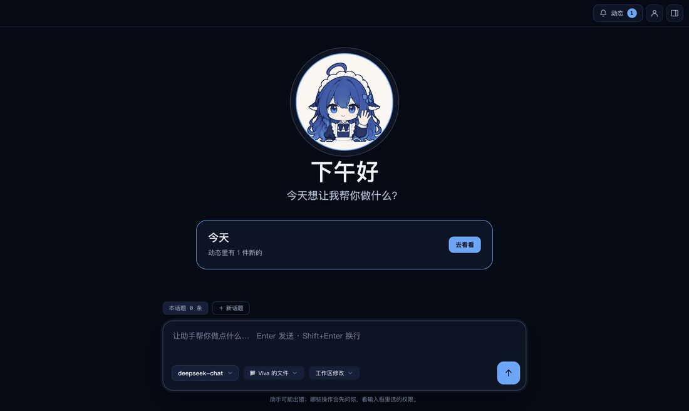
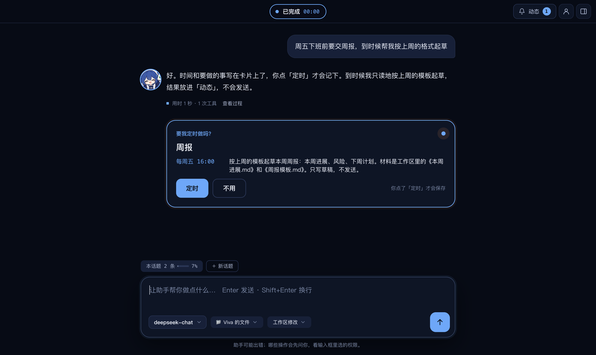
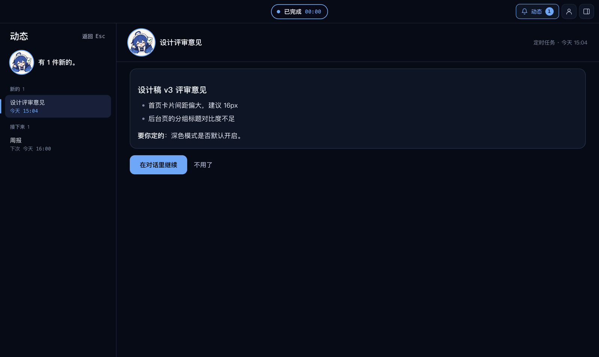
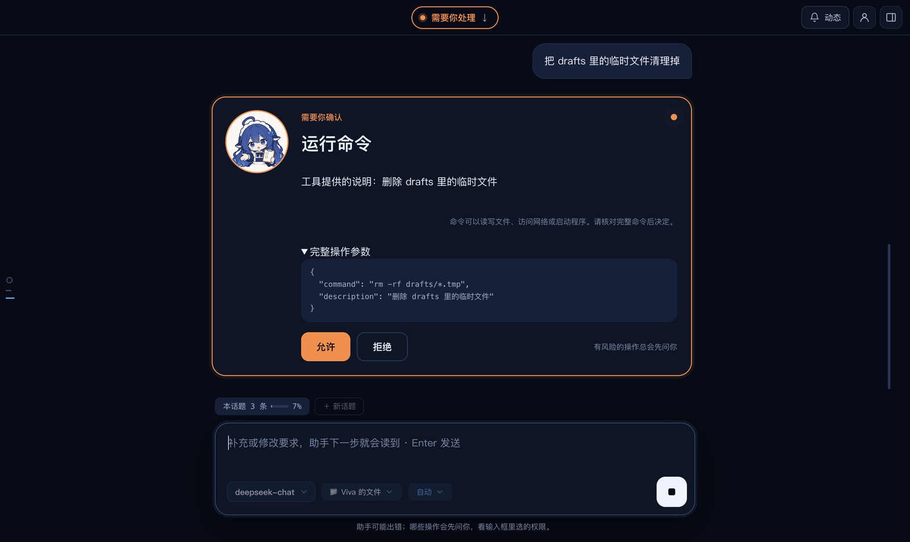
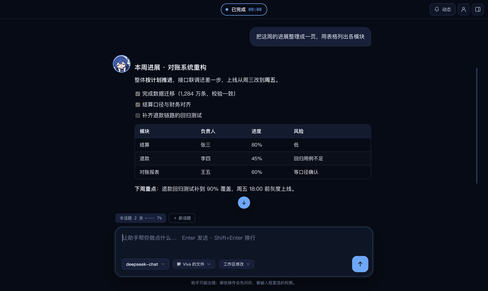
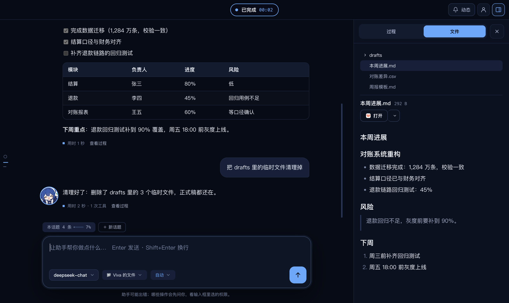
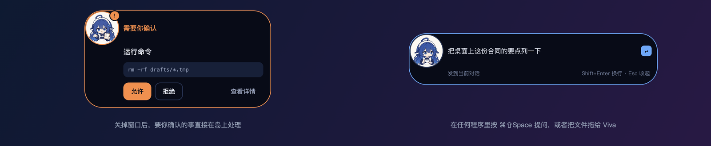
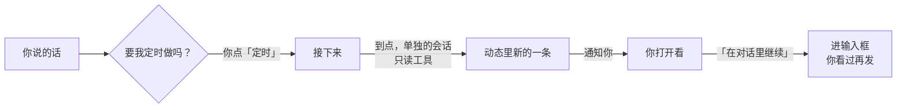

[English](README.md) | 简体中文

<div align="center">


# Viva

**会主动跟进的桌面 AI 助手。**<br>
你随口说的事，它记着；到点替你做好，放进「动态」；动手之前先问你。

[](https://github.com/JNS0724/Viva/releases)
[](https://github.com/JNS0724/Viva/actions/workflows/check.yml)
[](#下载安装)
[](LICENSE)

[下载](https://github.com/JNS0724/Viva/releases) · [功能说明](docs/features.zh-CN.md) · [开发](docs/development.zh-CN.md)



<sub>真实应用的录屏：说一句 → 它提议定时 → 你点头 → 到点它做好放进动态 → 「在对话里继续」。</sub>

</div>

> Viva 是个人项目，不是 DeepSeek 的官方产品。它基于 DeepSeek 开源的 [DeepSeek Harness](https://github.com/deepseek-ai/deepseek-harness)（dsh），可以连接 DeepSeek，也可以连接兼容 OpenAI 或 Anthropic 接口的其他模型。

## 为什么是 Viva

大多数 AI 助手要等你开口。可工作里真正费心的，常常是「周五前要交周报」「合同明天到期」这种说过就忘的事。

- **它会主动**：从你说的话里听出以后要做的事，问你要不要定时。
- **但不越界**：只定你点了头的事；到点运行时只能查看、不能改动，邮件和消息永远由你自己发。
- **一切靠说**：定、改、暂停、删除，在对话里说一句就行。

## 亮点

### 要我定时做吗？

说「周五下班前要交周报，到时候帮我起草」，模型把要做的事写成一段提示词，对话下面出现一张卡片：什么时候、做什么，都写清楚了。点「定时」才会保存。时间可以是一次、每天、每周或 cron。之后想改时间、暂停或删掉，在对话里说一句就行。

<table>
<tr>
<td width="50%"></td>
<td width="50%"></td>
</tr>
<tr>
<td align="center"><sub>提议定时：时间和要做的事写在卡片上</sub></td>
<td align="center"><sub>动态：到点带回来的结果，「在对话里继续」放进输入框</sub></td>
</tr>
</table>

### 到点只读运行，结果进动态

到点时，提示词在一个单独的会话里运行，**只能用查看类的工具**，而且只能看工作区里的文件；不管你选了哪档权限，写文件、跑命令、发消息都会被拒绝，也不会弹窗问你，因为那时没人在。它的回答成为「动态」里的一条，并发一条通知；标题栏的「动态」按钮上有新条目的数字。错过的（电脑睡着、Viva 关着）下次启动补上，每次到点只跑一次。

「动态」和「后台」是分开的：后台是你交代的任务，动态是应用主动带回来的东西。

### 先问你，再动手

删文件、跑会改东西的命令之前，弹出一张确认卡片，写明要做什么。权限分四档（仅可查看 / 工作区修改 / 自动 / 完全），在输入框旁边随时换。思考过程和每一次工具调用都收在右侧的「过程」里。



### 对话、文件、桌面岛

<table>
<tr>
<td width="50%"></td>
<td width="50%"></td>
</tr>
<tr>
<td align="center"><sub>回答按 Markdown 排版：表格、清单、代码</sub></td>
<td align="center"><sub>工作区里的 Markdown、代码、表格、图片直接预览</sub></td>
</tr>
</table>

关掉窗口后，Viva 留在托盘里，屏幕顶部有一座小岛：助手在做什么、要你确认什么，一眼就能看到；托盘菜单上写着动态里有几件新的。在任何程序里按 `⌘⇧Space`（Windows 上是 `Ctrl+Shift+Space`）就能提问，也可以把文件拖给她。



### 还有

- **今天**：首页的「今天」写着动态里有几件新的、今天还有几个定时，点一下就到动态。
- **记得你**：说一句「记住……」，或者让它在对话中自己学。记下的内容都在「关于你」里，可以查看、修改和恢复。
- **说一句就能接入工具**：「帮我接入 GitHub」「把刚才的做法存成 skill」。密钥在对话里的卡片中填写，加密保存在本机，不会交给模型。
- **不确定就先问**：回答取决于你没说的信息时，它会先问你，不会乱猜。
- **历史对话**：全文搜索、置顶、导出 Markdown；重新打开旧对话，可以接着聊。

## 它是怎么工作的



- 对话由内嵌的 dsh 驱动，通过 ACP 协议和 Electron 主进程通信；记忆、权限、定时都是 dsh 插件，不改 dsh 本身；定时的时间计算用 dsh 的 `dsh-schedule`。
- 细节见 [系统架构设计](docs/system-design.zh-CN.md) 和 [功能说明](docs/features.zh-CN.md)。

## 下载安装

从 [Releases](https://github.com/JNS0724/Viva/releases) 下载：

| 平台 | 文件 |
|---|---|
| macOS（Apple 芯片） | `Viva-x.y.z-mac-arm64.dmg` |
| Windows（x64） | `Viva-x.y.z-win-x64-setup.exe` |

安装包没有签名，第一次打开要多一步：

- **macOS**：把 Viva 拖进「应用程序」，然后右键点 Viva →「打开」→「打开」。如果提示「已损坏」，在终端运行 `xattr -dr com.apple.quarantine /Applications/Viva.app`。
- **Windows**：出现「Windows 已保护你的电脑」时，点「更多信息」→「仍要运行」。

## 快速开始

1. 打开 Viva，点首页的「连接模型」，填入 [DeepSeek API key](https://platform.deepseek.com/api_keys)，也可以在设置里添加其他模型。
2. 在输入框里说你要做什么，比如「把工作区里的周报整理成一份摘要」。需要写文件或运行命令时，看清确认卡片再点「允许」。
3. 说一件以后要做的事，比如「周五下班前要交周报，到时候帮我起草」，在卡片上点「定时」。到点后结果出现在「动态」里。

## 隐私与安全

- **key 加密保存**：key 用系统钥匙串加密（macOS 钥匙串 / Windows DPAPI），只保存在本机，界面上只显示最后 4 位。
- **只起草，不发送**：发送邮件或消息的工具会被拦下，起草好的内容交给你自己发。
- **定时只读**：到点运行的会话只能用查看类的工具、只看工作区里的文件，其余一律拒绝。
- **数据在本机**：对话、记忆、定时和动态都保存在本机，Viva 没有自己的服务器。只有在调用模型、使用联网工具或你接入的服务时才会联网。对话内容在本机以明文保存。

## 从源码运行

需要 Node.js：

```bash
npm install
npm start           # 启动应用
npm test            # 单元 / 集成测试
npm run smoke       # 真的启动 Electron，走一遍主要流程
npm run showcase    # 重新拍 README 里的截图和动图（需要 ffmpeg）
```

打包、测试和内嵌 dsh 的细节，见 [docs/development.md](docs/development.zh-CN.md)。

## 文档

- [功能说明](docs/features.zh-CN.md)：定时任务与动态、Viva 岛、文件、模型、记忆、历史对话等功能的细节
- [开发、打包与测试](docs/development.zh-CN.md)
- [系统架构设计](docs/system-design.zh-CN.md)：外壳与后端两个进程、事件内核、数据存储、插件、安全边界和生命周期
- [界面规范](docs/ui-guidelines.zh-CN.md)
- [发版前的真模型验证](docs/live-check.zh-CN.md)

## 参与

欢迎在 [Issues](https://github.com/JNS0724/Viva/issues) 里报问题、提想法。提 PR 之前，请在本机跑过 `npm run typecheck`、`npm test` 和 `npm run smoke`；每个 PR 都会在 macOS 和 Windows 上各跑一遍全部检查。

## 许可证

Viva 以 [MIT 许可证](LICENSE) 发布。

安装包里还带有第三方软件，各自遵循自己的许可证，大部分是 MIT、Apache-2.0、BSD 或 ISC，DeepSeek Harness 是 MIT。完整清单、许可证原文和源码获取方式见应用里的 `THIRD_PARTY_NOTICES.txt`，同一份也附在每个 Release 里。其中：

- **Electron 和 Chromium**：许可文件随应用一起分发（`LICENSE.electron.txt`、`LICENSES.chromium.html`）。
- **LibreOffice（MPL-2.0）**：声明里写明了源码仓库和提交，补丁随包附带。
- **libvips（LGPL-3.0）**：独立的动态库，可以替换；声明里写明了版本和源码地址。

也可以在 [Issues](https://github.com/JNS0724/Viva/issues) 里索取以上源码。

## 界面语言

设置 → 语言可选跟随系统、简体中文、English。新用户跟随系统，旧配置保留中文；切换不重启会话，不改变对话内容。README 与项目文档提供双语入口；已有演示截图/录像为中文。维护和验证方式见[开发：国际化](docs/development.zh-CN.md#国际化)。
