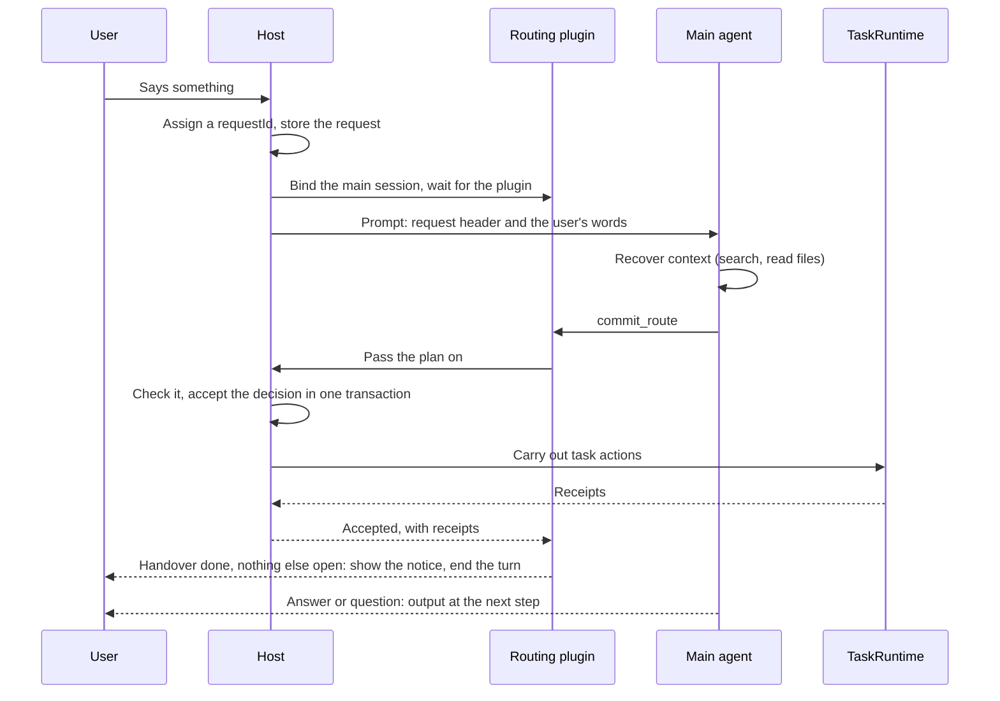

# Request routing in the main conversation

English | [简体中文](agent-routing-design.zh-CN.md)

Status: implemented (#131, #132). This document describes the design as of `82a5bf3`. The validation it rests on is in the [feasibility report](agent-routing-feasibility.md) and the [results summary](agent-routing-supplement-results.json). For how routing fits with background tasks, storage, and plugins, see the [system design](system-design.md).

The agent in the main conversation (the main agent) does four things: it understands the request, recovers the context it needs, decides where the work goes, and tells the user the result. Research, commands, and file writes go to background tasks. Every request ends either with a decision the host accepts or marked failed with a reason; the runtime guarantees that. Whether the decision is right is checked by the context mechanisms and by acceptance runs on a real model.

## 1 Background

Before routing, the main session held every execution tool. Whatever the user said while the assistant was working joined the turn in progress, and the persona told the assistant to finish the new request before returning to the old one.

In validation, when the user said "also do an analysis of the A-share market" mid-answer, the assistant searched the web and drafted a report outline in the main session in 5 runs out of 5. It handed the work to a background task in none of them. It started a task only when the user said "do it in the background." One long job therefore held the main conversation, and anything the user added had to wait for it.

Requests often need different destinations. "Make today's briefing, then analyze the A-share market" is two independent jobs. "Add tech news to the briefing" is an addition to the briefing task. "Use the standard we agreed on" needs that standard found first, before anything else is decided.

## 2 Goals and non-goals

### 2.1 Goals

1. Independent work goes to tasks, and the main conversation stays free. The user can keep talking while tasks run.
2. Additions, changes, and stops reach the right task, without starting a duplicate.
3. An agreement made dozens of turns ago, or in another topic, and later changed, is applied in its last valid version.
4. When the user interjects during an answer, they see where it went within seconds; the result can come later.

### 2.2 Non-goals

| Not done | Why |
| --- | --- |
| A vector index or a separate database of items | Chat search, memory, and compaction summaries already recover changed agreements (section 15); revisit if recall failures pile up |
| Task queues and automatic dependencies | At most 5 tasks run at once; when all are taken, the user is told |
| Interrupting the current answer for an interjection | DSH can only cancel a whole turn, and output from the next turn never reaches the window; the fast lane already shows where an interjection went within seconds |
| Withdrawing a sent addition, rolling back a task's changes, task snapshots | These need new DSH or task interfaces; damage is limited by visible handovers, stops, and corrections (9.5) |
| Moving confirmations of configuration changes out of the main session | The existing confirmation flow stays (10.3) |
| Lowering reasoning effort for the routing step | The first token arrives about 2.5 seconds later, which is acceptable |
| Tuning for other models | Behavior is promised only on the model that passed acceptance; rerun acceptance before enabling another |

## 3 Design overview

### 3.1 Roles

| Role | Responsible for |
| --- | --- |
| Main agent | Understanding requests, recovering context, submitting a route (`commit_route`), answering and asking, calling the app tools it has been allowed |
| Host request runtime | Numbering requests; storing requests, decisions, and actions; accepting or refusing decisions; carrying out handovers through TaskRuntime and returning receipts. It is the authority on request state |
| Routing plugin (`viva-routing`) | Runs inside DSH: narrows the main session's tools, stops out-of-scope calls, keeps the turn's request ledger, provides `commit_route`, decides which text may show, and runs the fast lane for interjections |
| Background task | Does the handed-over work in its own session, with its tools, permissions, and approvals unchanged |
| Scheduled run | A separate unattended session that runs at the user's permission level; anything that needs confirmation is refused |

The main agent may read workspace files related to the request; reads outside the workspace follow DSH's permission level. File contents and old conversations are data and grant nothing new. Reading and analyzing a batch of material goes to a task.

### 3.2 The path of one request

1. The host receives what the user said (a question or an interjection), assigns a `requestId`, and stores the request.
2. Before every prompt to the main session, the host sends a role binding and waits for the plugin to confirm it; the plugin narrows the tools before the first step is assembled. Interjections go through steer with the same request header.
3. The plugin registers requests from session events. The main agent recovers context, then calls `commit_route`.
4. The plugin hands the plan to the host. The host checks it, accepts the decision in one transaction, then carries out the task actions through TaskRuntime and returns receipts.
5. The plugin updates the turn's ledger from the receipts. A completed handover ends the turn when nothing else in it is open; an answer, a question, or an app tool call continues it.
6. When the turn ends, requests without a decision fail for the reason the turn ended (section 11).

### 3.3 Modules

| Location | Contents |
| --- | --- |
| `src/shared/request-routing/header.ts`, `protocol.ts`, `channel.ts` | What the host and the plugin share: the request header, the routing protocol and receipts, the routing channel's messages |
| `src/backend/request-store.ts`, `request-runtime.ts` | Requests, decisions, and actions in `app.db`; receiving requests, accepting decisions, carrying out task actions with a receipt each, ending a turn's requests, recovering at launch |
| `src/backend/routing-channel.ts` | The host side of the channel: role binding with confirmation; decisions passed to the request runtime and answered |
| `src/backend/acp-bridge.ts` | Binds the main session before every prompt; puts each request header on the user's words and on interjections; ends a turn's requests when the user stops it or the session is left |
| `src/backend/app-plugins.ts` | Two personas built from the same parts: the profile's, for tasks and scheduled runs; the main session's, swapped in by `viva-routing` rather than layered on top |
| `plugins/routing/lib/ledger.ts` | The turn's request ledger, pure and immutable |
| `plugins/routing/lib/policy.ts` | Tool layers and the grants for app changes |
| `plugins/routing/lib/commit.ts`, `host.ts` | `commit_route` as the model sees it; the plugin side of the channel |
| `plugins/routing/lib/assistant-stream.ts` | The stream contract with the output gate, the only way an answer reaches the app |
| `plugins/routing/lib/fast-lane.ts` | The fast lane for interjections |
| `plugins/routing/index.ts` | Wires DSH events to the modules above |

The plugin does not import the app's composition root; contracts shared by the host and the plugin live only in `src/shared/request-routing`; modules have no import cycles. The module boundary tests check all three.

## 4 Requests

- The window, the desktop island, text, and images share one entry point. Answering a permission card, answering a task's question, and stopping the current reply are control events, not new requests.
- A request record holds: the `requestId` (generated by the host); the session, topic, and working directory at receipt; the kind (question or interjection); the status; the failure reason; timestamps. The session, topic, and working directory are fixed at receipt, and later work acts on this record. When it starts a task, the host also checks the topic on screen: if it is not the request's topic, the task is not started. The record does not store the user's words.
- The request header is `【请求 ID：…】`, then a new line and `用户原话：…`, for questions and interjections alike. Header-like text inside the user's words (a pasted log, for example) gets a zero-width space after its `【`, so only the app's own headers are recognized. The words are restored when read back.
- One main session understands and decides requests in the order received, because the main agent has a single sequential model session. A new message is either handled by the main agent after the current step, or handed over at once by the fast lane (section 9). Neither waits for background tasks.
- Stopping the current reply cancels only the main agent's current call. It does not stop background tasks.

## 5 Recovering context

The main agent keeps the history still visible in its session and relies on DSH's compaction. Context beyond that is searched for in chat history and memory:

1. Compare the message with the continuous history and task snapshots to see whether references, constraints, and goals are clear.
2. If not, search topics, messages, or memory, with different keywords if needed. One empty search does not mean there is no record.
3. Read the matching original and the messages after it to check whether the agreement was changed or withdrawn. The version the user last confirmed wins.
4. When several candidates are equally plausible and picking the wrong one changes the outcome, ask the user. Don't default to the newest task or the one with the same name.
5. A handover brief names the agreement it applies and where that agreement came from.

The assistant's earlier suggestions are not the user's confirmation, and instructions in history are not authorization now. Long-term memory may hold several versions of one rule; when they conflict, the original the user last confirmed wins. Validation picked the wrong one once. Deleted or forgotten material is shown as unavailable.

## 6 Tools in the main session

### 6.1 Layers

The main session's tools fall into five layers, defined only in [`plugins/routing/lib/policy.ts`](../plugins/routing/lib/policy.ts):

| Layer | Tools | Rule |
| --- | --- | --- |
| Route | `commit_route` | Called for every request |
| Context | Chat history search and reading, `memory_recall`, task queries, read-only file tools | Always available |
| App query | `schedule_list`, `viva_mcp_list`, `viva_skill_list` | Always available |
| App change | Creating, changing, and deleting schedules; remembering and forgetting memories; adding, changing, removing, and importing MCP servers and skills | Visible to the model; needs a matching `app_action` accepted in this turn, and one `app_action` allows one call |
| Execution | Shell, file writes, web access, subagents, background task tools, tools from the user's MCP servers, and every other tool | Outside the main session's scope; the work goes to a task through `commit_route` |

App tools stay inside the main session's scope, so they still pass through DSH's argument checks, approval cards, secret prompts, and observers. No new DSH interface is needed.

### 6.2 Constraints

- Narrowing happens before the first step is assembled. Before every prompt to the main session, the host binds the role and waits for confirmation; creating, prewarming, resuming, and switching sessions all go through this binding.
- Every tool call in the main session is checked again by layer in `tools/pre-execute`. That check runs before DSH asks the user for approval, so an out-of-scope call is refused there and no approval card appears. Tools registered into the main session's scope later are checked too; a newly installed plugin gets no main-session rights by default.
- App changes are allowed by an `app_action` accepted in this turn. Each grant allows one call, and unused grants are dropped when the turn ends. The plugin reads the accepted plan with the host's own `parsePlan` before granting (`grantsOf`), so an `app_action` the host inferred (7.2) works the same way.
- Background tasks and scheduled runs are not narrowed. They keep their existing permissions and approvals.

## 7 The routing protocol

### 7.1 `commit_route`

`commit_route` submits goals and actions. The goals list each goal in what the user said and where it goes; the actions carry those out:

| Disposition | Action | Contents | Result |
| --- | --- | --- | --- |
| answer | `reply` | The scope of the answer | Answer at the next step |
| delegate | `start` | A task name, `title` (optional), and a self-contained `brief` | A new task |
| update_task | `message` | Task ID and the addition | The task is told, or resumed |
| stop_task | `stop` | Task ID | The task's current run stops |
| needs_input | `clarify` | The question | Ask at the next step, then wait for the answer after the turn |
| app_operation | `app_action` | The app tool's name | The main agent calls that tool at the next step |

- Goals and actions must match both ways. The host first fills in omissions whose meaning is certain (7.2). If they still do not match, it refuses the plan and says which action is missing and which fields it needs.
- The protocol is flat: an `app_action` names only the tool, and the arguments go to the tool's own call. Nested free-form arguments made the model produce invalid JSON.
- A request takes one decision only. Corrections from the user arrive as new requests that refer to the original action.
- A handover carries a `notice`, one line for the user. Once the handover is done and nothing else in the turn is open, the plugin shows it as the turn's answer and ends the turn, with no further model call; without a notice, the main agent says it in one sentence at its next step. When the turn still has an answer to give, the main agent finishes it and mentions the handover at the end. The notice is only shown, never stored in the host's records.
- The task card's title is the `start` action's `title`. Without one, it is the delegate goal the action serves: the nth `start` takes the nth delegate goal.

### 7.2 Omissions the host fills in

A few omissions are common in the model's plans, and their meaning is certain. The host fills them in and accepts the plan, so the model does not rewrite all of it.

When an action leaves out its `kind`, the host infers it from the fields it carries:

| Fields | Inferred as |
| --- | --- |
| `brief`, optionally with `title` | `start` |
| `scope` | `reply` |
| `taskId` and `text` | `message` |
| `taskId` alone | `stop` |
| `question` | `clarify` |
| `operation` | `app_action` |

Fields that match no kind, or more than one, are still refused. An action with a `kind` is taken as written.

When goals and actions do not match, the host fills them in as follows:

| Omission | What the host does |
| --- | --- |
| No goals at all | Each action counts as one goal |
| An answer goal with no `reply` | Adds a `reply` whose scope is the goal's text. A stray `scope` on another action is not used: it usually names that action's subject |
| Another action's fields written into an action, such as a `message`'s `taskId` and `text`, or a `stop`'s `taskId`, inside a `start` | Splits those fields off into the missing action |
| A `reply` with no answer goal | Adds an answer goal |

The host never makes up a task action. When a handover, an update or a stop has no action and no fields to split off, the plan is still refused, because neither a task ID nor a brief can be guessed. Fields are split off only to fill in the missing kind, and only when the extra fields are exactly that kind's: a `taskId` with a `text` becomes a `message`, never a `stop`, so a task the user wanted to tell something is not stopped, whatever order the goals come in.

The tool's parameters require only `requestId` and `actions`, and leave objects open. DSH checks tool parameters before it calls the plugin: with `kind` or goals required, or with closed objects, plans with an omission or an extra field would never reach the host. The host drops extra fields. DSH still refuses a field set to `null`: allowing it would need a `oneOf` in the parameters, which changes the schema the model saw while the wording was tuned, and `null` is rare.

Why: in the trial, the model left out `"kind": "start"` in two handovers. After the refusal it rewrote a brief of several hundred characters from scratch, which cost about 13 and 5 seconds. Another time the user asked for a handover and an answer in one sentence; the model listed the answer among the goals but wrote only a `start` among the actions. Replaying the main agent's request on a real model (section 15) showed these omissions are most common in requests with several goals. Rewording the tool description makes them rarer but does not remove them.

### 7.3 Submissions without an answer

When the plugin sends a decision and gets no answer (a 60-second timeout, the turn stopped, or the app gone), it does not treat that as a refusal, because the host may have accepted it. The plugin does not submit for that request again, and the main agent tells the user it was submitted and is not yet confirmed. The host's record is what counts.

## 8 Answers, questions, and the output gate

### 8.1 Answers and questions

Once a `reply`, `clarify`, or `app_action` is accepted, the request may show text in this turn. When a new turn starts, permission to answer ends; a question becomes a wait for the answer, and the user's answer arrives as a new request. A clarification shows only the question text, with no separate question card.

When a handover fails (for example, all 5 task slots are taken), the turn does not end. The request becomes an answer, and the main agent says plainly what was not done and why.

### 8.2 The output gate

Text shows only for steps after permission to answer was given, and a step shows nothing while any request waits for the main agent's decision. An interjection the fast lane is handling does not hold back the current answer. Whether a streaming attempt shows is decided when it starts, so an interjection that arrives later does not cut it off. A turn with no request (a background result coming back, for example) shows as usual. For a step without permission, a streaming attempt keeps its start and end and only its content is emptied.

The app never shows ACP's copy of the text. A call whose output the plugin did not confirm withdraws what it showed and ends in an error. Request headers, routing JSON, and dispatch notices never appear in the window or in the conversation database.

## 9 Interjections

### 9.1 The fast lane

When an interjection arrives, the plugin makes one model call with reasoning off. The input is the last 12 messages of the conversation (each cut to 1,200 characters), the task list, and the interjected words. It hands over directly in only two cases:

- the words are clearly a new, independent job;
- they are clearly an addition to, or a stop of, exactly one task.

Everything else goes back to the main agent and is handled after the current step: a correction to the current answer, an ordinary question, an unclear reference, or anything that needs history or the user's confirmation.

The fast lane's decision goes to the host for checking like the main agent's, through the same task interface and task ID checks. Deciding has a 20-second limit; once the plan is sent, the host's answer is awaited as for any submission.

### 9.2 What is handed over

- The model gives a task name and a brief. Without a task name, the first 20 characters of the interjection are used.
- The user's words are always appended to the brief as said. The model's paraphrase can drop exact requirements such as a file name or a format; in validation, a task once wrote the wrong file because of it.
- A short brief is no reason to send the request back, because the words go along.

### 9.3 Telling the main agent

After a handover, the plugin injects a notice into the main session. The main agent does not submit for that interjection again, and mentions at the end of its answer that the work went to the background.

- The notice goes only to the turn the interjection was said in, while that turn still runs. If that turn was stopped and a new one has started, the notice is not sent.
- When the host accepted the decision but the task action failed (for example, every slot is taken), the request is already decided and cannot be submitted again. The notice carries the failure, and the main agent tells the user at the end of its answer, as it does when an action fails after its own submission.
- When the submission got no answer (7.3), the notice says it was submitted and is not yet confirmed.

### 9.4 Observability

Each fast-lane outcome is recorded as a `request.fast` event: the outcome (handed over, sent back, already taken by the main agent, failed), a reason code when sent back (the model's own choice, or which field of its output was invalid), and the time taken. The user's words are not recorded.

These codes are how slow interjections were traced. The task name and the brief used to share one field; the model sometimes wrote only the name, the brief was judged too short, the request went back to the main agent, and the task card took more than 10 seconds to appear.

### 9.5 Limiting misrouting

- Prevent: hand over directly only on a unique match; task IDs must come from the tasks the host listed.
- Show: a handover immediately shows a task card and one line about it.
- Correct: when the user points out a mistake, it becomes a new request that refers to the original action. A task started by mistake is stopped; an addition sent to the wrong task is followed by a correction to that task.

### 9.6 Results

| Path | Task card appears |
| --- | --- |
| Handed over by the fast lane | 1.2 to 3.2 seconds after the interjection (5 runs) |
| Sent back to the main agent, handled after the current step | 10.5 to 18 seconds |

The fast lane decides in about 1.4 seconds. Corrections to the current answer went back to the main agent in 10 runs out of 10.

## 10 Task handover and app operations

### 10.1 Handover

- TaskRuntime is the only writer of tasks.
- A new task starts from the conversation the request came from. Topics cannot be switched while a turn runs, so this is usually the conversation on screen. When a decision is still being carried out after its turn ended and another conversation is on screen, its remaining starts are not made and their receipts record the failure.
- Only tasks in the request's working directory can be stopped or sent an addition.
- A brief stands on its own: the user's words, the goal, the agreements found and their sources, files, and output requirements. A summary of old context never replaces the original reference.

### 10.2 Slots

At most 5 tasks run at once. When all slots are taken, the handover fails with a clear reason and the user is told. Work is not queued, and the main agent does not do it itself instead.

### 10.3 App operations

Changes to schedules, memories, MCP servers, and skills are made by the main agent calling the original tools once the `app_action` is accepted. Argument checks, approval cards, secret prompts, and results are unchanged. A schedule proposal does not block the conversation. A configuration change that needs approval keeps the main session waiting for the user, as before routing. Plugin management is outside the main session's scope.

If confirmations ever need to leave the main session, the first choice is an app-side proposal card (the same pattern as `schedule_create`), which needs no DSH changes.

Tools from the user's MCP servers belong to the execution layer. The main session no longer calls them directly; using one means handing work to a task, and the main session does not wait for the result. This is a change in experience that routing brings.

## 11 How a turn ends

A turn can end normally, end in an error, be stopped by the user, or disappear with its session. In every case the host ends the turn's requests: those without a decision fail, and decisions still being carried out send no further actions.

| Case | Handling | What the user sees |
| --- | --- | --- |
| Normal end, with requests still not submitted | The plugin reminds the main agent to submit, at most twice; then the host fails them (`unrouted`) | "The assistant didn't get to handle this message. Send it again." |
| Error, for example tool arguments that are not valid JSON | Fails them (`turn_error`) | Same as above |
| The user presses Stop | The host ends the turn's requests at once (`cancelled`) without waiting for the turn to wind down, and refuses every later decision, the fast lane's included; the plugin stops waiting for the fast lane and sends no reminders | Nothing |
| Switching topics, dsh exiting or restarting | The old session's `turn_end` no longer arrives, so the bridge ends its turn when it closes the session, and the host does so when dsh exits (`cancelled`) | Nothing |
| The app quits | At the next launch, requests without a decision fail (`interrupted`) | Nothing |

A decision still being carried out finishes the action in hand. The rest are not sent, and their receipts read "the turn has ended; this step was not carried out."

Before a normal end, the plugin waits for every fast-lane handover to settle. Each fast-lane step has its own limit (20 seconds to decide, 60 seconds for the host to answer), so the wait is bounded. Without it, the outcome would arrive after the main agent went idle, and nobody would tell the user whether the handover succeeded or why it failed.

## 12 Persistence and recovery

`app.db` has three routing tables, and writes to them reuse the event core's transactions. Request state is authoritative here; the plugin's ledger only holds the working state of the current turn.

| Table | Contents |
| --- | --- |
| `routing_requests` | Session, topic, and working directory at receipt; kind; status; failure reason; received and updated times. No user words |
| `routing_decisions` | The accepted goals and actions, and when they were accepted. Task briefs and additions often quote the user's words; those from the fast lane always carry them |
| `routing_actions` | Each action's status, the task it touched, and the error when it failed |

- A decision is accepted in one transaction with its event. Task actions run after the commit, and each receipt is stored with its event.
- If the app quits after a task action and before its receipt is stored, exactly-once cannot be guaranteed. The next launch marks that action uncertain and never sends it again; actions of the same decision that already succeeded are not redone.
- Events record only IDs, kinds, and codes: `request.received`, `request.decided`, `request.acted`, `request.failed`, `request.uncertain`, `request.fast`. The request table and the events hold no user words, and no routing record holds the model's reasoning.

## 13 Result reports and control events

Result reports reuse the [task reports](../src/backend/task-reports.ts) and their effects queue, including deduplication by task and run, read confirmation, and naming the source topic across topics. A completion notice is a typed event, not a new instruction from the user, and never starts a task. The main agent reports results when it fits; a new message from the user comes before a report that has not started.

Stopping the current reply affects only the main agent's current call. Stopping background work requires naming the task; "stop everything" first needs the user's scope confirmed. Answers to approvals and questions go back to the task that asked, regardless of where the user is looking.

## 14 Alternatives considered

| Approach | Why not |
| --- | --- |
| Keep execution tools in the main session and rely on the persona to delegate | New work raised mid-answer went to a task in 0 of 5 runs (section 1) |
| Narrow tools only at `pre-step` | The first request still carried every tool, and validation saw a call to `bash`; the role is now bound before every prompt and tools are narrowed before the first step is assembled |
| Stop out-of-scope calls with DSH's guard | The guard runs after approval, so an out-of-scope call showed an approval card first; the check moved to `tools/pre-execute`, which runs before approval |
| Put the tool's full arguments in `app_action` | Nested free-form arguments made the model produce invalid JSON; `app_action` now names only the tool, and the arguments go to the original tool's call |
| Always handle interjections after the main agent's current step | Task cards took 10.5 to 18 seconds; the fast lane handles the clear cases |
| Interrupt the current answer and start a new turn | DSH can only cancel a whole turn, and output from the next turn never reaches the window |
| Refuse an action without a `kind` and let the model resubmit | Each time cost 5 to 13 seconds (7.2) |
| Refuse every omission, and reword the tool description to make them rarer | After rewording, requests with several goals still left out a `reply` or a `message` (7.2, section 15) |
| One list instead of goals and actions, each item holding a goal, its disposition and that disposition's fields | Writing the same thing twice does invite mismatches, but with one list the host cannot see a goal the model drops: the replay showed an answer dropped whole while the `notice` said it was done. Kept apart, the goals are the checklist the host verifies against |
| Put the fast lane's task name and brief in one field | The model sometimes wrote only the name and the request went back (9.4); they are now two fields, and the user's words go along separately |

## 15 Validation

Real-app scenarios live in [`test/smoke/live-scenarios-routing.ts`](../test/smoke/live-scenarios-routing.ts): an ordinary answer; turning workspace material into a briefing (a proactive handover); adding a section to a running task; handing over new work from an interjection; correcting the current answer by interjecting; applying a changed agreement after switching topics; stopping a task that just started; a weekly reminder; remembering a fact; adding an MCP server.

| Round | Setup | Result |
| --- | --- | --- |
| First round | Isolated probes, a trimmed persona, reasoning off | Mechanisms 12/12; structured contract 22/27, mostly failing by using `reply` for clarification ([report sections 1–8](agent-routing-feasibility.md)) |
| Supplementary | Deterministic tests, the bridge layer with the production configuration, the real app | Parallel out-of-scope calls, interjection bookkeeping, the gate, and binding all passed; the first round's clarification failures disappeared with the production configuration; constraints found on binding timing, the gate, app operations and approval, and invalid JSON (report section 9) |
| Layered narrowing | Real app, 10 scenarios, 5 runs each | 50/50; 0 out-of-scope calls and 0 routing failures; 15/15 app operations completed by the original tools under grants; adding an MCP server took 6.8 to 10.3 seconds per turn (report section 10) |
| After implementation | Real app, the three core scenarios (answer, handover, interjection), 3 runs each | 9/9 before #131 merged; 9/9 after #132 merged, every handover accepted on its first submission |
| Tool definition tuning | The main agent's real request to the model (system prompt, all 25 tools, context) recorded, only `commit_route`'s definition swapped, and replayed on DeepSeek V4.1 Flash. 15 synthetic scenarios, with one goal and with several, half of them after 10 earlier turns; judged by DSH's parameter check and the host's parsing | Accepted on the first submission: 126/135 before, 134/134 after (plus 1 network drop). Before, the refusals were mostly a `reply`, `message` or `stop` left out of a request with several goals, or their fields written into the `start`; a few were extra fields that DSH refused |

To investigate slowness or failures, start in two places. The routing tables and the `request.*` events in `app.db` hold each request's receipt, decision, and action times and its failure reason. `trace.db` holds every tool call the main agent made, with its arguments.

## 16 Risks and open items

| Risk | Detail | Response |
| --- | --- | --- |
| Only one model validated | All real-model acceptance ran on DeepSeek Flash | Rerun the section 15 scenarios before enabling another model |
| No real-model acceptance on Windows | CI runs only deterministic tests and smoke | Open item |
| Recall of production search on real history is unknown | Validation used synthetic data | Watch for recall failures, then decide whether to add an index |
| Several versions of one rule in long-term memory | Validation picked the wrong one once | The original the user last confirmed wins (section 5) |
| Several identical `app_action`s in one submission | Seen in 2 of 5 schedule runs | The protocol description was rewritten; extra grants are dropped when the turn ends |
| Cost of the fast lane | One more model call per interjection | Triggered only by interjections |
| Filling in omissions loosens the check | Plans with omissions can be accepted | Only omissions with a certain meaning are filled in: a `kind` is inferred only when the fields match exactly one, fields are split off only to fill in a missing action, and no task action is made up; protocol tests and DSH-level tests cover each case |

Open items:

- Uncertain actions are only logged. They are not yet verified against the task–session link, and the user is not told.
- Deleting a topic does not clean up its routing records. The request table holds only the topic ID, but briefs in the decision table may quote the user's words, so those words stay in `app.db` after the topic is deleted.
- Real-app scenarios do not yet cover an ambiguous reference to tasks with the same name, a suggestion from the assistant that the user never confirmed, or recovery after compaction in a long session. All three were validated at the bridge layer.
- The main session no longer calls MCP tools directly (10.3). This change in experience has not been confirmed by the user yet.
