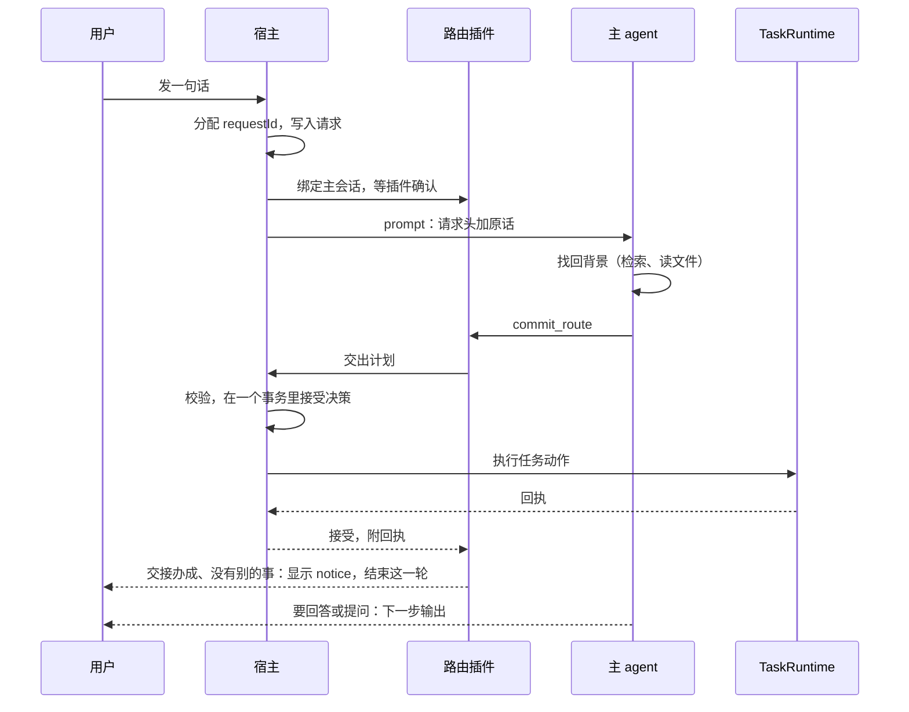

# 主对话的请求路由

[English](agent-routing-design.md) | 简体中文

状态：已实现（#131、#132），本文描述 `82a5bf3` 时的设计。设计依据的验证见[可行性验证报告](agent-routing-feasibility.zh-CN.md)和[结果汇总](agent-routing-supplement-results.json)；路由与后台任务、存储、插件的关系见[系统架构设计](system-design.zh-CN.md)。

主对话里的 agent（下称主 agent）做四件事：理解请求、找回背景、决定去向、把结果告诉用户。调研、命令、写文件交给后台任务。每条请求最后要么得到宿主接受的决策，要么记为失败并写明原因，这一点由运行时保证；决策是否正确，由上下文机制和真实模型验收来检验。

## 1 背景

路由之前，主会话持有全部执行工具。用户在助手工作时说的话，并进正在执行的这一轮；人设要求助手先把新的事做完，再回到原来的工作。

验证中，用户在回答途中说「另外做一份 A 股分析」，5 次里助手都在主会话里联网、写报告骨架，没有一次交给后台任务。只有用户明确说「放到后台做」，才会开任务。一件长任务因此占住主对话，用户插的话要等它做完。

用户的请求往往需要不同的去向。「先做今日简报，再分析 A 股」是两件独立的工作；「简报再加科技新闻」是给简报任务的补充；「按之前定的标准」要先找回那个标准，再决定做什么。

## 2 目标与非目标

### 2.1 目标

1. 独立的工作交给任务，主对话不被占住。任务在做时，用户可以继续说话。
2. 补充、修改和停止落到正确的任务上，不重复开任务。
3. 几十轮前或在其他话题里定过、又改过的约定，按最后有效的版本执行。
4. 用户在回答途中插话时，几秒内看到这句话的去向；结果可以晚到。

### 2.2 非目标

| 不做 | 原因 |
| --- | --- |
| 向量索引、独立的事项数据库 | 聊天检索、记忆和压缩摘要已能找回改过的约定（第 15 节）；召回失败多了再评估 |
| 任务排队、自动依赖 | 同时最多 5 个任务，满了如实告诉用户 |
| 插话打断当前回答 | DSH 只能取消整轮，取消后新一轮的输出到不了界面；快速旁路已经让插话几秒内有去向 |
| 撤回已发出的补充、回滚任务的改动、任务级快照 | 需要 DSH 或任务提供新接口；止损靠可见的去向、停止和更正（9.5） |
| 需要确认的配置操作脱离主会话 | 沿用原来的确认流程（10.3） |
| 降低路由步骤的推理强度 | 首字因此晚约 2.5 秒，可以接受 |
| 为其他模型调优 | 只对已验收的模型承诺行为；启用其他模型前先补验收 |

## 3 总体设计

### 3.1 角色

| 角色 | 负责 |
| --- | --- |
| 主 agent | 理解请求、找回背景、提交路由（`commit_route`）、回答和提问、调用获准的应用工具 |
| 宿主的请求运行时 | 给请求编号；保存请求、决策和动作；接受或驳回决策；经 TaskRuntime 执行交接并返回回执。请求的状态以它为准 |
| 路由插件（`viva-routing`） | 在 DSH 里执行：收窄主会话的工具、拦截越权调用、维护本轮的请求账本、提供 `commit_route`、控制哪些文字可以显示、处理插话的快速旁路 |
| 后台任务 | 在独立会话里完成交过来的工作，工具、权限和审批都不变 |
| 定时运行 | 独立的无人值守会话，按用户选的权限档位运行，需要确认的直接拒绝 |

主 agent 可以读工作区里与请求有关的文件，工作区外的读取按 DSH 的权限档位。文件内容和旧对话只是数据，不带来新的授权。整批资料的阅读和分析交给任务。

### 3.2 一条请求的路径

1. 宿主收到用户的话（提问或插话），分配 `requestId`，写入请求记录。
2. 主会话每次 prompt 之前，宿主发出角色绑定并等插件确认；插件在第一步组装之前收窄工具。插话走 steer，带同样的请求头。
3. 插件从会话事件里登记请求。主 agent 找回背景后调用 `commit_route`。
4. 插件把计划交给宿主。宿主校验，在一个事务里接受决策，提交之后经 TaskRuntime 执行任务动作，返回回执。
5. 插件按回执更新本轮账本：交接办成、这一轮没有别的事要做，就结束这一轮；要回答、提问或调用应用工具，就继续。
6. 这一轮结束时，没有决策的请求按结束的原因记为失败（第 11 节）。

### 3.3 模块

| 位置 | 内容 |
| --- | --- |
| `src/shared/request-routing/header.ts`、`protocol.ts`、`channel.ts` | 宿主和插件共用的部分：请求头、路由协议与回执、路由通道的消息 |
| `src/backend/request-store.ts`、`request-runtime.ts` | `app.db` 里的请求、决策和动作；接收请求、接受决策、执行任务动作并逐个留下回执、结束一轮的请求、启动时恢复 |
| `src/backend/routing-channel.ts` | 宿主一侧的通道：带确认的角色绑定；把决策交给请求运行时，再把结果答复给插件 |
| `src/backend/acp-bridge.ts` | 主会话每次 prompt 前先绑定；原话和插话都带上各自的请求头；用户停止、离开会话时结束这一轮的请求 |
| `src/backend/app-plugins.ts` | 由同一组段落拼成的两份人设：profile 的给任务和定时运行；主会话的由 `viva-routing` 换上，不叠加 |
| `plugins/routing/lib/ledger.ts` | 本轮的请求账本，纯函数，不可变 |
| `plugins/routing/lib/policy.ts` | 工具分层，以及应用变更的放行 |
| `plugins/routing/lib/commit.ts`、`host.ts` | 模型看到的 `commit_route`；插件一侧的通道 |
| `plugins/routing/lib/assistant-stream.ts` | 带输出门控的 stream 契约，回答到达应用的唯一途径 |
| `plugins/routing/lib/fast-lane.ts` | 插话的快速旁路 |
| `plugins/routing/index.ts` | 把 DSH 的事件接到以上模块 |

插件不导入应用的组装入口；宿主和插件共用的契约只放在 `src/shared/request-routing`；模块之间没有循环依赖。这三条由模块边界测试检查。

## 4 请求

- 窗口、桌面岛、文字和图片走同一个入口。回答权限卡、回答任务的问题、停止当前回复是控制事件，不算新请求。
- 请求记录包括：`requestId`（宿主生成）；接收时的会话、话题和工作目录；类型（提问或插话）；状态；失败原因；时间。会话、话题和工作目录在接收时固定，之后的执行按这份记录办事。交接任务时宿主还会核对当前选中的话题：不是请求所在的话题，就不启动任务。记录不保存原话。
- 请求头是 `【请求 ID：…】`，换行后接 `用户原话：…`，提问和插话的格式相同。原话里形似请求头的文字（例如粘贴的日志），会在 `【` 后插入一个零宽空格，所以只有应用加的请求头会被识别；读出原话时再还原。
- 同一个主会话按接收顺序理解和决策，因为主 agent 只有一个顺序执行的模型会话。新消息要么在当前步骤结束后由主 agent 处理，要么经快速旁路立即交出（第 9 节），都不等后台任务。
- 停止当前回复只取消主 agent 的这次调用，不会停止后台任务。

## 5 找回背景

主 agent 保留会话里仍可见的历史，沿用 DSH 的压缩。可见范围以外的背景，从聊天记录和记忆里检索：

1. 对照当前消息、连续的历史和任务快照，判断指代、约束和目标是否明确。
2. 不明确时检索话题、消息或记忆，可以换关键词。一次检索为空，不等于没有记录。
3. 读命中的原文和它之后的消息，核对约定有没有被改掉或取消，以用户最后一次确认的版本为准。
4. 几个候选同样合理、选错会改变结果时，问用户；不默认选最新的或同名的任务。
5. 交接的 brief 写明采用了哪个约定、出自哪里。

助手以前的建议不等于用户确认，历史里的指令也不是现在的授权。长期记忆可能存着同一规则的几个版本，冲突时以用户最后一次确认的原文为准；验证中曾选错一次。已删除或已遗忘的材料如实显示为不可用。

## 6 主会话的工具

### 6.1 分层

主会话的工具分五层，唯一的定义在 [`plugins/routing/lib/policy.ts`](../plugins/routing/lib/policy.ts)：

| 层 | 工具 | 规则 |
| --- | --- | --- |
| 路由 | `commit_route` | 每条请求必须调用 |
| 上下文 | 聊天记录的检索与读取、`memory_recall`、任务查询、只读的文件工具 | 随时可用 |
| 应用查询 | `schedule_list`、`viva_mcp_list`、`viva_skill_list` | 随时可用 |
| 应用变更 | 定时的新建、修改和删除；记忆的记住和遗忘；MCP 与 skill 的接入、修改、删除和导入 | 模型看得到；本轮先要有对应的 `app_action` 被接受，一个 `app_action` 放行一次调用 |
| 执行 | shell、写文件、联网、子 agent、后台任务工具、用户接入的 MCP 工具，以及其他所有工具 | 不在主会话的范围内；要做的事经 `commit_route` 交给任务 |

应用工具留在主会话的范围内，所以照常经过 DSH 的参数校验、审批卡、密钥窗口和观察者，不需要 DSH 提供新接口。

### 6.2 约束

- 收窄在第一步组装之前完成。宿主在主会话每次 prompt 之前绑定角色并等确认；新建、预热、恢复和切换会话都走这一步。
- 主会话的每次工具调用，在 `tools/pre-execute` 里按同一分层再判一次。这一步早于 DSH 请用户审批，所以越权调用在这里就被拒绝，不会弹出审批卡。后来注册进主会话范围的工具也要过这一关，新装的插件不会自动拿到主会话的权限。
- 应用变更由本轮已接受的 `app_action` 放行，一次放行一次调用，没用完的在这一轮结束时作废。插件用宿主同一个 `parsePlan` 读出接受的计划再放行（`grantsOf`），所以宿主推断出来的 `app_action`（7.2）同样有效。
- 后台任务和定时运行不收窄，沿用原来的权限和审批。

## 7 路由协议

### 7.1 `commit_route`

`commit_route` 提交 goals 和 actions。goals 列出用户这句话里的每个目标和它的去向，actions 是执行这些去向的动作：

| 去向 | 动作 | 内容 | 结果 |
| --- | --- | --- | --- |
| answer | `reply` | 回答的范围 | 下一步回答 |
| delegate | `start` | 任务名 `title`（可省）和自成一体的 `brief` | 新建任务 |
| update_task | `message` | 任务 ID 和补充内容 | 补充或恢复这个任务 |
| stop_task | `stop` | 任务 ID | 停止这个任务当前的运行 |
| needs_input | `clarify` | 问题 | 下一步提问，本轮结束后等回答 |
| app_operation | `app_action` | 应用工具名 | 下一步由主 agent 调用这个工具 |

- goals 和 actions 必须双向对应。宿主先补上意思确定的漏写（7.2），仍对不上就驳回，并说明缺哪个动作、要填哪些字段。
- 协议是扁平的：`app_action` 只写工具名，参数在调用工具时再给。嵌套的自由参数曾让模型生成非法 JSON。
- 一个请求只接受一次决策。用户的更正作为新请求到达，并引用原来的动作。
- 交给任务时，另带一句给用户看的 `notice`。交接办成、这一轮没有别的事要做时，插件把它作为这一轮的回复显示并结束这一轮，不再多一次模型调用；没写 `notice` 时，主 agent 在下一步用一句话说明。这一轮还有回答要说时，主 agent 接着说完，在结尾提一句这件事交给了后台。`notice` 只用于显示，不进宿主的记录。
- 任务卡片的标题取 `start` 的 `title`。没写时取这个动作对应的 delegate 目标：第 n 个 `start` 对应第 n 个 delegate 目标。

### 7.2 宿主补上的漏写

模型的提交有几种常见的漏写，意思其实是确定的。宿主补上后接受，不让模型整份重写。

动作没写 `kind` 时，按它带的字段推断：

| 带的字段 | 推断为 |
| --- | --- |
| `brief`，可另带 `title` | `start` |
| `scope` | `reply` |
| `taskId` 和 `text` | `message` |
| 只有 `taskId` | `stop` |
| `question` | `clarify` |
| `operation` | `app_action` |

字段对不上任何一种、或对得上不止一种时，照样驳回。写了 `kind` 的，按写的处理。

goals 和 actions 对不上时，按下表补：

| 漏写 | 宿主怎么补 |
| --- | --- |
| 整个没写 goals | 每个动作算一个目标 |
| answer 目标没有 `reply` | 用目标的文字补一个 `reply`。别的动作上多出来的 `scope` 不用，它多半是那个动作的主题 |
| 别的动作的字段写进了某个动作，例如 `start` 里带着 `message` 的 `taskId` 和 `text`，或 `stop` 的 `taskId` | 把这些字段拆出来，成为缺的那个动作 |
| 有 `reply`，但没有 answer 目标 | 补一个 answer 目标 |

宿主不凭空生成任务动作：交接、补充、停止任务缺了对应的动作，又没有字段可拆时，照样驳回，因为任务 ID 和委托都猜不出来。拆字段也只为补缺的那种动作，而且多出来的字段要正好是那种动作的：带着 `taskId` 和 `text` 的只会补成 `message`，不会补成 `stop`，免得把用户想补充的任务停掉，结果也不随 goals 的顺序变化。

工具参数只把 `requestId` 和 `actions` 设为必填，对象也不封闭。DSH 在调用插件之前先按工具参数校验：`kind` 或 goals 必填、对象封闭的话，漏写的和多写了字段的提交都到不了宿主。多写的字段由宿主丢掉。字段值为 `null` 仍由 DSH 驳回：要放行，参数就得写成 `oneOf`，模型看到的结构会和调优时不一样，而 `null` 很少出现。

这样做的原因：试用中有两次交接，模型漏写了 `"kind": "start"`，被驳回后把几百字的 brief 整份重写，分别多花了约 13 秒和 5 秒。另一次，用户一句话里既要交接又要回答，模型在 goals 里标了 answer，actions 里却只写了 `start`。在真实模型上重放主 agent 的请求（第 15 节），这类漏写在多目标的请求里最常见；只改写工具说明能减少，但去不掉。

### 7.3 没有答复的提交

插件发出决策后没有收到答复（60 秒超时、这一轮被停止、与应用断开），不把它当作驳回，因为宿主可能已经接受了。插件不再为这个请求提交，主 agent 告诉用户：这件事已经提交，结果待确认。结果以宿主的记录为准。

## 8 回答、提问与输出门控

### 8.1 回答与提问

`reply`、`clarify` 或 `app_action` 被接受后，这个请求在本轮可以输出文字。新的一轮开始时，回答许可失效；提问转为等待回答，用户的回答作为新请求到达。澄清只显示问题文字，不另加问题卡片。

交接没办成时（例如 5 个名额已满），这一轮不结束。请求转为回答，主 agent 如实说明哪件事没办成、为什么。

### 8.2 输出门控

只有拿到回答许可、并且在许可之后的步骤，才显示文字；还有请求在等主 agent 决策时，这一步不显示。快速旁路正在处理的插话不挡住当前回答。是否显示在每次流式输出开始时决定，开始之后到达的插话不会截断它。没有请求的一轮（例如后台结果送回来）照常显示。没有许可的步骤，流式输出保留开始和结束，只清空内容。

应用不显示 ACP 送来的那一份文字。插件没有确认输出的调用，撤回已显示的内容，并以错误结束。界面和会话库里不会出现请求头、路由 JSON 或调度说明。

## 9 插话

### 9.1 快速旁路

插话到达时，插件做一次不开推理的模型调用，输入是最近 12 条消息（每条最多取 1200 字）、任务列表和插话原文。只有两种情况直接交出：

- 明确是一件新的、独立的工作；
- 明确是对唯一一个任务的补充或停止。

其他情况交回主 agent，在当前步骤结束后处理：纠正当前回答、普通问题、指代不清、需要查历史或需要用户确认。

旁路的决策和主 agent 的一样交给宿主校验，用同一套任务接口和任务 ID 校验。判断限时 20 秒；计划发出后，按普通提交等宿主答复。

### 9.2 交出去的内容

- 模型给出任务名和委托。没给任务名时，取插话的前 20 个字。
- 用户原话总是原样附在委托之后。模型的转述可能丢掉文件名、格式这类明确的要求；验证中曾因此写错了文件。
- 委托写得短不是交回的理由，因为原话已经附上。

### 9.3 告诉主 agent

交出之后，插件向主会话注入一条已处理说明。主 agent 不再为这条插话提交，在回答结尾告诉用户这件事交给了后台。

- 说明只送给插话所在、仍在进行的那一轮。那一轮被停止、又开始了新的一轮时，说明不送。
- 宿主接受了决策、但任务没办成时（例如名额已满），请求已经决策，不能再提交。说明带上失败原因，主 agent 在回答结尾如实告诉用户。这和主 agent 自己提交后动作失败的处理一致。
- 提交没有答复时（7.3），说明写「已提交，结果待确认」。

### 9.4 观测

每次旁路处理都记一条 `request.fast` 事件，不含原话。事件记三项：结果（交出、交回、主 agent 已先处理、出错）；交回时的原因代码（模型自己的判断，或它的输出哪个字段不合格）；耗时。

插话变慢的问题就是靠这些代码定位的：任务名和委托曾经写在同一个字段里，模型有时只写了任务名，被判为委托太短而交回主 agent，卡片要 10 秒以上才出现。

### 9.5 判错止损

- 预防：只在唯一匹配时直接交出；任务 ID 必须来自宿主列出的任务。
- 可见：交出后立即显示任务卡片和一句说明。
- 纠正：用户指出错误时，作为新请求处理，并引用原来的动作。误开的任务直接停止；落错的补充，向那个任务发一句更正。

### 9.6 效果

| 情况 | 任务卡片出现 |
| --- | --- |
| 经快速旁路交出 | 插话后 1.2 至 3.2 秒（5 次） |
| 交回主 agent，在当前步骤结束后处理 | 10.5 至 18 秒 |

旁路的判断约 1.4 秒。对当前回答的纠正 10 次都交回了主 agent。

## 10 任务交接与应用操作

### 10.1 交接

- TaskRuntime 是任务唯一的写入方。
- 新任务从请求所在的对话开始。一轮进行中不能切换话题，所以通常它就是屏幕上的对话。决策在它的轮次结束后仍在执行、而屏幕上已经换了对话时，剩下的新建不再执行，回执记为失败。
- 只有请求所在工作目录里的任务，才能被停止或收到补充。
- brief 要自成一体：用户原话、目标、找到的约定和来源、文件和输出要求。对旧背景的概括不能代替原始引用。

### 10.2 名额

同时最多 5 个任务在跑。满了时返回明确的失败并告诉用户，不排队，也不改由主 agent 自己做。

### 10.3 应用操作

定时、记忆、MCP 与 skill 的变更，由主 agent 在 `app_action` 被接受后直接调用原来的工具；原有的参数校验、审批卡、密钥窗口和结果都不变。定时的提议不会挡住对话。需要审批的配置操作，由主会话等用户确认，和路由之前一样。插件管理不在主会话的范围内。

以后如果要让确认脱离主会话，优先用应用侧的提议卡片（和 `schedule_create` 相同的做法），不依赖 DSH 的改动。

用户接入的 MCP 服务器提供的工具属于执行层。主会话不再直接调用它们，要用就交给任务，主会话不等结果。这是路由带来的体验变化。

## 11 一轮的结束

一轮可能正常结束、出错、被用户停止，或者随会话一起消失。不论哪种，宿主都会结束这一轮的请求：没有决策的记为失败，还在执行的决策不再发出剩下的动作。

| 情况 | 处理 | 用户看到 |
| --- | --- | --- |
| 正常结束，仍有请求没提交 | 插件先提醒主 agent 补交，最多两次；之后宿主把它们记为失败（`unrouted`） | 「助手这次没能处理这条消息，请再发一次。」 |
| 出错结束，例如模型生成的工具参数不是合法 JSON | 记为失败（`turn_error`） | 同上 |
| 用户按停止 | 宿主立即结束这一轮的请求（`cancelled`），不等它收尾，之后到达的决策（包括快速旁路的）一律驳回；插件不再等旁路，也不提醒补交 | 不提示 |
| 切换话题、dsh 退出或重启 | 旧会话的 `turn_end` 送不到了。桥在收起会话时、宿主在 dsh 退出时，结束它这一轮（`cancelled`） | 不提示 |
| 应用退出 | 下次启动时，把没有决策的记为失败（`interrupted`） | 不提示 |

还在执行的决策，会把手上的动作做完；剩下的不再发出，回执记为「本轮已结束，这一步没有执行」。

正常结束之前，插件会等快速旁路的交接都有结果。旁路的每一步都有时限（判断 20 秒，宿主答复 60 秒），所以等待有上限。不等的话，结果回来时主 agent 已经空闲，交接的结果或失败原因就没人告诉用户。

## 12 持久化与恢复

`app.db` 有三张路由表，写入复用事件内核的事务。请求的状态以这里为准，插件里的账本只记本轮的工作状态。

| 表 | 内容 |
| --- | --- |
| `routing_requests` | 接收时的会话、话题和工作目录，类型，状态，失败原因，接收和更新的时间；不存原话 |
| `routing_decisions` | 被接受的 goals 和 actions，接受的时间。任务的委托和补充内容常引用用户原话；快速旁路交出的，总附着原话 |
| `routing_actions` | 每个动作的状态、关联的任务、失败时的错误 |

- 决策和它的事件在一个事务里接受；任务动作在提交之后执行，每个回执连同它的事件一起保存。
- 动作执行了、回执还没存下时应用退出，无法保证恰好执行一次。下次启动把这个动作标为不确定，不再重发；同一决策里已经成功的动作不重做。
- 事件只记 ID、类型和代码：`request.received`、`request.decided`、`request.acted`、`request.failed`、`request.uncertain`、`request.fast`。请求表和事件不含原话；路由记录都不保存模型的推理。

## 13 结果回报与控制事件

结果回报复用[任务报告](../src/backend/task-reports.ts)和它的 effects 队列。按任务和运行去重、确认读到、跨话题标明来源，这些都保留。完成通知是有类型的事件，不是新的用户委托，不会触发新任务。主 agent 在合适的时机汇报结果；用户的新消息优先于还没开始的汇报。

停止当前回复只影响主 agent 当前的调用。停止后台工作必须指明任务；「全部停下」要先确认用户指的是哪些。审批和问题的回答按原来的任务送回，不因用户此刻在看哪里而改变去向。

## 14 考虑过的其他做法

| 做法 | 没有采用的原因 |
| --- | --- |
| 主会话保留执行工具，只靠人设要求它分派 | 回答途中的新工作 5 次里 0 次交给任务（第 1 节） |
| 只在 `pre-step` 收窄工具 | 第一次请求仍带着全部工具，验证中出现过对 `bash` 的调用；改为每次 prompt 前绑定角色，在第一步组装前收窄 |
| 用 DSH 的 guard 拦越权调用 | guard 在审批之后，越权调用会先弹审批卡；改在审批之前的 `tools/pre-execute` 判 |
| `app_action` 带上工具的全部参数 | 嵌套的自由参数让模型生成非法 JSON；改为只写工具名，参数在调用原工具时给 |
| 插话一律等主 agent 当前步骤结束再处理 | 任务卡片要 10.5 至 18 秒才出现；为明确的情况加了快速旁路 |
| 插话打断当前回答，重新开始一轮 | DSH 只能取消整轮，取消后新一轮的输出到不了界面 |
| 漏写 `kind` 就驳回，让模型重新提交 | 每次多花 5 到 13 秒（7.2） |
| 漏写一律驳回，靠改写工具说明减少漏写 | 改写后，多目标的请求里仍有漏写 `reply`、`message` 的（7.2、第 15 节） |
| goals 和 actions 合成一个列表，每项写目标、去向和该去向的字段 | 两份写同一件事确实容易对不上，但合起来以后，模型漏掉一个目标时宿主发现不了：重放中出现过回答被整项漏掉、`notice` 却说已经办了。分开写，goals 就是宿主核对的清单 |
| 旁路的任务名和委托写在同一个字段 | 模型有时只写任务名，被判为不合格而交回（9.4）；改为两个字段，原话另附 |

## 15 验证

真实应用场景在 [`test/smoke/live-scenarios-routing.ts`](../test/smoke/live-scenarios-routing.ts)：普通问答；整理工作区材料做简报（主动交接）；给运行中的任务补一节；回答途中插话交出新工作；插话纠正当前回答；换话题后按改过的约定执行；停止刚开始的任务；每周提醒；记住一条事实；接入 MCP。

| 轮次 | 内容 | 结果 |
| --- | --- | --- |
| 首轮 | 隔离探针，精简人设，关闭推理 | 机制 12/12；结构化契约 22/27，失败主要是用 `reply` 表达澄清（[报告第 1–8 节](agent-routing-feasibility.zh-CN.md)） |
| 补充验证 | 确定性测试、生产配置的桥接层、真实应用 | 并行越权、插话记账、门控、绑定等确定性检查全部通过；生产配置下首轮的澄清失败消失；找出绑定时机、门控方式、应用操作与审批、非法 JSON 等约束（报告第 9 节） |
| 分层收窄 | 真实应用，10 个场景各 5 次 | 50/50；越权调用 0 次，路由失败 0 次；应用操作 15/15 经放行由原工具完成；接入 MCP 整轮 6.8 至 10.3 秒（报告第 10 节） |
| 实现之后 | 真实应用，回答、交接、插话三个核心场景各 3 次 | 合入 #131 前 9/9；合入 #132 后 9/9，交接都是一次提交成功 |
| 工具定义调优 | 录下主 agent 发给模型的真实请求（系统提示、全部 25 个工具、上下文），只换 `commit_route` 的定义，在 DeepSeek V4.1 Flash 上重放。15 个合成场景，有单目标和多目标，一半带 10 轮历史；按 DSH 的参数校验和宿主的解析判定 | 第一次提交就被接受：改前 126/135，改后 134/134（另有 1 次网络中断）。改前被驳回的，多是多目标请求里漏写 `reply`、`message`、`stop`，或把它们的字段写进 `start`，也有多写字段被 DSH 驳回的 |

排查慢和失败，从两处开始：`app.db` 的路由表和 `request.*` 事件，记着每条请求的接收、决策和动作时间以及失败原因；`trace.db` 记着主 agent 的每次工具调用和参数。

## 16 风险与未完成

| 风险 | 说明 | 应对 |
| --- | --- | --- |
| 只验证了一个模型 | 真实模型验收都在 DeepSeek Flash 上 | 启用其他模型前，补跑第 15 节的场景 |
| Windows 没有真实模型验收 | CI 只跑确定性测试和冒烟 | 列为待办 |
| 生产检索在真实历史上的召回未知 | 验证用的是合成数据 | 观察召回失败，再决定要不要加索引 |
| 长期记忆里同一规则有几个版本 | 验证中曾选错一次 | 以用户最后一次确认的原文为准（第 5 节） |
| 一次提交几个相同的 `app_action` | 定时场景 5 次里出现 2 次 | 改写了协议说明；多余的放行在一轮结束时作废 |
| 快速旁路的成本 | 每次插话多一次模型调用 | 只在插话时触发 |
| 补漏写放宽了校验 | 漏写的提交也会被接受 | 只补意思确定的：推断 `kind` 要字段对得上唯一一种，拆字段只为补缺的动作，不凭空生成任务动作；协议测试和 DSH 层测试覆盖每一种 |

未完成：

- 不确定的动作只记日志，还没有根据任务和会话的关联去核实，也没有告诉用户。
- 删除话题时不清理路由记录。请求表里只有话题 ID，但决策表里的委托可能引用了原话，所以话题删除后，这些原话仍留在 `app.db` 里。
- 真实应用场景还没有覆盖：同名任务的模糊指代、只有助手的建议而没有用户确认、长会话压缩之后的恢复。这三项在桥接层验证过。
- 主会话不再直接调用 MCP 工具（10.3），这项体验变化还没有经过用户确认。
