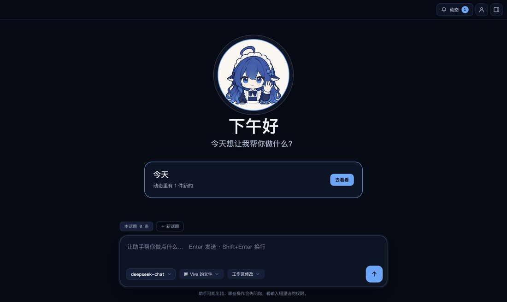

# Features

English | [简体中文](features.zh-CN.md)

See [README](../README.md) for installation and [Development](development.md) for building and testing. UI labels follow Settings → Language; user content and assistant replies retain their own language. Screenshots in this guide were captured in Chinese.

## Viva island

The dark capsule's border indicates state: subdued when idle, orange when attention is needed, red on error, blue on completion. In the title bar the island shows only a dot in the same color; on the desktop the maid sits at its upper left at 72 px, and the island grows around her.

- **In the window:** the title-bar island shows overall elapsed time and step count. Clicking expands recent steps, Stop, and the full activity view; merely passing over it does not expand it. While approval or an answer is pending, it says that attention is needed and scrolls to the conversation card. The question or approval details appear only in that card. The cat row at the end of the conversation describes the current action.
- **On the desktop:** closing the window keeps Viva in the tray/menu bar and shows the island at the top center. Minimizing or covering the window does not show it. The desktop island shows activity, asks for attention, and accepts work; open the main window for detailed activity. Running work has one action/elapsed-time line. Approvals expand automatically with Allow/Deny; a single-choice question can be answered directly, while other questions open the window. Errors show their reason. Completion remains for five seconds, stays while hovered, and remains another two seconds after leaving. Idle state is just the cat.
- **Hover and click:** hovering for about 0.2 seconds reveals a drag handle and, during work, Stop. Idle hover shows the question/file-drop hint and an open-window button. Clicking her while idle opens the input; clicking running/completed/error state opens the window. The tray and Dock also open the window and hide the desktop island.
- **Context menu:** Ask, Open Viva window, Stop (while working), Move to top center, Hide until the next window close, and Disable desktop island. Disabling persists until reenabled in Settings. The shortcut works with either hiding option. See `src/main/desk-menu.ts`.
- **First use:** a coach card explains clicking/shortcut, dropping files, dragging, and the context menu. Dismissing it, opening input, or dragging records `deskCoached` in `preferences.json`. Quit through the tray menu, or ⌘Q on macOS.
- **Ask anywhere:** ⌘⇧Space, or Ctrl+Shift+Space on Windows, opens island input. Enter sends to the current conversation; Esc closes. If the main window is open, the shortcut foregrounds it and focuses its composer. During work, input steers the current turn. Pending approvals/questions take precedence. With the desktop island disabled, the shortcut can temporarily show it while the window is closed to tray; it hides after the requested work completes. Settings reports shortcut conflicts.
- **Drop files:** drop up to ten files (folders are unsupported), then choose Summarize or type a request. Files are not copied: their local paths are appended using `src/shared/attachments.ts`. Conversation attachments show file labels and desktop-island origin. Reading outside the workspace still asks for approval.
- **Move:** drag anywhere; it shrinks to her while moving. Near top center it snaps home. Lower-screen placement expands upward; edges expand inward. Position is remembered by display; removing that display returns it to the main window's display. Settings can reset placement (`src/main/desk-place.ts`). During drag the transparent window shrinks from 600×352 to 104×104, moves on animation frames, and uses `setBounds` to avoid size drift at fractional Windows scaling. Animation and shadows are reduced during drag.
- **Disable:** Settings stores the switch and position in `preferences.json`. Closing still keeps the app in the tray.
- **Focus and input:** only open island input takes keyboard focus, which returns to the previous app when closed. The macOS window is a nonactivating panel. The island is excluded from screen capture/sharing and macOS fullscreen apps. Main checks the pointer every 50 ms and allows clicks/drops only over the island; other clicks pass through. It avoids Electron's `forward` mouse hook because a busy Windows main process could otherwise delay systemwide mouse movement.
- **Implementation:** both islands use `view/island-dom.ts` and `island-view.ts`; desktop input uses `view/island-input.ts`. `desk-island.ts` owns the transparent window and `desk.html`; `island-main.ts` relays state/actions. `island-ipc.ts` validates request identity, bounded text, and existing file paths. Smoke covers desktop approval, input, dropped files, and delivery to the main conversation.

## Steering during work

Send additions or corrections without waiting. The composer remains editable, with Send when it contains text and Stop when empty; desktop input behaves the same. The assistant reads the addition before its next step, after the current tool finishes, without starting a separate turn or interrupting that tool. The conversation marks it as steering. If the turn has just finished, delivery waits for cleanup and becomes the next question exactly once. Failed delivery stays visible with a retry-after-completion explanation.

The main composer, Run in background, task composer, and Edit and resend accept at most 20,000 characters. Oversized input explains the limit and retains the draft before sending or changing conversation paths.

ACP accepts only one active prompt per session, so `viva-steer` (`plugins/steer`, `steer@1`) relays through the dsh IPC channel to `agent.steer`. `src/main/steer-channel.ts` uses a five-second acknowledgement timeout. Actual-dsh integration tests verify delivery within the same turn and exactly one turn end.

## Background tasks

Use Run in background beside the composer to start separate work from the current conversation. Long-running foreground work can offer Move to background. A different request while approval is pending can also be routed to background work.

Each task leaves a single clickable status line in its original conversation, with its name, state, preview, and a link to its Background page. Approval and question actions live in the bottom-right task dock, or in the Background page when the dock is unavailable. Status wording is consistent across the conversation, dock, page, and island.

The island shows a spinner and active count, a check and unseen completion count, or an attention count; ready follow-ups show their count and Ready. Opening a completed task marks that result seen, clears its island/dock reminder, and retains its historical line and page entry. Seen state survives restart; a new result becomes unseen again.

The dock shows up to three tasks, prioritizing approvals, with Stop, Continue, Details, or Acknowledge as appropriate. It collapses to a small tag and remembers that choice. When space is tight, it yields to the conversation; pending approval/error tags remain and temporarily expand above the composer. The turn rail stays on the left. The Background page shares the persistent Review/Background/About you/Settings navigation and has a collapsible task list whose state is saved.

Drag either conversation edge to resize from 560 px up to the available width; double-click restores 760 px. The width is saved. Close dismisses a task; `#task-name message` addresses it. Unfinished work offers Resume or Discard after restart. See `smoke-tasks.ts` and `smoke-dock.ts`.

## Files

The drawer is a read-only workspace browser. Folders load on expansion; `.git` and `node_modules` are subdued. Files read/written in the current conversation have blue markers; the tree refreshes after turns. Markdown renders local workspace images, code uses main-process highlight.js, CSV/TSV tables show up to 2,000 rows with a raw-text toggle, images display directly, and binary files show name/size. Text pages are 200 KB and load on scroll. Disk changes refresh the open preview.

Open uses the default application. Its menu lists compatible apps with icons/default indication and Reveal in Finder/Explorer, using dsh's native-command module. Executables/scripts (`.exe`, `.sh`, `.js`, `.ps1`, etc.) only offer Reveal. Main validates paths and rejects traversal, absolute paths, and links escaping the workspace (`workspace-files.ts`).

Assistant file access differs from read-only preview: in Workspace changes and Read only modes, reads/searches outside the real workspace path ask for approval, including links. Arbitrary shell commands also ask because command text cannot prove read-only scope. Denial returns no file content; one-time approval does not become permanent or override write restrictions. Auto uses dsh review; Full does not ask.

## Configure MCP and skills in conversation

Ask to connect a service or save a procedure as a skill. Settings → Extensions lists servers and skills; servers can be edited in place or deleted, and skills removed.

`viva-config` exposes `viva_mcp_add/update/remove/list/import` and `viva_skill_create/install/remove/list`. Mutations require approval showing the command and arguments. Importing existing dsh configuration is the documented exception below. When secrets are needed, the model supplies only variable names; a dedicated window form sends values directly to main for safeStorage encryption in `mcp-servers.json`. Secrets do not enter dsh, chat, or activity; activity records only the request and completion of secret entry.

The plugin uses `config@1` IPC; `config-channel.ts` validates each request and reuses configuration storage. MCP reconnects after the turn; skills become available immediately. Skill names use lowercase letters, numbers, and hyphens; descriptions may use any language. Persona instructions require these tools and prohibit asking for secret values in conversation.

### Import and edit in place

Import from dsh accepts `DSH_HOME` (default `~/.dsh`), the last folder, or another folder, through Settings or chat. It reads existing user configuration without approval/secret prompts and does not modify the source. `dsh-mcp-import.ts` combines each profile's `cordis.yml`, `cordis.patch.yml`, and root patch in dsh order, handling insert, id overrides, and disabled entries.

Literal secrets are copied. Restricted `!!js process.env.X` and environment-based bearer templates resolve from the login-shell environment, app environment, then dsh `.env`. Other JavaScript is never executed. Missing variables do not abort import: the server is marked for secret completion. Case-insensitive duplicate names are skipped and reported. Editing prepopulates nonsecret fields; stored secrets show names only, blanks retain values, and entries can be added/removed. Saving reconnects the session. Chat-based updates require approval and use the same secure form.

## Plugins

Settings → Plugins manages the dsh plugins users install themselves, which add tools and abilities to the assistant: search, context compaction, vision and more.

- **Install:** enter an npm package name, a git address or a local folder and choose Look up first. Viva shows the package and its version and warns that a plugin runs inside the assistant with your permissions and can read your model keys and memories; nothing is installed until you choose Install. dsh's own plugin manager installs it with the pnpm Viva ships (no Node or pnpm of your own needed) and checks compatibility with dsh's version. If dependencies want to run build scripts, they are listed first and run only after Allow and install.
- **Switch and remove:** switches and removal take effect at once, in new conversations, without a restart, and switches survive a relaunch. Viva's own plugins, persona and safety settings are unaffected by these switches and plugins.
- **Visibility:** each plugin shows its version, description and whether it is on; a note says when part of it is an interface for dsh's Web client (Viva does not show that part; the rest works), and parts that did not start or stock dsh settings it changes are listed.
- **In conversation:** the model can propose installing a plugin, approved by you on an approval card.

## Proactive follow-ups

A request to remind or prepare something at a stated time produces a proposal. Only accepting it creates a follow-up; the model cannot create, edit, or delete one by itself. Main validates dates. Declining suppresses the same proposal for 30 days; category suppression behaves similarly.

- **Preparation windows:** choose three daily windows (08:30/12:30/16:30), two, one, or a custom weekday/weekend schedule. At most six windows, at least one hour apart; weekends may be disabled. Each item uses the last window at least one hour before its reminder, or as soon as possible if late. Preparation runs only without an active foreground conversation or running user task (approval waits do not count), between 08:00 and 22:00, within a default 30-call daily budget separate from user tasks. Starting work lets the current preparation finish then pauses; Wake stops it too and pauses for 30 minutes. Prepare now bypasses the window wait.
- **Capability boundary:** preparation is a model call with no tools. The app reads the follow-up, recent conversation, synthesized profile, and explicitly named text files (up to 20 KB each, no binary files) and marks them as data. It can return a draft but cannot execute embedded instructions, change files, edit follow-ups, or alter memory.
- **Review:** drafts appear in the background page. Continue puts a draft into the composer for review before sending; changed source files are flagged for rereading. Run in background creates normal work governed by current permissions. Discard removes it. A user task already handling the conversation prevents duplicate preparation.
- **Notifications:** an agreed reminder fires once at its scheduled time, outside the proactive daily cap. Ready drafts surface during a gap: returning to the window, completing a conversation/task, or returning after 15 minutes away. Each item is announced once, at most three proactive interruptions daily; foreground announcements stay in the window. Missed reminders after sleep/restart are combined. If preparation is late, the reminder still fires, offers preparation, and records the miss for weekly settings statistics.
- **Today:** the first gap with relevant activity shows one daily summary of ready drafts and reminders due. It counts toward the cap and replaces separate ready announcements. The home card opens the background page; empty days show nothing.
- **Watch a file:** an accepted `watch_file` proposal records mtime. Polling every minute avoids platform/network filesystem event differences. A change followed by ten quiet minutes schedules preparation in the next window, reading that file. Continuing does not stop the watch; deletion does.
- **Visibility:** she sleeps during preparation while you are idle; the island shows preparation/readiness, tray counts waiting items, and notifications open the background page. Optional launch-at-login is off by default and available only when installed; it starts in the tray.
- **Local data:** `app.db` (migrated from the earlier `followups.db`) stores follow-ups, notification bookkeeping, and weekly events. Settings shows acceptance rate, median notification-open delay, daily calls, calls per accepted proposal, and missed preparation. Windows notifications use installer AppUserModelID `app.viva.desktop`.

## Models and keys

Without a usable model, home shows Connect model and disables the composer. Add a DeepSeek key or another model in Settings to connect. Keys are encrypted with AES-256-GCM under a data key (`data-key.bin` in app data) that safeStorage protects (Keychain on macOS, DPAPI on Windows), and kept in app-data `settings.json` with mode 600 where supported; keys saved by an earlier version, encrypted with safeStorage directly, are still read and rewritten in the new form on the next save. Unavailable secure storage refuses saving instead of plaintext fallback. Only the backend process holds the key; the UI shows the last four characters. Saving/clearing restarts dsh and starts a new conversation. Saved keys override environment values. A missing dsh installation prompts dependency repair.

### Other models

Add a provider name, protocol, baseURL, one model ID per line, and API key (optional for local models). Providers appear grouped in the composer menu. Supported dsh `llm-pi-ai` protocols are OpenAI Chat Completions, OpenAI Responses, and Anthropic Messages. Kimi, Zhipu, Qwen, OpenRouter, Ollama, and LM Studio commonly use OpenAI compatibility.

Viva configures the existing plugin rather than implementing adapters. Provider routes use `custom-xxxxxxxx` ids. Keys are encrypted in `models.json` and supplied to dsh as `VIVA_MODEL_KEY_XXXXXXXX`; profile files contain variable names only. DeepSeek becomes optional; without its key, both DeepSeek plugins are disabled and its menu entries disappear. `lastModel` is restored through ACP provider/model settings on restart and new conversations; missing models fall back to DeepSeek or the first custom provider. Adding/removing providers restarts and resumes the current session without clearing history; changes are blocked during work. Provider editing is not yet supported.

## Clarifying questions

When an essential location/time/object/account is missing and memory cannot answer, persona rules require asking instead of guessing from timezone/IP. The built-in `ask_user_question` tool is relayed by `viva-questions` to cards. One single-choice question submits on click; multiple questions/selections require Submit. Free text and Skip are supported. Stopping or switching conversations closes pending questions. Answers enter ordinary memory extraction, so stable information can prevent repeated questions.

## Conversation history

`history.db` lives in app data (on macOS, `~/Library/Application Support/Viva`) and uses Electron's `node:sqlite`. It stores visible questions, answers, receipts, and dsh session identity, not thoughts/tool calls. Writes are incremental at turn start/end/error. Startup opens the latest conversation and tries ACP `session/resume`; failure starts a new session with an explicit lost-context divider.

The title-bar profile icon opens the Review/Background/About you/Settings hub below the title bar, leaving the island accessible. It remembers the last page. Back, Esc, or the icon closes it; ⌘F/Ctrl+F opens search. With no query, Review lists topics by month and day, newest first, with turn counts, files and bookmarks. Filters select all topics, tasks, files or bookmarks. Expand a topic to read or continue it; Earlier loads another page. Main-thread scrolling loads only the recent seven days. Older topics fold to one line, and the turn rail jumps among turns/topics with click or arrow keys. Hover over a message to bookmark it; rewinding removes bookmarks on rewritten messages. The assistant can use search_conversations and read_conversation, linking back with viva://timeline/<segment>/<sequence>.

Search highlights matches with nearby messages; Details navigates and highlights the source. Three or more characters use FTS5 trigram; shorter queries use substring matching.

Conversation menus offer Rename, Pin, Export Markdown, and Delete. Deletion offers Undo for eight seconds, then secure-deletes database content; dsh session logs remain. Old activity is restored from `sessions/…/session.v4.jsonl.zstd`; unavailable logs produce an explanation. Active work prevents conversation switching; switching disables sends. Legacy `history/*.json` imports once, preserving the renamed `history-imported` backup.

## Memory

`plugins/memory` owns memory; the app provides UI. See [Memory](memory.md) for the full design. `dsh-profile.ts` writes the private `profiles/viva` ACP composition with linked plugins and a shared `memory.db`; it does not touch the user's `~/.dsh`. Profile-write failure falls back to ACP without memory. App and plugin share the store contract: app edits profile/memories and habits; plugin stores learned memories, per-session retrieval state, and injection logs.

Retrieval has three layers: fixed rules/profile/preferences/habits at first turn, changes, and compaction; up to three name-matched memories from the user's own words, deduplicated within the session; explicit `memory_recall` keyword lookup when needed. Long pasted material uses the user's opening/closing lines; short follow-ups incorporate the preceding question. Native memory tools do not require approval; sensitive secrets/identity numbers are rejected.

Explicit Remember requests save immediately. After each turn, bounded background extraction adds facts or invalidates candidate memories it was shown, with all-or-nothing validation; it cannot alter user-owned entries. Casual chat is filtered. Profile fields are user-owned. Learned identity/people/projects/preferences become memories and periodically produce a synthesized profile after 24 hours or five changes; invalidations trigger earlier rebuilding. Only active memories are used, and recent additions appear separately. Invalid/sensitive synthesis falls back to the previous result. Legacy agent-written profile fields migrate to memories.

Forgetting/replacement invalidates instead of deleting and remains restorable in About you; only explicit UI deletion removes rows. Injection includes today's date, refreshed across midnight, so relative dates can become absolute. Activity shows which memories were included and why; saves notify the user. Failed plugin loading leaves chat functional and is reported in Settings.

## Markdown in messages

Assistant answers support headings, emphasis/strikethrough, inline/fenced code with language labels, ordered/unordered/task/nested lists, aligned tables, quotes, rules, and links. User messages remain original text. `marked` lexes; `h()` creates nodes without `innerHTML`. Raw HTML displays literally; remote images become links instead of loading. Internal viva://timeline links open the referenced record; only http(s)/mailto links open externally and main revalidates before opening the external browser/mail app; renderer navigation/new windows are blocked. Streaming parses incomplete code fences and reparses only when visible text changes.

## Character

Viva appears as a blue-haired maid (`view/maid.ts`; see [Maid character](maid-character.md)). She waves large on the home page, appears beside only the current turn's answer in the conversation, sits on cards while they wait for your approval or answer, and is the desktop island. The title-bar island shows only a state-colored dot. Her prop follows what the assistant is doing: a pencil while thinking, glasses and a keyboard while writing, a clipboard for approval, a headset for questions, a check card when done, a wrench on errors, an unplugged connector while offline. Reduced-motion settings keep her still. The app icon (`build/icons/`) still shows the cat for now.
