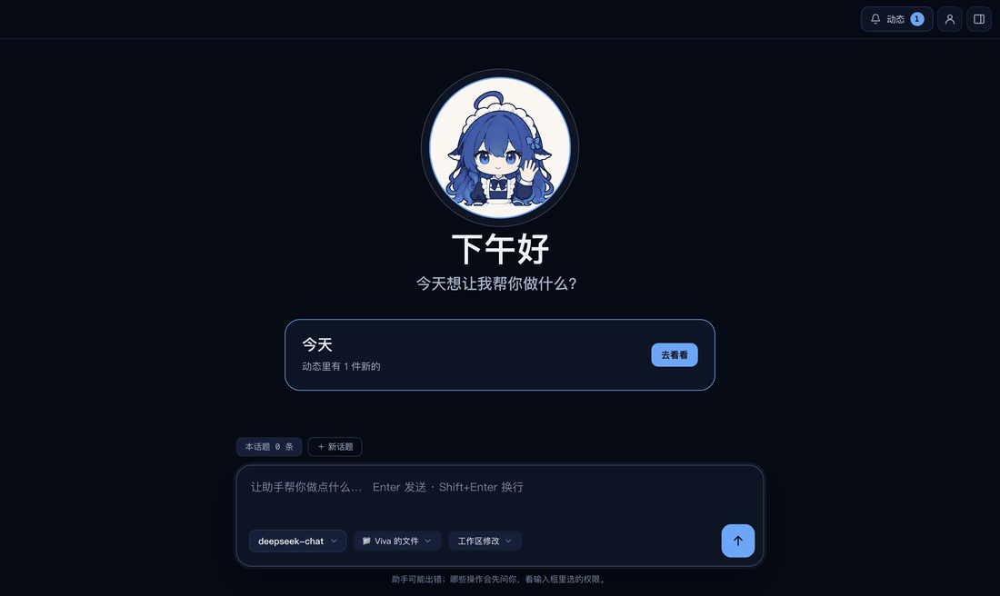

# 功能说明

[English](features.md) | 简体中文

各项功能的详细说明。安装和上手见 [README](../README.zh-CN.md)，开发、打包和测试见 [development.md](development.zh-CN.md)。

## Viva 岛

状态显示在「Viva 岛」上：一个深色的胶囊，描边颜色表示状态（平时暗、需要你时橙、出错红、完成蓝）。标题栏里的岛只有一个同色的圆点；桌面上的岛左上角是 72px 的女仆形象，岛围着她伸缩。

- **窗口里**：在标题栏正中，只说整体进度（用时、第几步）。点一下原地展开成最近几步（鼠标只是路过不展开），可以「停止」或「查看完整过程」。助手等你确认或回答时只写「需要你处理」，点一下滚到对话里的卡片；要确认什么、问了什么，只在卡片里出现一次。正在做什么，由对话底部带她头像的那一行说。
- **桌面上**：点窗口的关闭按钮后，Viva 不退出，而是留在托盘（macOS 的菜单栏、Windows 的通知区域）里，屏幕顶部正中出现同一个岛。窗口只是被别的程序挡住或最小化时，不出现桌面岛。
  - 桌面岛是在别的应用里用余光看的，所以只做三件事：告诉你在不在干活、需要你时拦下你、随手交活。它不展开过程，要看过程就打开窗口。
  - 工作中只有一行：当前动作和用时。
  - 需要你确认时自动展开，可以直接「允许」「拒绝」；反问时单个单选题可以直接点选项，其余情况点「打开窗口回答」。
  - 出错时显示原因；一轮完成后显示 5 秒「已完成」，鼠标停在上面时不消失，移开后再留 2 秒。
  - 没事的时候只剩她。
  - **鼠标停留**（约 0.2 秒，路过不算）只显示能做什么，不展开内容：右边出现拖动把手 `⋮⋮`，工作中多一个「停止」■；没事时岛变成 `问 Viva，或把文件拖过来  ⌘⇧Space`，旁边有 ↗ 打开窗口。
  - **点击**：没事时点她打开输入框；工作中、完成、出错时点岛打开窗口。点托盘图标（macOS 上是托盘菜单里的「打开 Viva」）或 Dock 图标也会打开窗口，桌面岛随之收起。
  - **右键**：系统菜单，有「提问…」「打开 Viva 窗口」「停止」（工作中才能点）「放回顶部正中」，以及两种关法：「先隐藏」只到下次关闭窗口为止，下次关窗口时岛照常出现；「不再显示桌面岛」和设置里关掉开关一样，一直不出现，要在设置里重新打开。两种关法下快捷键都照样能用（`src/shell/desk-menu.ts`）。
  - **第一次出现**：她下面展开一张说明：点我或按快捷键提问、把文件拖给我、按住拖动和右键。点「知道了」、打开输入框或拖动岛之后不再出现（记在 `preferences.json` 的 `deskCoached`）。要退出，用托盘菜单里的「退出 Viva」，macOS 上也可以按 ⌘Q。
- **在岛上提问**：在任何应用里按 `⌘⇧Space`（Windows 上是 `Ctrl+Shift+Space`），岛变成输入框，Enter 发到当前对话，Esc 收起。窗口没关时，快捷键把窗口叫到最前面，光标放进窗口自己的输入框。助手正在工作时，输入框变成「插话」，说的话进到正在做的这一轮（见[工作中插话](#工作中插话)）；助手在等你确认或回答时，岛先显示那件事。桌面岛关掉时，窗口关到托盘后快捷键照样能用：岛临时出现，问完的事做完后收起。快捷键被别的程序占用时，设置里会提示。
- **拖文件给 Viva**：把文件拖到岛上，她换成扶着耳麦在听的样子，岛张开成「松手，交给 Viva」。松手后输入框里带上文件标签，可以点「总结」，或输入要做什么。一次最多 10 个文件，文件夹先不支持。文件不复制，问题末尾附上它们的本机路径（`src/shared/attachments.js`）；对话里这些路径显示成文件标签，并注明「从 Viva 岛发送」。工作区外的文件，助手读取时照常请你确认。
- **拖动岛**：按住岛拖到屏幕任意位置，拖动时岛缩成只有她。放到顶部正中附近会吸回原位；放在屏幕下半部分时向上展开，靠近左右边缘时往屏幕里面展开。每块显示器分别记住位置，记在岛最后所在的显示器上；那块显示器拔掉后，岛回到主窗口所在屏幕的顶部正中。设置里有「放回顶部正中」（`src/shell/desk-place.ts`）。
  - **拖动的性能**：拖动时窗口本身缩成只够放下岛的 104×104（平时是 600×352），因为透明窗口每移动一次的开销和面积成正比，微软对分层窗口的建议也是尽量小。窗口跟着页面的画面帧移动（`requestAnimationFrame`），所以和屏幕刷新同步，60Hz、120Hz、144Hz 都跟手，指针不动时什么也不做；以前是 16 毫秒的定时器，Windows 上定时器精度约 15.6 毫秒，会一帧动一帧不动。每次移动都连同大小一起设（`setBounds`），不只改位置：Windows 上缩放是 175% 这类非整数时，`setPosition` 会把保留的大小取整，每移一次窗口就变大一点。拖动时不播放变形动画，阴影也换成短的。
- **可以关掉**：设置里的「桌面岛」开关。关掉后，关闭窗口照样留在托盘，只是不出现桌面岛。开关和岛的位置都保存在应用数据目录的 `preferences.json`。
- **不打扰**：桌面岛只在输入框打开时接收键盘，关上后键盘还给原来的应用（macOS 上它是不激活应用的面板窗口）。它不出现在录屏和屏幕共享里。主进程每 50 毫秒看一次指针是否在岛上，只在岛上才接收点击和拖入的文件，其余地方的点击直接落到下面的应用；鼠标是否停在岛上也由它告诉页面。窗口不用 Electron 的鼠标转发（`setIgnoreMouseEvents` 的 `forward`），因为它在 Windows 上靠全局低级鼠标钩子（`WH_MOUSE_LL`）实现，整个系统的鼠标移动都要先经过 Viva 的主进程，主进程一忙全系统的鼠标都会卡。macOS 上它不出现在全屏应用里。
- **实现**：两处是同一个组件（`src/renderer/view/island-dom.js`），显示的内容由 `island-view.js` 从状态算出；桌面岛的输入框在 `view/island-input.js`。桌面岛是主进程里的一个透明小窗口（`src/shell/desk-island.ts`，页面 `desk.html`）。窗口把岛的内容交给主进程转发，桌面岛的点击和提问再经主进程回到窗口（`island-main.js`）。所有消息都由 `island-ipc.js` 校验：岛上的按钮只能回答它正显示的那个请求或问题；提问只能是一段有长度上限的文字，加上主进程确认过存在的文件路径。冒烟测试会在等待确认时打开桌面岛，在岛上点「允许」，确认对话里的卡片随之消失；还会打开岛的输入框，模拟拖入文件，并检查在岛上问的问题出现在对话里。

## 工作中插话

助手工作时不用等它做完，可以直接再发消息：补充要求、改主意、提醒它别漏了什么。

- **怎么发**：工作中输入框照样能打字，提示变成「补充或修改要求，助手下一步就会读到」。有文字时按钮是发送，输入框空着时按钮是停止。桌面岛的输入框也一样，显示「插话」。
- **输入长度**：窗口对话、后台任务的输入框和「改了重发」一次最多 20,000 个字符。超过时会说明上限，原文留在输入框里供你缩短，不会先发送或改变对话路径。
- **什么时候读到**：话直接进到正在进行的这一轮，助手在下一步之前读到（比如当前工具调用结束后），不会另开一轮，也不会打断正在做的那一步。对话里这条消息下面标着「工作中插话」，助手对它的回复接在它下面。
- **不丢下手上的事**：插话是一条单独的请求，送给模型时带上它自己的请求头，前面再加一句只给模型看的说明「【插话】你还在处理用户之前交代的事时，用户又说了下面这句（原话）」，界面上仍是你打的原话。它和其他请求一样要分派（见「后台任务」）：明确是新的工作、或者是给某一个后台任务的补充或停止，插话一到就由快速调度直接交出去，任务卡片随即出现，当前的回答照常说完，结尾提一句已经交给后台；纠正当前回答、普通问题、指代不清或需要你确认的，交回主对话，在下一步处理。主对话自己不去做插话带来的另一件事。实机场景 `route-interject`、`route-interject-correct` 盯这两种情况。
- **刚好做完时**：话发出时这一轮恰好结束，就等这一轮收尾后作为下一个问题发出，消息不会重复。
- **没送到时**：消息留在对话里，标红「没有送到」，并提示等这一轮结束后再说一次。
- **实现**：dsh 本身支持插话（`agent.steer`），但它的 ACP 接口一个会话同一时间只接受一条消息，第二条会被拒绝。所以应用把话交给自己的 dsh 插件 `viva-steer`（`plugins/steer`，约定 `steer@1`），经启动 dsh 时打开的 IPC 通道送达，插件再交给这个会话的 agent。应用这边在 `src/backend/steer-channel.ts`，5 秒没有回应就算没送到。真 dsh 的集成测试（`test/steer-plugin.test.js`）确认插话在同一轮里送到模型，这一轮只结束一次。

## 后台任务

不用守着的事交给后台做，对话可以接着聊别的。

- **怎么交**：直接对助手说就行：主对话只负责理解、找背景和分派，调研、命令、写文件这些工作它都交给后台（从一份写清背景的交代开始一个全新会话），你说停下、补充、追问或让中断的任务接着做，它也交给对应的任务去办；回答途中插的话，明确是新工作或是给某个任务的，会立刻交出去，卡片随即出现；同时最多 5 个在跑（接着问、让中断的接着做也算），满了它会告诉你；任务里不能再开任务。任务结束后，结果交回主对话，不管现在聊到哪个话题，后台任务都归它管：助手正在回答时，结果插进这一轮，它顺带告诉你；对话空闲时，助手单独说一轮告诉你结果、要你做什么，几件差不多同时结束的合在一起说。交过去的说明写明任务的背景、目的和来自哪个话题，确认助手读到才算交到，Viva 中途退出也会在下次打开后补上。对话里在结果到达的位置留一条折叠记录「✓ #任务名 · 结果已插进这一轮 / 结果已送进对话 · 时间 · 展开」，展开是送进对话的原文和「打开任务」，重新打开对话也还在。单独说的那一轮没有你说的话，只有助手的回答。
- **在哪看**：每个后台任务在对话里留一行记录，挂在它开始时的那条消息下面：「#任务名 · 在后台 / 等你处理 / 做完了 / 出错了 · 一句话」，本身不带按钮，点它打开后台页的那件任务。等你处理的那行偏橙，写「去处理 →」。四种状态在对话、后台页、岛上说法一样。处理放在一个地方：后台页，允许、拒绝、回答它的问题、停下都在那里。标题栏的岛尾部一格只用符号加数字：有在做的显示转圈加件数（「◌ 2」）；岛在等你处理、另外还有任务也在等你时，显示橙色「+1 等你」。点这一格打开后台页。**做完的任务不在岛上提醒**：岛只显示在做和等你处理的任务，做完的结果由主对话告诉你，送进你正在看的对话就算看过。后台页把做完的照常列出，只给 24 小时内结束、还没告诉过你的标「未读」；在后台页打开过它也算看过。对话里的记录和后台页「做完了」里的记录照样保留，不用手动「关掉这件」。它又有新结果（比如你让助手追问之后又做完）会重新算未读。看过的记在本机，重启后不会再标。后台页是「回顾 · 后台 · 关于你 · 设置」里的一页：左边导航一直在，中间是任务列表（顶上「«」收成一条窄边，窄边上「»」再展开，有等你处理的显示橙色数字；收起与否下次打开还记得，默认展开），右边是选中任务的完整对话，在做的能「停下」，做完的「关掉这件」收起；这里没有输入框，要补充或追问对助手说；点头像会回到上次停留的那一页。
- **对话宽度**：鼠标移到对话两侧边缘会出现一条细线，按住拖动可以加宽或变窄（最窄 560，最宽时两边仍留出收藏按钮和左边刻度条的位置，不会横向滚动），双击恢复默认的 760；宽度下次打开还记得（`view/column-resize.ts`，冒烟测试 `smoke-column.ts`）。
- **退出时还没做完的**：任务说的话由后端边说边存（大约每 10 秒一次，一轮结束时马上存），Viva 退出或助手意外退出时再补存一次，窗口没打开也不会漏；下次打开时，没做完的在后台页标「已中断」，对助手说接着做，它会接回原会话继续，不想要了就「关掉这件」。冒烟测试 `smoke-tasks.ts` 覆盖了这些路径。

## 文件

抽屉的「文件」页是工作区的目录和文件预览，只读。

- **目录**：点文件夹才读取它里面的内容；`node_modules`、`.git` 这类文件夹显示成灰色。这次对话里助手读过或写过的文件带一个小蓝点。每轮结束后会重新读取，助手刚写的文件马上能看到。
- **预览**：Markdown 按排版显示，里面引用的工作区图片直接显示；代码按语言高亮（高亮在主进程里用 highlight.js 做）；CSV、TSV 显示成表格（最多 2000 行），可以切换回原文；图片直接显示；二进制文件只显示名称和大小。长文件按 200 KB 一页读取，滚到底自动读下一页。
- **自动刷新**：正在预览的文件在磁盘上变了（不管是助手还是别的程序改的），预览会重新读取。
- **打开**：「打开」用系统默认的应用打开；旁边的箭头列出能打开这个文件的所有应用（带图标，标出默认的那个），以及「显示文件位置」（Finder 或资源管理器）。应用列表由 dsh 的原生模块（`@deepseek-ai/dsh-native-command`）查询，Mac 和 Windows 都可用。程序和脚本（`.exe`、`.sh`、`.js`、`.ps1` 等）不提供「打开」，只能显示文件位置，避免点一下就运行。
- **范围**：只能看工作区里的文件。路径由主进程（`src/backend/workspace-files.ts`）检查，`../`、绝对路径和指向工作区外的链接都会被拒绝。
- **助手的文件访问**：这与文件页的只读预览不同，完全按 dsh 的权限档位：「工作区修改」下，文件工具和命令的写入由 dsh 的沙箱限制在工作区内，要写到外面会先问你；读取不限制，工作区外的文件也能直接读。「仅可查看」下什么都不能写，要写会先问你。「自动」由 dsh 的审查机制判断，「完全」不询问。允许一次不会变成永久授权。

## 在对话里配置 MCP 和 skill

添加 MCP 服务器、保存 skill，直接在对话里说就行，比如「帮我接入 GitHub」「把刚才写周报的做法存成 skill」。已经有的在「能力」页看：它和回顾、关于你、设置并列，分技能、MCP、插件三栏，左边列表、右边是选中的那一个；有用不了的，「能力」旁边带个数字。服务器可以「编辑」（原地改，不用删了重加），也可以删除；Viva 自己的 skill 可以删除，工作区里的标「只读」。

- **skill 的检查**：按 dsh 加载 skill 的规则逐项看：有 YAML frontmatter、有 name 和 description、name 是 kebab-case、`disable-model-invocation` / `user-invocable` 写的是布尔值（`src/backend/skill-spec.ts`）。dsh 遇到不合规的 skill 只在日志里警告、直接跳过，模型也不知道；这里把原因写出来。同名的 skill 按 dsh 的优先级（工作区 `.dsh/skills` > 工作区 `.agents/skills` > Viva 的）只用一个，被盖住的写明是谁盖住的。工作区按 dsh 的算法取：从工作目录往上最近的含 `.git` 的文件夹。
- **导入 skill**：「能力 · 技能」点「导入」，先选从哪儿来：这台电脑上找到的 Claude Code（`~/.claude/skills`）、Codex（`~/.codex/skills`）、`~/.agents/skills`、你自己的 dsh，或「选择文件夹…」（一整个目录或一个 skill 的文件夹都行）。然后逐个检查：符合规则的直接勾上；name 不是 kebab-case、或 Viva 里已有同名的，导入时在复制件里改名（同名的默认不勾）；dsh 加载不了的（没有 frontmatter、缺字段、调用开关写错、名字转不成 kebab-case）不能勾，写明原因。导入只复制进 Viva 的技能文件夹，原来的不动（`src/backend/skill-import.ts`）。

- **先确认**：模型用 `viva-config` 插件（`plugins/config`）的工具配置：`viva_mcp_add` / `viva_mcp_update` / `viva_mcp_remove` / `viva_mcp_list` / `viva_mcp_import`，`viva_skill_create` / `viva_skill_install` / `viva_skill_remove` / `viva_skill_list`。会改动配置的那几个，先弹出审批卡片（「接入 MCP 服务器「github」」，下面是要运行的命令和参数），你允许后才执行；从 dsh 导入例外，见下。
- **密钥不进对话**：服务要令牌时，模型只写名字（比如 `GITHUB_TOKEN`），窗口里弹出一张输入卡片让你填写。填的值直接交给主进程，用系统钥匙串加密存进 `mcp-servers.json`，不经过 dsh，也不会出现在聊天记录或「过程」里；「过程」只记下「请你填写密钥」和「你填写了密钥」。
- **谁来做**：插件只把请求交给应用（IPC，`config@1`，见 `plugins/config/lib/channel.js`）；应用在 `src/backend/config-channel.ts` 里逐项校验，再用和原来设置表单相同的代码写入。MCP 的改动在这一轮结束后重新接到会话上；skill 放进去就生效。新建的 skill 名字遵守 dsh 的规则（小写字母、数字和连字符），中文说明写在 description 里。
- **人设**里写明：要接入服务或保存做法时用这些工具，绝不在对话里向用户要密钥的值。

### 从 dsh 导入、原地编辑

- **从 dsh 导入**：「能力 · MCP」里点「从 dsh 导入」，选默认位置（`DSH_HOME`，没设就是 `~/.dsh`）、上次用过的文件夹，或「选择其他 .dsh 文件夹…」；在对话里说「把 dsh 的 MCP 搬过来」（可以带路径）也一样。不弹审批卡、不让你填密钥：这些服务器本来就是你在 dsh 里配好的，只读取、不改动原来的配置。
- **读哪里**：每个 profile 的 `profiles/<名字>/cordis.yml`、`cordis.patch.yml`，再加上 dsh 文件夹里的 `cordis.patch.yml`（按 dsh 的顺序叠加，能读到 `insert`、按 id 覆盖和 `disabled`），找出 `@deepseek-ai/dsh-mcp-client` 那几条（`src/backend/dsh-mcp-import.ts`）。
- **密钥**：直接写在配置里的照搬；写成 `!!js process.env.X`（或 `` `Bearer ${process.env.X}` `` 这类模板）的，按 dsh 的顺序找：你终端的环境（从登录 shell 读一次，因为从程序坞打开的应用拿不到）、应用自己的环境、dsh 文件夹里的 `.env`。其他 `!!js` 写法一律不执行。找不到的不打断导入：服务器照样加上，在列表里标「缺少密钥：X」，点「编辑」补上就行。
- **重名**：名字已经有的跳过（不区分大小写），结果里说明。
- **从其他客户端导入**：「能力 · MCP」里点「从其他客户端导入」，列出这台电脑上 Claude Desktop、Claude Code（`~/.claude.json`）、Cursor（`~/.cursor/mcp.json`）、Codex（`~/.codex/config.toml`，或 `CODEX_HOME` 指定的目录）里配好的服务器，逐个按 Viva 保存时的规则检查：`${VAR}` 写法的密钥从登录 shell 取值，取不到就按名字记成「缺少密钥」；SSE 连接方式、找不到的命令，以及在命令、参数或地址里引用变量的（那里的值不会加密）不能导入并写明原因；命令按登录 shell 找到的完整路径保存；名字里有 Viva 不支持的字符的会改名；Viva 已有同名的改名为 `名字-2` 且默认不勾。导入只写进 Viva 的配置（密钥加密），原来的配置文件只读（`src/backend/mcp-import.ts`）。Codex 的 TOML 由 `smol-toml` 读取（`src/backend/codex-mcp.ts`）：`env_vars`、`env_http_headers`、`bearer_token_env_var` 指定的变量当作密钥，从登录 shell 取值；在 Codex 里关着的默认不勾；只接受 Viva 能照搬或可以放心略去的设置（超时、`required`），用了其他设置的（`cwd`、`http_headers_helper`、`enabled_tools`/`disabled_tools`、不是 `local` 的 `environment_id`、远程环境的变量，以及还不认识的设置）不能导入并写明是哪一项，不会悄悄丢掉；Codex 不展开 `${…}`，所以写在普通值里的 `${…}` 也不导入，免得意思变了。
- **原地编辑**：点「编辑」在原位置展开表单，命令、参数、地址都已填好；已保存的密钥只显示名字，留空就保持不变，填了才替换，也可以新增或删除。保存后会话自动重新接一次。对话里用 `viva_mcp_update`（先审批，新密钥同样在窗口里填）。

## 插件

「能力 · 插件」管理用户自己装的 dsh 插件：搜索、上下文压缩、看图这类给助手加工具和能力的。

- **安装**：填 npm 包名、git 地址或本机文件夹，先点「查看」：显示它是什么包、什么版本，提醒「插件在助手里以你的权限运行，能读到你的模型 key 和记忆」，你点「安装」才装。安装由 dsh 自己的插件管理器完成，用 Viva 自带的 pnpm（不用另装 Node 或 pnpm），并按 dsh 的版本检查兼容性；依赖要运行构建脚本时，先列出来，你点「允许并安装」才运行。
- **启停、删除**：开关和删除即时生效，新的对话里就用上或不再用，不用重启；重启 Viva 后开关照旧。Viva 自己的插件、人设和安全相关的设置不受这些开关和插件影响。
- **看得见**：每个插件显示版本、说明、是否打开；有的部分没运行起来、会改 dsh 自带的设置，也会列出来。
- **在 Viva 里怎么样**：Viva 运行 dsh 的 ACP 组合（`dsh-base` 加 `dsh-acp-app`），不带 dsh 网页端的浏览器服务。所以读已装插件的 `package.json`（`src/backend/plugin-fit.ts`），只说确定知道的：依赖 `@deepseek-ai/dsh-host-webserver` 或 `dsh-web-app` 的标「Viva 里用不了」，打开着就算一个要处理的问题；带 `dsh.client`（给 dsh 网页端的界面）的，那部分界面不显示；其他的写「没发现已知的不兼容」，不打包票，因为插件自己的 patch 仍可能要 Viva 没有的服务。实际跑没跑起来看它的状态（有没运行起来的部分会列出来）。`dsh-web`（搜索、抓取）和 `dsh-api-gateway` 在 `dsh-base` 里，Viva 也有。插件作者可以在 `package.json` 里写 `"viva": { "supports": true }` 说明支持，显示为「作者说明支持 Viva」。安装之前也会判断：「查看」时，按名字安装的从源上读 `package.json`，本机文件夹直接读，结果显示在安装按钮上方；git 地址和版本范围不判断。
- **在对话里**：模型可以提出装插件，经授权卡片由你批准。
- **公司插件源**：「能力 · 插件 · 插件源」填公司 npm 源的地址和令牌。设置后插件只从这个源安装，不再退到公共源（`fallbackRegistries` 为空），免得内部包名被公共源上的同名包冒充；任何 `.npmrc` 里给某个 scope 单独配的源（`@scope:registry`，包括 pnpm 自带的 `@jsr`）也改指这个源：启动 dsh 时用同一个 pnpm 在 profile 目录读出这些 scope，在命令行上用 `--config.@scope:registry=` 覆盖，因为只有命令行能压过 `.npmrc`（`src/backend/plugin-registry.ts`）。读不到这些 scope 时（或 dsh 只能用自带 profile 启动时），交给 dsh 的是一个什么都不装、只报原因的 pnpm，宁可不装也不从别处装。令牌和模型 key 一样加密保存（`src/backend/plugin-source.ts`），页面只知道有没有令牌；令牌留空保存时只在同一 host 下沿用，换了 host 要重新填，旧令牌不会发给新地址。令牌不写进任何文件：pnpm 11 不展开项目 `.npmrc` 里的 `${…}`，所以启动 dsh 时令牌经 IPC 交给它，dsh 只在 pnpm 的环境里设成 `npm_config_//<源>/:_authToken`（见系统设计的「启动入口」），代理执行的命令拿不到。保存或移除后 dsh 重新启动，对话接着进行；一轮进行中不能改。
- **浏览公司源上的插件**：设置了公司插件源后，「能力 · 插件 · 添加插件」可以搜索源上的插件（留空按 dsh 搜），只列出 `package.json` 里声明了 `dsh.bundle` 的包，每个都标出在 Viva 里能不能用；点「查看」就按「名字@版本」走下面的查看和安装。搜索和读 `package.json` 用的是插件管理器安装时用的同一个 pnpm，带着同样的令牌和 scope 设置（`src/backend/plugin-catalog.ts`），所以列出来的就是能装的。只搜公司源：公共源不是 dsh 插件的目录。搜索词只能用文字、数字、空格和 `@ / . _ -`，因为 Windows 上的 pnpm 要经 shell 运行；源回的包名和版本也先校验再用。源不支持搜索时会说明原因，仍可以按名字安装。

## 定时任务

你说「提醒我」「到时候帮我做」「每周五帮我…」，Viva 问你要不要定时：一个定时就是一个时间加一段提示词。你点了「定时」才保存；到点时它自己把事情做了，结果放进「动态」并通知你。定、改、暂停、删除，都在对话里说。

- **要我定时做吗？**：模型用 `schedule_create`（`viva-tasks` 插件）提出，提示词由它根据对话写好、自成一体（运行时看不到这段对话）。这一轮的回答下面出现一张卡片，写明什么时候、做什么，之后的对话接在它后面，卡片留在原处；点「定时」才保存，点「不用」就算了。点「修改」能直接改名称、要做的事和时间（只一次、每天、每周几、每月几号），改好点「定时」按改后的保存，不用先拒绝再重说。时间可以是一次、每天、每周或 cron，常见的 cron 在卡片上按「每天 09:00」「工作日 09:00」「每月 1 日 09:00」这样的话显示，说不成这些话的才显示表达式并在修改里保留为「自定义」；记录和到期计算用 dsh 的 `dsh-schedule`（含时区和夏令时），主进程再算一遍，写不清或已过去的不收。Viva 重启后，没回答的卡片失效，要在对话里再提一次。
- **在对话里改**：「改到九点」「先停一下」「不要了」，模型用 `schedule_list` 找到它，再用 `schedule_update`、`schedule_delete` 去改、暂停、恢复或删除，不用再点卡片。这些工具只在主对话里有，后台任务里没有。
- **到点运行**：到点时，提示词在一个新开的会话里跑一轮，工作目录是定时创建时的那个（之后窗口换了文件夹也不影响；文件夹没了就算没跑成）。这个会话被应用标成「无人值守」，按你选的权限档位执行；按那个档位本该弹窗确认的直接拒绝，因为那时没人在。它不是后台任务，不出现在后台页，也不回报到对话里。一轮最多 10 分钟。
- **每次只跑一次，错过的补上**：到期的事从定时里取出，和「要跑一次」在同一个事务里存下，所以中途退出也不会丢，下次启动接着跑；同一次到期只会有一条结果。电脑睡着、Viva 没开时错过的，下次补跑一次（每个定时补最近的那次，不是每次都补）。没跑成的稍后重试，最多三次，之后放一条「试了几次都没做成」到动态里。还没跑的那次，如果定时已被暂停或删除，就不跑了。结果和它的通知在同一个事务里存下，通知没发出去就退出，下次启动补发。
- **动态**：标题栏的「动态」按钮进入，数字是新的件数。页面分「新的」「接下来」「看过的」：「接下来」是定时，按下次时间排，暂停的放最后，点开能暂停、恢复、删除；结果点开是她的回答（Markdown），「在对话里继续」把它带着来源放进输入框，你看过再发，「不用了」移到「看过的」。这里的东西不会变成后台任务。
- **今天**：首页的「今天」卡片写着动态里有几件新的、今天还有几个定时要跑，没有就不出现；点「去看看」到动态页。
- **看得见**：每条新结果发一条系统通知，点开就是动态页；托盘显示动态里有几件新的（macOS 在图标旁，Windows 在提示里），菜单直接到动态页。
- **开机启动**：设置里可选，默认关；开机后 Viva 留在托盘里，不开窗口。只有安装好的 Viva 能开。
- **数据**：`app.db` 存定时（dsh-schedule 的记录）、待跑的那次和动态的条目（最多 500 条），都只在本机。Windows 上的系统通知用安装器写的 AppUserModelID（`app.viva.desktop`）。

## 模型和 key

首次启动还没有可用的模型时，首页会显示「连接模型」卡片，输入框暂时禁用。点卡片上的按钮，在「设置」页里填入 DeepSeek API key，或添加其他模型，就会自动连接。

- key 用 AES-256-GCM 加密，密钥（应用数据目录的 `data-key.bin`）由系统钥匙串保护（Electron `safeStorage`：macOS 用钥匙串，Windows 用 DPAPI），保存在应用数据目录的 `settings.json` 里（权限 600）。钥匙串不可用时拒绝保存，不会退回明文。
- key 只留在主进程，界面只显示末 4 位；保存或清除后会重启 dsh 连接，并开始一段新对话。
- 「设置」页里保存的 key 优先于环境变量。
- 找不到 dsh（安装不完整）时，首页会提示重新运行 `npm install`。

### 其他模型

「设置」页的「模型」部分可以添加 DeepSeek 以外的模型：填名称、接口协议、接口地址（baseURL）和 API key（本地模型可不填），再逐行列出模型。添加后在输入框左下的模型菜单里按提供方分组出现。

- **获取可用模型**：按填好的协议、地址和 key 向接口要模型列表（OpenAI 协议是 `{baseURL}/models`，Anthropic 是 `/v1/models`，和 dsh 自己的做法一样），在列表里搜索、勾选，「添加所选」后成为模型行；接口给出的上下文长度和最大输出会一并填上。列不出模型的接口照常手动填写；接口要求跳转时不跟过去（key 不会带到别的地址），请直接填跳转后的地址。
- **每个模型**：模型 ID、上下文长度、最大输出，以及「读图」——勾上之后这个模型可以收到图片（写进 profile 的 `input: ['text', 'image']`）。上下文长度和最大输出留空时，dsh 按 262144 / 32768 计；最大输出不能超过上下文长度。

- **协议**：OpenAI 兼容（Chat Completions）、OpenAI Responses、Anthropic 兼容（Messages），即 dsh 的 `llm-pi-ai` 插件支持的三种。Kimi、智谱、通义、OpenRouter、Ollama、LM Studio 等大多用 OpenAI 兼容。
- **实现**：没有自己写模型适配器。dsh 的组合包里本来就挂着 `llm-pi-ai`，只是没有配置时不启用；Viva 把提供方写进自己 profile 的 `llm-pi-ai.providers`，每个提供方一条路由（id 为 `custom-xxxxxxxx`，不会和 pi-ai 自带目录里的 openai、anthropic 等重名）。
- **key**：和 DeepSeek key 一样用系统钥匙串加密，存在应用数据目录的 `models.json`；启动 dsh 时以环境变量 `VIVA_MODEL_KEY_XXXXXXXX` 交给 dsh 进程，profile 里只写变量名。
- **DeepSeek 变为可选**：有了其他模型，可以不填 DeepSeek key；没有 DeepSeek key 时，profile 里关掉 `llm-deepseek` 和 `llm-deepseek-account`，菜单里就不出现 DeepSeek。
- **默认模型**：记住上次在菜单里选的模型（`models.json` 的 `lastModel`），写进 profile 里 `acp` 一项的 `provider` / `model`，新对话和重启后都从它开始；同一次运行里新建对话也会切到它。上次选的模型不在了，就回到 DeepSeek，没有 DeepSeek 就用第一个添加的模型。
- **修改**：提供方可以添加、编辑和删除；编辑时 key 留空就保留原来的 key，但接口地址换到另一个主机时要重新填写，已存的 key 不会发到新主机（获取可用模型也一样）。改动后 dsh 会重启并接回当前对话，对话不会清空；任务进行中不能修改。

## 助手反问

回答取决于用户没说的关键信息（地点、时间范围、对象、账号……）、而记忆里也查不到时，助手先问再做，不拿时区或 IP 这类弱线索去猜。规则写在人设里（`src/backend/app-plugins.ts` 的 `PERSONA`）。

- **提问卡片**：模型调用 dsh 自带的 `ask_user_question` 工具，Viva 的 `viva-questions` 插件把问题经 IPC 交给窗口，显示成卡片。单个单选题点选项即回答；多个问题或多选题选好后点「提交」；也可以直接在输入框里打字回答，或「跳过」。停止本轮或切换对话时，问题自动关闭。
- **记下来**：用户的回答和其他话一样交给后台记忆提取；常住城市这类稳定信息会记进记忆，下次不再问。

## 历史对话

全部存在 `~/Library/Application Support/Viva/app.db`，用 Electron 自带的 `node:sqlite`，不依赖原生模块。

- **存什么**：只存对话区看得到的内容，也就是提问、回复和回执，外加每条消息来自哪个 dsh 会话。思考和工具调用不存。
- **怎么存**：每轮开始、结束和出错时增量写入，只追加新消息、更新最后一条，不整份重写。
- **启动时**：自动打开最近一段对话，并用 ACP 的 `session/resume` 接回原来的 dsh 会话。接不回时开新会话，分隔线会写明「助手已不记得这些内容」。
- **搜索、关于你和设置**：标题栏右侧的「关于你」图标打开一个页面，只盖住标题栏以下的部分，标题栏和岛照常可用。左边侧边栏切换「搜索」「关于你」「设置」，下次打开回到上次看的那页；左上角「← 返回」、Esc 或再点一次图标回到对话（`src/renderer/view/hub.js`）。⌘F（Windows 上 Ctrl+F）直接打开「搜索」。
- **搜索**：搜时间线上说过的话，命中处高亮，每条带上前后各一句；点「详情」回到对话，滚到那条消息并高亮一下。3 个字以上走 FTS5 trigram 全文索引，更短的退回模糊匹配。
- **往上翻只看近期**：往上滚只自动读回最近 7 天（`earlier-state.ts` 的 `RECENT_DAYS`）；更早的，顶上是「更早的记录在回顾里 →」。助手已不记得的旧话题折成一行：第一句问题、几轮、几点，点开在原地看全文，行上有「回到这个话题」。
- **按轮次跳转**：对话右边缘一列，当前话题一个问题一条横线，更早的话题一个话题一个圆点；正在看的那个亮起，移上去看问题或话题，点了跳过去，↑↓ 在标记间移动（`view/turn-rail.ts`）。
- **回顾**：侧栏「回顾」（⌘F）在搜索框空着时，按月、按天列出全部话题，最新的在前，一个话题一行（几轮、几点、带文件、收藏数）；点开在原地读，可以「回到这个话题」。筛选：全部 / 后台任务 / 带文件（交过文件或图片的）/ 收藏。往下点「更早的」再读一页（`view/review.ts`、`main/history-review.ts`）。
- **收藏**：鼠标移到一条消息上，旁边出现 ☆，点了收藏（★ 一直显示）；对话里、折起的旧话题里、回顾里都能收藏。收藏存在 `app.db` 的 `stars` 表，消息被回退改写时一起去掉。
- **助手查聊天记录**：`viva-history` 插件给助手一个 `search_conversations` 工具（和搜索同一个索引），你说「上次那个……」时它先查，回答里附「跳到原文」链接（`viva://timeline/<段>/<序号>`），点了回到那条消息。
- **单段操作**：每段对话的 ⋯ 菜单里有重命名、置顶、导出 Markdown、删除。
- **删除**：删除后底部出现「撤销」，8 秒后彻底清除。数据库开了 `secure_delete`，删掉的文字不会残留在文件里。dsh 自己在应用 dsh 目录 `sessions/` 下的日志不会被删。
- **旧对话的「过程」**：打开旧对话时，从 dsh 自己的日志（应用 dsh 目录的 `sessions/…/session.v4.jsonl.zstd`）读回思考和工具调用，读到后回执重新出现「查看过程」。读不到时，抽屉里会说明原因。
- **任务进行中**：不能切换到别的对话；切换过程中（新对话、打开旧对话）发送按钮暂时禁用，避免消息落进正在被替换的对话。

## 记忆

记忆整体是 `plugins/memory` 这个 dsh 插件，应用只负责界面。换一种记忆方案，就是换掉这个插件。它的表和记录的 `meta.contract_version` 就是约定，见 `plugins/memory/lib/store.ts` 和[系统架构设计](system-design.zh-CN.md#6-dsh-与插件)。

- **profile**：每次启动 dsh 前，`dsh-profile.js` 写好应用 dsh 目录里的 `profiles/viva`：dsh 自带的 ACP 组合，加上这个插件（`link:` 依赖，`node_modules` 里放一个转发到插件入口的小包，见 [development.md 的「打包」](development.zh-CN.md#打包)），并把 `memory.db` 的路径写进插件配置。你自己的 `~/.dsh` 不会被读写。写不了时退回 `acp` profile，助手照常可用，只是没有记忆。
- **约定**：插件和应用共用 `memory.db`（`plugins/memory/lib/store.js`）。应用在「关于你」里读写画像和记忆，把使用习惯写进去；插件写入它记下的内容、每个会话的检索状态，以及每轮带上了什么。
- **三层检索**：① 记忆规则、画像、偏好、使用习惯，在会话第一轮、内容变化后、以及 dsh 压缩对话之后各带一次，不检索；② 你自己的话里提到画像或记忆里的人名、项目名、系统名时，带上相关的记忆，最多 3 条，同一会话不重复；粘贴的长文本只看首尾你自己写的那几行，「那第二个呢」这类追问会结合上一个问题；③ 其余由模型自己用 `memory_recall` 带关键词查，查不到就返回空。
- **工具**：`memory_remember`（带关键词）、`memory_recall`、`memory_update_profile`、`memory_forget` 是 dsh 原生工具，不弹确认卡片。密码、密钥、验证码、证件号会被拒绝保存。
- **怎么更新**：你明确说「记住…」「以后…」时，模型当场调用工具保存。每轮结束后，插件还会在后台再调一次模型，补记漏掉的信息，或把被新信息推翻的旧记忆标为失效。后台的结果由代码把关：只能新增，或让它看过的记忆失效；你自己写的记忆它不能动；任何一处不合格，整批都不写入。闲聊会被简单规则过滤掉，不触发这次调用。
- **画像**：画像字段只由你填写，模型不能改；模型学到的身份、人、项目、偏好都记成记忆。插件每轮结束后检查一次：画像类记忆有变化，并且距上次整理超过 24 小时或已经积累了 5 处改动时，就用模型把有效记忆重新整理成「助手整理的画像」。整理只看当前有效的记忆，所以失效的旧事实会从画像里消失。两次整理之间新增的记忆，会作为「最近了解到的」直接附在画像后面。整理结果格式不对或含敏感信息时不保存，继续使用上一版。
- **失效而不删除**：被取代或被要求忘掉的记忆只是标为失效，不再参与检索，「关于你」里的「已失效」可以看到原因并恢复。只有你在页面上点删除，才会真正删掉。
- **日期**：每次带上下文都附上今天的日期，同一会话跨天会再发一次，模型据此把「下周一」写成具体日期。
- **看得见**：每轮带上了哪些记忆、为什么，显示在「过程」里；助手记下的内容会弹出「已记住」。插件加载失败时 dsh 照常工作，「能力」页会显示「记忆插件没有加载」。

## 消息里的 Markdown

助手的回答按 Markdown 显示：标题、粗体 / 斜体 / 删除线、行内代码和代码块（带语言标签）、有序 / 无序 / 任务列表（可嵌套）、表格（含对齐）、引用、分隔线、链接。用户自己发的消息保持原文。

- **只解析、不注入**：用 `marked` 的词法分析把文本拆成结构，每个元素都用 `h()` 自己建，不经过 `innerHTML`。回答里的原始 HTML（例如 `<script>`）按原文显示，图片不加载（只显示成指向原地址的「[图片：…]」链接）。
- **链接**：只有 http(s) 和 mailto 会成为链接，点击后由主进程再校验一次，用系统浏览器或邮件应用打开；页面本身不能跳转、不能开新窗口。
- **逐字显示**：回答边生成边解析，没写完的代码块也按代码块显示；每条回答只在可见文字变化时重新解析。

## 形象

Viva 的形象是一位蓝发女仆（`src/renderer/view/maid.ts`，设定见[界面规范](ui-guidelines.zh-CN.md#她的形象)）：首页是挥手问候的大图；对话里只出现在当前这一轮的回答旁边；等你确认或回答时，她在卡片上；桌面岛上也是她。标题栏的岛只有状态色圆点。她手里的道具跟着助手在做的事变：思考时铅笔点下巴，写回答时戴眼镜敲键盘，等你确认时递夹板，问你时扶耳麦，完成时举对勾卡，出错时拿扳手，连不上时看着断开的接头。系统开了「减少动态效果」时她不动。应用图标（`build/icons/`）暂时还是猫。
