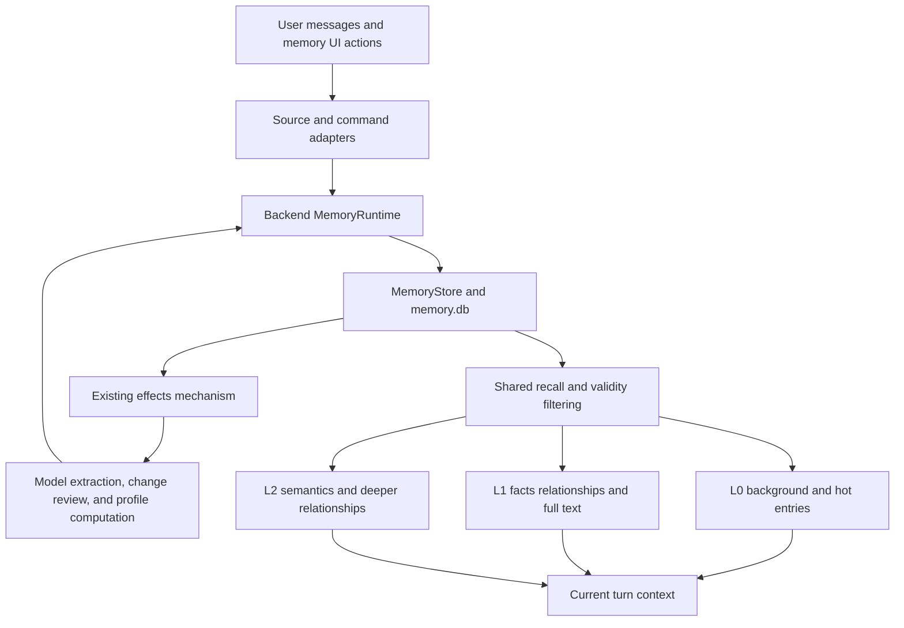

# Viva Long Term Memory Implementation Plan

> 2026-11-16: All further memory development and sequencing follows the [file memory and independent plugin plan](memory-reme-plan.md). R1/R2 completed their experimental scope and P1 core extraction is complete. P2 standalone-plugin and R3 document-dream implementation and acceptance are complete; R4, R5a and R5b remain. M1–M4 here document the old fact-store implementation and its authorization, evidence, forgetting and request barriers. They are historical reference, not the active delivery schedule or a substitute for acceptance of the new phases.

English | [简体中文](memory-design.zh-CN.md)

Revised on 2026-11-14. M1 and M2 include open-predicate extraction, separate model review of changes, timeline undo, and on-demand clarification. M3 implements layered recall, relation expansion, and index rebuilds. M4 adds evidence-linked user and project summaries, recoverable deletion cleanup, and tests for process death and request replay. The [system design](system-design.md) describes the current implementation.

Viva's long-term memory must cover the full lifecycle: extraction, admission, writing, updates, conflict resolution, forgetting, and recall. The central decision is to give the backend `MemoryRuntime` ownership of memory while models only propose candidates. Accepted memories retain their sources, scope, valid time, and revision. Facts, relationships, and profiles share one canonical fact store. L0, L1, and L2 describe access paths from fastest to slowest.

Implementation proceeds through M1 write governance, M2 updates and conflicts, M3 layered recall, and M4 profiles and recovery acceptance. First ensure that memories are written correctly, can be changed and forgotten, and cannot be corrupted by work resumed after a restart. Then improve recall coverage and speed.

## 1 Goals and scope

Memory should help Viva retain facts, preferences, and project agreements explicitly expressed by the user, together with the conditions under which they apply. “Give me the conclusion first this time” affects the current task. “From now on, give the conclusion first when answering technical questions” establishes an ongoing preference within technical questions. “Remember that I may move to Hangzhou next year” records a plan with a time and uncertainty; it must not become “the user lives in Hangzhou.”

The first version must satisfy these constraints:

- Unsupported model guesses cannot become facts about the user, and the assistant's own suggestions cannot become user authorization.
- Temporary requests cannot automatically become global preferences. Repetition cannot automatically widen their scope.
- Facts, entity relationships, and profile summaries cannot maintain conflicting independent versions of the truth.
- After a user edits, corrects, or forgets a memory, old extraction jobs, vectors, and profiles cannot overwrite the new state.
- All automatic injection and recall apply the same scope, time, retention, and revision checks.
- Routine extraction and explicit memory operations happen automatically. Clarify ambiguity when it affects current use, without adding approval to every memory.

The first version uses local SQLite and covers one Viva data directory. The same credential exclusion applies to automatic collection and explicit saves, including passwords, keys, and verification codes. The first memory contract starts with an empty database. See section 13.1 for the data scope.

## 2 Previous implementation and reasons for the redesign

| Area | Previous behavior | Current implementation or planned work |
| --- | --- | --- |
| DSH memory plugin and tools | Opened the database directly, ran extraction after a turn, and accepted model tool calls as permission to save or forget | The [DSH adapter](../plugins/memory/lib/adapter.ts) forwards tool requests and runs model computations. The [plugin-owned Node owner](../src/memory/node/owner.ts) binds provenance and authorization, acknowledges intake after persistence, and recovers queued work; Viva accesses it through a client. |
| Storage and provenance | Matched duplicate text globally and could revive inactive rows. Attached conversation provenance by timestamp | The [memory store](../src/memory/node/memory-store.ts) keeps source versions, evidence spans, change history, and revision checks. |
| Extraction and updates | The model proposed facts without original spans, scope, or validity dates. A proposal could replace an entry by referring to an ID shown to the extractor | The [shared contract](../src/memory/contracts/memory-contract.ts) carries proposed facts and change evidence. The backend verifier (`memory-facts.ts`) checks original text, applicability, and whether it supports the proposed change. |
| Recall and context | Combined fixed context, name matching, and a session-local retrieval history | The runtime checks scope, validity, and retention before keyword recall (`memory-match.ts`) and [context formatting](../src/memory/core/memory-context.ts). Section 10 describes the planned retrieval layers. |
| Profile synthesis | Resolved contradictions using newer dates and could save a summary after its inputs changed | Context uses user-entered fields and validated excerpts. Section 11 describes how summaries are generated and rechecked before use. |

Prompt instructions guide model behavior. The Viva backend controls authorization, source validation, and concurrent writes.

## 3 Architecture and write boundaries



| Component | Responsibility | Outside its responsibility |
| --- | --- | --- |
| `MemoryRuntime` | Admission, permission and scope binding, commands, update decisions, scheduling, and recall entry points | Performing model generation itself |
| `MemoryStore` | SQL, transactions, constraints, revision checks, and storage queries | Inferring user intent or deciding factual credibility |
| Extraction, change review, and profile functions | Propose facts with evidence, assess effects on existing facts, or produce derived content | Write accepted memories directly or identify themselves as the user |
| Recall module | Combine structured, keyword, and semantic candidates with shared filtering and ranking | Correct facts independently or relax forgetting rules |
| dsh memory plugin | Register tools, correlate source IDs assigned by the Viva backend, run model computations, and inject context returned by Runtime | Hold a database write connection or decide admission independently |
| Memory UI | Show evidence; edit, correct, forget, and restore | Upload an entire stale record as the basis for restoration |

`memory.db` remains separate for now to limit migration scope, with Runtime as its sole logical writer. Upgrade the plugin contract, configuration, and IPC together, removing the database write connection inside dsh. Adding Runtime while retaining the old plugin writer does not complete this change. Memory side effects reuse the [existing effects implementation](../src/backend/effects.ts), but their queue tables live in `memory.db` alongside memory state and commit through the same connection and transaction. Add only the transaction support and generation-scoped completion interface needed for this reuse. Do not create separate extraction queues, index queues, or a scheduling framework.

Records such as `memory.changed` in `app.db` are observations published after the memory transaction commits. They do not imply an atomic commit across both databases. When the UI reconnects or refreshes, `MemoryRuntime` snapshots and revisions are authoritative. Events wake refreshes; losing an event must not lose memory state. Failure to publish an observation cannot report a committed memory operation as unwritten or cause that business operation to run again. Events contain only IDs, revisions, outcome categories, and counts, not copies of memory text.

Model computation runs outside transactions. If the current implementation needs dsh's model routing, the plugin acts as a computation adapter without write authority, accepting requests with a job ID and generation. Runtime still validates and commits the result. Accepted work cannot be discarded merely because no session is currently active.

## 4 Data model and revisions

The following is an implementation contract. Field names may be standardized during implementation; the responsibilities and constraints must remain.

| Object | Required fields | Constraints |
| --- | --- | --- |
| `memory_sources` | `id`, `source_key`, session and message IDs, original author kind, content version and hash, necessary original text, `asserted_at`, `received_at`, processing outcome | Unique `source_key`. Source content is immutable. Explicitly replacing the same message creates a new version |
| `memory_candidates` | Source spans, atomic assertion, modality and qualifiers, proposed scope and time, target ID and revision, admission outcome and reason, expiry | Candidates cannot enter ordinary recall or profiles; extracted output is not an accepted fact |
| `memories` | Stable ID, revision, qualified assertion, kind, subject, optional predicate and object, scope, applicability conditions and exceptions, valid time, validity and retention states | The single canonical fact store; source relationships are held in a separate association table |
| `memory_evidence` | Memory ID, source ID and version, original spans for the atomic assertion and its subject, relation, value, and qualifiers, source purpose | Attach evidence to each fact. Record supporting assertions separately from interpretive context. Reattaching the same source is idempotent |
| `memory_entities` and aliases | Stable entity ID, type, canonical name, confirmed aliases | No automatic merging of similar names; entity rows hold identity, not separate factual truth |
| `memory_links` | Change ID, relationship kind, IDs and committed revisions of the target and any replacement, change evidence, applicable scope and time, undo state | Record traceable corrections, replacements, endings, and possible conflicts. Distinguish the validity asserted by a source from validity derived from a change. Undo refers to the change ID |
| `memory_projections` | Kind, scope, result, input set revision, dependency IDs and revisions, generator version | Profiles and vectors are rebuildable; they cannot become new factual sources |
| `memory_exclusions` | Minimal identifiers for forgotten records and sources, exclusion scope, category rules, user intent reference | Prevent revival from old inputs without retaining text the user requested to delete |
| `effects` and `memory_meta` | Work kind, key, generation, retry metadata; content revision and contract version | Reuse effects for work state rather than duplicating a job state machine in candidates |

Facts and relationships share storage. For example, “the user is responsible for Viva” is a memory with `subject=user / predicate=responsible_for / object=project:Viva`, together with its original assertion and evidence. It does not create a second truth in a separate graph store. When reliable structure is unavailable, retain the sourced original assertion rather than guessing to fill a triple.

Scope is a discriminated union: `user`, `project(projectId)`, `conversation(conversationId)`, or `task(taskId)`, also bound to the current user's identity. A directory is input to project resolution, not a permanent project ID. An unknown project cannot fall back to global user scope. Cross-project recall requires an explicit current request.

Scope defines data ownership and isolation. The technical topic and exception in “give the conclusion first for technical questions, except in casual chat” are separate applicability conditions. Store them with the accepted memory and check them during recall and application. If a condition cannot be evaluated reliably, the qualified original assertion may be returned as reference material, but must not activate unconditionally as a behavioral preference. The first version does not add a general rule engine for these conditions.

There are three kinds of time: `asserted_at` records when the statement was made, `valid_from/valid_to` when its content applies, and `received_at` when the system received it. Resolve relative dates using the timezone at the time of the message while retaining the original wording. Unknown boundaries remain unknown rather than becoming indefinite validity. Having no end time does not mean a statement is true forever.

Keep these states separate:

- Candidate admission: `pending / accepted / rejected / expired`.
- Accepted memory validity: `active / superseded / retracted`. Expiration is evaluated at query time. An unresolved relationship projects `disputed` for the scope, conditions, and time being queried.
- Retention: `retained / forgotten`; after text is fully deleted, retain only necessary exclusion identifiers.
- L0, L1, and L2: access paths, not credibility or persistence states.

Initially maintain one persistent content revision counter. A transaction that changes memory semantics or visibility increments it once, and affected records carry that revision. Building derived indexes, retrying jobs, and reading do not increment content revision, so profile rebuilding does not trigger itself.

Revisions protect concurrent user edits and input snapshots. An effect generation isolates old results after work is replaced or cancelled; ordinary retries keep that generation. A session's `compactionEpoch` controls context reinjection only. These three versions must not be interchangeable.

Initial indexes cover the unique source key, memories by scope and validity, subject and predicate, reverse lookup by object entity, candidate expiry, and both directions of the memory-source association. Full-text and vector indexes are derived indexes, not write entry points.

## 5 Source receipt and extraction

### 5.1 Source receipt

In M1, the Viva backend determines provenance at the user entry points. Main conversation messages (including the desktop island), interjections, question-card answers validated by the Viva backend, and manual writes in About You get a stable source ID before forwarding to dsh or reporting completion. The sender generates an operation ID before the first submission and keeps it on retries. The Viva backend validates the operation and binds it to its source. Bind each answer to its request ID, individual question ID, and actual answer, and accept it before releasing the dsh question waiter. Text and images are handled separately. M1 automatically collects text.

The Viva backend binds the actual author, logical conversation, message, project, and allowed scope. dsh's `source.kind = 'user'` describes the runtime message role. Task briefs, scheduled prompts, excerpts carried into resumed conversations, and tool results are context with their own source kinds. An interjection resent as a prompt, a message copied into a fork, and a historical reference retain the original source ID. An ordinary fork keeps the original branch's evidence. Only explicit replacement or deletion of an original message withdraws its source.

A source key consists of the stable message or operation ID assigned by the Viva backend and the content version, with the original conversation association retained. Resending the same key returns the existing receipt. A different content hash for the same key is a protocol error. Split long messages at complete semantic boundaries and preserve original offsets and qualifiers. M1 automatically saves project memories only when the Viva backend can establish the project identity. Entries with an unknown project remain candidates or use an explicit current conversation or task scope.

Source text is immutable, but its withdrawal state can change. Editing or deleting a message withdraws its old version, invalidates related candidates and work, and rechecks dependent memories in one memory transaction. Only memories with other valid independent evidence may remain in use. The edited version passes through admission separately. Replaying an old version returns its withdrawn outcome without queuing work that could revive it.

Necessary source text remains recoverably readable until extraction finishes. After processing, the source retains only the passages needed by accepted evidence, change history, and pending candidates, with stable offsets for each. Candidate expiry triggers cleanup even while the app is idle. The original content hash remains available for replay validation.

### 5.2 Extraction inputs and outputs

Extraction inputs include the current user content, bounded adjacent context, exact question-answer associations, and the IDs and revisions of relevant existing memories. Assistant messages serve only to resolve references. Web pages, files, and reported statements retain their authors and source kinds. In M1, skip any whole source or context block containing a detected credential, keeping only the IDs and rejection reason needed for idempotency. Compute content hashes only for original text admitted to memory storage. Also validate candidate and summary outputs before admitting them.

```ts
interface CandidateProposal {
  sourceId: string
  spans: Array<{ start: number; end: number }>
  assertion?: string
  modality: 'asserted' | 'planned' | 'hypothetical' | 'reported'
  fact?: {
    predicate: string
    subjectSpan?: { start: number; end: number }
    relationSpan: { start: number; end: number }
    valueSpan: { start: number; end: number }
    polarity: 'affirmed' | 'negated' | 'uncertain'
    qualifierSpans: Array<{ start: number; end: number }>
  }
  proposedScope: Scope
  temporal: TemporalContext
  contextSourceIds: string[]
  change?: {
    kind: 'correct' | 'supersede' | 'end' | 'possible_conflict'
    target: { memoryId: string; expectedRevision: number }
    evidenceSpans: Array<{ start: number; end: number }>
  }
}
```

`Scope` and `TemporalContext` follow the contract in section 4. Spans are UTF-16 half-open intervals `[start, end)` in the immutable source text, not in a model's abbreviated rendering. Chunked input carries an explicit mapping to original message offsets.

The extractor proposes atomic assertions and their conditions, and can describe how they relate to earlier records. A change proposal refers to a record and revision shown in the extraction input and identifies original spans that express the change, identify the old content, and qualify the effective time. A new fact requires an assertion and its evidence. A replacement also requires a new value. A correction or ending can supply change evidence without a new value. Model-proposed actions and relationships remain proposals. The Viva backend verifies authorization against the genuine user source. Treat instructions embedded in the material as data, including when the material is wrapped in JSON.

The model reads complete passages with the necessary context. It identifies assertion boundaries, subjects, relations, negation, time, conditions, exceptions, and quotation attribution, and returns source spans supporting those judgments. Retire predicate-specific cases, word lists, and clause-splitting regular expressions that decide these semantics. Chunking preserves the text governed by conditions, quotations, and exceptions. Multiple spans can jointly support an assertion across clauses. If meaning or scope remains unclear, retain the proposal as a candidate. Question-card options and the user's selection apply to the current turn by default. Persisting a selection requires explicit lasting intent and its user source.

### 5.3 Admission sequence

1. The Viva backend binds the source, author, and accessible scope, checks source status, and prepares input filtered for credentials.
2. The extraction model proposes facts with original evidence, distinguishes self-reports from plans, hypotheticals, quotations, examples, and reported speech, and preserves negation, frequency, time, conditions, and exceptions.
3. The backend validates the output schema, source revision, original spans, and authorized scope. Proposals whose meaning or scope remains unclear can stay as candidates or be discarded.
4. Check for duplicates and find potentially affected records. Ordinary new facts use one extraction call. Proposals that change the validity or availability of existing memories receive one additional review under section 7.2.
5. Commit facts, evidence, change history, invalidations, and completion of the current effect in a transaction with revision checks.

**Matching source text proves provenance, not the correctness of the model's interpretation.** Automatic acceptance must preserve enough of the complete source assertion to express its original meaning. Free paraphrases may serve as display or retrieval projections, but cannot replace the canonical fact. If an ambiguous paraphrase cannot be validated, retain the original wording or do not admit it. Model scores can help rank candidates, but cannot replace admission rules.

## 6 Admission and retention policy

| Input kind | Handling | Ordinary recall and profiles |
| --- | --- | --- |
| An explicit “remember,” with a clear subject and scope | Save automatically, preserving conditions, time, and uncertainty | Recall is allowed; plans and other modalities keep their original meaning |
| “From now on, give the conclusion first for technical questions” | Save a preference scoped to technical questions | Use within its applicable scope |
| A clear, stable self-report suitable for future use | Save as a user assertion with time and evidence | Allowed, without labeling it a permanent objective fact |
| “Give the conclusion first this time” | Current task constraint, persisted only in task scope if necessary | Excluded from the global profile |
| A project decision or temporary project state | Project scope with explicit conditions of validity | Only in the relevant project's context |
| Model guesses, psychological interpretations, or assistant suggestions | Do not admit as memory | Excluded |
| Quotations, hypotheticals, or third-party reports | Preserve modality; save only for an explicit memory purpose | Not presented as user self-reports or certain facts |
| Unclear subject, entity, scope, or time | Keep as a candidate or skip; clarify when needed | Excluded |

Initial candidate retention is 7 days, with task candidates allowed to expire earlier when the task ends. This is a configurable default. Clear expired candidate text while retaining the processing outcome and necessary idempotency identifiers to prevent repeated extraction of the same source. Promotion requires new explicit evidence, a user edit, or a conclusive rule evaluation. Elapsed time and repeated retrieval do not promote candidates.

An explicit save means the user wants retention; it does not automatically mean global scope, permanence, or certainty. Current task requirements may temporarily override behavior without rewriting the user's existing long-term preferences.

## 7 Deduplication updates and conflict resolution

### 7.1 Deduplication and entity identity

A retry of the same source is the same processing attempt and must not increase evidence weight. A user independently restating something in another message can add assertion evidence, but multiple agents repeating the same original statement still share one origin. Repetition counts, invocation counts, and independent evidence counts are not interchangeable.

Content normalization finds possible duplicates. A global `norm UNIQUE` constraint must no longer merge memories across scopes, times, or authors. Identical text cannot revive a forgotten memory through `touch`. Matching names or nearby vectors only produce entity match candidates. Merging requires an explicit alias or reliable project binding, and the merge retains provenance and revisions.

### 7.2 Update semantics

| Situation | Operation | Meaning of the old record |
| --- | --- | --- |
| Additional detail without contradiction | Add evidence or a related atomic fact | The original content remains valid |
| “I misspoke. I was on the Risk team at the time” | `correct`, mark the old assertion `retracted`, and link a corrected value when one is supplied | The mistaken assertion remains in the change history. The corrected value applies to the corrected interval by default, with any explicit time correction taken from the new evidence |
| “Starting today I transferred from Payments to Risk” | `supersede`, end the old state and activate the new state at the effective boundary | Dated recall can still return the old fact for times before the boundary |
| “Starting today I no longer own the weekly report” | `end`, close the old responsibility at the effective boundary | The earlier responsibility remains queryable and the new owner is unknown |
| Different projects, non-overlapping conditions, or compatible values | Preserve the facts with their respective scopes and conditions | Each remains usable when applicable |
| Evidence suggests incompatibility, but the type of change is unclear | Record a `possible_conflict` and keep evidence for both claims | Withhold certainty only within the scope and time where the claims may be incompatible |

Predicate keys are open-ended. Predicate keys, entity names, and similarity help retrieve candidates. The backend requests a separate model review for automatic corrections, replacements, and endings, and for possible conflicts that would suspend use of an existing fact. Each review verdict binds to a draft containing the source, the full proposal, the target revision, both sets of conditions, and the proposed interval. An automatic correction, replacement, or ending must identify a unique target. Keep the old fact if the evidence remains ambiguous. A failed model call or unusable response leaves the work pending for retry. Admit independently supported new assertions through the ordinary path. Keep other proposals as candidates for clarification when needed under section 10.

Suppose the user's team in `#17@r5` and weekly report recipient in `#23@r2` are both Payments. The user says, “Starting at midnight on November 16, I'm transferring from Payments to Risk.” Extraction marks the old value, new value, and date. Review identifies `#17@r5` as the team membership that changes. The backend resolves November 16 at midnight in the message's timezone to the effective instant `T` and verifies that `#17@r5` applied immediately before `T`. If a confirmed transfer to Data already takes effect on November 20 in the same team timeline, Risk applies from `T` until that existing boundary. `#23@r2` remains valid.

The backend resolves structured date and boundary values against the timestamp and timezone stored with the source. A change explicitly described as taking effect now can use the source timestamp. A correction can target an ended historical fact and recomputes only the interval supported by the evidence. A replacement or ending requires the old fact to apply immediately before the effective instant. A future change enters the current state when that instant arrives. Keep event-based conditions such as “after the release is complete” verbatim and pending until the condition can be verified. If the boundary is unresolved, retain the old fact and the pending proposal.

Record the old value's retirement interval separately from the new value's validity. When the new value expires, the old value applies again only if the source supports a temporary replacement or resumption. A semantic review can confirm equivalent condition wording. Deletion uses the old-value spans tied to the reviewed source and preserves the new value's own qualifiers and independent evidence.

```text
snapshot = loadSourceAndAuthorizedCandidates(sourceId)
proposal = extractWithModel(snapshot.source)
review = none
if proposal.affectsExistingMemory:
    review = reviewWithModel(snapshot.source, proposal, snapshot.candidates)
    if review does not support the proposed effect:
        proposal = keepIndependentFactsAndRecordPendingChange(proposal)
        review = none

transaction:
    if receiptExists(operationId):
        return savedReceipt(operationId)
    requireCurrentSourceAndEffectGeneration(snapshot)
    requireEvidenceSpansMatchOriginalText(proposal, review)
    if proposal.affectsExistingMemory:
        requireReviewMatchesSnapshotAndProposedWrite(review, snapshot, proposal)
        requireCurrentTargetRevisionsAndAuthorizedScope(review)
        requireApplicableIntervalAndPreserveOtherChanges(review)
        writeChangeWithEvidenceAndUndoHistory(review)
    else:
        saveSourcedFactsAndCandidates(proposal)
    writeInvalidationsAndSaveReceipt(operationId)
    completeCurrentEffectGeneration(snapshot)
```

Provenance and revision checks constrain the record and interval a commit can change. The semantic review can still misinterpret the source. Evaluate shared values across different relations, paraphrases, conditions spanning several clauses, and quotations with real models.

### 7.3 Concurrent writes and undo

Every change to an existing memory carries `expectedRevision`. Check the change source, affected record revisions, and the candidate scope used in the decision within the commit transaction. A mismatch returns `conflict` with current record references, or triggers a fresh read and computation for a background job. Commit the old and new facts, the change relationship, validity intervals, dependent invalidation, and job completion in one transaction.

An edit in the UI creates a new user source and preserves the original author. Old records, replacement relationships, and necessary evidence support explanations. A request to delete text covers these historical copies too.

About You lists automatic corrections, replacements, and endings with before and after values, original evidence, applicable time, and an undo action for each change ID. Undo is a new, user-authorized, idempotent operation with revision checks. The backend removes the change and effects supported only by it, then recomputes the timeline and current state from original assertions and other valid changes. A new value supported only by the undone change leaves the current fact set. If it has independent evidence, keep it and recheck its relationship to other facts. Later changes and existing forgetting and deletion decisions remain part of the checks. If current changes prevent a safe undo, return the affected current records for review. Keep the minimum marker needed to prevent same-source retries from reapplying an undone change. Withdrawing the only source for a change also requires rechecking the validity intervals and states derived from it.

## 8 Forgetting withdrawal and deletion

| User intent | System action |
| --- | --- |
| “That is no longer the case” | End validity or replace the old state, while allowing explicit historical queries |
| “That was remembered incorrectly” | Correct it; the old content cannot remain a historical truth |
| “Stop remembering this” | Stop automatic use immediately and record minimal exclusion identifiers |
| “Delete this content” | Stop use and clean up text, evidence copies, profiles, indexes, and caches controlled by the memory system |
| “Do not save this kind of information again” | Add a collection exclusion rule for the category and scope |

The forgetting transaction updates retention or exclusion records, cancels related work, invalidates dependent profiles, and increments content revision. After commit, L0 and other caches are invalidated. Even if running computation cannot actually be cancelled, its commit must recheck sources, revisions, and exclusion rules.

Exclusion records retain only the stable IDs, source references, and necessary normalized identifiers needed to block replay. They must not preserve deleted text under another field name. An identical string alone must not permanently ban every future statement: the same old source cannot revive memory, while a new explicit save or restore request follows a separate admission path. If a “stop collecting this category” rule exists, the new request must first resolve its relationship to that rule.

Users can explicitly request forgetting in chat or in About You. Clear new statements can update validity according to the correction and state-transition rules in section 7. M1 applies no automatic forgetting based on use frequency or idle time.

Memory injection, model-facing history search and reading, continuation from saved records, and session resume share the exclusion policy. Filter search hits, neighboring messages, previously returned tool results, and derived content that depends on withdrawn sources. Users can still open retained original chats in Review. M1 uses source references and dependencies to identify affected content. Omit an entire derived block when the contribution from an affected source cannot be isolated. If dependencies in an affected session cannot be verified, continue with only verifiable user messages and freshly generated, valid memory context.

Deleting a database record cannot retract a model request that has already been sent. Coordinate any change that makes an existing fact unusable with new requests from affected sessions, including automatic corrections, replacements, possible conflicts, undo, forgetting, and source withdrawal. The Viva backend coordinates dispatch from affected sessions with the invalidation commit. A dispatch barrier covers the dependency and validity check through sending so a request with stale dependencies cannot be sent after commit. Cover later steps in the same turn, retries, tool returns, compaction, resume, and forks. When rebuilding is necessary, freeze affected request paths and cancel turns that used stale material as needed. Routine automatic updates do not restart all sessions. If dependencies cannot be verified, resume potentially affected sessions from filtered records. When a plugin tool requests forgetting, the Viva backend coordinates cancellation outside the tool call to avoid waiting for that same tool to finish. On restart or resume, check the latest exclusions.

Task briefs, follow-ups, and persisted schedule prompts carry the source and revision dependencies of the context used to write them. Recheck them when delivering the prompt and before the actual provider request. A stale brief or schedule is held for a fresh instruction. If a request already holds permission to send, a mutation affecting its dependencies waits for that send to settle. Unrelated requests can proceed. When a conversation needs rebuilding, continue the same Viva topic in a new DSH session seeded with filtered records. Resuming or forking an affected old session uses the same path. If preparation fails, leave the original topic readable and offer a retry. Verify the actual next model request.

Original-message delivery receipts are independent of memory admission. A delivered message that fails credential filtering can still be withdrawn by stable ID without storing the credential text or its hash. Background and scheduled runs with dependencies wait for a DSH instance that can enforce the dispatch barrier. A scheduled result carries the dependencies it used during execution. Recheck these at publication, retry, and continuation from Updates. The copied result is derived context, and stale results remain readable in Updates.

The UI distinguishes “no longer used” from “application-controlled memory copies cleaned up.” The latter requires cleanup work and checks of the memory store, derived indexes, and caches. Original chats, operating system backups, external model services, and user exports follow their respective retention rules. Chat deletion uses the history deletion flow. A memory supported only by a deleted message also stops being used. Undoing chat deletion restores the original chat in the app. Model reads still apply the exclusion policy, and restoring memory requires an explicit restore operation. Deleting an individual memory cleans the copies held by the memory system according to that fact's evidence and preserves other facts with independent valid support. The deletion transaction queues cleanup. Completion verifies affected source spans, index revisions, and profile references and requires a successful SQLite WAL truncation. Supplemental assistant question text without dependency references may quote a deleted value, so deletion clears that text and retains the user's answers and receipts.

Saved routing plans can contain task briefs or follow-up text. They remain with chat and task history for diagnostics. Recovery can inspect their status without replaying the plan text or rerunning its actions. Clearing memory copies does not delete these diagnostic records.

## 9 Durable receipt and background execution

### 9.1 Receipt protocol

```text
Source validated by the Viva backend
  → persist Source and extract effect in one memory.db transaction
  → commit
  → ACK
```

ACK confirms that the source and any applicable extraction work are durable. Candidate admission follows. A manual write commits the source and the memory change in the same transaction. If intake fails, chat can proceed and the memory intake reports an explicit failure. A caller retrying intake keeps the original source key. If ACK is lost after commit, the retry returns the existing receipt. Retrying memory intake does not resend the chat prompt.

Save each extraction's output together with the Source processing outcome, including `accepted / candidate / skipped / rejected`. Model or storage failures remain incomplete work or retries, rather than masquerading as “no memory.” An effect disappearing does not itself prove extraction succeeded.

### 9.2 Execution and commit

1. Read the effect key, generation, and input snapshot, recording source content versions, target memory revisions, and current content revision.
2. Run model, embedding, or summary computation outside the transaction. For proposals that affect existing memories, bind extraction and semantic review to the same source and candidate snapshot.
3. Begin a transaction in the same `memory.db`. Check the effect generation, the validity of the change source, the revisions of affected targets, the candidate scope, and the applicable exclusion rules.
4. Write admission results and derived invalidations, increment content revision where necessary, and complete only the current generation within that transaction.
5. After commit, wake subsequent effects and notify the UI to read a fresh snapshot.

Calling the existing `effects.holds` alone does not protect business writes; the check and result write must be in the same transaction. Existing `finish(kind, key)` completes whatever generation is current, so it must not be used for asynchronous computation results. Add a narrow interface that completes a specific effect generation, preventing an old request from deleting new work. Ordinary retries keep the current generation; replacement input gets a new one.

Summaries must check whether the input set changed, not only whether selected dependencies were updated. A newly added relevant fact can also make the old summary stale. The first version conservatively checks the global content revision. Introduce per-scope revisions only if measurements show frequent invalidation from unrelated changes.

### 9.3 Crash recovery and dependency validation

On restart, recover accepted sources and unfinished effects from `memory.db`, including those from closed or inactive conversations. dsh archives can help verify event association or supply context. Any archive read must match source IDs already recorded by the Viva backend and respect exclusions.

The existing [steer plugin](../plugins/steer/index.ts) is a reference for paginated reads of offline logs. M1 recovery starts at the Viva backend's source intake transaction. Test exit after source commit and before ACK, during computation, and during result commit.

Chat history and memory evidence retain separate storage owners. A history deletion or explicit replacement writes durable source-withdrawal work in the same `app.db` transaction as the history change. Section 8 covers session request admission. Until the withdrawal is applied to `memory.db`, the backend blocks affected model-facing reads and extraction commits. On startup, recover pending withdrawals before allowing related reads and extraction. Withdraw by stable ID idempotently and release the block only after success.

Initially allow one background model computation at a time to reduce contention with user interaction, and reuse the existing retry backoff. On exit, stop admitting new computations, cancel cancellable calls, and leave durable work for restart. When a model is temporarily unavailable, retain the work and its reason; conversation can continue using validated memories.

## 10 L0 L1 L2 recall

All three layers read the same canonical facts. They differ in query cost and coverage. Memories do not need promotion or relocation between three independent databases.

| Layer | Content read | Trigger | Initial constraints |
| --- | --- | --- | --- |
| L0 | Validated brief user background, current project summary, hot entities, and references in the current session | A new turn, relevant revision change, compaction, or reconstruction | Cache by scope and content revision; stop using stale entries immediately |
| L1 | Fact filters, confirmed aliases, direct relationships, full-text or keyword matches | Questions about an object, preference, time, or fact | Filter scope, retention, and time before retrieval; prefer direct relationships |
| L2 | Semantic neighbors, more distant relationships, historical evidence | Insufficient L1 results, synthesis across sessions, or explicit deep search | Bound elapsed time, nodes, and tokens; partial results are allowed |

The fixed pipeline is: resolve current scope and question → retrieve candidate IDs → merge and deduplicate → read current content from canonical records → filter retention, valid time, disputes, and revisions, and check applicability conditions → rank → produce an evidence package within the context budget. L0 hits also check revisions and temporal boundaries; they cannot bypass final filtering.

The vector index returns only memory IDs and their revisions. Hits for old revisions are discarded; stale text stored in an index cannot be sent directly to the model. Embeddings record the model identifier, dimensions, and content version, and are rebuilt after configuration changes. An unavailable index falls back to L1 without affecting writes or forgetting.

Full-text cases cover Chinese, English, short names, and project codes. Run the [local comparison script](../scripts/memory-embedding-check.ts) to compare full-text and keyword recall with actual E5 retrieval. Installed macOS acceptance runs inference and restart checks from the mounted DMG. The Windows package workflow runs the same checks after installation.

Default relationship expansion is one hop. Explicit deep search allows at most two hops and 50 visited entities. Every edge carries its original fact and time; connected paths do not justify inferring new facts. User profiles do not expand through an unbounded graph.

The initial budgets below are design targets. Measure p50 and p95 on target machines before adjusting them:

| Item | Initial value |
| --- | --- |
| Total memory injection budget for a normal turn | About 2,000 tokens shared by L0 and recalled results |
| Explicit deep search budget | About 4,000 tokens, configurable |
| Warm L0, L1, and local L2 query targets | About 5, 50, and 500 ms respectively |
| Embedding and remote model latency | Measured separately and included in the end-to-end waiting budget |

Ranking first satisfies scope and validity constraints, then combines object matches, keywords, semantic relevance, and time. Recent use affects ranking, not credibility. Return relevant disputes separately, with the evidence, scope, and time for both claims. Automatic injection and profiles present only applicable, undisputed material as certain. Ask one specific question in the foreground only when the dispute would change the current answer or action, the evidence and current instructions cannot resolve it, and a useful conditional answer or an undisputed part cannot be completed first. Background work records the dispute and continues what it can. If the user chooses a value for this task only, apply it to this task. Update memory when the user gives an explicit lasting correction, change, or condition. Timeouts or limited results return `partial` with a reason, rather than claiming “the user has no such information.”

If review is uncertain and the original text still supports a grounded alternative for the same relation, a relevant foreground recall can return the alternative as provisional alongside the saved fact. The saved fact remains valid. Background recall may report the pending change and continue without the alternative. The backend checks source, scope, time, and record version again before showing the card or accepting an answer. At most one memory clarification is available per foreground turn. Ordinary cards are checked against relevant disputes in the operation before display. Their choices can supply task parameters. A memory clarification choice applies to that turn. When the user types a lasting correction, an independent review checks the lasting intent against the answer itself.

M3 uses indexes to select eligible candidates in the user scope and the exact current scope before reading candidate evidence and required dispute or pending-relation peers. Automatic injection and explicit recall share scope, revision, retention, source availability, and time checks. Evidence on hold for withdrawal still constrains its peers until the timeline is reprojected. Automatic injection uses a 3,200 UTF-16 code-unit limit for the entire block. Explicit recall uses a 6,000 code-unit limit for the serialized response, including evidence and metadata. It sends complete entries and dispute pairs and reports `partial` with `output-budget` when a packet does not fit. Dispatch checks dependencies for delivered facts and the dispute state used in the response.

M3 uses contentless SQLite FTS5 for full-text candidates. Tokenization preserves short Han names with unigrams and bigrams, Latin words, and project codes next to Han text. The index stores keyed token digests and record revisions. Exact matches take precedence, and canonical text is verified before use. When reliable matches are absent or indexing is unavailable, keyword fallback is bounded and incomplete coverage is reported. Dirty IDs commit with canonical writes, then refresh in batches at startup and after a manual rebuild.

When direct recall has no reliable match or the caller requests `deep`, an Electron child process uses the bundled int8 `Xenova/multilingual-e5-small` model. Embedding works offline and independently of the selected DSH model. Startup, memory changes, and manual rebuilds trigger idle backfill of missing 384-dimensional vectors. A search can encode relevant missing entries first, up to eight per batch. Full-text matches take precedence, and semantic candidates require source verification. Explicit project codes must match exactly. The six-second inference budget and separately bounded vector scan produce partial results when coverage, input size, or compute is limited. Model upgrades, rebuilds, revisions, and withdrawals invalidate affected vectors. In a source checkout, `npm run memory:prepare-embedding` stages release assets. On Apple Silicon, the bundled ONNX runtime requires macOS 14 or later. Earlier supported macOS versions use full-text and keyword recall. This paragraph records the historical M3 implementation. For R4 file retrieval and the current MiniLM release recipe, see section 15 of [the revised memory plan](memory-reme-plan.md).

Relation expansion loads neighbors by indexed subject or object within the same scope. Exact names and independently grounded evidence support a path, whose evidence and overlapping validity windows are included. Normal recall expands one hop, and deep recall up to two hops and 50 entities with a 12,000-code-unit response budget. In Chinese prose, use 「name」 to delimit an explicit entity. The request barrier persists path revisions, expiry, and historical date zones for revalidation on retries, restart, and handoff to background work.

## 11 Profiles and context injection

Generate user profiles and project summaries separately. Inputs contain only accepted memories currently allowed for use and information the user entered manually. Each output statement carries evidence IDs and revisions. Candidates, guesses, and unresolved conflicts cannot become certain descriptions, and a new summary must not be produced by repeatedly compressing the previous one.

M4 uses extractive summaries. A separate DSH computation selects and orders up to six items from at most 24 verified inputs. The model returns only supplied references. Viva validates their scope and revision and stores the references, generator identifier, content set revision, and expiry. It reads the canonical text again at delivery time. Manual fields have their own section. About You links individual statements to the original message when available.

Viva identifies a project using its verified Git worktree and Git administration directory. Symlinks to the same worktree share its scope. Separate worktrees, moves, and repository recreation establish different scopes. An unknown project cannot grant project memory writes or recall. DSH sessions keep their project identity across restarts. Changing projects starts a fresh session, and model history reads and background handoffs validate project access.

Invalidating a summary and regenerating it are separate operations. Once evidence is edited, withdrawn, or forgotten, stop injecting the old summary immediately. Until a new summary is ready, fall back to valid original entries. Do not wait for the next scheduled synthesis to remove incorrect content. Derived content still requires semantic fidelity checks; having references does not automatically prove a summary correct.

Injection receives the session ID, scope, content revision, `compactionEpoch`, and current question, then returns bounded context and references. Revalidate after compaction, a project switch, or recovery. Tracking only “this entity was already injected” is insufficient when its content has changed. Present memory as reference material; it cannot bypass current instructions, permissions, or tool policy.

## 12 Command interfaces and UI behavior

```ts
acceptSource(envelope)
proposeMemory({ operationKey, sourceId, proposal })
correctMemory({ id, expectedRevision, sourceId, correction })
supersedeMemory({ id, expectedRevision, sourceId, replacement, effectiveAt })
endMemory({ id, expectedRevision, sourceId, effectiveAt })
undoMemoryChange({ operationKey, changeId, expectedRevisions })
forgetMemory({ selector, expectedRevision, mode })
restoreMemory({ id, expectedRevision, intentRef })
recall({ query, scope, asOf, budget })
contextForTurn({ sessionId, turn, compactionEpoch, question })
```

These are domain interface sketches, not permission credentials a model may supply arbitrarily. Adapters bind user identity, genuine provenance, the current project, and accessible scope. A model can request only a subset of the scope allowed by the Viva backend. Restoration reads the record still retained by the backend. If its text was fully deleted, return that restoration is unavailable rather than accepting a stale object uploaded by the UI.

Memory mutation commands are idempotent by operation key. A selector covering multiple records first resolves to explicit IDs and their revisions, which are checked atomically before execution. Clarify ambiguous targets rather than deleting other projects' data through a broad phrase. Model-initiated forgetting or correction must still reference genuine user intent from the current turn; the model cannot manufacture `by: user`.

The Viva backend resolves explicit chat requests to save, correct, or forget from the current user source. Bind the write command to the operation, source ID, and specific target or original text span. When the user explicitly requests a memory operation and the target is ambiguous, ask which entry they mean. Ambiguities found by background extraction follow the on-use clarification policy in section 10. Main conversation routing can still grant a single tool invocation. MemoryRuntime separately verifies the target, scope, and user intent for the operation.

Retain external tool names such as `memory_remember / memory_recall / memory_forget` to reduce caller changes. Return structured outcomes: `accepted / scoped / candidate / rejected / conflict`, with available IDs, revisions, reasons, and references. Say “remembered” only after formal admission. Candidates can be shown as pending confirmation or retained silently, without a false completion message.

The memory UI must at least show content, provenance, scope, time, and current state, and provide editing, correction, stopping use, deletion, and restoration when available. About You provides automatic change history and undo. Historical and future disputes can be viewed for their applicable periods. Users can say both claims apply, reject both, or supply a new value. A resolution applies to the records and intervals the user identifies. Candidates can be viewed separately. Automatic changes and unresolved cases do not prompt for per-entry approval. Persistent failures use understandable status such as “Memory organization will retry later,” without exposing queue parameters as user tasks.

## 13 Implementation phases and removal of old paths

Each phase must provide a complete working write and read path. Remove the replaced path within that phase rather than maintaining long-term dual writes.

| Phase | Deliverables and completion conditions | Old paths removed in the same phase |
| --- | --- | --- |
| M1 Extraction and write governance | Backend intake durably queues sources before ACK. Runtime owns admission, evidence, scope, revision, editing, and forgetting. Commit results with current-generation completion. Reuse keyword recall and apply forgetting to history reads and session resume | Direct plugin database writes, direct `addMemory`, end-of-turn fire-and-forget, self-declared `by: user`, implicit revival of identical text, `claimChanges` provenance attachment, unversioned overwrites, and restoration from stale objects |
| M2 Updates and conflicts | Open facts, source-backed automatic corrections and replacements, on-use clarification, change history, and undo | The predicate table and its sentence, entity, and recall exceptions, and using `updatedAt` to decide truth |
| M3 Layered recall | Shared validity filtering for L0, L1, and L2; comparative full-text and vector validation; budgets, fallback, and index rebuilding | Different filters at each entry point, per-turn `allMemories` scans, and name-based injection that never refreshes |
| M4 Profiles and complete recovery acceptance | User and project summaries, statement-level evidence and input set versions, invalidation fallback, and end-to-end crash, cleanup, and performance acceptance | Unversioned summary overwrites, resolving contradictions by date, and continued injection of invalid profiles |

M1 pauses injection of model-generated profiles. It uses the user-entered profile and original memories that pass the shared validity checks. M1 verifies that edits and forgetting take effect and survive a restart. M1 keeps insufficiently supported proposals as candidates. M2 follows section 7 to distinguish admitting a new fact, changing an old one, and clarifying a dispute when it matters to a task. M3 extends retrieval. M4 delivers profiles with statement-level evidence and verifies copy cleanup.

The current layout follows the new plan: `src/memory/core` owns domain orchestration and rules, `src/memory/node/owner.ts` assembles the single owner, and `src/memory/node/memory-store.ts` owns transactions and queries. `plugins/memory` adapts DSH ingestion, tools and actual transport boundaries; the Viva backend retains clients, history transactions and presentation. Shared Node-free contracts live under `src/memory/contracts`. Prefer migrating and reusing existing code rather than retaining two memory services.

### 13.1 Initial data contract

There is no existing user data to carry forward. M1 uses an empty `memory.db` under the new contract. Development and acceptance tests start with an empty app data directory. Legacy database migration, import, backup restoration, and a legacy review UI are out of scope. Check the contract version on open and report a clear error for an incompatible database. Automatic collection starts with sources received by the Viva backend after the new contract is active. Update the system design when the M1 implementation ships.

### 13.2 Relationship to the overall architecture

This plan follows the existing direction of one backend business writer, publication after commit, and generation checks that isolate obsolete effects. Keep ACP and use the existing plugin channel for model computation, context reads, and session control. Verify the paths in section 15 before implementation.

### 13.3 M1 runtime behavior

The backend stores source receipts and owns the only production write path. The DSH adapter requests context, serves the native tools, and runs extraction on the configured model route. Automatic admission preserves a complete, bounded paragraph of the source. Uncertain proposals remain candidates for seven days. Confirmed answers retain their exact question and answer association. M1 scopes project-specific statements to the conversation when the Viva backend has no independent project identity.

The private DSH profile enforces the dispatch barrier in section 8. The stock profile without the memory adapter stops before committing changes that would retire its context. A rebuilt conversation sends verifiable user messages. Older assistant answers, tool results, and summaries remain available in Review. Editing a message during rewind withdraws the old source and admits the new message separately. If DSH is running without the memory adapter, the edit prompts for reconnection before starting. Chat deletion is recoverable through a durable withdrawal job. Restoring a chat restores its visibility and leaves the withdrawal in effect.

### 13.4 Target M2 behavior

The model proposes open facts and candidate changes from complete passages under section 5. Proposals that affect existing memories receive the review described in section 7.2. Automatic extraction, explicit chat saves, and UI actions share the Viva backend's constraints for provenance, scope, revisions, and commit. Manual or explicit saves can persist first and gain structure on the same entry in the background. Resolve time in the source timezone. Undated assertions that clearly describe a current state may apply from the time they were made. Ambiguous historical and future boundaries remain unknown.

Automatic corrections, replacements, and endings rely on source evidence, preserve change history, and support undo. A possible conflict remains scoped to the applicable context and period. The recall tool returns its evidence, and clarification follows the conditions in section 10. Dated recall returns applicable records for that day and preserves effective boundaries when a state changes within the day. Injection, recall tool results, and derived content all follow the session validity checks in section 8.

## 14 Acceptance cases and observability

| Case | Required result |
| --- | --- |
| “Be brief this time” | Applies only to the current task, not the user's long-term profile |
| “Give the conclusion first when explaining code from now on, but not in casual chat” | Preserve the domain limit and exception |
| “Suppose I lived in Shanghai,” or personal information inside a quotation | Do not extract it as a real fact about the user |
| The assistant's question contains several premises and the user answers only one option | Confirm only the proposition actually answered |
| “Remember that I may move to Hangzhou next year” | Save an uncertain plan without replacing current residence |
| Same-source retries, or three agents repeating one assertion | No additional independent evidence or duplicate writes |
| A model uses a valid tool name to request forgetting a target the user did not authorize | Reject the command and preserve the accepted memory |
| Resent interjections, forks, continuation from records, task briefs, and scheduled prompts | Retries keep the original source ID. Copied or appended context supplies no new user evidence |
| A source or neighboring context contains a synthetic key, including credentials in a URL | Credential text is absent from memory storage, background extraction requests, and diagnostics |
| Replay an old source version after its message is edited or deleted | The old version cannot continue supporting facts; dependencies are revalidated without revival |
| “I lived in Shanghai last year” is ingested after “I live in Hangzhou now” | Coexist with correct time semantics; ingestion order does not overwrite |
| The user works in Payments and joins a book club. In another case, the model supplies valid spans and the correct target ID and revision but uses “changed laptops” as evidence for a report email change | The first two facts coexist. In the second case, reject the change to the old email and any conflict based on that unrelated wording |
| The same email is described as linked in one statement and unlinked in another | Preserve the distinction between affirmation and negation. They supply evidence for separate assertions |
| “Starting tomorrow, change my weekly report email from A to B” | An open predicate updates automatically with evidence. A applies before the boundary, B applies after it, and A remains in history |
| The same change is phrased as “switch to,” “update to,” or “send everything to this address from now on,” with enough evidence to identify the target | The same semantic review produces equivalent changes |
| Payments is both the team and the report recipient. The user explicitly transfers to Risk, and a later transfer to Data already has a confirmed effective date | Update team membership only for the interval between the transfers. Preserve the report recipient and later timeline |
| “I take over scheduling once the release is complete,” a multi-line quotation, or a condition separated from its assertion by another clause | The event-dependent fact stays pending until the event is verified. Preserve the full quotation or condition, and avoid admitting it as an unconditional fact about the user |
| The user edits the target memory or withdraws the source after semantic review | Reject the stale write. Review a fresh snapshot after a revision change. End the job if the source was withdrawn |
| “The email A I gave last year was wrong. It was B then” | Last year's recall returns B and A appears only in the change history. The current email remains applicable |
| The user clearly ends an old responsibility or corrects an assertion without a new value | Close the old interval or mark the old assertion as incorrect. Preserve traceable history and leave the new value unknown |
| The same assertion appears in a quotation, hypothetical, or question-card option, or the evidence actually describes a third party | No automatic change to the user's facts and no scope expansion |
| The report email is disputed. The user first asks to edit the report and later needs its submission address | No question while editing. Ask once when the address is needed and neither the source nor current instructions can resolve it |
| Undo A→B when B has no independent evidence and no later change exists | A applies again, B leaves the current fact set, and the change remains visible in history |
| Undo A→B after an independent change to C, or when B has independent evidence | Cancel only the selected change and its effects. Preserve independent facts, recheck their availability, and prevent same-source retries from reapplying the change |
| Withdraw the only source of a replacement, or delete one of two facts supported by the same paragraph | Recompute derived end dates and retained fact text. Withdrawn content stays unavailable and the independently supported fact survives |
| An automatic change or undo runs while affected and unrelated sessions are active | Capture the next actual model request. Verify that stale injection, tool results, and derived content are filtered and that unrelated requests continue |
| An old extraction result returns after a user edit | Revision conflict prevents the stale overwrite |
| An old job returns or old chat is replayed after forgetting | Accepted memory, profiles, and indexes cannot revive it |
| A new relevant fact is added while a summary is generated | The old input set version cannot commit the summary |
| A vector hit uses an old revision or a different project | Final filtering rejects it without leaking stale text or out-of-scope content |
| The same entity appears again after compaction or an edit | Inject its current version with the correct scope |
| Kill the process around source commit, ACK, computation, and result commit | Committed sources remain processable and business results are idempotent. Uncommitted sources receive no success receipt |
| Restart after closing the conversation for an accepted source | Continue unfinished extraction without reopening the conversation |
| Crash after history deletion commits and before memory withdrawal | Apply pending withdrawal on startup before affected source content reaches a model |
| Forget during an active turn, then continue, resume after restart, or continue from records | Capture the next model request and confirm it contains neither excluded content nor dependent summaries or tool results |
| The user requests content deletion | Stop use immediately; copy-cleanup completion matches actual checks |
| L2 times out or is unavailable | Fall back to L1 with partial-result information; fact state is unchanged |

Tests have three layers: pure admission and update rule tests; transaction and crash tests using real SQLite with controlled model output; and real dsh, plugin-channel, and UI smoke tests on macOS and Windows. Evaluate semantic extraction separately with real models using fixed examples covering negation, conditions, quotations, short answers, and historical time. Deterministic transaction tests cannot substitute for semantic quality evaluation.

Key metrics are erroneous promotion into long-term memory, scope expansion, unsupported assertion admission, incorrect automatic changes, clarification frequency, state accuracy after undo, recurrence of corrected facts, recurrence after forgetting, recall precision, and end-to-end p95. Acceptance cases must have zero stale overwrites, cross-scope leaks, or revival through same-source replay. Record every semantic failure example rather than hiding these problems behind an average score.

Runtime diagnostics record intake backlog, the oldest unfinished source, candidate admission reasons, retry counts, revision conflicts, invalid summaries, and index coverage. Logs contain only IDs, revisions, counts, durations, and error categories, avoiding further copies of memory text or keys.

## 15 Prerequisites to verify

| Item | Validation | Implementation impact |
| --- | --- | --- |
| Propagation of source IDs assigned by the Viva backend | Trace normal sends, interjection fallback, question-card answers, forks, and continuation from records. Simulate a lost ACK and restart after session close | M1 intake contract and idempotency acceptance |
| Model computation calls from backend to plugin | Minimal experiments without an active session, during restart and cancellation, and with late results from an old generation | Determines the computation adapter's location without changing Runtime's write authority |
| Model context after forgetting | Isolated probes verified both paths in section 15.1. Repeat the live, resumed, forked, and history-continuation checks through the M1 forgetting entry points | M1 release condition |
| Request barrier for automatic changes and undo | Commit a change between checking and sending. Capture actual requests from later steps, retries, resume, and forks, and verify that unrelated sessions continue | M2 release condition |
| History withdrawal transaction boundary | Simulate crashes and concurrent reads between history deletion, memory withdrawal, and resumed reads | M1 release condition |
| Chinese full-text and vector approach | Fixed recall examples and Electron packaging tests on both platforms | Basis for M3 selection; retain keyword fallback until validated |

The first implementation batch is bounded by M1: close the source-receipt and write-governance loop while delivering basic recall of valid memories. Extend relationship recall, vectors, and profiles only after these boundaries pass their tests.

### 15.1 DSH session verification

On 2026-11-13, 12 isolated probe cases each produced their expected results on macOS with DSH `0.2.0-rc.2` and `0.2.2-rc.2`. The probes used temporary app data, a simulated model, and synthetic markers. Checks inspected requests received by the model endpoint.

- `agent/request` blocked the next step after a tool return and ran again when DSH retried the same step. `agent/pre-step` did not run again for that retry. Changing exclusions after the check and before dispatch let stale content through. When ACP cancellation reached DSH at that same point, the endpoint received no request from the paused turn.
- After an in-place replacement of DSH's model-visible messages, the next request omitted the synthetic summary, original text, and tool result. This held after restart and resume. Forking at a point before the replacement sent the original content again. M1 therefore stops and rebuilds affected sessions when continuing the topic.
- A new DSH session using filtered history kept the same Viva topic ID. The next request retained unrelated user information and omitted the excluded original text and its assistant paraphrase. This also held after restarting and resuming the new session, while the original chat remained readable from history storage.

The mechanism probes above used synthetic exclusion state. On 2026-11-14, local integration tests exercised committed replacement and on-demand clarification through real DSH against a simulated model. The model received the replacement in a fresh session, and neither a subsequent foreground step nor an Auto approval request could dispatch stale context. The tests also verified a dispatch at an elapsed validity boundary and a clarification choice that expires with the turn. [DSH integration tests](../test/memory-plugin.test.ts) · [Desktop memory smoke test](../test/smoke/smoke-memory.ts)

The integration test verifies the request path. The semantic quality of extraction with external models is a separate evaluation.


Local M4 acceptance includes real process death inside and around intake and result transactions, around the ACK, and during computation. It also covers cross-database recovery, continued history, project switches, request checks for background tasks and schedules, and resumed deletion cleanup after a blocked WAL checkpoint. [Crash tests](../test/memory-recovery.test.ts) · [DSH request tests](../test/memory-handoff.test.ts). On an Apple Silicon synthetic fixture, warm profile, full-text/keyword, and local semantic recall p95 were about 0.8, 1.7, and 5.1 ms, respectively. These [local measurements](../scripts/memory-embedding-check.ts) use a small fixture and exclude DSH round trips and remote generation.
