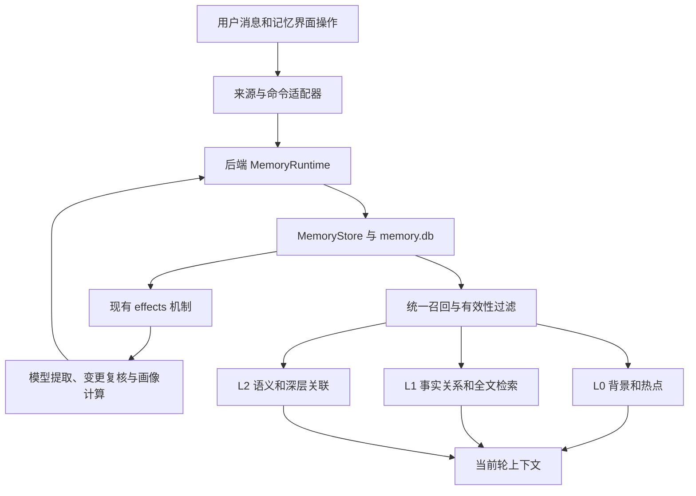

# Viva 长期记忆实施方案

[English](memory-design.md) | 简体中文

本文修订于 2026-11-14。M1 和 M2 已实现开放谓词提取、独立变更复核、时间线撤销和按需澄清。M3 的分层召回及 M4 的自动画像和完整恢复验收仍在计划中。现行实现见[系统架构设计](system-design.zh-CN.md)。

Viva 的长期记忆需要覆盖提取、准入、写入、更新、冲突消解、遗忘和召回的完整生命周期。核心决定是：由后端 `MemoryRuntime` 统一管理记忆，模型只提出候选；正式记忆保留来源、适用范围、有效时间和版本；事实、关系及画像共用同一份事实底座；L0、L1、L2 只表示从快到慢的访问路径。

实施顺序为 M1 写入治理、M2 更新与冲突、M3 分层召回、M4 画像与恢复验收。先保证写得对、改得动、忘得掉以及重启后不乱写，再提高召回率和速度。

## 1 目标和范围

记忆应帮助 Viva 记住用户明确表达的事实、偏好和项目约定，同时保留它们成立的条件。用户说“这次先给结论”，只影响当前任务；说“以后回答技术问题先给结论”，才形成技术问答范围内的持续偏好。用户说“记住我明年可能搬去杭州”，保存的是带时间和不确定性的计划，不能写成“用户住在杭州”。

第一版必须满足以下约束：

- 没有来源的模型猜测不能变成用户事实，助手自己的建议不能成为用户授权。
- 临时要求不能自动升级为全局偏好，重复出现不能自动扩大适用范围。
- 同一事实、实体关系和总结画像不能各自维护相互矛盾的真值。
- 用户修改、纠错或遗忘后，旧提取任务、旧向量和旧画像不能覆盖新状态。
- 任何自动注入和召回都执行相同的范围、时间、保留状态和版本检查。
- 普通提取与明确的记忆操作自动完成；只在歧义影响当前使用时澄清，不为每条记忆增加审批。

第一版使用本地 SQLite，范围限于单个 Viva 数据目录。密码、密钥、验证码等凭据排除在记忆采集之外，显式保存也受同一规则约束。首个记忆契约从空库开始，数据范围见第 13.1 节。

## 2 原实现和改造原因

| 环节 | 原实现 | 当前实现或后续计划 |
| --- | --- | --- |
| DSH 记忆插件和工具 | 直接打开数据库，轮次结束后提取，并将模型调用工具视为保存或遗忘的授权 | [DSH 适配器](../plugins/memory/lib/adapter.ts)转发工具请求、执行模型计算。[后端运行时](../src/backend/memory-runtime.ts)绑定来源和授权，持久化后确认接收，并恢复排队工作。 |
| 存储和来源 | 全局按文本去重，可能复活已失效的记录。用时间戳事后补绑会话来源 | [记忆存储](../src/backend/memory-store.ts)保留来源版本、依据跨度和变更历史，写入时校验 revision。 |
| 提取和更新 | 模型提议缺少原文跨度、范围和有效时间，可凭提取输入中见过的条目 ID 提议替换 | [共享契约](../src/shared/memory-contract.ts)携带事实提议和变更依据。[后端校验](../src/backend/memory-facts.ts)核对原文、适用条件和原文是否支持该变更。 |
| 召回和上下文 | 使用固定背景、名称命中和会话内检索历史 | 运行时校验范围、有效时间和保留状态，再进行[关键词召回](../src/backend/memory-match.ts)和[上下文格式化](../src/backend/memory-context.ts)。第 10 节描述后续的分层召回。 |
| 画像整理 | 按较新日期裁决矛盾，生成期间输入有变化仍可能写入旧摘要 | 当前上下文使用手填画像和符合条件的记忆。第 11 节描述后续带逐条依据和 revision 检查的画像整理。 |

提示词约束模型行为。Viva 后端负责授权、来源校验和并发写入控制。

## 3 架构和写入边界



| 组件 | 职责 | 不承担的职责 |
| --- | --- | --- |
| `MemoryRuntime` | 准入、权限和范围绑定、命令执行、更新决策、任务调度、召回入口 | 执行模型生成本身 |
| `MemoryStore` | SQL、事务、约束、版本检查及存储查询 | 推断用户意图、决定事实可信度 |
| 提取、变更复核与画像函数 | 从输入提出带证据的事实、复核对旧事实的影响或生成派生内容 | 直接写正式记忆、将自己标成用户 |
| 召回模块 | 组合结构化、关键词和语义候选，统一过滤与排序 | 自行修正事实或放宽遗忘规则 |
| dsh 记忆插件 | 注册工具、关联 Viva 后端分配的来源 ID、执行模型计算、按需注入 Runtime 返回的上下文 | 持有数据库写连接、独立决定是否入库 |
| 记忆界面 | 展示依据、修改、纠错、遗忘、恢复 | 上传整条旧记录作为恢复依据 |

`memory.db` 暂时保持独立，以控制迁移范围，Runtime 是它唯一的逻辑写入方。同步升级插件契约、配置和 IPC，移除 dsh 内的数据库写连接；仅新增一个 Runtime 而保留旧插件写库不算完成。记忆副作用仍复用[现有 effects 实现](../src/backend/effects.ts)，但其队列表与记忆状态一起放在 `memory.db`，用同一个数据库连接和事务提交。只为该复用补充必要的事务和按 generation 完成接口，不新建提取队列、索引队列或调度框架。

`app.db` 中的 `memory.changed` 等记录是记忆事务提交后的观察事件，不声称跨两个数据库原子提交。UI 重连或刷新时以 `MemoryRuntime` 的快照和 revision 为准；事件用于唤醒刷新，丢失事件不能造成记忆状态丢失。观察事件失败不能把已提交的记忆操作报告为未写入，也不能重新执行该业务操作。事件只记录 ID、版本、结果类别和数量，不复制记忆正文。

模型计算放在事务之外。如果现阶段需要复用 dsh 的模型路由，插件作为无写入权的计算适配器接受带 job ID 和 generation 的请求；返回结果仍由 Runtime 校验、提交。不能因当前没有活跃会话就丢弃已接收的工作。

## 4 数据模型与版本

以下是实现契约，字段名可在编码时统一；表的职责和约束必须保留。

| 对象 | 必要字段 | 约束 |
| --- | --- | --- |
| `memory_sources` | `id`、`source_key`、会话与消息 ID、原始作者类型、内容版本及 hash、必要原文、`asserted_at`、`received_at`、处理结果 | `source_key` 唯一。源内容不可原地改写，明确替换同一消息时产生新版本 |
| `memory_candidates` | 来源跨度、原子陈述、模态与限定词、建议范围和时间、目标 ID 与 revision、准入结果及原因、过期时间 | 候选不能进入普通召回和画像；提取结果不是正式事实 |
| `memories` | 稳定 ID、revision、带限定条件的陈述、种类、subject、可选 predicate 和 object、scope、适用条件及例外、有效时间、有效性和保留状态 | 正式事实的唯一底座；来源关系在独立关联表保存 |
| `memory_evidence` | memory ID、source ID 与版本、原子陈述及其主语、关系、值和限定语的原文跨度、来源用途 | 按单条事实关联证据；辅助理解的上下文与陈述依据分别记录；同来源关联幂等 |
| `memory_entities` 与 aliases | 稳定实体 ID、类型、标准名称、已确认别名 | 不按相似名字自动合并；实体表只保存身份，不另存事实真值 |
| `memory_links` | 变更 ID、关系类型、目标及可选替代项的 ID 与提交 revision、变更证据、适用范围及时间、撤销状态 | 记录可追溯的更正、替换、结束和疑似冲突。区分原文断言的有效期与由变更推导的有效期；撤销命令引用变更 ID |
| `memory_projections` | 类型、scope、结果、输入集合 revision、依赖 ID 与 revision、生成器版本 | 画像、向量等均可重建；不能作为新的事实来源 |
| `memory_exclusions` | 被忘记记录和来源的最小标识、排除范围、类别规则、用户意图引用 | 防止旧输入复活；不保留已经要求删除的正文 |
| `effects` 与 `memory_meta` | 工作类型、key、generation、重试信息；内容 revision、契约版本 | 工作状态沿用 effects；不在候选表复制一套任务状态机 |

事实和关系统一存储。例如“用户负责 Viva”是一条 `subject=user / predicate=responsible_for / object=project:Viva` 的记忆，也有原始陈述和依据；不再向独立图存储写第二份真值。无法可靠结构化的内容先保存带来源的原文陈述，不为了填满三元组而猜测。

范围使用判别联合：`user`、`project(projectId)`、`conversation(conversationId)`、`task(taskId)`，同时绑定当前用户身份。目录只是项目解析的输入，不能直接充当永久项目 ID。未知项目不能降级为用户全局范围；跨项目召回必须来自当前明确请求。

scope 表示数据归属与隔离；“技术问题先给结论，闲聊除外”中的技术话题和例外属于独立的适用条件。条件随正式记忆保存，在召回和应用时一起检查；无法可靠判断条件时，可以把带条件的原文作为资料返回，不能无条件激活为行为偏好。第一版不为这些条件建立通用规则引擎。

时间分为三类：`asserted_at` 是这句话何时说出，`valid_from/valid_to` 是内容何时成立，`received_at` 是系统何时收到。相对日期按消息发生时的时区解析，同时保留原始表述；无法确定的边界保持未知，不能填成永久有效。没有结束时间也不代表永远成立。

状态分开表示：

- 候选准入：`pending / accepted / rejected / expired`。
- 正式记忆有效性：`active / superseded / retracted`。是否过期由查询时间计算，`disputed` 由未决关系按查询范围、条件和时间计算。
- 保留状态：`retained / forgotten`；彻底删除正文后只保留必要的排除标识。
- L0、L1、L2：访问路径，不是可信度或持久化状态。

先只维护一个持久化的内容 revision 计数器，影响记忆语义或可见性的事务将其递增一次，变化记录携带同一 revision。派生索引的生成、任务重试和读取不递增内容 revision，避免画像重建自己触发自己。

revision 用于用户并发修改和输入快照检查；effect generation 只用于同一工作被替换或取消后的旧结果隔离，普通重试沿用 generation；会话 `compactionEpoch` 只用于上下文重注入。这三种版本不能混用。

初始索引包括来源唯一键、按 scope 和有效性查询的记忆索引、subject 与 predicate、object 实体反向索引、候选过期时间、记忆与来源双向关联。全文和向量索引是派生索引，不是写入入口。

## 5 来源接收与提取

### 5.1 来源接收

M1 由 Viva 后端在用户操作入口确定来源。主对话（含桌面岛）、插话、已通过 Viva 后端校验的问题卡回答以及「关于你」的手动写入，均在向 dsh 转发或报告操作完成前分配稳定的来源 ID。发送方在首次提交前生成操作 ID，并在重试中沿用。Viva 后端校验后建立操作与来源的绑定。回答同时绑定问题请求 ID、具体问题 ID 和实际答案，在向 dsh 解除问题等待前接收。聊天正文和图片分开处理，M1 的自动采集范围限于文本。

Viva 后端绑定真实作者、逻辑会话、消息、项目和允许范围。dsh 的 `source.kind = 'user'` 只描述运行时消息角色。后台委托、定时提示、历史续接附文和工具结果作为上下文，携带各自的来源类型。插话重送、会话分叉复制和历史引用沿用原始来源标识。普通分叉保留原分支的依据。只有明确替换或删除原消息才撤回旧来源。

源键由 Viva 后端分配的稳定消息或操作 ID 与内容版本组成，保留首次接收的会话归属。重发同一源键返回已有接收结果。同一键出现不同内容 hash 属于协议错误。长消息按完整语义段分块，保留原始偏移和限定词。M1 只有在 Viva 后端已能确定项目身份时才自动保存项目记忆。项目身份未知的条目留作候选，或按明确的当前会话或任务范围保存。

源正文不可改写，但源的撤回状态可以改变。编辑或删除消息时，在同一记忆事务中撤回旧版本、使相关候选和工作失效，并重新检查依赖记忆；只有仍具有效独立依据的记忆才能继续使用。编辑产生的新版本另行准入。旧版本重放只返回其已撤回结果，不能再次排队复活。

必要的来源正文在提取结束前保持可恢复读取。处理完成后只保留正式依据、变更历史和待确认候选所需的语段，各语段沿用原文偏移。候选到期会触发清理，包括应用空闲时。原文 hash 保留用于核验重放。

### 5.2 提取输入和输出

提取输入包括当前用户内容、有界相邻上下文、精确的问题与回答关联、相关旧记忆的 ID 和 revision。助手消息只用于解析指代。网页、文件和转述保留作者与来源类别。M1 对检测到凭据的来源或上下文块整块跳过，仅保留幂等所需的 ID 和拒绝原因。内容 hash 只对进入记忆库的原文计算。仍需校验候选和摘要输出，防止敏感内容进入正式记忆。

```ts
interface CandidateProposal {
  sourceId: string
  spans: Array<{ start: number; end: number }>
  assertion?: string
  modality: 'asserted' | 'planned' | 'hypothetical' | 'reported'
  fact?: {
    predicate: string
    subjectSpan?: { start: number; end: number }
    relationSpan: { start: number; end: number }
    valueSpan: { start: number; end: number }
    polarity: 'affirmed' | 'negated' | 'uncertain'
    qualifierSpans: Array<{ start: number; end: number }>
  }
  proposedScope: Scope
  temporal: TemporalContext
  contextSourceIds: string[]
  change?: {
    kind: 'correct' | 'supersede' | 'end' | 'possible_conflict'
    target: { memoryId: string; expectedRevision: number }
    evidenceSpans: Array<{ start: number; end: number }>
  }
}
```

`Scope` 和 `TemporalContext` 采用第 4 节的契约。跨度使用不可变原文上的 UTF-16 半开区间 `[start, end)`，不能指向模型缩写后的文本。分块输入显式携带原消息的 offset 映射。

提取器提出原子陈述及其条件，可以指出它和旧记录的关系。变更提议引用本次输入中展示过的旧记录及 revision，并标明原文中表达变更、指向旧内容以及限定生效时间的片段。新增事实需要陈述及其依据，替换还需要新值。更正和结束允许只有变更依据而没有新值。模型输出的动作和关系标签是提议，授权由 Viva 后端从真实用户来源核验。将材料包装为 JSON 也不能证明其中没有提示注入；材料里的命令始终按数据处理。

模型阅读包含必要上下文的完整语段，识别陈述边界、主语、关系、否定、时间、条件、例外和引文归属，并返回支持这些判断的原文跨度。退掉用于作出这些语义判断的谓词特判、词表和分句正则。分块要保留条件、引用及例外所约束的正文。跨分句的依据可以由多个跨度共同表示。无法可靠判定语义或范围时，保留为候选。问题卡选项及用户对选项的点击默认只适用于本轮，持久化另需明确的长期意图及其用户来源。

### 5.3 准入顺序

1. Viva 后端绑定来源、作者和可访问范围，检查来源状态，并准备经过凭据过滤的输入。
2. 提取模型提出具备原文证据的事实，区分自述、计划、假设、引文、示例和转述，并保留否定、频率、时间、条件和例外。
3. 后端校验输出结构、来源版本、原文跨度和授权范围。语义或范围仍不明确的提议留在候选或放弃。
4. 查重并查找可能受影响的旧记录。普通新增只调用一次提取模型。会改变旧记忆有效性或可用性的提议按第 7.2 节额外复核一次。
5. 在带版本检查的事务中提交记忆、依据、变更历史、失效标记及当前 effect 的完成状态。

**原文存在只能证明来源，不能证明模型概括正确。** 自动接受路径必须保留足以表达原意的完整来源陈述。自由改写可作为显示或检索投影，但不能替代事实底座；模糊改写无法验证时，保留原文或不入库。模型评分只能帮助排序，不能代替准入规则。

## 6 准入与保留策略

| 输入类型 | 处理 | 可进入普通召回和画像 |
| --- | --- | --- |
| 明确“记住”，对象和范围清楚 | 自动保存，保留条件、时间及不确定性 | 可召回；计划等仍按原模态表达 |
| “以后技术问题先给结论” | 保存为技术问答范围的偏好 | 在适用范围内使用 |
| 清楚且适合长期使用的稳定自述 | 保存为有时间与依据的用户陈述 | 可以；不标为永久客观事实 |
| “这次先给结论” | 当前任务约束，必要时仅按 task 范围保存 | 不进入全局画像 |
| 项目决策或临时项目状态 | project 范围，明确有效条件 | 只进入对应项目上下文 |
| 模型猜测、心理解读、助手建议 | 不进入正式记忆 | 不可以 |
| 引文、假设、第三方转述 | 保留模态；只有明确的记忆用途才保存 | 不能作为用户自述或确定事实 |
| 主语、实体、范围或时间不明 | 候选或跳过；需要使用时才澄清 | 不可以 |

初始候选保留期为 7 天，任务候选可以随任务结束提前过期；这是可配置默认值。过期候选清理正文，留下处理结果和必要的幂等标识，避免同一来源反复提取。候选升级必须获得新的明确证据、用户修改或确定的规则判断，不能仅因时间过去或被多次召回而升级。

用户显式保存表示需要保留，不自动表示全局、永久或确定。当前任务要求可以临时覆盖执行行为，但不因此重写用户已有的长期偏好。

## 7 去重 更新与冲突消解

### 7.1 去重和实体识别

同源重试是同一次处理，不能增加证据数量。同一用户在不同消息中独立重述可以增加陈述依据，但多个 agent 转述同一条话仍属于同一原始来源。重复次数、调用次数和独立证据数量不得混为一谈。

内容规范化用于寻找候选重复，不再使用全局 `norm UNIQUE` 来合并不同 scope、时间或作者的记忆。文本相同但一条已被遗忘时，禁止通过 `touch` 自动复活。实体同名或向量相近只生成匹配候选；明确别名或可靠的项目绑定才允许合并，合并操作也要保留来源和版本。

### 7.2 更新语义

| 情况 | 操作 | 旧记录的意义 |
| --- | --- | --- |
| 增加非矛盾细节 | 增补依据或新建相关原子事实 | 原内容仍成立 |
| “之前说错了，我那时在风控组” | `correct`，将旧陈述标为 `retracted`，有新值时关联更正项 | 错误陈述留在变更历史中。新值默认适用被更正的区间，用户明确修正时间时按新依据调整 |
| “从今天起，我从支付组调到了风控组” | `supersede`，从生效边界结束旧状态并启用新状态 | 边界以前仍可按日期召回旧事实 |
| “我从今天起不再负责周报” | `end`，从生效边界结束原职责 | 仍可查询此前的职责，新负责人保持未知 |
| 不同项目、适用条件不重叠，或两个值可以并存 | 分别保留事实、范围和适用条件 | 两条均按各自条件使用 |
| 确有互斥迹象，证据无法确定是哪种变化 | 记录 `possible_conflict`，保留双方依据 | 仅在可能互斥的适用范围和时间内暂缓当作确定事实使用 |

谓词键开放。谓词键、实体名称和相似度用于检索候选。自动更正、替换、结束，以及会暂停旧事实使用的疑似冲突，均由后端发起一次单独的模型语义复核。每条复核结论绑定一份草案，其中包含来源、完整提议、目标记录的 revision、双方条件和拟变更区间。自动更正、替换或结束须定位唯一目标。证据仍有歧义时保留旧事实。模型调用失败或返回不可用结果时，保留后台工作供重试。能单独成立的新陈述走普通准入，其余保留为候选，依第 10 节在实际需要使用时澄清。

例如现有 `#17@r5` 的团队和 `#23@r2` 的周报收件人都是支付组。用户说「11 月 16 日零点起，我从支付组调到风控组」。提取模型标出旧值、新值和日期，复核模型根据原文指出 `#17@r5` 的团队归属发生变化。后端将该消息时区的 11 月 16 日零点换算为生效点 `T`，核对 `#17@r5` 在 `T` 前仍有效。如果同一团队时间线已经确认 11 月 20 日起转到数据组，风控组只适用于 `T` 到 11 月 20 日的已有边界，`#23@r2` 继续有效。

后端以来源所记录的发送时间和时区为基准，解析模型给出的结构化时间和边界。明确描述现状发生变更时可用消息发送时间。更正可针对已结束的历史事实，只重算证据覆盖的区间。替换和结束须核对旧事实在生效点前适用，未来变更到点才进入当前有效状态。「发布完成后」等事件条件保留原文，在条件可确认前保持待生效。无法确定边界时保留旧事实及待处理提议。

旧值的停用区间与新值的适用区间分别记录。新值到期时，旧值只有在原文明确支持临时替换或恢复时才再次适用。语义复核可确认原文中的同义条件。删除用复核关联的旧值跨度清理副本，并保留新值自己的限定语和独立证据。

```text
snapshot = loadSourceAndAuthorizedCandidates(sourceId)
proposal = extractWithModel(snapshot.source)
review = none
if proposal.affectsExistingMemory:
    review = reviewWithModel(snapshot.source, proposal, snapshot.candidates)
    if review does not support the proposed effect:
        proposal = keepIndependentFactsAndRecordPendingChange(proposal)
        review = none

transaction:
    if receiptExists(operationId):
        return savedReceipt(operationId)
    requireCurrentSourceAndEffectGeneration(snapshot)
    requireEvidenceSpansMatchOriginalText(proposal, review)
    if proposal.affectsExistingMemory:
        requireReviewMatchesSnapshotAndProposedWrite(review, snapshot, proposal)
        requireCurrentTargetRevisionsAndAuthorizedScope(review)
        requireApplicableIntervalAndPreserveOtherChanges(review)
        writeChangeWithEvidenceAndUndoHistory(review)
    else:
        saveSourcedFactsAndCandidates(proposal)
    writeInvalidationsAndSaveReceipt(operationId)
    completeCurrentEffectGeneration(snapshot)
```

来源和版本检查能约束提交对象及区间。语义复核本身仍可能误判，需要用真实模型验证同值不同关系、同义改写、跨句条件和引文。

### 7.3 写入并发和撤销

所有针对旧记忆的修改携带 `expectedRevision`。提交时在同一事务中复核变更来源、涉及的记录 revision 和作出决策时的候选范围。版本不匹配时返回 `conflict` 和当前记录引用，或为后台任务重新读取并计算。新旧事实、变更关系、有效期、派生失效和任务完成在同一事务中提交。

用户在界面的编辑形成新的用户来源，不覆盖旧来源作者。旧记录、替代关系和必要证据支持解释；用户要求删除正文时，这些历史副本也在删除范围内。

自动更正、替换和结束均在「关于你」的变更记录中展示前后内容、原文依据和适用时间，并提供按变更 ID 撤销的入口。撤销是用户授权、幂等且带 revision 的新操作。后端撤去该变更及仅由它产生的效果，再用原始断言和其余有效变更重算时间线与当前状态。新值仅由被撤销变更支持时，退出当前事实。新值有其他独立依据时保留，并重新检查与其他事实的关系。已生效的遗忘、删除和后续更新继续参与校验。若当前状态已变化到无法安全撤销，返回受影响的当前记录供用户处理。保留阻止原变更被同源重试再次执行的最小标识。撤回变更的唯一来源时，也要重新核验由该变更推导的有效期和状态。

## 8 遗忘 撤回和删除

| 用户意图 | 系统动作 |
| --- | --- |
| “现在不这样了” | 结束适用期或替代旧状态，允许明确历史查询 |
| “之前记错了” | 纠错，不能继续把旧内容当作历史真相 |
| “别再记这件事” | 立即停止自动使用，记录最小排除标识 |
| “把这条内容删掉” | 停止使用并清理记忆系统控制的正文、依据副本、画像、索引和缓存 |
| “以后不要保存这类信息” | 增加类别与 scope 的采集排除规则 |

遗忘事务同时更新保留状态或排除记录、取消相关工作、使关联画像失效，并递增内容 revision。事务提交后 L0 和其他缓存失效；正在运行的任务即便不能真正取消，提交时仍必须重新检查来源、revision 和排除规则。

排除记录只保留阻止重放所需的稳定 ID、来源引用和必要的规范化标识，不把被删除正文换个字段继续保存。不能仅凭相同字符串永久封禁所有未来表达；同一旧来源不得恢复，用户新的明确保存或恢复请求通过独立准入路径处理。存在“停止采集此类内容”规则时，新的请求也要先解决与该规则的关系。

用户可以在聊天或「关于你」明确发起遗忘。系统根据明确的新陈述更新有效状态，按第 7 节处理纠错和状态变化。M1 没有按使用频次或闲置时间自动遗忘的规则。

记忆注入、模型的历史搜索与原文读取、历史续接和会话恢复共用排除策略。过滤覆盖搜索命中、相邻消息、已经返回的工具结果，以及依赖被撤回来源的派生内容。用户在「回顾」里仍可主动查看保留的原始聊天。M1 用来源引用和派生依赖识别受影响的内容。若无法隔离某条依据在派生内容里的影响，整块省略。无法可靠核对受影响会话的依赖时，续接只带可核验的用户消息和新生成的有效记忆上下文。

删除数据库记录无法撤回已发给模型的请求。任何使已有事实失效的变更都要与受影响会话的新模型请求协调，包括自动更正、替换、疑似冲突、撤销、遗忘及来源撤回。Viva 后端协调受影响会话的发送与失效提交。新请求在实际发出前校验依赖与有效时间，检查和发送之间也要受屏障保护，确保变更提交后不会发出含旧依赖的请求。覆盖同一轮的后续步骤、重试、工具返回、压缩、恢复和分叉。需要重建时先冻结相关请求入口，并按需取消使用了旧材料的轮次。普通自动更新不重启所有会话；依赖无法核验时，对可能受影响的会话采用过滤后的续接。插件工具触发遗忘时，由 Viva 后端在工具调用之外协调取消，避免等待当前工具退出形成循环。重启和恢复时同样检查最新排除状态。

后台任务交代、续问和持久化的定时提示词携带撰写时所用的来源与记录版本。在交付提示词及实际发送模型请求前重新校验。依赖失效的任务交代或定时提示词等待新指令。若请求已获准发送，影响其依赖的写入等待这次发送结束，无关请求可以继续。需要重建对话时，用过滤后的记录新建 DSH 会话，沿用原 Viva 话题。恢复或分叉到受影响的旧会话也走此路径。准备失败时保持原话题可阅读，并提示重试。验收以实际发给模型的下一次请求为准。

原文投递凭证独立于记忆准入。即使正文因凭据过滤被拒绝，已经投递过的消息仍可用稳定 ID 撤回，无须保存凭据的正文或 hash。带依赖的后台任务和定时执行等待当前 DSH 实例具备请求屏障。定时任务结果携带本次执行实际使用的依赖，发布、重试和「在对话里继续」均重新校验。动态正文作为派生上下文，用户仍可查看已过期结果。

界面区分“已停止使用”和“应用控制的记忆副本已清理”。后者需要清理任务完成并核查记忆库、派生索引和缓存。原始聊天、操作系统备份、外部模型服务和用户导出文件由各自的保留规则管理。删除聊天仍走历史删除流程。以被删消息为唯一依据的记忆同时停止使用；撤销聊天删除时恢复应用内原文的可见性，模型读取仍按排除策略校验，恢复记忆须另走明确的恢复操作。删除单条记忆时按事实依据清理记忆系统的副本，保留有独立有效依据的其他事实。

## 9 持久化接收与后台执行

### 9.1 接收协议

```text
Viva 后端已校验的来源
  → memory.db 事务内持久化 Source 与 extract effect
  → 提交
  → ACK
```

ACK 表示来源和适用的提取任务已持久化。候选准入随后执行。手动写入在同一事务中完成来源与记忆变更。若接收写入失败，对话仍可继续，记忆接收返回明确失败状态。调用方重试接收时沿用原 source key。提交后 ACK 丢失时，重试返回已有接收结果；记忆接收重试本身不会重发对话请求。

同一次提取的输出和 Source 的处理结果一起保存，包括 `accepted / candidate / skipped / rejected`；模型或存储失败仍属于未完成或重试，不能伪装成“没有记忆”。effect 消失本身不能代表提取成功。

### 9.2 执行与提交

1. 读取 effect 的 key、generation 和输入快照，记录源内容版本、目标 memory revision 及当前内容 revision。
2. 在事务外运行模型、embedding 或摘要计算。对会影响旧记忆的提议，将提取与语义复核绑定到同一来源及候选快照。
3. 开启同一 `memory.db` 事务，核对 effect 仍持有该 generation、变更来源仍有效、涉及的目标版本和候选范围仍匹配，以及排除规则允许结果。
4. 写入准入结果及派生失效状态，按必要性递增内容 revision；在同一事务中只完成当前 generation。
5. 提交后唤醒后续 effects，并通知 UI 读取新快照。

现有 `effects.holds` 单独检查不足以保护业务写入；检查必须与结果写入同处事务。现有 `finish(kind, key)` 会完成当前任意 generation，不用于异步计算回写；增加按 effect generation 完成的窄接口，避免旧请求删除新工作。普通重试沿用当前 generation，替换输入才生成新的 generation。

摘要需要检查输入集合是否改变，不能只检查已选中的依赖有没有更新；新增的相关事实同样会让旧摘要过时。第一版直接使用内容 revision 作保守集合检查，后续只有测得频繁无关失效才细分到 scope revision。

### 9.3 崩溃恢复与依赖验证

重启从 `memory.db` 恢复已接收的来源及未完成的 effects，覆盖已关闭或不再活跃的会话。dsh 的存档可用于核对事件归属和读取上下文。任何补读都必须匹配 Viva 后端已记录的来源标识及排除状态。

现有 [steer 插件](../plugins/steer/index.ts) 提供离线日志分页读取的实现参考。M1 的恢复验收以 Viva 后端的来源接收事务为起点，覆盖来源写入后、ACK 前退出以及计算或提交期间退出。

聊天原文与记忆证据仍各有存储所有者。历史删除或明确替换在 `app.db` 中提交时，同事务记录来源撤回工作。会话的请求控制见第 8 节。撤回应用到 `memory.db` 前，后端暂停受影响来源的模型读取和提取提交。启动时恢复尚未应用的撤回，再开放相关读取和提取。撤回按稳定 ID 幂等执行，成功后才能释放屏障。

初始运行策略为单个后台模型计算并发，避免与用户交互争抢；失败沿用现有退避机制。退出时停止接新计算、取消可取消的调用，持久化工作留待重启。模型暂不可用时保留工作和原因，对话仍可继续使用已验证记忆。

## 10 L0 L1 L2 召回

三层读取同一事实底座，区别是查询成本与覆盖面。记忆不需要在三份独立库之间升级或搬迁。

| 层 | 读取内容 | 触发条件 | 初始约束 |
| --- | --- | --- | --- |
| L0 | 已验证的简短用户背景、当前项目摘要、热点实体和当前会话引用 | 新轮次、相关 revision 改变、压缩或重建后 | 按 scope 与内容 revision 缓存；过时立即停用 |
| L1 | 事实过滤、已确认别名、直接关系、全文或关键词匹配 | 当前问题含对象、偏好、时间或事实查询 | 先筛 scope、保留状态和时间，再召回；直接关系优先 |
| L2 | 语义近邻、较远关系、历史依据 | L1 不足、跨会话归纳、用户明确深查 | 有期限、节点和 token 上限；可以返回部分结果 |

固定流程为：解析当前范围与问题 → 获取候选 ID → 合并去重 → 从主记录读取当前内容 → 过滤保留状态、有效时间、争议与 revision，检查适用条件 → 排序 → 按上下文预算输出证据包。L0 命中也需要校验版本和时间边界，不能绕过最终过滤。

向量索引只返回 memory ID 与对应 revision。旧 revision 的命中被丢弃；不能将索引保存的旧正文直接送给模型。embedding 记录模型标识、维度和内容版本，配置改变后重建。索引不可用时回退 L1，不影响写入和遗忘。

全文检索需要验证中文、英文、短人名及项目代号。SQLite FTS 与分词方式通过小样本对比后选定。M1 复用现有关键词匹配。向量后端先做 Electron 的 macOS 与 Windows 加载、打包、删除及重建验证，再固定依赖。

默认关系展开 1 跳，明确深查最多 2 跳且最多访问 50 个实体；每条关系携带原始事实与时间，不能因路径相连就推断出新事实。用户画像不沿图无限扩散。

初始预算如下，均为设计目标，需在目标机器上测量 p50、p95 后调整：

| 项目 | 初值 |
| --- | --- |
| 一般轮次注入的记忆总预算 | 约 2,000 tokens，由 L0 和召回结果共享 |
| 显式深查预算 | 约 4,000 tokens，可配置 |
| 热态 L0、L1、本地 L2 查询目标 | 分别约 5、50、500 ms |
| embedding 和远端模型延迟 | 单独统计，并纳入端到端等待预算 |

排序先满足确定的范围与有效性约束，再综合对象命中、关键词、语义相关度和时间。新近使用只影响排序，不增加事实可信度。争议信息在检索相关时单独返回，附冲突双方依据、范围和时间。自动注入和画像只把适用且无争议的内容作为确定事实。只有争议会改变当前回答或操作、已有证据和本轮指示仍无法解决、且不能先给有用的条件式答案或继续无争议部分时，前台才问一个具体问题。后台记录争议并继续可做的部分。用户只指定本次用哪个值时，按本次执行；只有明确给出长期纠正、变更或适用条件时，才据此更新记忆。检索超时或结果受限返回 `partial` 及原因，不能说“用户没有这项信息”。

复核不确定、原文仍支持同一关系的另一项陈述时，相关的前台召回可同时返回已保存事实和待确认选项。已保存事实继续有效。后台召回可以报告有待确认的变更并继续处理。展示卡片和接受回答前，后端再次检查来源、范围、有效时间和记录版本。每个前台轮次最多发起一次记忆澄清。普通提问卡在展示前按本次操作和卡片内容检查相关争议，普通问题的选项可作为任务参数。记忆澄清的选项只在本轮使用。用户自行输入的文字若能独立表达长期更正，则由独立复核核对原文中的长期授权。

## 11 画像与上下文注入

用户画像与项目摘要分开生成。输入仅含当前允许使用的正式记忆及用户手动填写的信息，输出每条总结携带依据 ID 与 revision；不能把候选、猜测或未解决冲突写成确定描述，也不能从上一版摘要反复压缩生成下一版。

摘要失效和摘要重新生成是两件事。依据被修改、撤回或遗忘后，旧摘要立刻停止注入；新摘要尚未生成时回退到有效原始条目。不能等下一次定时整理才移除错误内容。派生内容的语义忠实性仍需验证，保留依据并不自动证明总结正确。

注入以 session ID、scope、内容 revision、`compactionEpoch` 和当前问题为输入，返回有上限的上下文及引用。会话压缩、切换项目或恢复后重新校验；不能只记录“这个实体已经注入过”而忽略实体内容后来改变。记忆内容作为资料呈现，不允许绕过当前指令、权限或工具策略。

## 12 命令接口与界面行为

```ts
acceptSource(envelope)
proposeMemory({ operationKey, sourceId, proposal })
correctMemory({ id, expectedRevision, sourceId, correction })
supersedeMemory({ id, expectedRevision, sourceId, replacement, effectiveAt })
endMemory({ id, expectedRevision, sourceId, effectiveAt })
undoMemoryChange({ operationKey, changeId, expectedRevisions })
forgetMemory({ selector, expectedRevision, mode })
restoreMemory({ id, expectedRevision, intentRef })
recall({ query, scope, asOf, budget })
contextForTurn({ sessionId, turn, compactionEpoch, question })
```

这些是领域接口示意，不是允许模型任意传入的权限凭证。用户身份、真实来源、当前项目和可访问范围由适配器绑定；模型只能请求 Viva 后端允许的子范围。恢复从后端仍保留的记录读取，已彻底删除正文时返回不可恢复，不能接受 UI 上传的旧对象来复活。

记忆变更命令以 operation key 幂等。selector 涉及多条记录时先解析出明确 ID 和各自 revision，原子核对后执行；目标含糊时澄清，不因一条宽泛文本误删其他项目。模型发起的遗忘或纠错仍需关联本轮真实用户意图，不能自行构造 `by: user`。

聊天中明确表达的保存、纠错或遗忘由 Viva 后端从当前用户来源解析。写命令绑定操作类型、来源 ID 和确定的目标或原文跨度。用户主动要求执行记忆操作且目标不唯一时，确认具体条目。后台提取发现的歧义按第 10 节在使用时澄清。主会话路由发给工具的一次调用许可可继续使用，MemoryRuntime 仍独立核验这次操作的目标、范围和用户意图。

保留 `memory_remember / memory_recall / memory_forget` 等外部工具名以减少调用改造，返回值改为结构化结果：`accepted / scoped / candidate / rejected / conflict`，包括可用的 ID、revision、原因和引用。只有正式保存才显示“已记住”；候选显示“待确认”或静默保留，不制造完成假象。

记忆界面至少能看到内容、来源、范围、时间和当前状态，并提供编辑、纠错、停止使用、删除与可用时的恢复。「关于你」提供自动变更历史和撤销，历史或未来争议也能按其适用时段查看。用户可说明两条都成立、两条都不成立或提供新值；确认只影响用户明确指向的记录和时段。候选在可选视图查看，自动变更和待澄清状态均不弹出逐条审批。持续失败显示可理解的状态，例如“记忆整理稍后重试”，不把内部队列参数展示成用户任务。

## 13 实施阶段与旧路径退出

每阶段必须有完整可用的写入和读取路径，替换后删除对应旧路径，不能长期双写。

| 阶段 | 交付和完成条件 | 同阶段退出的旧路径 |
| --- | --- | --- |
| M1 提取与写入治理 | 后端接收来源并持久排队，提交后 ACK。Runtime 负责准入、证据、scope、revision、编辑和遗忘。结果与当前 generation 完成原子提交。召回复用关键词，遗忘覆盖历史读取与会话恢复 | 插件直接写库、直接 `addMemory`、轮次末 fire-and-forget、`by: user` 自声明、同文隐式复活、`claimChanges` 来源补绑、无版本覆盖和旧对象恢复 |
| M2 更新与冲突 | 开放事实、带原文证据的自动更正和替换、按需澄清、变更历史与撤销 | 谓词小表及其句式、实体、召回特判，按 `updatedAt` 裁决真伪 |
| M3 分层召回 | L0、L1、L2 共用有效性过滤；全文和向量对比验证；预算、降级及索引重建 | 各入口分别过滤、每轮全量 `allMemories` 扫描、按名称注入后永不更新 |
| M4 画像与完整恢复验收 | 用户与项目摘要、逐条依据和集合版本、失效回退；全链路崩溃、删除清理和性能验收 | 无版本摘要覆盖、按时间选择矛盾、继续注入失效画像 |

M1 暂停模型生成的画像注入，使用手填画像及经过统一有效性检查的原始记忆。M1 验收用户修改、遗忘与重启后的正确性，并将依据不足的提议保留为候选。M2 按第 7 节区分新事实的准入、对旧事实的变更，以及实际使用时才需要澄清的冲突。M3 扩展检索能力，M4 交付带逐条依据的画像和副本清理验收。

建议模块布局保持小范围：`src/backend/memory-runtime.ts` 负责编排，`src/backend/memory-store.ts` 负责事务与查询，提取、准入、召回和画像按职责拆为纯函数模块；`plugins/memory/index.ts` 和工具模块只做适配。共享类型进入 `src/shared` 的无 Node 契约。优先迁移并复用现有实现，不同时保留新旧两套“记忆服务”。

### 13.1 初始数据契约

目前没有用户数据需要承接。M1 使用新契约的空 `memory.db`，开发与验收从空应用数据目录启动。旧库迁移、导入、备份恢复和待核验界面均移出实施范围。存储打开时校验契约版本，遇到不匹配的库明确报错。自动采集从启用新契约后由 Viva 后端接收的来源开始。系统架构文档在 M1 代码交付时同步更新。

### 13.2 与整体架构的关系

本方案沿用后端唯一业务写入方、提交后对外发布和 generation 隔离过期副作用的既有方向。继续使用 ACP，沿现有插件通道接入模型计算、上下文读取和会话控制。实现前验证第 15 节的关键路径。

### 13.3 M1 运行行为

后端持久化来源回执，并负责生产环境的全部记忆写入。DSH 适配器获取上下文、提供原生工具，并通过当前模型线路计算提取结果。自动准入保留长度受限的完整原文段落。依据不足的提议作为候选保留七天。已校验的问题卡回答保留具体问题和实际答案的关联。Viva 后端缺少独立项目身份时，M1 将有明确项目限定的陈述限制在当前会话。

私有 DSH profile 执行第 8 节的请求屏障。使用未加载记忆适配器的原生 profile 时，后端在提交会使旧上下文失效的变更前停止 DSH。重建后的对话携带可核验的用户消息，原助手回复、工具结果和摘要保留在「回顾」中。回退时编辑消息会撤回旧来源，并单独接收新消息。DSH 未加载记忆适配器时，编辑开始前提示重新连接。聊天删除通过持久化撤回任务恢复执行。恢复聊天会恢复其可见性，已经生效的记忆撤回继续保留。

### 13.4 M2 目标行为

模型按第 5 节从完整语段提出开放事实和变更候选，并按第 7.2 节复核会影响旧记录的提议。自动提取、聊天明确保存及界面操作共用 Viva 后端的来源、范围、版本和提交约束。手动或明确要求保存的条目可先持久化，后台为同一条记录补结构。时间按来源时区解析。明确描述当前状态的无日期断言可从说出时起使用，含糊的历史和未来边界保持未知。

自动更正、替换及结束以原文证据为依据，变更保留历史并可撤销。证据不足时保留适用范围和时段内的疑似冲突，由召回工具返回证据，仅在第 10 节的条件满足时澄清。按日期召回返回该日适用的记录，同日切换时保留各记录的有效边界。注入、召回工具结果及派生内容均遵循第 8 节的会话有效性检查。

## 14 验收用例与可观测性

| 用例 | 必须得到的结果 |
| --- | --- |
| “这次简短一点” | 仅当前任务生效，不进入用户长期画像 |
| “以后解释代码先给结论，闲聊不用” | 保留领域限制和例外 |
| “假如我住在上海”及引文中的个人信息 | 不提取为用户现实事实 |
| 助手问题含多个前提，用户只回答一个选项 | 只确认实际回答的命题 |
| “记住我明年可能搬去杭州” | 保存不确定计划，不替换当前居住地 |
| 同源重试，三个 agent 重复同一陈述 | 不增加独立证据，不重复写入 |
| 模型用合法工具名请求遗忘，但当前用户未授权该目标 | 拒绝命令，正式记忆保持原状态 |
| 插话重送、分叉、历史续接、后台委托和定时提示 | 重送沿用原来源 ID。复制和附文不能成为新的用户证据 |
| 输入或相邻上下文含合成密钥，包括 URL 中的凭据 | 记忆库、后台提取请求和诊断均无凭据正文 |
| 来源消息编辑或删除后旧版本重放 | 旧版本不能继续支持事实；依赖重新验证，不复活 |
| “我去年住在上海”晚于“我现在住在杭州”入库 | 时间正确并存，不按入库顺序覆盖 |
| 已在支付组工作，又加入读书会；模型给出合法跨度和正确旧 ID/revision，但把“换了笔记本”当成周报邮箱的变更依据 | 前者并存；后者拒绝变更旧邮箱或用无关片段生成冲突 |
| 同一邮箱分别被陈述为已绑定和未绑定 | 保留肯定与否定的区别，不合并成同一条陈述的依据 |
| “从明天起周报邮箱从 A 改为 B” | 开放谓词自动更新并留依据；到达生效边界前继续使用 A，此后使用 B，历史保留 A |
| 同一变更分别写为“切换至”“更新为”或“以后都发到”，且原文足以确认目标 | 经同一套语义复核得到等效变更 |
| 团队和周报收件人原来都是支付组；用户明确调到风控组，之后另有已经确认的数据组生效日期 | 只更新团队在两次变更之间的区间，保留周报收件人及后续时间线 |
| “发布完成后我负责排班”、跨行引文、条件与陈述之间夹有另一分句 | 事件确认前事实不生效；引文和条件完整保留，不能作为无条件的用户事实 |
| 语义复核通过后，用户修改了目标记忆或撤回了来源 | 拒绝旧快照的写入；版本变更时用新快照复核，来源撤回时结束该工作 |
| “去年说的邮箱 A 有误，当时是 B” | 去年召回 B，A 仅在变更历史中可见；当前邮箱继续适用 |
| 只有明确结束旧职责，或更正旧陈述且没有给出新值 | 分别结束有效期或标为错误，保留可追溯历史，新值保持未知 |
| 同一陈述出现在引文、假设或问题卡选项中，或者证据片段的主语实际是第三方 | 不触发用户事实的自动变更或扩大范围 |
| 周报邮箱有疑似冲突，先润色周报，后来需要按记忆填提交地址 | 润色时不问；确实需要地址且仍无法从原文或本轮指示确定时，只问一次 |
| 撤销 A→B，B 没有独立依据且无后续变更 | A 恢复适用，B 退出当前事实，变更历史仍可查 |
| 撤销 A→B，之后已有独立 C，或者 B 另有独立证据 | 只撤销该变更及其效果；保留独立事实，重新检查可用状态，同源重试不能重做该变更 |
| 撤回唯一的替换来源，或删除同一段原文支持的两条事实中的一条 | 重算派生截止时间及保留事实的正文；不带回已撤回内容，不连带删除仍有有效依据的另一条 |
| 自动更新或撤销期间，同时有受影响会话和无关会话运行 | 捕获下一次实际模型请求，核对旧注入、工具结果和派生内容已按新版本过滤；无关请求继续 |
| 用户编辑后旧提取结果返回 | 版本冲突，旧结果不能覆盖 |
| 用户遗忘后旧任务返回、旧聊天重放 | 正式记忆、画像和索引均不能复活 |
| 新的相关事实在摘要生成中途加入 | 旧集合版本不能提交摘要 |
| 向量命中旧 revision 或别的项目 | 最终过滤拒绝，不泄漏旧正文或跨范围内容 |
| 同一实体在压缩后或修改后再次出现 | 注入当前版本及正确范围 |
| 来源事务前后、ACK 前后、计算中、结果提交前后杀进程 | 已提交来源最终可处理，业务结果幂等。未提交来源没有成功回执 |
| 已接收来源所在的会话关闭后重启 | 无需重新打开该会话，继续未完成提取 |
| 聊天删除提交后、记忆撤回前崩溃 | 启动先应用待处理撤回，受影响来源在此之前不进入模型 |
| 遗忘时轮次正在运行，随后继续、重启恢复或从记录续接 | 捕获下一次模型请求，确认没有被排除的内容及依赖它的旧摘要和工具结果 |
| 用户要求删除内容 | 立即停止使用；副本清理完成状态与实际检查一致 |
| L2 超时或不可用 | 回退 L1，返回部分结果说明，事实状态不变 |

测试分三层：纯准入和更新规则测试；真实 SQLite 加受控模型结果的事务及崩溃测试；macOS、Windows 的真实 dsh、插件通道和 UI 冒烟。真实模型语义提取另用含否定、条件、引文、短回答、历史时间的固定样例评估，确定性事务测试不能替代语义质量评估。

重点指标是错误长期化率、范围扩大率、无依据陈述准入率、错误自动变更率、澄清触发率、撤销后状态正确率、纠错后旧事实再现率、遗忘后再现率，以及召回准确率和端到端 p95。旧版本覆盖、跨范围泄漏、同源重放复活在验收用例中必须为零；语义质量记录每个失败样例，不能以平均分掩盖这些问题。

运行诊断记录接收积压、最老未完成来源、候选准入原因、重试次数、版本冲突、失效摘要和索引覆盖情况。日志只带 ID、版本、计数、耗时和错误类别，避免把记忆正文或密钥再次复制到日志。

## 15 实施前需要验证的事项

| 事项 | 验证方式 | 对实施的影响 |
| --- | --- | --- |
| Viva 后端来源 ID 的贯通 | 跟踪正常发送、插话回落重送、问题卡回答、分叉和历史续接。模拟 ACK 丢失和会话关闭后重启 | M1 接收契约和幂等验收 |
| 后端到插件的模型计算调用 | 无活跃会话、重启、取消及旧 generation 返回的最小实验 | 决定计算适配位置，不改变 Runtime 写入权 |
| 遗忘后的模型上下文 | 隔离探针已验证两条路径，见第 15.1 节。M1 实现后用真实遗忘入口重跑实时、恢复、分叉和历史续接 | M1 上线条件 |
| 自动变更与撤销的请求屏障 | 在检查和发出请求之间提交变更，捕获同轮后续步骤、重试、恢复和分叉的实际请求，确认无关会话继续运行 | M2 上线条件 |
| 历史撤回的事务边界 | 在历史删除提交、记忆撤回和恢复读取之间制造崩溃和并发 | M1 上线条件 |
| 中文全文与向量方案 | 固定召回样本及双平台 Electron 打包测试 | M3 选型依据，未通过前保留关键词回退 |

首个实现批次以 M1 为边界：来源接收和写入治理形成闭环，同时交付最基本的有效记忆召回。只有这些边界经过测试，才继续扩展关系召回、向量和画像。

### 15.1 DSH 会话验证

2026-11-13 在 macOS 上用 DSH `0.2.0-rc.2` 和 `0.2.2-rc.2` 各跑了 12 项隔离探针，全部得到预期结果。探针使用临时应用数据、模拟模型和合成标记，直接检查发送到模型端点的请求。

- `agent/request` 能阻止同一轮里工具返回后的下一步，也会在 DSH 重试同一步时再次运行。`agent/pre-step` 在同一步重试时不会重跑。把排除状态改在检查之后、请求发送之前，单次检查仍会放出旧内容。在同一位置送达 ACP 取消后，探针没有观察到这次请求。
- 原地替换 DSH 的模型可见消息后，合成摘要、旧原文和工具结果均未进入下一次请求，重启恢复后也未出现。从替换以前的位置分叉，旧内容再次进入模型请求。因此 M1 对受影响会话采用停止并续接路径。
- 从过滤后的历史新建 DSH 会话，Viva 话题 ID 保持一致，下一次模型请求保留无关的用户信息，排除指定原文及其助手复述。新会话重启恢复后也符合预期，原始聊天仍可从历史存储读取。

以上探针使用合成的排除状态。2026-11-14，本地集成测试通过真实 DSH 和模拟模型验证了已提交的自动替换与按需澄清。新会话的请求含替换值，前台后续步骤和自动审批均无法发送失效上下文。测试也验证了请求越过有效期边界时会被拦截，以及澄清选择随本轮结束而失效。[DSH 集成测试](../test/memory-plugin.test.ts) · [桌面记忆冒烟测试](../test/smoke/smoke-memory.ts)

集成测试验证请求链路。真实外部模型的语义提取质量另行评估。
