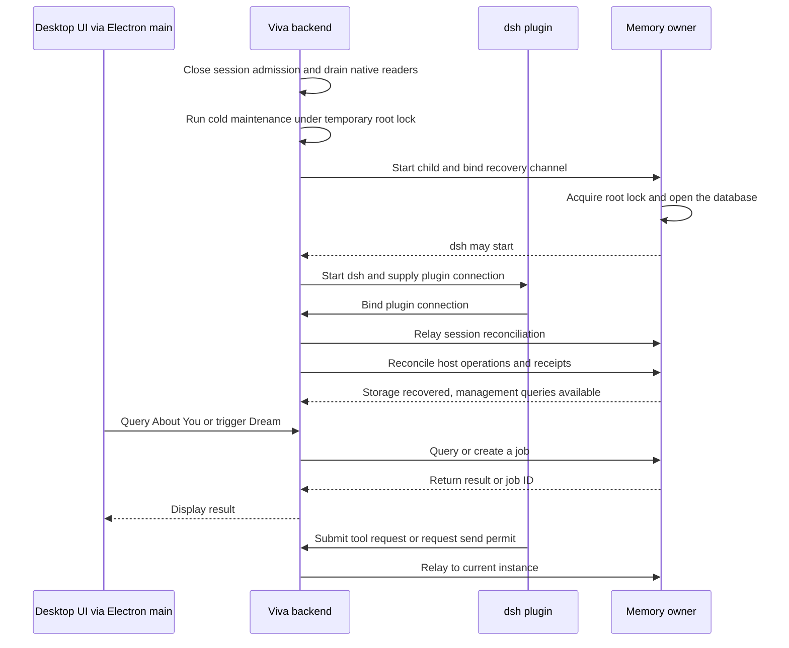
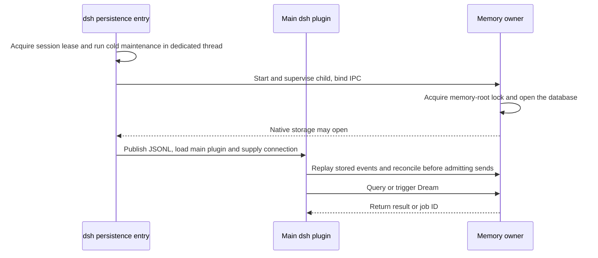
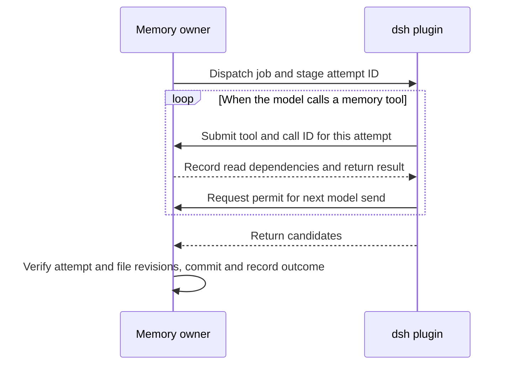

# Memory owner isolation and query availability

[中文](memory-owner-isolation.zh-CN.md)

**Status · Process isolation and asynchronous verification are implemented.** November 20, 2026. This document records the original failure paths and the staged acceptance criteria. Viva and standalone dsh share the [owner entry point](../src/memory/node/owner-worker.ts) and [supervisor](../src/memory/node/owner-supervisor.ts).

The first acceptance case holds a read of memory file A indefinitely. A user must still be able to find committed, verifiable file B in both About You and the main conversation, and cancel the current turn. If the whole volume or owner is unavailable, the interface should offer a retry within its request budget and retain drafts and attachments.

## Failure paths before isolation

- Previously, directory enumeration, synchronous Markdown reads and hashing shared the dsh event loop. A stalled file delayed IPC, cancellation and heartbeats.
- Foreground reads also touch disk. Recall calls a full `sync()` before lexical search. Node search, relation lookups, and some ID-based reads can also enumerate files. Moving the catalog alone leaves the A/B acceptance case unresolved. [Retrieval](../src/memory/core/memory-file-retrieval.ts) · [File access](../src/memory/node/memory-file-store.ts)
- SQLite uses `DatabaseSync`, WAL, and short transactions. The existing two-second `busy_timeout` bounds lock waits. Slow SQL and underlying I/O need a separate request deadline and process supervision. Embedding already has a child process, a six-second inference timeout, and a thirty-second cooldown for certain failures. Heartbeats currently run every five seconds and mark a peer suspect after fifteen seconds for diagnostics. [SQLite](../src/memory/node/sqlite.ts) · [Embedding process](../src/memory/node/memory-embedder.ts) · [Heartbeat](../src/diagnostics/health.ts)

## Process responsibilities

Ship memory as the `viva-memory` dsh plugin. In the Agent process, the plugin registers tools, captures completed turns, and checks permits before model sends. Replace the plugin's direct call to `openMemoryOwner()` with an asynchronous client. Package the owner entry point with the plugin so standalone dsh can run the full memory workflow. [Current plugin adapter](../plugins/memory/lib/adapter.ts) · [Plugin package](../plugins/memory/package.json)

| Component | State and responsibilities |
|---|---|
| Viva backend | Supervise dsh and the owner independently. Route management UI calls directly to the owner over asynchronous IPC and end foreground waits at their deadlines. |
| dsh / Agent | Own native sessions, model transport, tool adapters, and user cancellation. Execute Dream model calls asynchronously and correlate their results by job and instance generation. |
| Memory owner | Act as sole writer for a memory root. Own SQLite, authorization, committed file versions, Dream jobs and operation receipts. Serve queries while waiting for the model or asynchronous file reads. |
| File reader and embedder | The owner starts a fallback reader on demand for individual registered paths when ordinary reads stall. The embedder computes vectors in its own process. |

### Viva desktop

The backend supervises dsh and the owner separately. On cold startup it drains native session readers and takes the memory-root lock temporarily to settle pending native publications. Maintenance releases the lock, then the owner takes the same lock and opens the database. Native session storage stays closed through this handoff. An occupied lock blocks owner startup. The backend binds the plugin's IPC during the dsh handshake. Management calls go directly to the owner. The backend relays plugin requests and model callbacks. Receipts requiring host acknowledgment use the same owner connection. [Cold startup gate](../src/backend/dsh-lifecycle.ts) · [Desktop supervision and relay](../src/backend/desktop-memory-owner.ts)

On a dsh-only restart the backend checks for pending cold maintenance with the surviving owner. A routine restart keeps the owner available for About You. When maintenance is needed, the backend waits for dsh and the owner to exit, drains native readers, runs maintenance, and then starts the replacements. On an owner-only restart dsh stays running and the plugin reconciles sessions before resuming model sends. An ordinary query timeout ends the caller's wait.

### Standalone dsh

The standalone package includes the same owner entry point. The persistence entry takes the session-root lease and runs cold maintenance in a dedicated thread. It starts the separate owner before publishing JSONL persistence. The main plugin then binds to that owner. The lease lasts until native storage closes and survives an owner-only restart. [Packaged profile](../scripts/build-memory-plugin.ts) · [Persistence startup](../plugins/memory/persistence.ts) · [Root lock](../src/memory/node/owner-lock.ts)

The desktop backend supplies the connection. In standalone dsh the persistence entry starts and supervises the owner. Both use the same client and verify protocol version, role, host and configured storage roots. A mismatched binding or occupied root returns a retryable status and keeps native sessions gated. Defer standalone attachment to a third-party resident owner and cross-host cold-maintenance handoff until an integration needs them. [Existing host binding check](../src/memory/node/native-original-maintenance.ts)

### Reconnection and recovery

- **Open the recovery channel first.** The recovery channel is the set of methods allowed on the same trusted IPC connection while recovering. Bind to the current instance and reuse the restricted methods available during `recovering` to look up operations, finish prepared commits and acknowledge host receipts. Once withdrawal state has recovered, the management UI can query verified data. Session sends and background commits also require turn reconciliation. On timeout, incompatible versions or stale replies, preserve input and retry. [Recovery methods](../src/backend/remote-memory-channel.ts) · [Host operation recovery](../src/backend/memory-withdrawal.ts)
- **Restart of one endpoint.** Track active sessions and turns by dsh instance. On owner restart retain the markers and pause affected background work and send permits. The surviving plugin supplies active turns and native event sequence numbers. Reconcile durable events and receipts through the same sequence, then resume live delivery. Replay events arriving during the snapshot in order and deduplicate by sequence. After confirmed dsh exit, recover completed or cancelled turns from persisted events, mark unfinished turns interrupted, and release only the old instance's markers. Keep unreconciled sessions paused. [Current turn recovery](../src/memory/node/owner.ts) · [Session event replay](../plugins/memory/lib/ingestion.ts)
- **Supervisor exit.** A supervisor-owned child watches its private parent channel. On disconnect it stops admission, closes children and exits. An ordinary client disconnect invalidates only that connection. During orderly shutdown the supervisor waits for exit and on timeout cleans up using its process handle or platform process tree. If the supervisor is killed while the old owner is stuck in synchronous I/O, even its disconnect callback may stall. Terminate a remaining process only with proof of ownership. Otherwise surface the occupied root and how to recover, and preserve the OS lock. Admit a replacement only after the old process exits and the new owner acquires the lock. [Root lock lifetime](../src/memory/node/owner-lock.ts)

Viva retries an attach whose acknowledgement was lost on the same dsh connection. In standalone mode, a newly attached plugin receives the current owner snapshot immediately, including when persistence has already started the child. If the first reconciliation acknowledgement is lost, the plugin retries against the same ready owner. An owner replacement invalidates outstanding reconciliation for the old instance.

### Dream in both modes

The caller creates a stable `operationId` for each manual request. The owner atomically records its associated job before acknowledging it. A retry returns the original job and its latest status, including completion. Foreground reads continue while the model works.

Bind each tool request and candidate reply to both process instances and the current stage attempt. On a lost tool acknowledgment abandon the attempt and recompute from the existing job checkpoint. Drafts stay local to the attempt and the existing operation journal protects final writes. Intermediate tool calls do not need a second persistent receipt store. [Dream integration stage](../src/memory/core/memory-dream-jobs.ts) · [Tool contract](../src/memory/contracts/compute.ts)

## Asynchronous I/O and read consistency

1. **File integrity.** Start with the registered path and committed revision. Hash the file on read. Skip missing or mismatched files and leave unknown paths alone. A renamed file is missing at its registered path. Historical aliases can still resolve links to previously accepted files.
2. **Foreground reads.** Page the file list from the committed catalog and resolve detail by ID. Recall and node search get candidates from a published index maintained incrementally in the background. Verify candidates against current project, source, usage, and revision rules. Where current disk validation is required, bound each file check and run it off the owner's event loop. Reserve bounded foreground capacity while background publication is running. Coalesce checks on the same stalled or isolated path and leave time for other candidates. Defer whole-directory temp file cleanup to the background. Limit startup checks to journal recovery for known commits. On a candidate timeout, continue to the next candidate and mark the result partial. Unauthorized candidates must consume neither result slots nor relation counts. Withhold old content whose validity cannot be confirmed. The UI must distinguish an unavailable query from an empty result.
3. **Writes.** dsh and the backend call the owner asynchronously. Keep synchronous SQLite calls and short transactions inside the owner initially. Read files, hash content, and run inference outside transactions, then verify the expected version at commit. Recover writes through the existing journal and `operationId`. Look up the receipt after an acknowledgment is lost. Consider a dedicated database thread if measurements show slow SQL continues to block the owner. [File journal](../src/memory/node/memory-file-journal.ts) · [Index](../src/memory/node/memory-file-index.ts)

Foreground queries, model-send checks and Dream verify file evidence asynchronously. Journal writes and final commit checks still access the filesystem inside the commit boundary. If these operations stall the owner, the caller deadline bounds the wait and the supervisor handles recovery.

### When to synchronize the file index

The owner knows which file IDs change in each application write and queues only the affected projections. Idle time and waking from sleep do not trigger a Markdown directory walk. Startup discards obsolete scan jobs. External Markdown never becomes a registered revision through a background model call. [Index publication](../src/memory/core/memory-runtime.ts)

| Trigger | Owner action | Foreground behavior |
|---|---|---|
| Startup or recovery | Recover authoritative commit and withdrawal state needed to determine visibility. Ordinary pending markers suppress only affected items and dependent results. Open reads for other verified memories and bound background publication and reconciliation work. Build a missing, incompatible or corrupt index in the background and publish when complete. | Use a trusted published index when available. Otherwise report that the index is being prepared. Automatic injection may omit new evidence. |
| Remember, edit, daily note or Dream commit | Tie the catalog, text index, links and revision updates for affected IDs to the file journal. Acknowledge searchable success after publication. Backfill vectors later and resume interrupted work from its receipt. | A keyword lookup immediately after a successful remember can find the file before vectors exist. Each Dream batch indexes only its changes. |
| Disable, delete or withdraw a source | Hide affected text, relations and candidates before acknowledging success. Finish recoverable residual index cleanup in the background. | The next query cannot disclose withdrawn data. Existing model sends remain subject to send permits. |
| Externally changed, missing or unreadable file | A confirmed mismatch or missing file found by retrieval can retire its projection. A timeout leaves the projection intact. Opening the registered file after restoring its original bytes can republish it. | Omit unverified bytes and continue with other verified candidates. |

**Completing publication.** Daily notes, Dream (including corrections), manual edits, undo and re-enabling share one publication path. The affected set includes files whose visible content changes through existing source, replacement or link relationships even when their bytes are unchanged. Check the current revision, usage and policy before publication. Withhold old text, vector candidates and relation counts for affected entries pending verification. [Derived visibility rules](../src/memory/core/memory-document-read-policy.ts)

In the existing SQLite transaction that commits the authoritative change, record the affected file or source IDs and revisions against the operation. Normal writes immediately invoke the same idempotent publisher that recovery and retries resume from the receipt. Publish the lexical index from the current authoritative version and clear matching pending work in the same transaction, preserving newer work. Acknowledge searchable success after publication. Backfill vectors later. [Journal completion transaction](../src/memory/node/memory-file-journal.ts) · [Conditional index updates](../src/memory/node/memory-file-index.ts)

Automatic injection, recall, reading by ID and relation queries never start a full scan. The separate `ingestion.synchronize(session)` reconciles session events from the cursor when current session context is needed. It runs independently of file index maintenance. [Current retrieval entry points](../src/memory/core/memory-file-retrieval.ts) · [Session cursor](../plugins/memory/lib/ingestion.ts)

Index publication and cleanup use their own runner over the existing durable queue. While Dream waits for the model, a committed file can still become searchable. Startup leaves a pending publication in the queue if that file cannot be verified and opens reads for other verified files.

### Latency of automatic injection and frequent tool calls

Automatic injection searches only for admitted query inputs before a model request. Both foreground paths use the published index and asynchronously verify candidate files. Session replay still tracks durable event cursors. The management list pages through the committed registry and verifies selected candidates and their correction dependencies. Sparse title searches can continue into subsequent candidate pages. [Injection hook](../plugins/memory/lib/adapter.ts) · [Search and deduplication](../src/memory/core/memory-file-retrieval.ts) · [Session replay](../plugins/memory/lib/ingestion.ts)

| Path | Initial implementation | Proposed acceptance target (local warm index) |
|---|---|---|
| Automatic injection | Start one optional lookup per newly admitted query input, including a new interjection in the same turn. Search the published text index and existing vectors. Wait for query encoding only within the remaining budget. Preserve automatic relevance thresholds. | Added optional lookup wait p95 ≤ 100 ms, with a 200 ms foreground deadline. Use only verified context returned in time, otherwise omit new evidence for this step. |
| Explicit `memory_recall` and `memory_node_search` | Run a bounded candidate search in the owner, fetching more and validating in batches as needed. Keep vector backfill and Dream in the background and reserve queue and execution capacity for foreground reads. | End-to-end tool call p95 ≤ 300 ms. |
| Explicit `memory_read` | Locate the file by ID and line range and verify its revision before reading. Avoid repeating the preceding recall. | End-to-end p95 ≤ 100 ms. |

**Bound the actual reads.** Page candidates from the index by scope and date. Load only that page's chunks and relevant links, and resolve ID lookups directly from the catalog. Deduplicate by delivered chunk and revision. When text or vector search is degraded, return the verified partial results available within the same foreground candidate and time budgets. For injection, prepare qualifying lexical hits first. Allocate only part of the remaining time to vectors so validation and IPC have time to finish. If the embedder stalls, the owner can still return the qualifying lexical hits in time. [Current SQLite retrieval](../src/memory/node/memory-file-index.ts)

These are proposed targets to calibrate. The 200 ms budget starts at optional lookup admission and covers queuing, IPC, retrieval and result validation. The caller discards late results. Session recovery, source registration and authorization to send existing memory to the model still have to complete. Explicit tools use the whole-call limits below and can wait longer for a requested lookup.

Retain the existing persistence acknowledgment, serial queue, and event cursor. Measure duplicate waits for persistence on a real tool call. Reuse an acknowledgment within that call only if both entry points wait for the same durable position and context generation. Consider cross-call synchronization reuse or query vector caching only if measurements show a bottleneck. Within a request, coalesce checks on the same file revision and recheck visibility and revision before delivery. Authorize and record read dependencies per caller and retain explicit recall’s per-turn hit deduplication. [Read dependencies and turn scope](../src/memory/core/memory-runtime.ts)

Compare before and after through the real plugin hooks. Measure time to the first model request with automatic injection on and off, end-to-end tool p50/p95, full scans, files validated and IPC round trips per call. Exercise cold and warm indexes, recall → read → repeat recall within a turn, concurrent Dream and an unavailable embedder. Keep the matches fixed and add unrelated files. Compare directory walks, index rows loaded and chunks decoded. Warm queries should perform zero directory walks and keep candidate and link loads within the query limits. Check retrieval quality, injection skip rate and visibility after revocation alongside latency.

Local measurements cover cold and warm indexes, consecutive tools in the same turn, concurrent Dream, and loss of the embedding process. The report distinguishes the ACP tool result from the next model request. [Local latency results in Chinese](qa-memory-latency-20261119.zh-CN.md)

### Timeouts for conversation memory tools

Viva and standalone dsh use the same rule. For `memory_recall`, `memory_read` and `memory_node_search`, the dsh plugin starts one budget before the first wait for session synchronization. For the initial implementation, reuse the existing 10-second foreground read limit and honor earlier user cancellation. Queuing, session synchronization, IPC and result validation share the budget. Pass only the remaining duration to the owner. The caller ends its wait at the deadline even if the owner stalls or a reply is lost. [Request budget](../src/shared/request-budget.ts) · [Current tool entry point](../plugins/memory/lib/adapter.ts)

If the owner can return verified partial hits in time, mark the result `partial`. If no valid reply arrives by the deadline, dsh returns `status: unavailable` with `reason: timeout` so the model can recognize a failed lookup. Preserve explicit user cancellation as cancellation. Send a best-effort cancel to the owner and ignore late results. Dispatched work continues to count towards execution limits until completion is confirmed or the executing process exits. [Existing read admission limits](../src/backend/remote-memory-channel.ts)

### Main conversation tool budgets

**Main conversation tools default to five seconds.** The common invocation path uses the execution budget declared by the tool and falls back to this default when the declaration is absent. A newly registered tool inherits the deadline automatically. When a tool needs longer, declare its budget on the tool and document the work that warrants it, such as traversing a directory or running a bulk import. Configure the default once. The table records the effective budgets of existing tools.

This table covers all 26 tools callable directly by the main conversation on the proposal branch. The proposed first-release limits are cumulative execution seconds per invocation. The current column identifies which part of the call is timed today. Calibrate the proposed values with normal workloads and fault injection. [Main tool scope](../plugins/routing/lib/policy.ts) · [App operations](../src/shared/request-routing/protocol.ts)

| Tool | Current timing scope | Proposed limit (seconds) |
|---|---|---:|
| `search_conversations` | 5 s for host reply | Default 5 |
| `read_conversation` | 5 s for host reply | Default 5 |
| `list_background_tasks` | 5 s for host reply | Default 5 |
| `get_background_task` | 5 s for host reply | Default 5 |
| `schedule_list` | 60 s for host reply | Default 5 |
| `viva_mcp_list` | No whole-call deadline | Default 5 |
| `viva_skill_list` | No whole-call deadline | Default 5 |
| `memory_recall` | Vector stage only | 10 |
| `memory_read` | No whole-call deadline | 10 |
| `memory_node_search` | No whole-call deadline | 10 |
| `read` | No whole-call deadline | 10 |
| `read_image` | No whole-call deadline | 10 |
| `glob` | 30 s cooperative tool timeout | 30 |
| `grep` | 30 s cooperative tool timeout | 30 |
| `memory_remember` | No whole-call deadline | 30 |
| `viva_mcp_add` | No whole-call deadline | 30 |
| `viva_mcp_update` | No whole-call deadline | 30 |
| `viva_mcp_remove` | No whole-call deadline | 30 |
| `viva_skill_create` | No whole-call deadline | 30 |
| `viva_skill_remove` | No whole-call deadline | 30 |
| `commit_route` | 60 s for host reply | 60 |
| `schedule_create` | 60 s for host reply | 60 |
| `schedule_update` | 60 s for host reply | 60 |
| `schedule_delete` | 60 s for host reply | 60 |
| `viva_mcp_import` | No whole-call deadline | 60 |
| `viva_skill_install` | No whole-call deadline | 60 |

Lightweight queries keep a five-second budget. File and memory reads get ten seconds for disk validation or image decoding. Directory searches keep thirty seconds, also the allowance for individual local changes. Bulk imports, copying a local skill directory, routing and schedule changes get sixty seconds. Give `schedule_list` its own read budget. The `schedule_create` receipt covers creation of a proposal. User confirmation to save it is a subsequent step. [Schedule tools](../plugins/tasks/index.ts) · [Configuration tools](../plugins/config/lib/tools.ts)

Start the clock before the first potentially blocking wait. Pause it only during an explicit approval or secure credential prompt. Honor user cancellation throughout and resume with the remaining time after input. An unresponsive host continues to consume the budget. Pass remaining durations across IPC. Local IPC and vector deadlines can end their stage earlier. For calls that could block the dsh event loop, enforce the deadline from the backend, isolate late results by turn and tool call ID, and apply the recovery rules below.

Report a timed-out read as incomplete. Memory retrieval may return verified partial hits early. If a dispatched write, import or routing request loses its acknowledgment, report the outcome as unknown and check the existing receipt or resulting state before considering a retry. Preserve `accepted: unknown` for `commit_route`. [Routing receipts](../plugins/routing/index.ts)

For acceptance, register a test tool without a declared budget and stall it. It must time out at five seconds. A tool explicitly declaring thirty seconds must be able to run past five seconds and end its wait at its own deadline. Also cover expiry at each budget tier, resuming the remaining budget after approval or credential input, early user cancellation, and a lost reply after a committed write. Shell, web and third-party MCP tools run by background tasks retain their own execution policies.

Once a native dsh tool starts, the SDK waits for its execution to settle. Cooperative tools can return a tool-level timeout. If a foreground tool ignores cancellation, the Viva backend requests a turn stop 500 ms after its execution budget expires. The eight-second stop grace then applies. Standalone dsh relies on its host for recovery from a blocked event loop. [Tool execution](../src/shared/node/tool-call-budget.ts) · [Backend timer](../src/backend/tool-budget-watchdog.ts)

### Cancellation across the main conversation

Use the 10-second budget above for memory reads. Every foreground tool receives the turn cancellation signal and has an execution budget appropriate to the tool. Long-running commands can have longer budgets, and interactive approval has its own wait. A tool timeout reports the outcome of that call to the model. User cancellation stops subsequent tool calls and model sends for the turn. A timeout on a write or external side effect leaves its outcome unknown until verified, so automatic retries must wait.

On Stop, immediately show “Stopping” and preserve the draft. Target the session and turn visible at the click and make repeated cancellation idempotent. The backend starts a grace timer independently of dsh and requests cooperative cancellation. Show “Stopped” once the matching turn ends due to cancellation. If dsh has not confirmed by the deadline, use the background task's existing eight-second grace period as a starting point, isolate the old turn's output, show that execution has yet to confirm the stop, and offer session recovery. Admit another turn once the runtime can accept work and the old turn is isolated. Explain that restarting shared dsh may interrupt background tasks before the user chooses to recover. Detach the old native session after an unconfirmed stop and create a fresh native session for the selected conversation on recovery. Preserve the displayed history and draft. Carry verified user history forward for the model. Preserve existing interjection and attachment draft behavior. [Composer](../src/renderer/app.ts) · [Foreground cancellation](../src/backend/acp-bridge.ts) · [Existing task grace period](../src/backend/stop-in-time.ts)

Exercise Stop through the real composer with an asynchronous tool stalled and, separately, with the dsh event loop suspended. Verify immediate feedback, editing and recovery after the grace period, isolation of late output, repeated clicks, and late cancellation after switching conversations. Also verify a long command making normal progress can continue.

The backend keeps the stopped conversation identity available for the final history save and for window reload. If a reload follows a long response whose unsaved output exceeds the replay buffer, the window shows the last saved history, explains the gap and offers recovery. It skips saving this incomplete snapshot over the existing checkpoint.

## Authorization across processes

Bind each model send permit to the owner instance, dsh instance, session generation, send attempt, and request-body digest. Record dependencies before handing over the first request bytes. Revocation closes admission for new sends and waits for granted attempts to finish or be confirmed abandoned. A timeout leaves the outcome unknown. SDK retries obtain fresh permits. On disconnect, dsh closes the old connection's physical send gate, rejects late grants and uses local transport records to drain outstanding sends. The new owner may acknowledge revocation after dsh confirms over the new connection that the old generation is closed and drained, or after the supervisor confirms the old sending process has exited. The drain acknowledgment can be repeated. Discard IPC and compute results from older generations. [Send fence](../src/memory/core/send-fence.ts) · [Transport boundary](../plugins/memory/lib/transport.ts)

An optional recall timeout may omit newly retrieved memory for that turn. When an existing session already contains memory and its permit cannot be verified, pause the model send and keep input, cancellation, and recovery available. This authorization determines whether an existing session can send while the owner is offline.

## Circuit breakers and recovery

When a native output receipt fails, operations waiting on that receipt report the failure. Subsequent receipts can still be written in session order. Final replies that require owner verification have the five-second RPC budget plus one second for the relay. Reloading a window during a turn restores its ID, start time and stopping state.

When all three ordinary file reads run overdue, queued requests can switch to a reusable reader process started on demand. An ordinary file read waits up to 250 ms, a fallback read up to two seconds, and a non-injection verification batch has a 2.5-second budget. Automatic injection keeps its overall 200 ms deadline. Passive Dream refreshes only query status. A further user click can retry the original operation ID.

| Failure signal | Response and recovery condition |
|---|---|
| A registered file stalls | Bound the read, retain its registration and leave uncertain index state intact. Continue with other candidates. |
| Repeated model load, protocol, or inference failures | Suspend vector queries and index preparation for that model fingerprint. Return authorized lexical results and allow one probe after cooldown. Track cancellation, worker contention, and oversized inputs separately. |
| Owner heartbeat lost | The parent probes on its own clock. On confirmed failure it retires the old process and retries with backoff. The new instance starts after confirmed exit and settlement of old sends. Admission resumes after the replacement acquires the root lock. |
| Dream awaits a model while the owner responds | Apply job-level deadlines and retries while serving foreground reads. Handle a slow diagnostic sink independently. |

Measure query and event-loop latency, read and write queue depth, timed-out children still alive, lexical fallback reasons, recovery probes, and restart counts. Record operation IDs, instance generations, and durations. Keep query bodies out of diagnostic logs.

## Delivery and acceptance

| Stage | Deliverable | Acceptance |
|---|---|---|
| 1 | Verify individual files and remove full synchronization from foreground reads | With A stalled, both query paths return B and the user can cancel. Unknown Markdown stays outside the registry, and idle wakeups perform no directory walks. |
| 2 | Separate owner, direct management IPC, cross-process send permits, cold startup and recovery | Stop the owner before and during a model send, and after a file commit but before acknowledgment. dsh stays alive, old permits expire, receipt lookup resolves unknown writes without duplication, and both Viva and standalone dsh can restart. |
| 3 | Dependency-specific circuit breakers and health supervision | Inject SQLite contention, an embedding crash or hang, lost IPC acknowledgment, and system sleep/resume. Verify lexical fallback, bounded concurrency, one recovery probe, and bounded restart attempts. |

Run fault injection in isolated profiles on both macOS and Windows. Reuse the cross-platform process pause fixture and availability smoke test. Measure query latency from cold and warm indexes, cancellation latency, and recovery time before setting new foreground budgets or breaker thresholds. [Process pause fixture](../test/fixtures/diagnostics-process-pause.ts) · [Memory availability smoke test](../scripts/smoke-memory-availability.ts)

Before stage 1 removes full synchronization from reads, verify these cases against the shared memory implementation.

| Fault injection | Expected outcome |
|---|---|
| Restart after file commit but before publication, then retry the operation | The pending write republishes once. Older content stays hidden if verification stalls, while an independent B remains readable. |
| Disable a source used by a derived file and re-enable it. Separately edit a registered file on disk | Injection, tool hits and relations follow current policy. The changed file is skipped. Other verified files remain readable. |
| Add or move external files. Separately stall query encoding for a strong lexical match | No files are imported or rebound. Return verified lexical matches within the optional lookup budget. |

Stage 2 exercises the new process boundaries on macOS and Windows. Start standalone dsh from the packaged plugin and use its real session, daily note and Dream entry points.

| Fault injection | Expected outcome |
|---|---|
| Stall session lease acquisition or cold-maintenance I/O. Separately stall reads of A | The supervisor can answer health checks and handle input and cancellation. An independent B returns within the file verification budget. |
| Pause the owner or drop its reply during a conversation memory tool call. Separately cancel early | dsh returns a timeout when the total budget from the first wait expires and honors earlier cancellation. Late results never enter the turn, and repeated timeouts keep in-flight executions bounded. |
| Drop a permit grant and, separately, its settlement reply, then reconnect the surviving dsh | A late grant cannot start a send. Revocation can complete once old sends drain. |
| Cold start with a pending publication from an older version, or supply the desktop plugin with a mismatched owner connection | Native sessions stay closed until maintenance completes. A mismatched binding keeps them closed. |
| Restart the owner with a prepared operation awaiting host acknowledgment | The recovery channel can look up the receipt and finish the commit. Ordinary calls cannot block recovery. |
| Kill only the owner, then in a separate run only dsh, during an active turn | In the first case consolidation waits and the turn is recorded once. In the second the old turn is retired and About You can still read B. |
| Kill the supervisor and restart immediately. Separately disconnect an ordinary client | The child exits or the remaining lock holder is reported, with a single writer throughout. The backend's owner keeps serving when the desktop plugin disconnects. |
| Drop the Dream creation acknowledgment and retry after completion. Separately disconnect after tool execution but before its reply | The caller gets the original job and completion time. The old attempt cannot call tools or submit candidates, and recovery commits once. |
