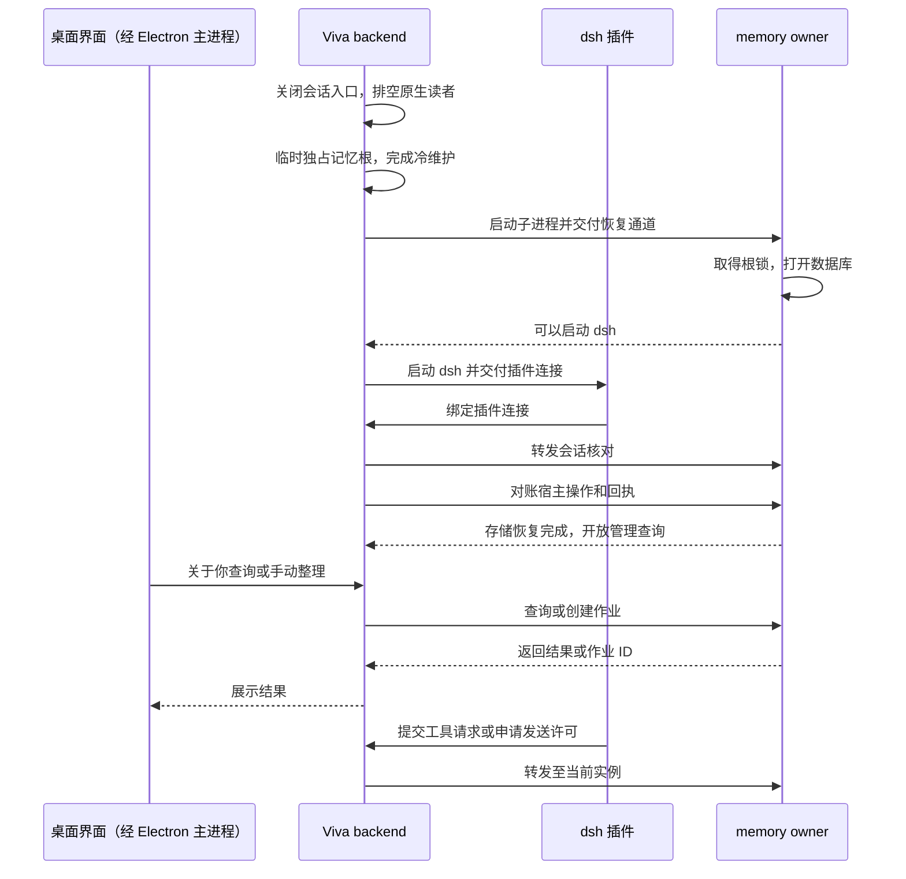
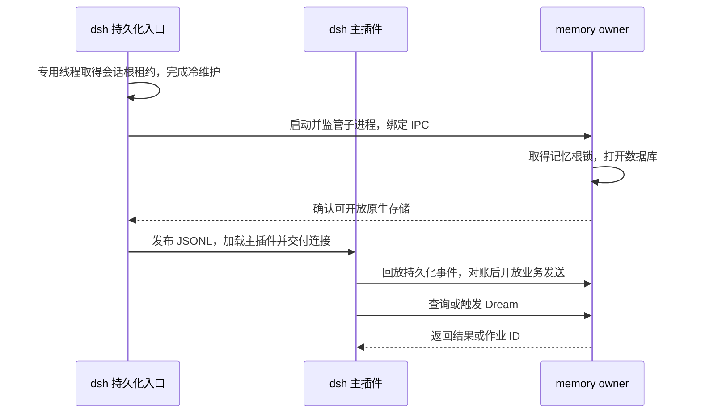
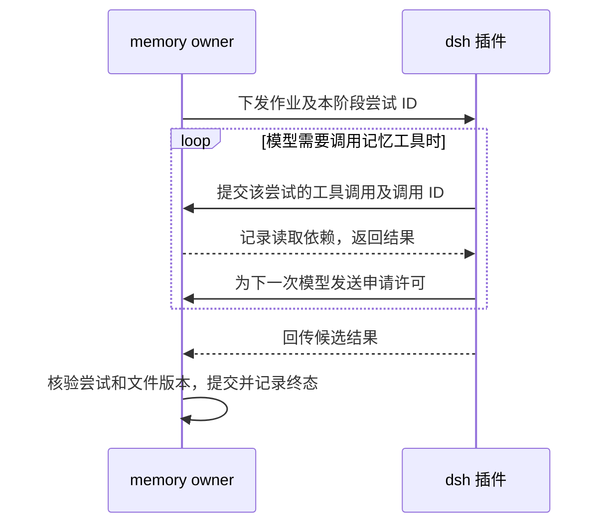

# 记忆服务进程隔离与查询可用性方案

[English](memory-owner-isolation.md)

**状态 · 进程拆分与异步核验已实现。** 2026-11-20。下文保留故障背景和分阶段验收条件。Viva 和独立 dsh 共用 [owner 入口](../src/memory/node/owner-worker.ts)与 [监管逻辑](../src/memory/node/owner-supervisor.ts)。

首要验收场景是让记忆文件 A 的读取一直挂起。此时用户应能在“关于你”和主对话里查到已提交且可核验的文件 B，并能取消当前对话。若整个磁盘卷或 owner 已不可用，页面应在预算内给出可重试状态，保留草稿和附件。

## 拆分前的故障路径

- 早期实现把目录遍历、同步读取 Markdown 和计算哈希放在 dsh 事件循环里。一个文件卡住，就可能拖住 IPC、取消和心跳。
- 前台检索也会访问磁盘。召回在关键词搜索前执行全量 `sync()`，节点搜索、关系查询和部分按 ID 读取也会遍历文件。仅迁出 catalog 仍不能满足“坏 A、查 B”。[检索实现](../src/memory/core/memory-file-retrieval.ts) · [文件读写](../src/memory/node/memory-file-store.ts)
- SQLite 使用 `DatabaseSync`、WAL 和短事务。现有两秒 `busy_timeout` 约束锁等待；慢查询及底层 I/O 还需要独立的请求预算和进程监管。嵌入已有子进程、六秒推理超时及部分错误后的三十秒冷却。当前每五秒发送心跳，十五秒失联标记为可疑，主要用于诊断。[SQLite](../src/memory/node/sqlite.ts) · [嵌入进程](../src/memory/node/memory-embedder.ts) · [心跳](../src/diagnostics/health.ts)

## 进程职责

记忆继续以 `viva-memory` dsh 插件交付。插件在 Agent 进程内注册工具、采集已完成的对话回合，并在模型发送前检查许可。将插件直接调用 `openMemoryOwner()` 的位置换成异步客户端，把 owner 入口随插件一起发布，使独立 dsh 也能运行完整的记忆功能。[当前插件入口](../plugins/memory/lib/adapter.ts) · [插件包](../plugins/memory/package.json)

| 组件 | 持有的状态与职责 |
|---|---|
| Viva backend | 分别监管 dsh 和 owner，给管理页面提供直达 owner 的异步 IPC，并在请求截止时结束前台等待。 |
| dsh / Agent | 持有原生会话、模型传输、工具适配和用户取消。Dream 的模型计算由 dsh 异步执行，以 job 和实例代次关联结果。 |
| memory owner | 每个记忆根目录只有一个写者。持有 SQLite、授权状态、已提交的文件版本、Dream 作业和操作回执；等待模型或异步读文件时仍可处理查询。 |
| 嵌入子进程 | 独立计算向量。已登记文件由 owner 在本进程内异步读取并核验。 |

### Viva 桌面模式

backend 分别监管 dsh 与 owner。首次启动先排空原生会话读者，由冷维护临时独占记忆根并处理未结算的原生发布。维护完成后释放根锁，独立 owner 随即尝试取得同一把锁并打开记忆库。期间原生会话存储保持关闭，根锁占用会阻止 owner 启动。backend 在 dsh 的启动握手中绑定插件 IPC。管理页面直接调用 owner，插件的记忆调用和反向模型计算经 backend 转发。需要宿主确认的回执沿用同一条 owner IPC。[冷启动门](../src/backend/dsh-lifecycle.ts) · [桌面监管与转发](../src/backend/desktop-memory-owner.ts)

仅重启 dsh 时，backend 向存活 owner 查询是否有待结算的冷维护。常规重启保留该 owner，“关于你”可继续读取。需要冷维护时，backend 等待旧 dsh 和 owner 退出，在排空原生读者后执行维护，再启动替代 owner 和 dsh。owner 单独重启时保持 dsh 运行，插件在恢复后核对会话再重新开放模型发送。普通查询超时只结束该次等待。

### 独立 dsh 模式

独立安装包包含同一 owner 入口。持久化入口在专用线程取得会话根租约并执行冷维护，随后启动独立 owner，再发布 JSONL 持久化服务。主插件加载时绑定该 owner。会话根租约持有至存储关闭，owner 单独重启时租约继续有效。[打包配置](../scripts/build-memory-plugin.ts) · [持久化启动顺序](../plugins/memory/persistence.ts) · [根锁](../src/memory/node/owner-lock.ts)

首版的监管者只有两种：桌面由 backend 提供连接，独立 dsh 由持久化入口启动并管理 owner。两者使用同一客户端，校验协议版本、角色、宿主及配置的存储根。绑定错误或根锁占用时返回可重试状态，保留原生会话的启动门。独立 dsh 连接第三方常驻 owner 的配置和跨宿主冷维护交接，留待有实际接入需求时设计。[现有宿主绑定校验](../src/memory/node/native-original-maintenance.ts)

### 重连与故障恢复

- **先恢复，再按用途开放。** “恢复通道”指同一条受信 IPC 在恢复期间允许的方法。客户端绑定当前实例，沿用 `recovering` 阶段的受限方法，允许查操作、完成已准备的提交和确认宿主回执。涉及撤销的状态恢复后，管理页可查询已核验的数据。会话发送和后台提交另等回合对账。连接超时、版本不兼容或收到旧连接回包时，保留输入和重试入口。[恢复方法](../src/backend/remote-memory-channel.ts) · [宿主操作恢复](../src/backend/memory-withdrawal.ts)
- **只重启一端。** 按 dsh 实例记录活跃会话和回合。owner 重启时保留标记，暂停相关后台消费与发送许可；存活插件提供活动回合及原生事件序号，按已有持久化事件和回执补齐到同一位置，再接续实时事件。快照期间到达的事件依序补发、按序号去重。dsh 已确认退出时，从已保存事件补齐完成或取消的回合，标记未完成回合中断，只释放旧实例的标记。无法核对的会话保持暂停。[当前回合恢复](../src/memory/node/owner.ts) · [会话事件回放](../plugins/memory/lib/ingestion.ts)
- **监管者退出。** 自启 owner 监视专属父通道，断开后停止接单、收尾子进程并退出。普通客户端断开只撤销该连接。正常关闭由监管者等待退出，超时利用受监管的进程句柄或平台进程树清理。若监管者被强杀且旧 owner 卡在同步 I/O，断连回调也可能卡住。只在能确认进程归属时终止残留进程；否则显示占用和恢复方式，保留 OS 根锁。旧进程退出并取得根锁后才开放替代实例。[根锁释放条件](../src/memory/node/owner-lock.ts)

Viva 在原 dsh 连接上重试回包丢失的首次绑定。独立 dsh 的持久化入口可能已经启动 owner，插件订阅时会立即收到当前快照。首次对账回包丢失时，插件向同一就绪实例重试。owner 更换后，旧实例的对账结果随即失效。

### 两种模式共用的 Dream 流程

手动触发方为一次操作生成稳定的 `operationId`。owner 原子记录该 ID 对应的作业再回执，重复请求查回原作业及终态。等待模型期间照常响应前台查询。

每次工具请求和候选结果都绑定双方实例和当前阶段尝试。工具回执丢失即废弃该尝试，从已有作业检查点重算；草稿留在尝试内，正式写入沿用操作日志。避免为中间工具调用再建一套持久化回执。[Dream 整合阶段](../src/memory/core/memory-dream-jobs.ts) · [工具契约](../src/memory/contracts/compute.ts)

## 异步 I/O 与读取一致性

1. **文件完整性。** 按已登记的路径和修订读取文件并核对哈希。原路径缺失或内容不符就跳过，新出现的路径不导入。外部重命名按原路径缺失处理。旧版本已接纳的别名仍可用于解析历史链接。
2. **前台查询。** 文件列表从已提交目录分页读取，详情按 ID 定位。召回和节点查询从已发布索引取候选，后台增量维护索引。根据当前项目、来源、启用状态和修订核验候选，必要时在 owner 事件循环外限时校验单个文件。为前台核验预留有限容量，避免后台发布占满读取槽；隔离或正在等待的同一路径合并处理，给其余候选保留预算。将全目录临时文件清理移到后台，启动只做恢复已知提交所需的日志检查。候选超时则继续补取其他候选，结果标记为部分可用。未授权项不得占用结果名额或出现在关联数量中。无法核验时，不向模型返回旧正文；整次查询不可用时，页面应明确区别于“没有匹配记忆”。
3. **写入。** dsh 和 backend 异步调用 owner。owner 内先保留同步 SQLite 和短事务。文件读取、哈希及模型推理在事务外完成，提交时检查预期版本。写入按已有 journal 和 `operationId` 恢复；回执丢失时先查操作状态。若测得慢 SQL 持续阻塞 owner，再评估专用数据库线程。[文件日志](../src/memory/node/memory-file-journal.ts) · [索引](../src/memory/node/memory-file-index.ts)

前台查询、模型发送和 Dream 异步核验文件证据。写日志和提交前最终核验仍在提交边界内访问磁盘。如果这些操作卡住 owner，调用方按截止时间结束等待，由监管进程负责恢复。

### 文件索引何时同步

应用内写入时，owner 已知变更的文件 ID，只为受影响的索引项排队。空闲和休眠唤醒均不遍历 Markdown 目录。启动时清理旧版扫描任务。后台不会调用模型接纳外部编辑的正文。[索引发布](../src/memory/core/memory-runtime.ts)

| 触发时机 | owner 的动作 | 对前台的影响 |
|---|---|---|
| 启动或恢复 | 先恢复判定可见性所需的权威提交与撤销状态。普通待发布标记只屏蔽受影响项及其依赖范围，其余已核验记忆即可读取。后台按限额补发并核对磁盘。首次建库、索引不兼容或损坏时后台重建，完成后发布。 | 有可信的已发布索引就用它；没有则返回“索引准备中”，自动注入可跳过本次新增证据。 |
| 记住、编辑、日记落盘或 Dream 提交 | 与文件日志关联，按受影响 ID 更新目录、全文索引、链接及版本，再返回可检索的成功回执；向量延后补算。中途崩溃按操作回执继续。 | “记住 X”成功后紧接着查 X，即使向量尚未生成也能按关键词找到。Dream 每批只更新实际改动。 |
| 停用、删除或撤销来源 | 成功回执前使受影响的正文、关联和索引候选不可见；后台完成可恢复的残余索引清理。 | 紧接着查询不会读到已撤销内容，已有模型发送仍遵守发送许可。 |
| 文件被外部修改、移走或暂时读不到 | 检索确认内容不符或缺失时可清理该项投影。超时保留原投影。把原字节放回登记路径后，打开该记忆详情可触发重新发布。 | 跳过未核验的正文，继续返回其余可核验的候选。 |

**一次写入如何完成发布。** 日记提交、Dream（含纠正）、手动修改、撤销、重新启用共用一个发布入口。“受影响”也包括经现有来源、替代或链接关系改变可见内容的文件，即使文件字节未变。发布前按当前修订、使用状态和策略版本校验；对尚未核实的影响项暂不返回旧正文、旧向量候选或关系计数。[可见性派生规则](../src/memory/core/memory-document-read-policy.ts)

在提交权威变更的现有 SQLite 事务中，登记与操作关联的待发布文件或来源 ID 及版本。正常写入随即调用同一个幂等发布函数；重启或重试相同操作时，从回执接续该函数。发布按当前权威版本更新关键词索引，并在同一事务中清除匹配的待办，保留期间产生的较新待办。对应变更发布后才报告可检索的成功，向量稍后补算。[日志完成事务](../src/memory/node/memory-file-journal.ts) · [索引的条件更新](../src/memory/node/memory-file-index.ts)

自动注入、召回、按 ID 读取和节点关系查询均不触发全库扫描。另一个 `ingestion.synchronize(session)` 用于会话事件对账，仍在需要最新会话上下文时按游标补齐，其时机和文件索引维护各自独立。[现有检索入口](../src/memory/core/memory-file-retrieval.ts) · [会话游标](../plugins/memory/lib/ingestion.ts)

索引发布和清理使用现有持久队列中的独立执行器。Dream 等待模型时，新提交的文件仍可发布。启动时遇到暂时无法核验的文件，会保留它的待办，并对其他已核验文件开放查询。

### 自动注入与高频工具调用的时延

自动注入在发模型请求前执行，只为已接纳的查询输入检索。两条前台路径使用已发布索引，并异步核验候选文件。会话事件对账仍按持久化游标运行。管理列表先从已提交登记表选出分页候选，再核验这些文件及其更正依赖。稀疏的标题搜索可以续读后续候选页。[自动注入入口](../plugins/memory/lib/adapter.ts) · [检索与去重](../src/memory/core/memory-file-retrieval.ts) · [会话回放](../plugins/memory/lib/ingestion.ts)

| 路径 | 首版处理方式 | 建议验收目标（本地热索引） |
|---|---|---|
| 自动注入 | 每份新接纳的查询输入只发起一次可选检索，同回合的新插话仍可触发。先查已发布的全文索引和已有向量；仅在剩余时间允许时等待查询向量。保留自动注入的相关性门槛。 | 可选检索增加的等待 p95 ≤ 100 毫秒，前台最多等 200 毫秒。到期只使用及时返回并完成核验的上下文，否则跳过本次新增证据。 |
| 显式 `memory_recall`、`memory_node_search` | 在 owner 内完成一次有界的候选检索，按需补取并批量核验。向量索引补算和 Dream 留在后台，给前台留出队列和执行容量。 | 单次工具调用端到端 p95 ≤ 300 毫秒。 |
| 显式 `memory_read` | 按文件 ID 和行范围直接定位，核验该版本后读取；不重跑上一次召回。 | 端到端 p95 ≤ 100 毫秒。 |

**限定实际读取量。** 查询按作用域和日期分页取候选，只载入本页分块和相关链接，按 ID 读取直接走目录索引。去重也按已交付分块及其版本处理。全文或向量能力不足时，返回已核验的部分结果；前台回退路径同样受候选数和时长限制。自动注入先准备达标的关键词命中，向量等待只用剩余时间的一部分，为最终核验和 IPC 回包预留时间。向量挂起时仍能及时交付该关键词结果。[当前 SQLite 检索实现](../src/memory/node/memory-file-index.ts)

上述数值是待校准的设计目标。自动注入的 200 毫秒从进入可选检索开始，覆盖排队、IPC、查询和本次结果核验。调用方到点放弃迟到结果；会话恢复、来源登记和已有记忆的模型发送许可仍须完成。显式工具沿用下节的总超时，允许用户主动检索比自动注入等得更久。

会话同步沿用现有持久化确认、串行队列和事件游标。先测量真实工具调用中重复等待持久化的耗时；只有同一次调用的两个入口确实重复等待同一持久化位置和上下文代次时，才复用该次确认。跨调用共享同步及查询向量缓存留待实测出现瓶颈时考虑。一次请求内可合并同一文件版本的重复核验，交付前再次检查可见性与版本。各调用独立核验授权、登记读取依赖，并沿用显式召回的同轮命中去重。[读取依赖与回合范围](../src/memory/core/memory-runtime.ts)

通过真实插件入口对比优化前后：自动注入开启与关闭时首个模型请求发起时间的差值、各工具端到端 p50/p95，以及每次调用的扫描次数、核验文件数和 IPC 往返数。分别跑冷热索引、同一回合连续“召回→读取→再次召回”、Dream 同时整理和嵌入失联。固定命中内容，增加无关文件，比较目录遍历次数、实际载入的索引行与解码分块数。热查询零次目录遍历，候选与关联加载量维持在查询限额内。同时检查命中质量、注入跳过率和撤销后的可见性。

本机已测量冷热索引、同回合读取、Dream 并发和嵌入进程退出场景。报告分别列出 ACP 工具终态和下一次模型请求两个计时边界。[本地延迟验收](qa-memory-latency-20261119.zh-CN.md)

### 会话记忆工具的超时

Viva 和独立 dsh 共用同一条规则。对 `memory_recall`、`memory_read`、`memory_node_search`，dsh 插件在第一次等待会话同步前启动总预算，首版建议复用现有前台读取上限 10 秒，并响应更早的用户取消。排队、会话同步、IPC 往返和结果核验共用这份预算。向 owner 只传剩余时长；调用方负责按时结束等待，即使 owner 卡住或回包丢失也能返回。[请求预算](../src/shared/request-budget.ts) · [现有工具入口](../plugins/memory/lib/adapter.ts)

owner 若能提前返回已核验的部分命中，结果标记为 `partial`。到期仍无有效回包时，dsh 返回 `status: unavailable`、`reason: timeout`，让模型知道本次没查成；用户主动取消仍按取消处理。dsh 尽力通知 owner 取消并忽略迟到结果。已派发工作继续占执行配额，直到确认结束或执行进程退出。[已有读取配额机制](../src/backend/remote-memory-channel.ts)

### 主会话工具预算表

**主会话工具默认 5 秒。** 统一调用入口从工具声明取执行预算，未声明就用默认值。新增工具只需正常注册，即可获得这份保护。确实需要更多时间时，在工具定义处声明更长的预算并说明耗时场景，例如遍历目录或批量导入。默认值只配置一次，下表记录现有工具的有效预算。

以下为本方案分支主会话可直接调用的全部 26 项工具。首版建议值按单次调用的累计执行时间计算，单位为秒。现状列注明已有计时覆盖的环节；这些建议值待故障注入和正常负载实测后校准。[主会话白名单](../plugins/routing/lib/policy.ts) · [应用操作清单](../src/shared/request-routing/protocol.ts)

| 工具 | 当前计时范围 | 建议上限（秒） |
|---|---|---:|
| `search_conversations` | 等待宿主回包 5 秒 | 默认 5 |
| `read_conversation` | 等待宿主回包 5 秒 | 默认 5 |
| `list_background_tasks` | 等待宿主回包 5 秒 | 默认 5 |
| `get_background_task` | 等待宿主回包 5 秒 | 默认 5 |
| `schedule_list` | 等待宿主回包 60 秒 | 默认 5 |
| `viva_mcp_list` | 无整次调用上限 | 默认 5 |
| `viva_skill_list` | 无整次调用上限 | 默认 5 |
| `memory_recall` | 仅向量阶段有预算 | 10 |
| `memory_read` | 无整次调用上限 | 10 |
| `memory_node_search` | 无整次调用上限 | 10 |
| `read` | 无整次调用上限 | 10 |
| `read_image` | 无整次调用上限 | 10 |
| `glob` | 工具协作式超时 30 秒 | 30 |
| `grep` | 工具协作式超时 30 秒 | 30 |
| `memory_remember` | 无整次调用上限 | 30 |
| `viva_mcp_add` | 无整次调用上限 | 30 |
| `viva_mcp_update` | 无整次调用上限 | 30 |
| `viva_mcp_remove` | 无整次调用上限 | 30 |
| `viva_skill_create` | 无整次调用上限 | 30 |
| `viva_skill_remove` | 无整次调用上限 | 30 |
| `commit_route` | 等待宿主回包 60 秒 | 60 |
| `schedule_create` | 等待宿主回包 60 秒 | 60 |
| `schedule_update` | 等待宿主回包 60 秒 | 60 |
| `schedule_delete` | 等待宿主回包 60 秒 | 60 |
| `viva_mcp_import` | 无整次调用上限 | 60 |
| `viva_skill_install` | 无整次调用上限 | 60 |

轻量查询沿用 5 秒，文件及记忆读取留 10 秒给磁盘核验或图片解码。目录搜索保留 30 秒，本地单项修改也分配 30 秒。批量导入、复制本地 skill 目录和已有的路由或定时变更可等 60 秒。`schedule_list` 从共用的 60 秒写操作等待中拆出；`schedule_create` 的工具回执表示提议已创建，用户随后确认保存是另一步。[定时任务工具](../plugins/tasks/index.ts) · [配置工具](../plugins/config/lib/tools.ts)

从首次可能阻塞的等待开始计时。只有进入显式的用户审批或安全凭据输入状态才暂停执行预算，用户取消始终生效；收到输入后继续使用剩余时长。宿主迟迟不回包仍计时。跨进程传剩余时长，旧 IPC 或向量阶段的局部计时可提前结束本阶段。若 dsh 事件循环可能被阻塞，由 backend 在其进程外计时并按回合及工具调用 ID 隔离迟到结果，沿用下节的恢复规则。

只读调用超时要报告查询未完成；记忆检索可提前返回已核验的部分结果。写入、导入和路由派发后若丢失确认，保留“结果未知”，通过已有回执或读取最终状态核实后再决定是否重试。`commit_route` 沿用 `accepted: unknown`。[路由回执](../plugins/routing/index.ts)

验收时注册一个未声明预算的测试工具，挂起后应在 5 秒到期；再验证显式声明 30 秒的工具可以正常跨过 5 秒，并在自己的截止时间结束等待。另覆盖各档预算的到期边界、审批或密钥输入后恢复剩余时间、用户提前取消，以及写入已提交但回包丢失。后台任务执行的 Shell、联网和第三方 MCP 工具继续使用各自的执行策略。

dsh SDK 会等待已经开始执行的原生工具结束。支持取消的工具可返回工具级超时。若前台工具忽略取消，Viva backend 在执行预算到期 500 毫秒后请求停止该回合，随后适用 8 秒停止宽限。独立 dsh 的事件循环被阻塞时，恢复需要其宿主介入。[工具执行入口](../src/shared/node/tool-call-budget.ts) · [backend 计时器](../src/backend/tool-budget-watchdog.ts)

### 主对话共用的取消规则

把上面的 10 秒作为记忆读取的工具预算。所有主会话工具共用回合取消信号，按工具性质设置执行预算。长命令可采用更长的执行预算，交互审批单独等待。单个工具超时向模型报告本次调用结果；用户取消则停止整轮的后续工具和模型调用。带写入或外部副作用的工具超时后保留“结果未知”，查证前禁止自动重试。

点击停止时，界面立即显示“正在停止”，保留草稿；取消请求携带点击时的会话和回合标识，重复点击幂等。backend 同时启动独立于 dsh 的宽限计时，并发出协作取消。收到该回合结束事件后显示“已停止”。若 dsh 仍未确认，参考后台任务已有的 8 秒宽限，隔离旧回合输出，显示“执行端未确认停止”，并提供恢复会话入口。只有运行时可接单且旧回合已隔离时才放行下一轮。恢复入口先提示共享 dsh 重启可能中断后台任务，再由用户决定。未确认停止后解除旧原生会话绑定，恢复时为当前对话建立新原生会话。界面历史和草稿继续保留，模型可接续已核验的用户历史。保持插话和带附件草稿现有的发送语义。[输入框](../src/renderer/app.ts) · [主会话取消](../src/backend/acp-bridge.ts) · [后台任务宽限](../src/backend/stop-in-time.ts)

验收分别挂起一个异步工具和 dsh 事件循环，通过真实输入框点击停止。验证立即反馈、宽限到期仍可编辑及恢复、迟到输出不会进入下一轮，并覆盖重复点击和切换会话时的迟到取消。另验证长命令在正常取得进展时可继续运行。

backend 保留停止时的会话标识，供最后一次历史保存和窗口重载使用。若长回复未保存的输出已经超出回放缓冲，重载后会显示上次保存的记录，说明缺失并提供恢复入口。此时界面会跳过自动保存，避免用残缺的回放覆盖已有记录。

## 授权跨进程后如何生效

每次向模型发送请求的许可绑定 owner 实例、dsh 实例、会话代次、发送尝试和请求体摘要。交出首批请求字节前先登记依赖。撤销时关闭新许可，等待已授予的发送完成或证实放弃。调用超时仍属结果未知，SDK 重试须取得新许可。断连时 dsh 封闭旧连接的物理发送入口并拒绝晚到许可，用本地发送记录等候已发请求结算。经新连接重复确认旧代次已封闭、已排空，或由监管者证实旧发送进程退出后，新 owner 才能报告撤销完成。丢弃旧代次迟到的 IPC 与计算结果。[发送屏障](../src/memory/core/send-fence.ts) · [物理发送入口](../plugins/memory/lib/transport.ts)

可选召回超时允许跳过本次新增记忆。已有会话携带历史记忆且无法确认许可时，暂停该次模型发送，保留输入、取消和恢复入口。owner 整体失联后，已有会话能否继续发模型取决于这项授权。

## 熔断与恢复

单次原生输出回执失败时，等待该回执的操作会报告失败，后续回执仍可按会话顺序写入。需要 owner 核验的最终回复使用 5 秒 RPC 预算，另留 1 秒给转发。窗口在回合中重载会恢复回合标识、开始时间和停止状态。

owner 最多并发读取三个文件。单文件排队和读取合计最多等 250 毫秒。底层 I/O 真正结束才释放槽位；三个槽位都持续阻塞时，新读取也会超时。非自动注入的文件核验共用 2.5 秒预算。自动注入仍受 200 毫秒总预算限制。被动刷新 Dream 状态只查询，可按操作 ID 确认请求是否已接纳，包括并入其他作业的请求。再次点击会重试未确认的请求，或在已确认后启动新操作。文件列表每次翻页遍历对读不到的项最多补试一次，刷新后可以重新核验。

| 故障信号 | 处置与恢复条件 |
|---|---|
| 单个已登记的文件长期无响应 | 限时跳过，保留登记信息和未确定失效的索引项，继续核验其他候选。 |
| 模型加载、协议或推理连续失败 | 按模型指纹暂停向量查询及索引准备，直接返回经授权的关键词结果。冷却后只放行一个探测。取消、worker 忙和单条输入过长单独计数。 |
| owner 心跳丢失 | 父进程按自身时钟探测 owner。确认失联后结束旧进程并按退避间隔重试。确认旧进程退出、旧发送权限结算且新进程取得根锁后开放新实例。 |
| Dream 正在等模型，owner 仍可响应 | 使用作业自己的截止时间和重试策略，前台读取继续。诊断日志写入慢也独立处理。 |

记录查询延迟、事件循环延迟、读写队列深度、超时后未退出的进程数、关键词回退原因、恢复探测和重启次数。日志使用操作 ID、实例代次和耗时，避免记录查询正文。

## 交付与验收

| 批次 | 交付 | 放行条件 |
|---|---|---|
| 1 | 前台按文件核验，移除查询时的全库同步 | A 卡住时，两种查询均可返回 B，对话可取消。空闲唤醒不遍历目录，未登记的 Markdown 不会进入记忆。 |
| 2 | 独立 owner；管理页直连；跨进程发送许可、冷启动与恢复 | 在模型发送前、发送中、文件提交后回执前分别终止 owner。dsh 保持运行，旧许可失效，未知操作可查回执且无重复写入。Viva 与独立 dsh 均可重启。 |
| 3 | 分层熔断与业务健康监管 | 注入 SQLite 锁竞争、嵌入崩溃或挂起、IPC 丢回执、系统睡眠恢复。检查关键词回退、并发上限、单次恢复探测及有限重启。 |

macOS 和 Windows 均用隔离测试配置执行上述故障注入；复用跨平台暂停夹具和可用性冒烟。记录冷启动与热索引下的查询耗时、取消延迟及恢复时间，以测量结果确定新的前台预算和熔断阈值。[进程暂停夹具](../test/fixtures/diagnostics-process-pause.ts) · [记忆可用性冒烟](../scripts/smoke-memory-availability.ts)

第一批在移除读侧全库同步前，通过共用的记忆实现验证以下场景。

| 注入故障 | 应观察到的结果 |
|---|---|
| 文件已提交但索引尚未发布时重启并重试同一操作 | 待发布写入可恢复且只生效一次。如果核验卡住，旧正文保持不可见，独立的 B 仍可查。 |
| 停用衍生记忆使用的来源后再启用；另从外部改写一个已登记文件 | 注入、工具命中和关联反映当前策略。跳过外部改写的文件，其余可核验的文件仍可读。 |
| 从外部新增或移动文件；另在有强关键词匹配时挂起向量编码 | 新文件不会被导入，原文件不会改绑。已核验的关键词命中仍可在可选检索预算内返回。 |

第二批在 macOS 和 Windows 验证新增的进程边界。独立模式从打包插件启动，走真实会话、日记和整理入口。

| 注入故障 | 应观察到的结果 |
|---|---|
| 挂起会话租约或冷维护的磁盘操作；另单独挂起 A 的读取 | 监管者仍可探活、响应输入和取消；独立文件 B 仍能在核验预算内返回。 |
| 主会话调用记忆工具时暂停 owner 或丢弃回包，另测提前取消 | 从首次等待算起，dsh 在总预算到期时返回超时，提前取消及时生效。恢复后迟到结果不会进入该轮对话，连续超时不会无限增加在途执行。 |
| 分别丢弃发送许可和结算回包，再重连存活 dsh | 迟到许可无法启动发送；旧发送排空后撤销可完成。 |
| 带旧版待发布回执冷启动，或桌面插件收到不匹配的 owner 连接 | 维护完成前无法打开原生会话；错误绑定保持关闭。 |
| 已准备操作等待宿主确认时重启 owner | 恢复通道可查回执并继续提交；普通请求不会阻塞恢复。 |
| 活跃回合中分别只杀 owner、只杀 dsh | 前者不提前整理且最终只录入一次；后者清退旧回合，「关于你」仍可读取 B。 |
| 强杀监管者后立即重启；另行断开普通客户端 | 自启 owner 退出或明确报告残留占用，始终只有一个写者；桌面插件断开后，backend 管理的 owner 继续服务。 |
| 吞掉 Dream 创建回执后等作业完成再重试；工具执行后回执前中断连接 | 返回原作业及完成时间；旧尝试无法继续调用工具或提交结果，恢复后只提交一次。 |
