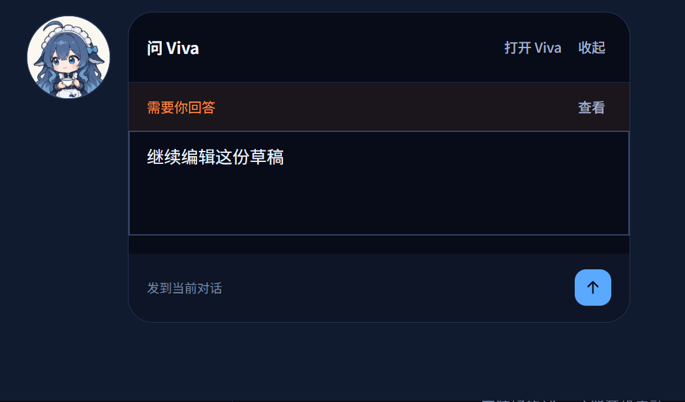

# 桌面岛交互优化实施与 Windows 验收

日期：2026-11-08。实施基线为视觉 PR [#117](https://github.com/JNS0724/Viva/pull/117) 的 `d319a6e`。本报告记录本轮实现与本地证据；线上结果以交互 PR 当前提交的检查为准。

## 实现行为

- 头像采用固定 80px 命中区、72px 半身图。展开后内容出现在旁侧，头像中心不随状态移动；面板宽 440px、最高 320px，与命中区间隔 12px，靠右向左、靠下向上布局。
- 悬停仅提供反馈；短按头像统一展开、收起，“打开 Viva”单独进入主窗口。移动达到 8 个逻辑像素才启动拖动，保留抓取偏移；释放后保持收起，Esc 或指针取消恢复原位。
- 正文选择、滚动及按钮不触发拖动。确认、提问、输入、后台和结果面板都有收起入口；收起不会拒绝、跳过或删除待办。
- 新请求到达输入态时显示通知，保留输入和焦点；点击后才查看请求。单选题明确提示“点选一项，立即回答”。
- 同次应用运行中，文字、文件引用、图片和错误按话题共享。窗口交接用所有权代次拒绝旧窗口回写；迟到附件追加到原草稿。明确新建话题携带已准备的输入，回到已有话题恢复该话题自己的草稿。
- 桌面岛发送需主窗口接收回执，再按发送时的草稿版本清理，避免清除后续输入；文件或图片可单独发送。窗口重建后可恢复该次运行的草稿。

## 本地验证结果

| 验证 | 结果 | 证据范围 |
| --- | --- | --- |
| `npm run typecheck` | 通过 | 主进程、渲染器、preload、插件和测试 |
| `npm test` | 1129 项，1127 通过、2 跳过、0 失败 | 包含草稿交接、过时回执、新话题继承、拖动取消及抓取偏移 |
| `npm run check:i18n` | 通过 | 中英规则同步、文档链接及校验哈希 |
| `npm run build` + `npm run smoke` | 12/12 通过，约 4.1 分钟 | 完整 Windows 源码冒烟，`island-interaction-final-v3` |
| 生产 DOM/CSS 布局 | 13 场景通过 | 固定锚点、输入在操作栏之前、长选项、十附件、错误、请求到达保留焦点、向上展开、正文滚动 |
| 共享草稿集成 | 通过 | 真实 PNG、文件与文字跨宿主、窗口重建、文件单独发送及成功后清理 |
| Windows 原生操作 | 通过已列场景 | 真实短按与拖动、原生输入、Esc 收起与恢复草稿、请求通知、确认、立即回答、后台列表、完成后继续补充 |
| Electron 100% / 150% 缩放 | 10 个状态布局通过 | `--force-device-scale-factor=1` / `1.5`，输入、确认、提问、后台、完成态的锚点及窗口边界；未修改系统显示设置 |

完整冒烟使用官方 Electron 44.7.0，独立临时配置及测试模型；没有调用用户实际会话或真实外部服务。原生状态切换使用产品构建后的桌面岛模块与本地模拟请求，不执行卡片中的命令。自动化截图使用产品 DOM/CSS，没有生成或改绘界面证据。

## 本轮发现并修复的问题

1. 旧输入区域 `order` 规则使操作栏排到输入框之前。已限定新布局顺序，增加 `entryBeforeFooter` 几何断言并通过原生复验。
2. 发送回执先于草稿广播到达时，发送函数的清理阶段会把旧文字重新写回。已移除成功后的无条件写回，集成场景验证成功后草稿清空，并保留后续输入。
3. 新话题准备完成后切换草稿键，曾清掉准备期间输入。已明确继承新话题草稿，同时保留已有话题各自内容；最终完整冒烟通过原失败断言。
4. 强制桌面岛退出时，草稿所有权曾未归还主窗口。已修复并增加回归。
5. 首轮 macOS CI 发现命中区域单测仍用旧布局的窗口坐标，导致指针实际落在新岛之外。测试改为相对实际窗口位置设置内外指针，保留两平台命中语义断言；本地额外执行 macOS 分支通过，真实平台结果以修复后的 CI 为准。首轮 Windows headless 在 GitHub 下载 Electron 时遇到 HTTP 504，未进入测试；没有修改产品代码或降低门禁来绕过。

历史失败日志、最终日志、trace 和截图保留在本地验收输出中；未通过重跑掩盖未定位的产品失败。额外缩放脚本首轮因把 `ELECTRON_RUN_AS_NODE` 设为空值而启动失败，移除该变量后完成验证，未更改产品启动行为。

## 交付与验证边界

- 复用现有头像，无新增运行时依赖、安装包素材或打包范围。两张验证 PNG 仅在 `docs/images`，不进入现有 `package.json` / `out` 打包白名单。
- 草稿仅保留在本次应用运行的内存中，退出应用后不保留；没有新增磁盘草稿存储或清理用户数据。
- 当前本地结果属于 Windows。macOS 当前改动的 CI 和截图需在交互 PR 上单独验收，不能沿用 #117 的全绿结果。人工 macOS 拖动、真实多显示器切换、原生合成器高帧率录屏仍未覆盖；不据此声称所有圆角瞬间闪烁均已消除。
- 100% / 150% 检查使用 Electron 进程缩放参数，不等同于更改真实显示器的 Windows DPI。没有扩展短窗口适配。

复现完整源码回归：安装锁定依赖后运行 `npm run typecheck`、`npm test`、`npm run check:i18n`、`npm run smoke`。最后一条会自动先构建；如果覆盖 Electron 路径，应保持为项目锁定的 44.7.0 版本。
