# Viva Windows 界面问题台账

记录日期为 2026年11月8日。覆盖桌面岛 22 个状态画面，以及前序主窗口字体、占位文字、设置页和后台空态观察。桌面岛问题集中在内容裁切、圆形轮廓、展开态留白和复杂状态的信息可读性。

## 评审范围与版本

| 项目 | 记录 |
| --- | --- |
| 实机环境 | Windows 11 Pro，175% 系统缩放，devicePixelRatio 1.75，Electron 44.7.0 |
| 评审基线 | `80b482c6255d450410131bb8f241a755d60038b6` |
| 文档提交起点 | `7911f69`，相关桌面岛与主窗口样式文件相较评审基线未变化 |
| 证据日期 | 2026年11月7日至8日，沿用该次 Windows 实机评审画面及用户原图 |
| 桌面岛覆盖 | 21 个固定状态样例与 1 个后台列表展开态，复用生产窗口、preload、desk.html 及对应样式 |
| 状态数据 | 命令、文件、问题与任务为展示样例，实际模型与文件业务链路的覆盖有限 |

P1 表示影响内容或关键操作可达，P2 表示明显的可读性或视觉一致性问题，P3 表示美观或信息辨识度观察。问题编号用于关联状态和截图。

## 问题概览

| 编号 | 级别 | 现象 | 证据状态 |
| --- | --- | --- | --- |
| IS01 | P1 | 长内容与底部操作超出桌面岛窗口 | 实测尺寸与截图已确认 |
| IS02 | P2 | 圆形边框偏心且多层轮廓叠加 | 用户 PNG 像素测量及实机截图已确认 |
| IS03 | P2 | 展开态头像贴边且正文持续右缩进 | 多状态截图与布局测量已确认 |
| IS04 | P2 | 复杂工作状态截断主要状态词 | 状态截图已确认 |
| IS05 | P3 | 提问选项与次要操作换行松散 | 状态截图与操作区测量已确认 |
| IS06 | P3 | 向上展开改变内部阅读顺序 | 上下展开截图对照已确认 |
| IS07 | P3 | 后台入口与展开头部主要依靠数字表达 | 视觉观察 |
| IS08 | P3 | 未连接输入的恢复入口辨识度较低 | 视觉观察 |
| GL01 | P2 | 中文等宽区域回退为新宋体风格 | 模型名称实际字体已确认，其他区域有截图观察 |
| GL02 | P2 | 部分主窗口表单占位文字对比度偏低 | 采样颜色与计算已确认 |
| GL03 | P3 | 设置页首屏的当前连接信息层次偏低 | 视觉观察 |
| GL04 | P3 | 后台空态的空列表占据较大宽度 | 视觉观察 |

## 桌面岛问题

### IS01 长内容与底部操作超出原生窗口

原生宿主配置高度为 352 CSS px，本机实测视口为 353px。长问题样例的卡片高 398px，底部到达 y=408，跳过按钮位于 y=350–390。十文件样例的卡片高 564px，底部到达 y=574，第 7 项仅露出上沿，第 8–10 项及 y=516–556 的总结按钮位于视口之外。

桌面页采用 `overflow:hidden`，这些样例缺少可以访问溢出内容的对应滚动区域。受影响内容包括后部附件、移除控件和底部操作。对应状态为 09、21。

### IS02 圆形边框偏心与重复轮廓

用户提供的 191 × 160 PNG 中，沿外圆中心附近横纵中线测得左侧、上侧连续深色边缘各约 6 图像像素，右侧、下侧各约 8 图像像素。头像圆面相对外圆约向左上偏 1 图像像素。该测量适用于这张原图。

折叠态的深色圆环较重。展开态中，岛的底色、外框边线和头像自身 2px 描边同时出现，头像轮廓与面板边框距离很近，状态角标也靠近外框。对应状态包括 01、02、03、07、08、10、16、17。

### IS03 展开态头像贴边与正文空间失衡

引导、确认、提问、输入、附件和后台列表共用靠近左上的 72px 头像。正文从约 86px 后开始，420px 宽提问卡片的正文只有约 315px 宽，头像下方长期保留空列。

输入态的头像上侧与左侧留白窄，下方空白较多，输入行与辅助说明之间的空档偏大。内容卡片则因持续右缩进而减少正文和按钮可用宽度，长文案更容易换行。对应状态为 03、07–15、20、22。

### IS04 复杂工作状态的主要状态词被挤压

长任务、后台计数与悬停工具同时出现时，正在处理被截成正…，时间、进度圈、后台数字和工具仍完整显示。用户难以一眼识别当前状态，多个小控件聚集在同一行。

普通工作胶囊中，72px 头像占据 80px 高容器的大部分高度，任务、时间和进度圈相对偏小。对应状态为 02、05、06。

### IS05 提问操作区的换行与间距不稳定

普通双选项样例的操作区高 88px，跳过单独占第二个 40px 高的行。长选项样例呈阶梯状换行，操作区增至 184px。次要操作进一步推高卡片，问题、选项和跳过之间的层次松散。对应状态为 08、09。

### IS06 向上展开改变内部阅读顺序

向下展开时，头像和状态标题位于问题前。向上展开提问时，问题与选项位于上部，头像和需要你回答位于下部。向上展开输入时，快捷键和目标说明移到输入框上方。

同一功能随屏幕位置出现不同的信息顺序，头像也由贴上边变为贴下边，上下方向的视觉连续性较弱。对应状态为 19、20。

### IS07 后台入口与头部的语义较弱

常驻后台入口主要显示进度圈和数字，后台任务含义依赖悬停说明或展开后的内容。列表展开后头部仍主要依靠数字表达，两条任务本身可读，但入口、头部与任务列表之间的语义衔接较弱。对应状态为 18、22。

### IS08 未连接输入的恢复入口不够直观

未连接时，不可输入原因和 Esc 提示可读，恢复路径主要通过先打开窗口的文字说明表达。用户在桌面岛内识别恢复操作的成本较高。对应状态为 12。

## 字体与占位文字

### GL01 中文等宽区域的字体回退不一致

在主窗口模型显示名称中输入本地样式评审 Model，实际平台字体查询返回 6 个中文字符使用 `NSimSun`，6 个拉丁字形使用 `Cascadia Mono`。中文呈宋体风格，与界面正文的无衬线字体不一致。

个人资料的自然语言字段，以及文件文本、CSV、过程 JSON 和 Markdown 代码块中的中文，也在截图中呈现类似的字体差异。其中，模型名称具有直接平台字体证据，其他区域的结论为视觉观察。

`--font-mono` 缺少明确的中文回退项，通用 `.field` 使用该字体链。此问题的直接实测范围为主窗口，桌面岛各文字区域的实际字体归属仍需单独确认。

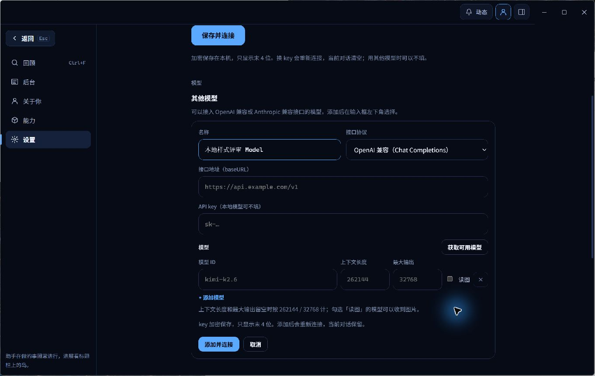

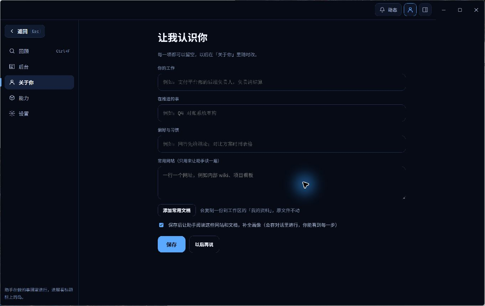

### GL02 部分表单占位文字对比度偏低

前序主窗口可编辑字段的 computed style 采样中，占位文字为 `#757575`，背景为 `#060B16`，字号为 14px。按相对亮度公式计算约为 4.27 比 1，低于普通小字 4.5 比 1 的参考值。普通 `.field` 的占位样式与其他输入区域之间存在不一致。

该数值仅适用于上述表单采样。对话输入框和桌面岛已有各自明确的占位文字 token，桌面岛的问 Viva、补充指令和附件指令等占位文案不能直接套用 4.27 比 1 的测量结论。未连接输入的禁用样式也与普通可编辑字段属于不同状态。

相关截图见 GL01 的模型配置与个人资料表单。

## 前序主窗口信息层次观察

### GL03 设置页当前连接信息的层次偏低

本地自定义模型已连接时，设置首屏仍主要呈现未填写的 DeepSeek key 区块，实际连接信息需要向下滚动。首屏较难直接判断当前使用哪个模型和连接状态。观察发生在约 880px 宽的窗口中。

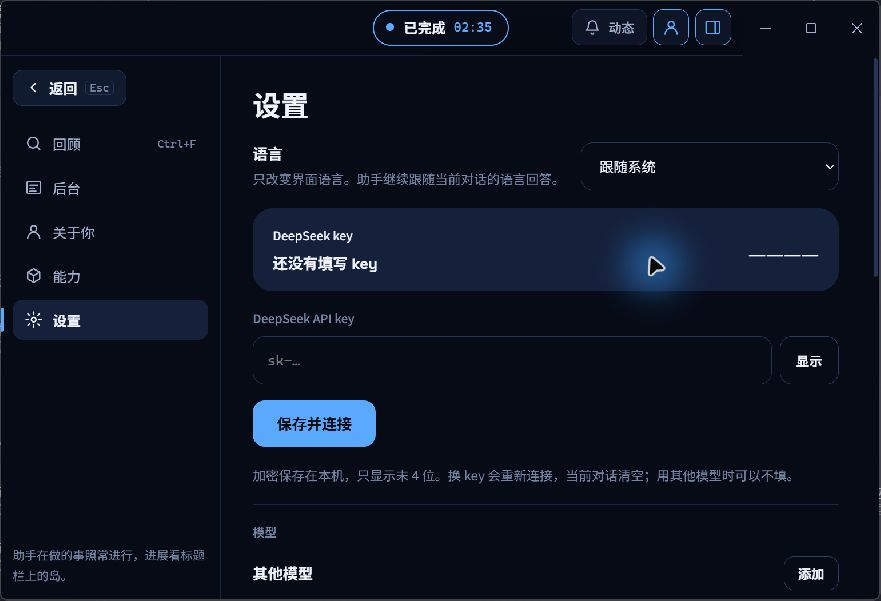

### GL04 后台空态的空列表挤压引导内容

约 880px 宽窗口中，220px 导航与约 280px 空任务列表共同占据较大宽度，右侧引导仅剩约 380px。空列与窄引导区的比例使视觉重心偏向右侧。此观察覆盖任务为空的状态。

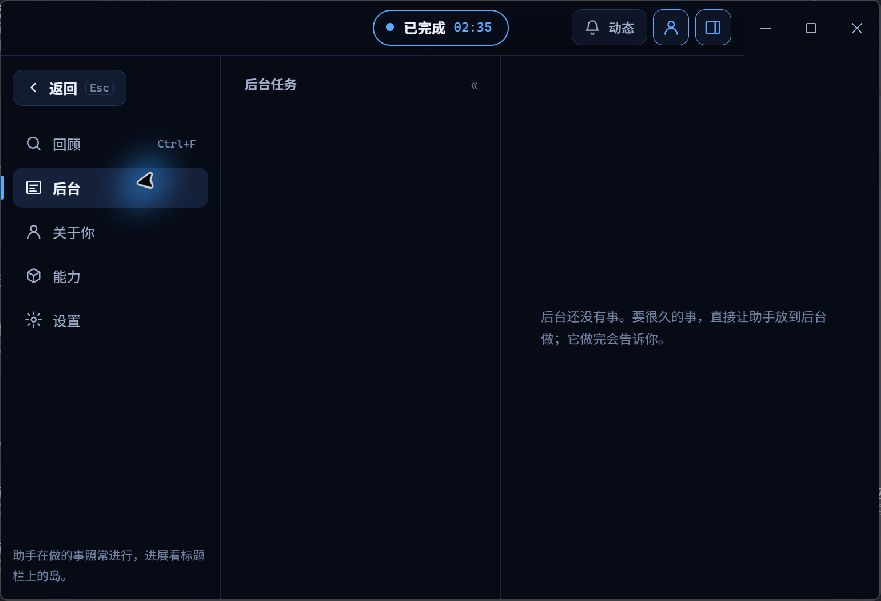

## 动态表现与跨平台待确认记录

| 编号 | 现象或线索 | 已有证据 | 当前确定程度 |
| --- | --- | --- | --- |
| DV01 | 展开后拖动偶尔闪出矩形边框，像圆角短暂消失 | 用户报告。两次快拖在按下约 13–14ms 后，原生视口已缩为 105 × 105，页面面板仍为 560 × 115，位置约 x=−227.43、y=−4.93。采样中的圆角一直为 40px | 窗口与页面尺寸瞬时不一致已确认。采样来自绘制前 requestAnimationFrame，瞬时矩形闪框的原生合成器画面尚待确认 |
| DV02 | 圆形切割边缘有锯齿感 | 用户报告，175% 缩放下的稳定截图可作外观参考。头像源图为 256 × 256，显示为 72 CSS px，约 126 物理像素 | 抗锯齿的具体成因待确认。现有部分工具截图为 JPEG，压缩会影响边缘判断 |
| DV03 | 用户感觉 macOS 没有相同黑边 | 用户跨平台使用感受，相关 CSS 由两平台共用 | 同版本 macOS 实机对照待确认 |

## 桌面岛各状态记录

下表关联每个状态的独立截图。状态 04 属于组件样例，其业务可达性与正常状态存在差异。

| 状态 | 问题编号或覆盖状态 | 画面观察 |
| --- | --- | --- |
| [01 折叠静止](#01-折叠静止) | IS02 | 深色圆环较重，四侧边缘宽度不一致。头像表情和取景可辨认。 |
| [02 折叠悬停](#02-折叠悬停) | IS02 IS04 | 头像与外框接近，提问提示、快捷键、打开窗口入口及拖动手柄共同占用胶囊空间，头像和正文的尺度差异较大。 |
| [03 首次引导](#03-首次引导) | IS02 IS03 | 头像靠近左上圆角，三条提示和主按钮持续向右缩进，头像下方留下空列。 |
| [04 连接中组件样例](#04-连接中组件样例) | 覆盖受限 | 连接文字可读。此画面由强制组件样例呈现，正常桌面岛策略通常将连接中状态折叠。 |
| [05 工作中](#05-工作中) | IS04 | 72px 头像占据 80px 高胶囊的大部分高度，任务、时间和进度圈较小，视觉比例偏向头像。 |
| [06 工作中长标题与后台计数](#06-工作中长标题与后台计数) | IS04 | 长任务、后台计数和悬停工具同时出现时，正在处理被截成正…，多个次要控件仍完整显示。 |
| [07 等待权限确认](#07-等待权限确认) | IS02 IS03 | 头像贴近外框，状态角标接近边缘。正文、命令和操作区持续右缩进，左侧空列较宽。 |
| [08 等待回答](#08-等待回答) | IS03 IS05 | 双选项可读，跳过单独占第二行。头像下方空列与松散操作区共同抬高卡片。 |
| [09 长问题与多个选项](#09-长问题与多个选项) | IS01 IS03 IS05 | 长问题与四个选项将卡片撑至 398px，超过 353px 视口，底部跳过区域被裁切。 |
| [10 展开输入](#10-展开输入) | IS02 IS03 | 头像位于面板左上，上侧和左侧留白窄，下方空白较多。输入行与辅助说明之间空档偏大。 |
| [11 工作中补充输入](#11-工作中补充输入) | IS03 | 补充指令的占位文字与下一步会读到的说明可区分用途，头像偏上和留白失衡沿用普通输入态。 |
| [12 未连接输入](#12-未连接输入) | IS03 IS08 | 不可输入的原因可读，恢复连接依赖先打开窗口的文字说明，桌面岛内的恢复入口辨识度较低。 |
| [13 文件与图片附件](#13-文件与图片附件) | IS03 | 三个附件的名称、大小、图片缩略图和移除控件可见，附件正文仍整体右缩进，头像下方保留空列。 |
| [14 文件拖入提示](#14-文件拖入提示) | IS03 | 蓝色外框和内层虚线框形成重复轮廓，左侧空列继续压缩文件投放区域。 |
| [15 输入发送失败](#15-输入发送失败) | IS03 | 失败说明及输入已保留的提示可读，头像继续贴近左上，输入组的留白分配失衡。 |
| [16 任务完成](#16-任务完成) | IS02 | 完成文字、蓝色外框和勾号可识别，头像轮廓、角标和面板外框聚集在较小区域。 |
| [17 任务错误](#17-任务错误) | IS02 | 错误文字和说明可读，红色外框与头像自身轮廓叠加，头像周围视觉重量偏高。 |
| [18 后台任务入口](#18-后台任务入口) | IS07 | 常驻入口主要显示进度圈和数字，后台任务含义依赖悬停说明或展开后的内容。 |
| [19 向上展开提问](#19-向上展开提问) | IS06 | 问题与选项位于上部，头像和需要你回答位于下部，与向下展开时的信息顺序不同。 |
| [20 向上展开输入](#20-向上展开输入) | IS03 IS06 | 快捷键和目标说明移到输入框上方，头像贴近下侧，与向下展开的阅读顺序和留白分布不同。 |
| [21 十份长名称文件附件](#21-十份长名称文件附件) | IS01 | 卡片高 564px，第 7 项仅露上沿，第 8–10 项及总结按钮位于 353px 视口之外。 |
| [22 后台任务展开列表](#22-后台任务展开列表) | IS03 IS07 | 两条任务、耗时和停下按钮可读。头部主要显示数字，任务含义较弱，列表持续右缩进。 |

## 桌面岛状态截图

### 01 折叠静止

深色圆环较重，四侧边缘宽度不一致。头像表情和取景可辨认。

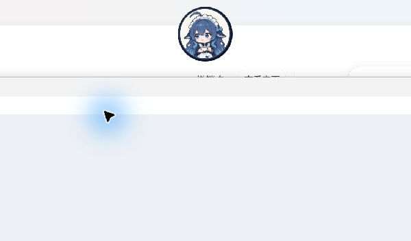

### 02 折叠悬停

头像与外框接近，提问提示、快捷键、打开窗口入口及拖动手柄共同占用胶囊空间，头像和正文的尺度差异较大。

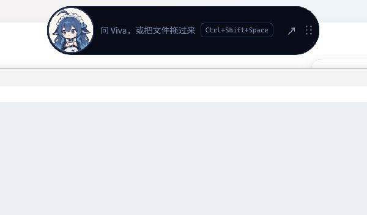

### 03 首次引导

头像靠近左上圆角，三条提示和主按钮持续向右缩进，头像下方留下空列。

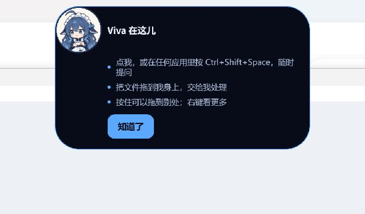

### 04 连接中组件样例

连接文字可读。此画面由强制组件样例呈现，正常桌面岛策略通常将连接中状态折叠。

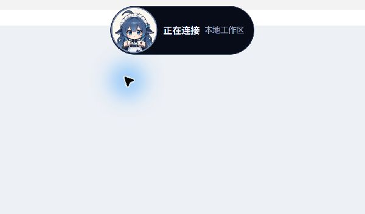

### 05 工作中

72px 头像占据 80px 高胶囊的大部分高度，任务、时间和进度圈较小，视觉比例偏向头像。

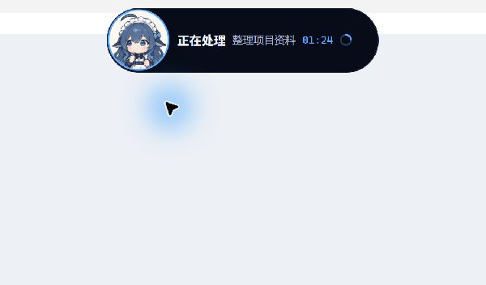

### 06 工作中长标题与后台计数

长任务、后台计数和悬停工具同时出现时，正在处理被截成正…，多个次要控件仍完整显示。

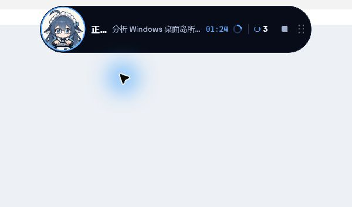

### 07 等待权限确认

头像贴近外框，状态角标接近边缘。正文、命令和操作区持续右缩进，左侧空列较宽。

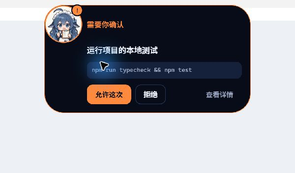

### 08 等待回答

双选项可读，跳过单独占第二行。头像下方空列与松散操作区共同抬高卡片。

### 09 长问题与多个选项

长问题与四个选项将卡片撑至 398px，超过 353px 视口，底部跳过区域被裁切。

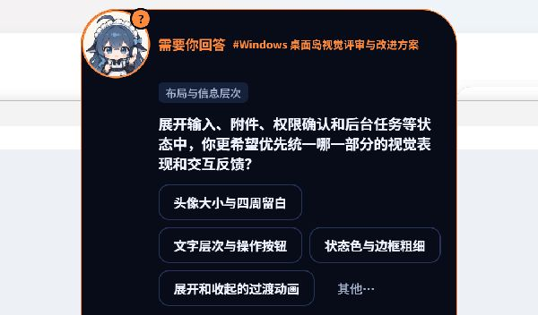

### 10 展开输入

头像位于面板左上，上侧和左侧留白窄，下方空白较多。输入行与辅助说明之间空档偏大。

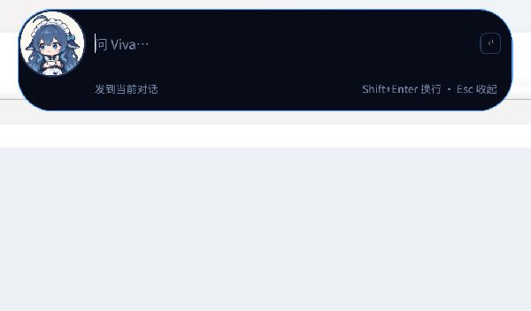

### 11 工作中补充输入

补充指令的占位文字与下一步会读到的说明可区分用途，头像偏上和留白失衡沿用普通输入态。

### 12 未连接输入

不可输入的原因可读，恢复连接依赖先打开窗口的文字说明，桌面岛内的恢复入口辨识度较低。

### 13 文件与图片附件

三个附件的名称、大小、图片缩略图和移除控件可见，附件正文仍整体右缩进，头像下方保留空列。

### 14 文件拖入提示

蓝色外框和内层虚线框形成重复轮廓，左侧空列继续压缩文件投放区域。

### 15 输入发送失败

失败说明及输入已保留的提示可读，头像继续贴近左上，输入组的留白分配失衡。

### 16 任务完成

完成文字、蓝色外框和勾号可识别，头像轮廓、角标和面板外框聚集在较小区域。

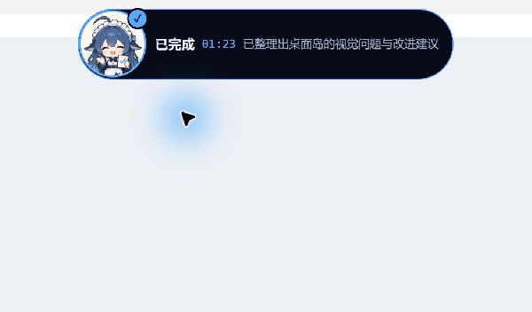

### 17 任务错误

错误文字和说明可读，红色外框与头像自身轮廓叠加，头像周围视觉重量偏高。

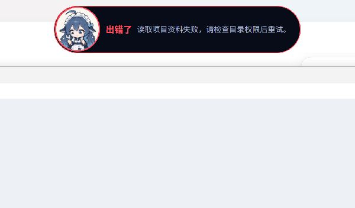

### 18 后台任务入口

常驻入口主要显示进度圈和数字，后台任务含义依赖悬停说明或展开后的内容。

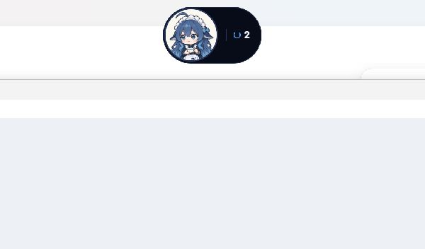

### 19 向上展开提问

问题与选项位于上部，头像和需要你回答位于下部，与向下展开时的信息顺序不同。

### 20 向上展开输入

快捷键和目标说明移到输入框上方，头像贴近下侧，与向下展开的阅读顺序和留白分布不同。

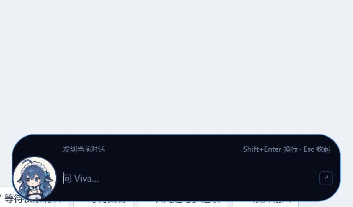

### 21 十份长名称文件附件

卡片高 564px，第 7 项仅露上沿，第 8–10 项及总结按钮位于 353px 视口之外。

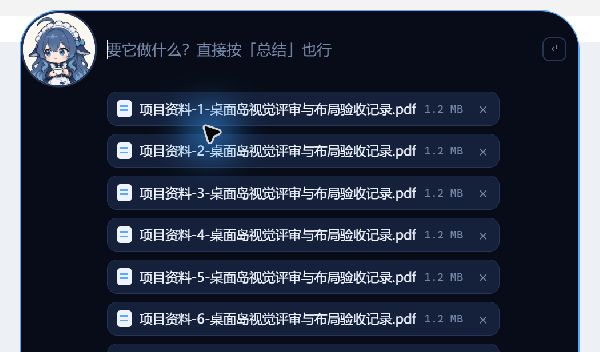

### 22 后台任务展开列表

两条任务、耗时和停下按钮可读。头部主要显示数字，任务含义较弱，列表持续右缩进。

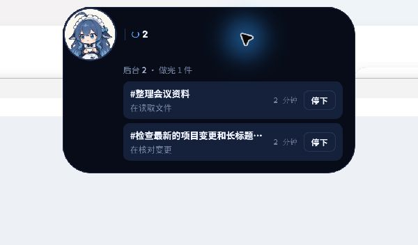

## 其他字体截图

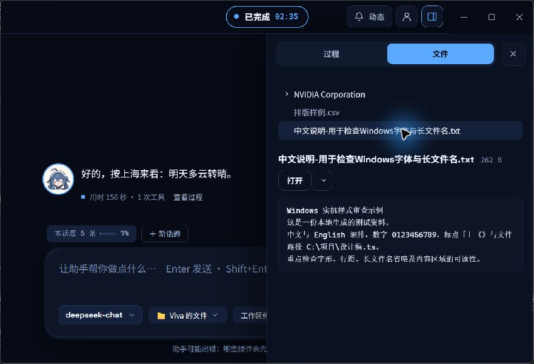

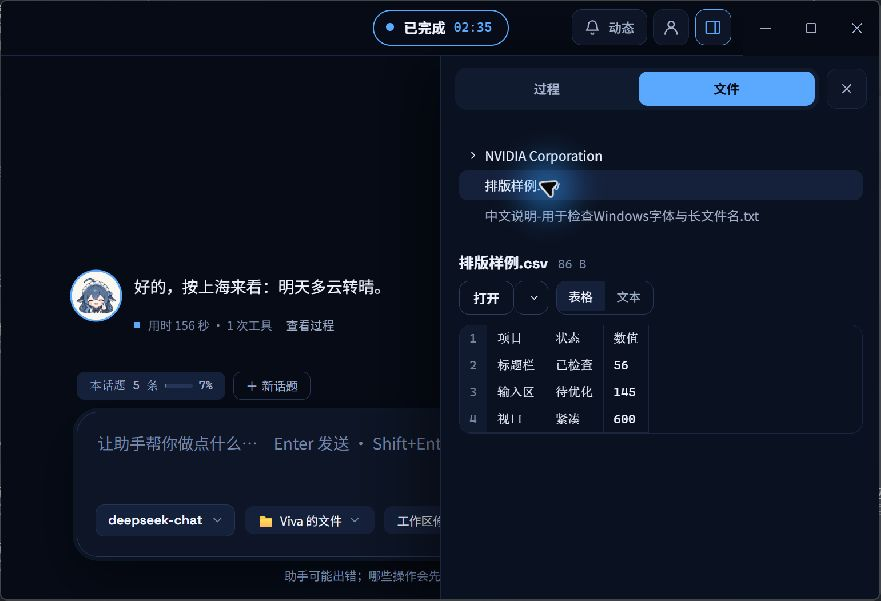

## 证据边界

- 本台账记录固定版本的 Windows 观察，其他系统缩放比例、同版本 macOS 及完整无障碍覆盖仍待确认。
- 状态截图使用固定数据呈现。连接中、附件与拖入提示等样例的业务触发范围受限。
- 鼠标蓝色光晕属于采集时的指针提示，背景应用内容来自透明窗口后的桌面。
- 颜色对比度结论仅覆盖主窗口表单采样，字体查询的直接证据仅覆盖已记录的模型名称。
- 量化数据和素材哈希见 [测量与证据索引](images/qa-windows-ui-issues-20261108/evidence.json)。

## 相关源码

以下位置用于定位对应界面区域。

- [桌面岛样式](../src/renderer/island.css)
- [主窗口字体与表单样式](../src/renderer/styles.css)
- [桌面岛内容构建](../src/renderer/view/island-dom.ts)
- [桌面岛输入](../src/renderer/view/island-input.ts)
- [桌面岛后台列表](../src/renderer/view/island-tasks.ts)
- [渲染器桌面岛布局](../src/renderer/desk.ts)
- [原生桌面岛窗口](../src/shell/desk-island.ts)
- [桌面岛宿主尺寸](../src/shell/desk-place.ts)
