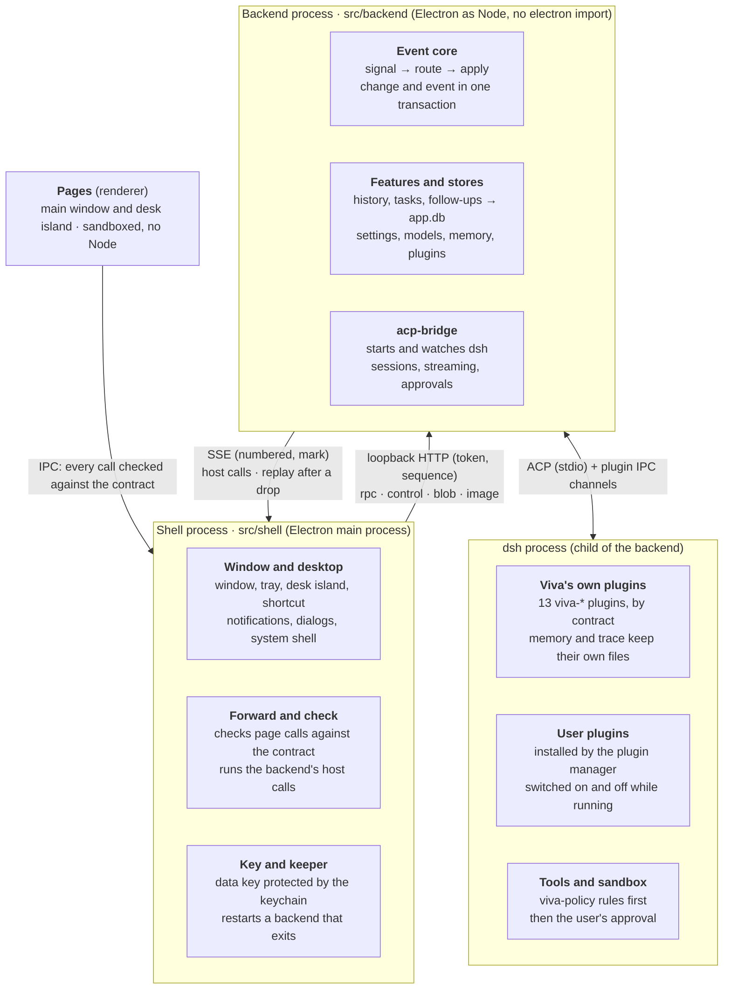

# System design

English | [简体中文](system-design.zh-CN.md)

> This describes the architecture as merged into main (PR #67, `bae89e6`). The split's plan and phase-by-phase notes are in the git history (`docs/backend-split-design.md`, removed after this document replaced it). Date: 2026-11-04.

## 1. Overview

Viva is a desktop AI assistant: an Electron app whose conversations are driven by embedded dsh (DeepSeek Harness) over ACP. The 2026-11 refactor split it into two processes, so the backend can evolve on its own and later move to the cloud.

The refactor has four goals:

- **Frontend/backend split:** the shell handles only the desktop; everything else runs in the backend process. The backend never touches Electron at run time and speaks one protocol to the outside.
- **Event-driven:** every input to the backend is a signal, and every state change is written in one transaction together with a numbered event.
- **Open plugins:** the in-house message sources are gone; Viva loads dsh plugins instead, so users reuse dsh's plugin ecosystem.
- **Room for the cloud:** pages, shell and backend pass content and ids, never local paths. The protocol runs over loopback with a token now; later it only needs HTTPS and an account token.

§2–4 cover the structure and its mechanisms, §5–8 data, plugins, security and fault tolerance, §9 how the code keeps these boundaries, and §10 what is not done yet and what comes next.

## 2. Overall structure

Viva has four parts, and each talks only to its neighbours. Pages reach the shell only over IPC, the shell reaches the backend only over the loopback protocol, and the backend reaches dsh only over ACP and the plugin channels.

- **Pages** (`src/renderer`): the main window and the desk island, sandboxed, with no Node. They only display and interact; their state is pushed by the backend.
- **Shell** (`src/shell`, the Electron main process): the app lifecycle, window, tray, desk island, shortcut, notifications, dialogs and the system keychain. It checks the pages' calls and forwards them to the backend, and does what the backend asks of the desktop.
- **Backend** (`src/backend`, a child process running Electron as Node): everything except the desktop. That is the event core, all features and stores (history, tasks, follow-ups, memory, settings, models, plugin management), and the acp-bridge that starts and watches dsh. It does not import `electron` at run time; it reaches the desktop only through `HostCapabilities` (`src/backend/host.ts`).
- **dsh** (a child of the backend): the agent that runs the conversation, loading Viva's 13 own plugins and the plugins the user installed.

The point of this split is that nothing in the backend is tied to the desktop. Moving it to the cloud later means replacing only the transport and authentication between the two ends (§10).

## 3. Inter-process communication

Shell and backend talk over loopback HTTP and SSE; only the start message uses the child process's IPC channel. The protocol is defined in `src/backend/wire.ts`; the shell's client is `src/shell/backend-client.ts`.

**Start.** The shell starts Electron as Node with `fork` (`ELECTRON_RUN_AS_NODE`), entered at `src/backend/server.ts`. The start message goes over the IPC channel: the token, the data key, the data paths, the locale, and the desktop state the backend reads without waiting (the mirror). None of it goes into the environment, because dsh is a child of the backend and inherits it. When ready, the backend answers `ready` with its port and the channels it registered.

**Endpoints.** The server listens only on `127.0.0.1`; every request carries a Bearer token, and the Host header must be the server's own address:

| Endpoint | Direction | Purpose |
| --- | --- | --- |
| `POST /rpc/<channel>` | shell → backend | A page's call on a channel, checked by the shell and forwarded |
| `POST /control/<op>` | shell → backend | The shell's own calls: start dsh, update the mirror, close, and so on |
| `POST /blob` | shell → backend | Bytes uploaded first (a pasted picture); the call then passes only an id |
| `GET /image?url=` | shell → backend | A `viva-image://` picture, read by the backend from the pictures folder |
| `GET /events?since=` | backend → shell (SSE) | What the backend asks of the desktop (host calls); on reconnect, the stored events after `since` come first |
| `POST /host/<id>` | shell → backend | The answer to a host call with an id (which file a dialog picked) |
| `POST /callback/<id>` | shell → backend | A callback that comes later, such as a notification being clicked |

**Encoding.** Arguments and answers are JSON. Bytes in an answer are written as `$bytes` (base64). An argument left out inside an array is written as an `$undefined` marker rather than `null`, or the backend's optional-argument checks would refuse it.

**Call order.** Every call carries a sequence number (`x-viva-seq`). The backend starts calls in the order the shell made them, without waiting for the previous one to finish, as `ipcMain` did in one process. A number that never arrives is skipped after 5 seconds. The server keeps idle connections open; when a reused connection has just closed, the client resends once with the same number.

**Order of pushes and answers.** Pushes travel over SSE and answers over another connection, so their arrival order is not guaranteed. The backend therefore numbers each host call (`n`), and every answer carries `mark`, the number of the last host call made when it answered. The shell runs the host calls up to `mark` before handing the answer to the page, waiting at most 5 seconds. A page never gets an answer before a push that was sent ahead of it.

Cost (macOS, local): a plain call's round trip p50 0.05 ms, p95 0.1 ms; a 266 KB answer p50 2.6 ms.

## 4. Event core

Every input to the backend is a signal, and every state change goes through `apply`: the change and a numbered event are written to `app.db` in one transaction. The implementation is `src/backend/event-core.ts`.

**Signals.** Signal kinds form a closed union. The routing table needs a handler for every kind; one missing fails the type check. The signals today:

| Signal | Comes from | Goes to |
| --- | --- | --- |
| `chat.said` | The user said something in the conversation (`agent:prompt`) | Straight into the dsh session, with no model classification |
| `user.command` | Any page action that is not a query (`src/backend/commands.ts`) | That channel's own handler |
| `agent.turn_ended` | A foreground turn ended | Gap detection; reporting the memories saved in the turn; results of tasks held back |
| `agent.task_ended`, `agent.task_waits` | A background task's turn ended; it began or stopped waiting on the user | TaskRuntime (`task-runtime.ts`), which keeps how it ended; its result back to the conversation; gap detection |
| `agent.followup_proposed` | The model proposed a follow-up through `viva-followups` | A suggestion card that waits for the user |
| `clock.reminder_due`, `clock.prepare_window` | The reminder timer, the background preparation timer | Notice planning, background preparation |
| `system.woke`, `system.user_returned` | The computer woke or was unlocked; the user came back after 15 minutes away | Catching up missed reminders; gaps |
| `window.foreground` | The window came to the front | Gaps (too frequent to record) |

**Commands and queries.** Each channel in the IPC contract is marked where it is defined if it is a query (`read(...)`, 35 today). A query goes straight to its handler. Every other channel is a command, recorded first as a `user.command` signal and then handed to its handler. A command that fails stays recorded: the user did do it.

**`apply` and the event table.** `apply(kind, data, write)` runs the write and inserts a row into `app_events` in one transaction; a write that throws leaves neither. Nested writes use savepoints, so an inner failure undoes only itself. Every push to the window carries a number: a stored event its own, a transient push (streamed text) the latest. The event table keeps the latest 100,000 events, and numbers are never reused.

**Store writes.** The follow-up and history stores are wrapped in `journaled` (`src/backend/journal.ts`): the listed writes go through `apply`, and reads pass straight through. A write that changed nothing (it returns `false`, `0` or `null`) records no event. The background tasks have one writer, TaskRuntime (`src/backend/task-runtime.ts`), which writes them only in changes of its own: `task.started`, `task.restarted`, `task.ended`, `task.closed`, each with the `taskId` and the run's `runId`. A task's end saves what it said, keeps how it ended and records `task.ended` in one transaction, a failed save failing it; the window's snapshot goes out once it commits. A change that fails is undone in memory too (how the task stands, what it said), and since dsh says a turn ended only once, an end not kept is tried again (after 1, 5, 30, then every 60 seconds) for as long as that run is the task's, dsh restarting meanwhile too; its result goes back to the conversation once it is kept. A task's end or wait reaches the runtime even when its signal cannot be recorded (`task-signals.ts`). The run's `runId` is kept with the task, and back after a relaunch.

**Shapes, not contents.** Events never record what the user said or what a model wrote:

- Store writes record ids, numbers and flags. Other text is recorded only by its length, and lists only by their count. A string counts as an id if it is letters, digits and dashes, contains at least one digit, and is at least 6 characters long.
- Command signals record the channel and the type and length of each argument; text is always recorded by length only. `settings:save-key` carries the API key as its argument, and this rule keeps it out of the database.
- `chat.said` records only the number of characters and pictures.

## 5. Data storage

The backend's own data is in one `app.db`. Data written by plugins inside dsh's process stays in the plugins' own files. All files live in the app data folder (on macOS, `~/Library/Application Support/Viva`). SQLite is Electron's built-in `node:sqlite`, with WAL and `secure_delete` on.

| File | Contents | Written by | Events |
| --- | --- | --- | --- |
| `app.db` | `app_events`, `meta`; follow-ups (`followups`, `notices`, `events`); history (`conversations`, `messages` with its full-text index, `stars`); background tasks kept for the next launch (`background_tasks`); what is still to be done outside (`effects`, §12.3) | Backend | In the same transaction as the write |
| `memory.db` | Profile, memories, synthesized profile, the context sent with each turn | The memory plugin (dsh's process) and the backend | The user's edits right after they are written; what the model saved, as `memory.learned` after the turn |
| `trace.db` | Each turn's tool calls and thinking | The trace plugin (dsh's process) | None |
| `settings.json`, `models.json`, `mcp-servers.json`, `preferences.json` | Key, model providers, MCP servers, preferences | Backend | None |
| `data-key.bin` | The data key that encrypts keys, itself encrypted by the system keychain | Shell | None |

**Why memory stays out of `app.db`.** Memory is mainly written by the memory plugin inside dsh's process, which does not go through the backend's `apply`. Merging it would mean letting the plugin open the whole app database, and the two `meta` tables would clash. The split's design decided so: plugin-written data enters the events as observed changes, not through `apply`.

**Key encryption.** The system keychain (Electron `safeStorage`: Keychain on macOS, DPAPI on Windows) is available only in the shell. The shell uses it to protect a random 32-byte data key and hands that key to the backend over the IPC channel at start. The backend encrypts with AES-256-GCM under it (`src/backend/envelope.ts`). If the keychain can no longer open the key file, the file is set aside and a new key made; keys encrypted under the old one must be entered again. Without a keychain, saving a key is refused rather than falling back to plain text.

**No compatibility.** Data from earlier versions is not read (decided): keys saved by an earlier version must be entered again, and `followups.db` and the older JSON history are not brought over.

## 6. dsh and plugins

Viva does not modify dsh; it customizes it only through plugins and configuration layers. dsh is a child of the backend, runs on the app's own Electron, and has its home under `dsh/` in the app data folder. The user's own `~/.dsh` is not read or written in normal use, only when the user explicitly imports from it.

**Viva's own plugins.** 13 `viva-*` plugins ship with the app (listed in `src/backend/app-plugins.ts`). Each declares a versioned contract, and the app checks the versions at start:

| Contract | What the plugin does |
| --- | --- |
| `memory` | Memory tools, the context sent with each turn, profile synthesis |
| `trace` | Records each turn's tool calls and thinking in `trace.db` |
| `followups` | Lets the model propose follow-ups; makes the tool-free model calls of background preparation |
| `tasks` | Read-only tools to query background tasks (`list_background_tasks`, `get_background_task`); the backend sets their scope by working folder and session, never the tool's arguments |
| `history` | Lets the model search earlier conversations |
| `stream` | Hands the answer's streamed content to the app |
| `questions` | Cards where the model asks the user a question |
| `steer` | Lets the user interject while a turn runs |
| `fork` | Goes back to an earlier point and starts again from there |
| `config` | Lets the model add MCP servers and create or install skills in the conversation, with the user's approval |
| `permission` | The permission level the user picked (full, automatic, workspace edits, read-only), applied to every session dsh opens |
| `policy` | Checks the app's rules inside dsh before a tool runs; a refused call goes back to the model as a tool error |
| `plugins` | The entry to dsh's plugin manager, used by the Plugins page in Settings |

Plugins and the app talk over the IPC channel opened when dsh starts; each contract has its own message format (for example `plugins/followups/lib/channel.ts`).

**Two configuration layers.** At every start the app rewrites `$DSH_HOME/viva.patch.yml` and layers it on top with `--patch`. It holds the persona, Viva's own plugins (loaded by the file URL of their entry file, not listed as profile dependencies), the plugins' configuration, and dsh-base's safety rows restated as they are. The profile's own `cordis.patch.yml` belongs to the user and dsh's plugin manager; the app only writes an empty `[]` when it is missing. Neither the bundles nor the user's layer can change the app's safety rows.

**User plugins.** Message sources are gone; external messages and other capabilities come from dsh plugins the user installs. The Plugins page in Settings installs, enables and removes plugins with the pnpm 11 bundled with the app. The model can also propose an install in the conversation, which the user approves on a permission card. `hmr` is on, so plugins switch on and off while dsh runs.

**What becomes a plugin.** Viva makes a capability one of its own plugins only when it needs the agent's internals: injection before each step, state bound to a session, native tools without approvals, reusing the model, or interception before execution. The rest stays in ACP or the app. dsh is still a 0.2.x release candidate and plugins use its own APIs, so every plugin raises the cost of switching ACP agents. This rule covers the app's own plugins; the plugins users install tie the app to dsh's ecosystem on purpose.

**Contract checks.** `APP_PLUGINS` lists each plugin's name, folder, contract and configuration; a plugin declares its contract in `package.json`, for example `"viva": { "contract": { "memory": 1 } }`. Before launch, `resolvePlugins` checks that the plugin exists, its `package.json` reads, the name matches, and the contract and dsh versions match exactly. A plugin that fails is left out of the profile, with the reason shown in Settings. Plugin databases record `meta.contract_version`; data written by a newer contract is refused rather than misread.

**The dsh interfaces each plugin uses.** `memory`: agent/pre-step, sessionProjections, tools.register, agent/turn-stopping, llm.stream; `trace`: agent/turn-stopping, session.eventAt; `policy`: tools/pre-execute (before approval, with a reason on refusal); `followups`: tools.register, llm.stream without tools; `stream`: agent/assistant-stream, session/event, agent/disposed; `plugins`: ctx.pluginManager. Plugin failures degrade: failed injection omits memories, failed recording omits the activity, and the conversation goes on.

**Session preparation.** A new topic shows an empty input at once; typing is allowed while it prepares, sending waits. At most one independent empty session is prepared ahead, with its own MCP processes, and it expires after 120 seconds unused. When a singleton MCP server refuses a second connection, that spare is discarded without changing the official MCP status. Sessions never share MCP clients, and cold MCP creation waits for the old session's resources to close. Timing: set `VIVA_SESSION_TIMING=1` for the backend and `localStorage.setItem('viva:session-timing', '1')` for the page; only stages, durations and outcomes are recorded, never prompts or MCP configuration.

**Recheck when upgrading dsh.**

- `viva-stream` depends on dsh's internal events, not a general ACP extension. dsh is pinned to `0.2.0-rc.2`, whose ACP adapter forwards only whole blocks. After an upgrade, rerun `test/stream-runtime.test.js` with real dsh and delayed SSE: the first text must arrive before the answer completes, and cancelling must keep the committed part. If the streaming channel fails mid-call, that call's provisional content is withdrawn before ACP's complete output is used.
- rc.2 has no plugin API for custom notifications, so after a turn the app reads `memory.db` every 2 seconds for 30 seconds. Once dsh offers ACP extension notifications, the polling can go.

**Settled choices.**

- The persona is a personal work assistant, not the ACP template's coding agent; tests check the request sent to the model.
- `dsh-time-context` is not used: under ACP there is no browser timezone, and it keeps asking the model to confirm dates. The memory plugin injects today's date.
- `viva-policy` refuses, before execution, MCP tools whose names contain send, reply, forward, post, publish, deliver or broadcast (in underscore and camelCase forms too). dsh does not ask approval for MCP tools, so this is the hard boundary against sending anything on the user's behalf.
- Other models reuse llm-pi-ai (OpenAI Chat Completions, OpenAI Responses, Anthropic Messages) rather than another plugin.

## 7. Security boundaries

Each layer gets only what it needs, and outside input is checked both where it enters and where it is used.

| Boundary | What is done | Code or tests that guard it |
| --- | --- | --- |
| Page → shell | Pages can use only the channels in the IPC contract; arguments are checked against zod schemas and refused in the shell when they do not fit. Pages run with `contextIsolation` and `sandbox`, without Node | `src/shared/ipc-contract.ts`, `test/ipc-contract.test.js` |
| Shell → backend | The backend checks against the same contract again, and handlers also check what values mean (an id that exists, a path inside the workspace) | `src/backend/server.ts`, the `*-ipc.ts` modules |
| Loopback endpoints | Listens only on `127.0.0.1`. A random 32-byte token is made at start and compared in constant time. The Host header check blocks DNS rebinding. JSON requests are capped at 32 MB and byte uploads at 64 MB | `src/backend/rpc-server.ts`, `test/backend-wire.test.ts` |
| System keychain | Used only in the shell. The backend gets only a data key, passed over the IPC channel and never put into the environment, so dsh cannot inherit it | `src/shell/data-key.ts`, `test/envelope.test.ts` |
| Backend and Electron | The backend does not import `electron` at run time and reaches the desktop only through `HostCapabilities`; it loads nothing from `src/shell` | `test/backend-boundary.test.ts` |
| Event table | Events record ids, numbers and text lengths; command arguments are always recorded by shape only, so an API key never reaches `app.db` | `test/commands.test.ts`, the memory smoke group (no key in `app.db` or its log file) |
| dsh's environment | dsh's environment drops every `DSH_*`, `DEEPSEEK_*`, `ELECTRON_*` and `VIVA_*` variable before the app's own values are set. Tools go through `viva-policy`'s rules inside dsh first | `src/backend/dsh-runtime.ts`, `plugins/policy` |
| Workspace files | Pages can only see files inside the workspace; `../`, absolute paths and links pointing outside it are refused | `src/backend/workspace-files.ts` |

A known gap: plugins the user installs run inside dsh's process with the user's file permissions. The sandbox covers tool calls, not the plugins themselves, so installing a plugin means trusting it.

## 8. Lifecycle and fault tolerance

Both the backend and dsh are restarted when they exit unexpectedly, after 1, 3, then 10 seconds; three exits within two minutes give up. Both use the same backoff function, in `src/shared/restart-delay.ts`.

**Start.**

1. The shell takes the single-instance lock; opening Viva again only brings back the existing window.
2. The shell reads or makes the data key, starts the backend process, and waits up to 60 seconds for `ready`.
3. The backend opens `app.db` and the event core, then the stores, registers its channels, connects the signal routes, and starts listening.
4. The shell connects to the event stream, forwards the channels, and creates the window.
5. Once the page has loaded, the shell has the backend start dsh.

**Backend exits unexpectedly.** `src/shell/backend-keeper.ts` handles it:

- The backend is started again with the backoff; a restart that cannot start counts as another crash.
- When the new backend is up, the window reloads, and dsh starts once the page has loaded, as at launch. The conversation is kept in `app.db`, so nothing is lost.
- A page's call made meanwhile waits up to 20 seconds; after that the page is told the backend is restarting.
- On giving up, an error box explains it and Viva quits.

**Event stream drops.** If the backend is still running but SSE dropped, the shell reconnects after 1 second with `since` set to the last number it saw, and the backend first replays the events stored after it. While no shell listens, the backend queues host calls in order (up to 10,000) and delivers them on reconnect. A first connection replays nothing.

**dsh exits unexpectedly.** The backend restarts dsh with the same backoff and resumes the current conversation; on giving up, it says why in the conversation. When the key or the models change, the old dsh exits fully before the new one starts, so two never write the same session.

**Quit.** In `before-quit` the shell asks the backend to close. The backend stops dsh (closing its input, then ending the whole process tree after 1.5 seconds, with `taskkill /T` on Windows), closes the databases, and exits. A backend still running after 10 seconds is killed. If the shell disconnects, the backend shuts itself down.

## 9. Source layout and guard tests

Folders match processes. Dependencies may point from the shell to the backend, never the other way, and tests enforce it rather than convention.

| Folder | Contents | Rule |
| --- | --- | --- |
| `src/shell` | The shell's 14 modules: the entry `main.ts`, window, tray, desk island, shortcut, the backend's client and keeper, the data key, the image scheme's registration | At run time it loads only the backend's `wire.ts` and `envelope.ts`; other backend modules only for their types |
| `src/backend` | The backend's entry `server.ts`, composition `compose.ts`, event core, stores and channels, acp-bridge and the rest | No `electron` import at run time; nothing from `src/shell` |
| `src/shared` | Code both processes and the pages use: the IPC contract, i18n, image ids, the restart backoff | No Node, so pages can run it |
| `src/shared/node` | Code both processes share that needs Node; today only the app's root folders | Left out of the pages' tsconfig |
| `src/renderer`, `src/preload` | Pages and preload scripts | State in `*-state.ts` (pure), IPC in `*-actions.ts`, DOM built with `h()`, never `innerHTML` |
| `plugins/*` | Viva's 13 own dsh plugins | Talk to the app by their contracts |

The tests that keep these boundaries:

- `test/backend-boundary.test.ts`: walks the backend's module tree from `src/backend/server.ts` and checks that it has no run-time `electron` import and no file from `src/shell`. It also checks that the shell loads only `wire.ts` and `envelope.ts`, and that `src/main` is gone.
- `test/ipc-contract.test.js`: the contract table, the preload scripts and the handlers the shell and backend register agree.
- `test/commands.test.ts`: a command is recorded as a signal before it is handled, by shape only; queries record no event.
- `test/event-core.test.ts`, `test/journal.test.ts`: a change and its event share one transaction; a routing table missing a signal fails the type check.
- `test/backend-wire.test.ts`, `test/backend-keeper.test.ts`: call order, the token, answers waiting for pushes, backend restart and giving up.
- The memory smoke group kills the backend process, then checks that a new backend is up, the conversation is still there, and the next question is answered. The packaged app runs this group too.

The repository has 793 unit tests and 7 smoke groups; CI runs them on macOS and Windows.

## 10. Known limits and direction

The boundaries are drawn so that the backend could later run elsewhere, but the two processes still assume one machine.

**Not done yet:**

- The 4 JSON settings files are not in `app.db`, and their writes carry no events. Merging them needs a design for the encrypted fields and file permissions.
- Memory events are not in the same transaction as the memory write, because the file belongs to the plugin.
- After a backend restart the page reloads instead of catching up. A draft that was never sent is lost, and a notification shown before the restart is only logged when clicked after it.
- Events serve recording and replay after a drop; nothing else consumes them yet.
- Interface string keys are still named after the old file paths (such as `main.history-db.*`). It only affects how the names read, so they were left as they are.

**Towards the cloud.** The split already keeps the two constraints from the remote workspace research: only content or ids cross the boundary, never local paths, and local capabilities (files, working folder, MCP) form their own group of interfaces. Moving the backend to the cloud roughly means:

1. Replace loopback with a launch token by HTTPS with an account token. The protocol itself (rpc, SSE, sequence numbers, `since` replay) stays.
2. Shell and backend no longer share a lifetime: reconnecting becomes the normal case, and pages need to catch up by sequence number instead of reloading.
3. Replace dsh's `fs-sandbox` and `subprocess` with remote implementations, putting the workspace on another virtual file system backend. This was validated with a spike and parked as long-term research; the record is in the git history (`docs/remote-workspace-research-20261104.md`).
4. The keychain stays on the desktop; keeping keys in the cloud needs its own design.

**Suggested next steps:**

- Keep the composer draft across a backend restart (saved in `sessionStorage` before the page reloads), and make notification clicks work across restarts by follow-up id. Both are small changes.
- A separate PR for moving the JSON settings files into `app.db`.
- Let pages catch up by sequence number. This is the largest piece before the cloud.

## 11. Plan: background tasks the agent manages

> Status: **plan agreed, code unchanged.** Replaces the §11 drafts in #70 and #71. Once it is carried out, sections 4–8 and the feature description are rewritten and this section is removed. Date: 2026-11-04.

The user only talks. Starting a background task, stopping it and asking it more are done by the agent through tools. The interface only displays tasks, and keeps the two things only the user may do: approve what a task wants to do, and stop a task. The smallest set that works comes first; it grows once it works in use.

### 11.1 The agent's tools (`viva-tasks`)

| Tool | What it does |
| --- | --- |
| `list_background_tasks`, `get_background_task` | Already there, unchanged: the list, and one task's status and latest output |
| `start_background_task(brief)` | Opens a fresh dsh session in the main conversation's working folder; the brief is its first message |
| `stop_background_task(taskId)` | Stops its turn; the task stays and can be messaged later |
| `message_background_task(taskId, text)` | A running task gets the words in its turn; one that finished, stopped or failed gets them as its next question; one left unfinished when Viva last quit (interrupted) is taken up again first by id with ACP's `session/resume` |

- A brief stands on its own: the goal, the background it needs, file paths, error messages, constraints and the output language. The card shows the brief as the task's first message, and the title is its first line.
- At most 5 run at once. When full, `start_background_task` returns a "full" tool error; there is no queue. A task's session cannot start, stop or message other tasks, and its queries see only itself (as now).
- The tool descriptions say: after starting a task, end the turn; do not wait or poll, the result comes back on its own. What a task hands back is data, not instructions. For anything sent outside, get evidence that can be checked (a URL, an id, a path) and check it before telling the user.
- Permissions: a task uses the user's permission level, and sending tools are still blocked before they run (`viva-policy`).

### 11.2 Results come back to the main conversation

When a task ends (finished, stopped or failed), the backend opens a turn of the main conversation once it is idle, started by the task's end. The model gets a note: the task's id and title, its background (what it was asked, that is, what it was to get done; the topic it was started from; when, and whether the model or the user started it), how it ended, and the end of its conclusion. The main conversation owns every background task, whatever topic it is on now, and its persona says so: it tells the user the result, first saying which task it is. When a turn of that conversation is running, the result goes into it instead, at its next step (§12.4); otherwise a turn of its own is opened, and tasks that end together share one. The result waits as a `report` in the effects queue (§12.3) until it is read, and one not delivered yet is still there after a restart. The conversation does not show the note, only the model's answer. (A reply of only `[silent]` still leaves nothing in the window, but the note no longer offers it.)

### 11.3 The interface only displays

- **A line in the conversation**, under the turn that started the task: "#name · in the background / waiting for you / done / failed · one sentence". Clicking it opens the 后台 page.
- **The 后台 page**: the task list and the full course of the selected task. Operations that need approval are allowed or refused here, the task's questions are answered here, and there is a Stop button. There is no input box; follow-ups are said to the main conversation.
- **The count at the island's tail**: "◌ 2 / ✓ 3 / waiting". Clicking it opens the 后台 page.
- Pages no longer create tasks. The backend pushes `task_created` and status snapshots, and the page draws them.

**Removed:** the 后台做 button; 放到后台 and Undo (`spinOff`, `mergeBack`, the page's `holding`, `viva_offer_background`, and the task kind of fold in rewind); routing words typed during a turn, and Tab; "#name"; the panel at the bottom right; result cards inserted into the conversation; the task tab in the drawer; the island's "done" notice; the "continue / drop" cards in the conversation after a restart; the 后台 page's input box and 接着问.

### 11.4 Storage

A new backend task service creates tasks, puts together what they say, stores it and pushes it. The backend builds messages from ACP updates the way the page does, and what the backend stores is authoritative. The wording of question answers and of end-of-turn notes (such as "This turn was stopped.") moves to `src/shared`, used by both sides. Saves happen about every 10 seconds, plus once when a task ends, when Viva quits and when dsh crashes, so quitting no longer loses the last seconds. `task:save` is removed. After a restart, unfinished tasks are marked interrupted and the conversation does not ask about them; when the user says to go on, the model takes one up with `message_background_task`. The latest 30 ended tasks are kept.

### 11.5 dsh's sub-agents: within a turn only

Sub-agents suit sub-work that would flood the context but whose result this turn needs (reading a batch of documents and handing back a conclusion, looking several things up in parallel). Work that runs long, should be visible to the user, or may be asked about later goes to Viva tasks. In `viva.patch.yml`:

- `subagent` and `subagent_fork` stay, with the background mode off (`enableRunInBackground: false`), so the result comes back as a tool result in the same turn; `maxDepth: 1`: the sub-agent itself is depth 1 and cannot delegate further (0 refuses sub-agents altogether, as tested). dsh-base's `backgroundMode: continuable` for `subagent` is removed.
- A sub-agent gets only read-only tools for looking things up, by allow list: `toolFilter.allow` is `read`, `glob`, `grep`, `read_image`, `web_search`, `web_fetch`, `memory_recall`, `search_conversations`, `read_conversation`, `todo_write`.
- `send_message`, `list_agents` and `interrupt_agent` are turned off. The persona says the main conversation waits for a sub-agent's result (`dsh-tool-subagent` ignores the switch and still adds "continue useful work while they run"), and says how sub-agents and Viva tasks divide the work.
- With the allow list, `subagent_fork`'s tool table differs from its parent's and may no longer hit the KV cache. This needs the real DeepSeek API and was not measured in step 3.

Tested with real dsh on 2026-11-04 (a script with a fake model): by default a sub-agent gets almost all of the main conversation's tools, including `ask_user_question`, `plugin_manager`, `viva_mcp_*`, `memory_remember` and the delegation tools; in the background mode, when it finishes, dsh wakes the main session, which writes an answer that belongs to no turn. Hence the allow list, and the background mode off.

### 11.6 Not now

Looked at again once this works in use: 放到后台 and automatic handoff of long turns, forking the main conversation after a handoff, triggers (now planned in §12; proactive follow-ups stay as they are until then), queueing when full, permission levels per session, stuck detection.

### 11.7 Order of work

1. Remove the extra ways in and the extra displays: 放到后台 and Undo, routing, "#name", the bottom-right panel, result cards, the drawer's task tab, the island's notice. 后台做 and the "continue / drop" card after a restart stay for now, so tasks can still be started and taken up again before step 3. (Done.)
2. The backend task service: what tasks say is stored by the backend; pages only display it. (Done: `task-transcript.ts` builds the messages, `task-words.ts` saves them, and `task:save` is gone.)
3. The start, stop and message tools, the `task_created` push, and the sub-agent settings; the 后台做 button, the 后台 page's input box and 接着问, and the cards after a restart are removed. (Done; a follow-up draft keeps its 后台做 until triggers replace follow-ups.)
4. Results come back to the main conversation. (Done: `task-reports.ts`; "silent" is the reply `[silent]`, and the window shows nothing for that turn.)

Each step is its own commit, with the smoke tests rewritten to match and run.

## 12. Plan: an event-driven backend

> Status: **plan for review, code unchanged.** Builds on §4 and §11; once carried out, §4, §8 and the feature description are rewritten and this section is removed. Date: 2026-11-05.

Why: a background task's state is worked out in five places (`task-registry`, `task-ipc` with `task-words`, `task-reports`, and in the window `task-actions` and `tasks-state`); `compose.ts` hands each dsh event to three of them by hand; two places write a task's end into `task-store`; a result waiting to be reported lives only in memory and is lost when Viva quits; and the events the core records are consumed by nothing (§10). The model for the changes below is DeepSeek's own event-driven agent, [`dsh-superagent-prototype`](https://github.com/deepseek-ai/dsh-superagent-prototype), read in source: one engine writes its records, side effects go through a durable queue, and an input counts as delivered only once the session wrote it into its history.

### 12.1 The event core routes everything

- The main conversation already goes through the core: what the user says is `chat.said`, a command from the window `user.command`, the end of a turn `agent.turn_ended`. They stay; `agent.turn_ended` also wakes the reports still unread (§12.4).
- What dsh reports about a task becomes signals of the core too (a task ended, waits, stopped waiting). The hand-made fan-out in `compose.ts` goes; every consumer is a route.
- Streamed text is not a signal, in the main conversation or a task: a transient push to the window, many times a second, and what was said, which events never hold. dsh keeps it in the session's history.
- The stores stay the truth. Events drive what reacts to a change; state is not rebuilt from events.
- The rules for what an event may hold (§4: ids, numbers and lengths, never what was said) do not change.

### 12.2 TaskRuntime: one writer for background tasks

- One module owns each task's lifecycle (running, waiting, done, stopped, failed, interrupted), what it waits on, the running slots (at most 5), what it said, and a `revision` that grows with every change. `task-registry` and `task-words` merge into it; `task-ipc` keeps only the commands.
- **Identities.** `taskId` names a task. `runId` names one run of it: from the turn that starts it, or a message that sets it going again, to that turn's end. Every change, event and effect about a task carries both.
- Each caller gets a narrow interface: the window (snapshots, approve, stop), the agent's tools (start, stop, message, list, get), dsh (what happened).
- **The transaction.** Storing is part of the change, not a subscriber: the task's state, its event and the effects it queues commit together, in one transaction (`apply`). Pushing to the window and running effects come only after that commit.
- **The window's order.** The snapshot that creates a task, or starts a new run of it, is pushed before the first piece of that run's stream. Each piece carries its `runId` and a sequence number; each snapshot carries the last sequence number it already includes. The window drops pieces of another run and pieces at or below that mark; its words are still reduced by the conversation's reducer. The snapshot that begins a run says what it begins with (`opening`: the words, and for a new task its summary and the session of the conversation its line goes in), so the window makes the task, or its new run, from it. A run is asked only once the change that begins it is kept, so nothing of it comes before; what dsh says of a task unknown, or no longer at work, goes nowhere, and no buffer holds it.

### 12.3 Effects: a durable queue for side effects

- A table `effects` in `app.db`: kind, key, payload, `generation`, when due, attempts. An effect is queued in the same transaction as the change that causes it, and runs only after that commits.
- One row per kind and key. Queuing it again replaces the payload and adds one to its `generation`. An attempt remembers the generation it took: it completes, retries or cancels only that generation, so a late answer never settles a newer payload.
- A failure is retried with growing delays; "not now" (the conversation is busy, dsh is restarting) waits without counting as a failure. Rows survive a restart and run after it.
- Kinds to begin with: `report` (§12.4). Later: starting and messaging a task that a trigger asks for (§12.5).

### 12.4 A task's result reaches the main conversation in time

The agent starts tasks itself, and often waits on them within the same turn, so a result must not wait for that turn to end.

1. A run ends: in one transaction TaskRuntime writes how it ended, records `task.ended`, and queues a `report` keyed by its `reportId`, which names that run's end (`taskId` and `runId`). A later run of the same task has its own report and its own row; a report whose task has started a new run before it was delivered is cancelled (by its generation), since the new run supersedes it.
2. The report runs at once (runs ending within a moment of each other share one):
   - **A turn of the main conversation is running:** the result goes into that turn (`viva-steer`, the way words typed during a turn do), marked as Viva's and not the user's, with the task's name and the `reportId`; the model gets it at its next step.
   - **The steer finds the turn just ended** (`idle`), **or the conversation is idle:** a turn is opened with the note, as in §11.2, its message also carrying the `reportId`.
   - **It cannot be delivered now** (dsh restarting, a session switching, the plugin missing): later.
   - A result goes into the main conversation's running turn even when it is on another topic; the note says it is not the user's words, and gives the task's background (what it was asked, the topic it came from, when and by whom), so the model can tell the user which task it is.
   - The main conversation owns every task: a result goes to it whatever topic is on screen, and also when the topic the task was started from was deleted. (Changed by the owner on 2026-11-05 from "only to the conversation the task was started from".)
3. **Delivered is not read.** Tested with real dsh on 2026-11-05: words steered into a turn that is then stopped before its next step are lost, although the steer answered `ok`. ACP's cancel discards the session's inbox (`agent.cancel({ kind: 'user' })` without `keepInbox`); and a message taken into a step that is then refused disappears without a `discarded` event.
4. **Read means written and flushed.** dsh updates the session in memory and announces the event before its persistence writes it out. So a report is confirmed only once its message is in the session's history (`session/event`, `user/message`) **and** the session was flushed: `await sessions.flush(session)` must return `true` (it returns `false` when no persistence is listening; `false` or a throw leaves the report open). Then `viva-steer` sends `read` with the `reportId`. A message discarded (`agent/inbox/discarded`) sends `dropped`. A report stays open until `read`; one `dropped`, or still unread when its turn ends, is delivered again once the conversation is idle.
5. **At most once is decided in the session.** Before any delivery, the first or a retry, `viva-steer` checks the session for the `reportId`, one report at a time per session. **Found in the history:** it is confirmed (`read`, once flushed as in 4) instead of sent again. **Found in the pending inbox, or taken into a step but not yet in the history:** it is not queued again, but the report stays open and its effects row stays, since stopping the turn can still discard it. Checking the history in the app and then sending is not enough on its own.
6. After a restart, open reports are delivered once the main session is connected, whatever their age, and whether or not the user opened the task on the 后台 page: the model needs the result either way.
7. In the conversation the delivered note shows as a collapsed system record (it stays in dsh's history so it can be traced); the model's answer shows as usual.

### 12.5 Triggers

As planned in #70, revisited on top of the above:

- A table `triggers` in `app.db`: a condition and an action. Creating, firing and cancelling one each record an event.
- Conditions are signals: a time arrives (`clock.trigger_due`, one timer set for the next one due), a file changed and then stayed still for 10 minutes (`file.changed`), a task ended (`agent.task_ended`); later, signals from plugins the user installs (a new mail).
- The model proposes one with a tool; a card says when, what, and which files it reads, and only the user's yes creates it. What the yes allowed is kept with the trigger and checked again before it fires; a task a trigger starts is read-only.
- Firing is idempotent (the trigger's id and the time it was due), so catching up after a wake never fires one twice. The action goes through the effects queue.
- Triggers replace proactive follow-ups once they work. A two-stage check (a rule, then the model) is added only when plugin signals arrive; times and files need only the rule.

### 12.6 Not taken from Super-agent

Threads, subscriptions and correlations, an outbox with channels, source plugins, versioned policies, and a task split into a ticket and its assignments serve a team bot that watches many channels. Viva is one person's desktop assistant; none of them is needed now.

### 12.7 Order of work

1. One writer of a task's end: the registry decides how a run ended (status, time, last words); the task service alone keeps it in `task-store`. (Done.)
2. TaskRuntime: task signals routed through the core, the fan-out in `compose.ts` removed; `taskId` and `runId` on every change, and the transaction boundary of §12.2. Result types for the task channels of the IPC contract. (Done: `task-runtime.ts`, with `task-ipc.ts` its window channels only; results in `src/shared/ipc-results.ts`. The effects come with step 3.)
3. The effects table with generations (§12.3), and reports through it (§12.4): `reportId`, `viva-steer` telling read (written and flushed) from discarded, and the check for a `reportId` in the session's history and inbox before every delivery. (Done: the `effects` table (`src/backend/effects.ts`); a run's `report` queued with its end; delivered into the running turn through `viva-steer` (`plugins/steer/lib/reports.ts`) or as a turn of its own whose note carries its token (a random secret kept with the report; a report is known only by a message's `viva-report` source or a token the app gave that session, never by words); each pass bound to its session and checked again before sending; where a report went is kept with it before it is sent, and asked there first after a switch (the session read as stored if no agent holds it), only one lost there sent again to the conversation as it is now; done only on `report_read` from the session it went to, sent again after `report_dropped`; tested on the real dsh (`test/steer-reports-dsh.test.ts`).)
4. The delivered result in the conversation: a collapsed system record that opens on what the model was given (§12.4 point 7). (Done. A record is not a message: records have one writer, the backend, in a table of their own (`report_records`, `src/backend/history-db.ts`), and the window's saves of its messages never touch them, so a record never moves a message nor a message's place. When the report is read, its record is written for the conversation of the session it went to, whichever conversation that is now, together with how many of that conversation's messages were stored then (its place), and the report is done in the same transaction (`src/backend/report-records.ts`); a write that fails leaves the report queued, tried again after the queue's wait, and a report is recorded once. A blank topic on screen is stored with its first record, so the record comes back after a restart. Going back, or back onto a folded path, the records of the part the two paths share go with the path that goes on, and the others stay with the path folded, shown when it is opened. The window only draws records (`src/renderer/report-state.ts`, `src/renderer/view/report-record.ts`): on the conversation on screen, as soon as `viva-steer` says the note was written (`report_written`), after the messages there then, so what the model says next comes below it; loaded, each after the messages before it, also in earlier segments of the timeline. Drawn without its token; the note's format is shared in `src/shared/task-report.ts`. What it costs: loaded again, a record that came while an answer was still streaming is drawn above that answer.)
5. The window: the order of snapshots and stream pieces (§12.2), then a task created by its first snapshot and the early buffers removed; a pure conversation reducer and a narrow view type for the thread. (The order, the snapshots that make tasks, and the buffers removed: done. Each piece of a task's stream reaches the window from TaskRuntime (`src/backend/task-runtime.ts`), not straight from dsh, numbered with its run after it is taken in and before the snapshot it changed; a run's end goes out once it is kept. `task_created`, `task_asked` and `task_resumed` are gone: the snapshot that begins a run says it. The window (`src/renderer/tasks-state.ts`) takes a piece only of a task it knows, of the run it is at and newer than its mark, which `task:finished` gives with each task for a window that opens. While that read is in flight the live channel goes on: what it says of a task the window does not know yet waits, in order, and is taken once the read is (`src/renderer/task-actions.ts` loadKept). A push and the answer to a call come from the main process in the order it sent them, so all that happened after the read is among what waited; the pieces the read had are left out by their numbers, and a snapshot older than what the window has changes nothing. More than 2,000 waiting, the read is not taken and is begun again. A read never puts back a task the window has as new or newer. This wait lasts only while the tasks are read; it is not the buffer of a task not made yet. The pure reducer and the narrow view type are the next part.)
6. Triggers; their proposal card is shown as a design before it is built.
7. Proactive follow-ups removed, once triggers do all they did.
8. Pages catch up by sequence number after a reconnect instead of reloading.

Each step is its own pull request with its tests; steps 2 to 5 also run the smoke tests. Unused code, stale comments (a `.js` named for a module now `.ts`) and loose IPC result types are cleaned in the files a step touches, not in a step of their own.

### 12.8 Review's answers, for the owner to confirm

The review of this plan (2026-11-05) proposed these answers, written into §12.4 above; they wait for the owner's confirmation:

- A result is delivered after a restart whatever its age; opening the task on the 后台 page does not count as the model having it. A 24-hour limit is for proactive reminders, not for results.
- A result goes, in time, to the main conversation whatever topic it is on, marked with the task and its run, with the task's background in the note; the persona tells the model it owns the tasks and must tell the user their results (the owner, 2026-11-05).
- The delivered note stays in dsh's history so it can be traced, and shows in the conversation as a collapsed system record.
