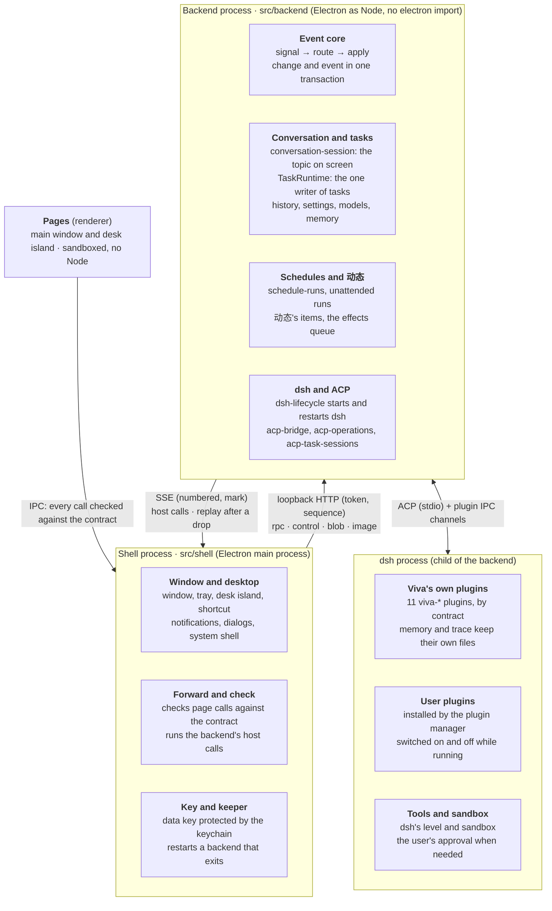

# System design

English | [简体中文](system-design.zh-CN.md)

> This describes the architecture on main as of PR #132 (`82a5bf3`, 2026-11-10). The split's plan and phase-by-phase notes are in the git history (`docs/backend-split-design.md`, removed after this document replaced it); the module-by-module cleanup that followed is recorded in the [architecture cleanup](architecture-health.md).

## 1. Overview

Viva is a desktop AI assistant: an Electron app whose conversations are driven by embedded dsh (DeepSeek Harness) over ACP. The 2026-11 refactor split it into two processes, so the backend can evolve on its own and later move to the cloud.

The refactor has four goals:

- **Frontend/backend split:** the shell handles only the desktop; everything else runs in the backend process. The backend never touches Electron at run time and speaks one protocol to the outside.
- **Event-driven:** every input to the backend is a signal, and every state change is written in one transaction together with a numbered event.
- **Open plugins:** the in-house message sources are gone; Viva loads dsh plugins instead, so users reuse dsh's plugin ecosystem.
- **Room for the cloud:** pages, shell and backend pass content and ids, never local paths. The protocol runs over loopback with a token now; later it only needs HTTPS and an account token.

§2–4 cover the structure and its mechanisms, §5–8 data, plugins, security and fault tolerance, §9 how the code keeps these boundaries, and §10 what is not done yet and what comes next.

## 2. Overall structure

Viva has four parts, and each talks only to its neighbours. Pages reach the shell only over IPC, the shell reaches the backend only over the loopback protocol, and the backend reaches dsh only over ACP and the plugin channels.

- **Pages** (`src/renderer`): the main window and the desk island, sandboxed, with no Node. They only display and interact; their state is pushed by the backend.
- **Shell** (`src/shell`, the Electron main process): the app lifecycle, window, tray, desk island, shortcut, notifications, dialogs and the system keychain. It checks the pages' calls and forwards them to the backend, and does what the backend asks of the desktop.
- **Backend** (`src/backend`, a child process running Electron as Node): everything except the desktop. That is the event core, all features and stores (history, tasks, schedules and 动态, memory, settings, models, plugin management), and the modules that run dsh: `dsh-lifecycle.ts` starts and restarts it, `acp-bridge.ts` holds its process, MCP and the session on screen, `acp-operations.ts` the prompts under way and `acp-task-sessions.ts` the tasks' sessions. `compose.ts` creates, wires and closes these modules; it still coordinates some features itself (settings, MCP changes, schedules and 动态). It does not import `electron` at run time; it reaches the desktop only through `HostCapabilities` (`src/backend/host.ts`).
- **dsh** (a child of the backend): the agent that runs the conversation, loading Viva's 11 own plugins and the plugins the user installed.

The point of this split is that nothing in the backend is tied to the desktop. Moving it to the cloud later means replacing only the transport and authentication between the two ends (§10).

## 3. Inter-process communication

Shell and backend talk over loopback HTTP and SSE; only the start message uses the child process's IPC channel. The protocol is defined in `src/backend/wire.ts`; the shell's client is `src/shell/backend-client.ts`.

**Start.** The shell starts Electron as Node with `fork` (`ELECTRON_RUN_AS_NODE`), entered at `src/backend/server.ts`. The start message goes over the IPC channel: the token, the data key, the data paths, the locale, and the desktop state the backend reads without waiting (the mirror). None of it goes into the environment, because dsh is a child of the backend and inherits it. When ready, the backend answers `ready` with its port and the channels it registered.

**Endpoints.** The server listens only on `127.0.0.1`; every request carries a Bearer token, and the Host header must be the server's own address:

| Endpoint | Direction | Purpose |
| --- | --- | --- |
| `POST /rpc/<channel>` | shell → backend | A page's call on a channel, checked by the shell and forwarded |
| `POST /control/<op>` | shell → backend | The shell's own calls: start dsh, update the mirror, close, and so on |
| `POST /blob` | shell → backend | Bytes uploaded first (a pasted picture); the call then passes only an id |
| `GET /image?url=` | shell → backend | A `viva-image://` picture, read by the backend from the pictures folder |
| `GET /events?since=&after=` | backend → shell (SSE) | What the backend asks of the desktop (host calls); on reconnect, the stored events after `since`, then the host calls after `after`, come first |
| `POST /host/<id>` | shell → backend | The answer to a host call with an id (which file a dialog picked) |
| `POST /callback/<id>` | shell → backend | A callback that comes later, such as a notification being clicked |

**Encoding.** Arguments and answers are JSON. Bytes in an answer are written as `$bytes` (base64). An argument left out inside an array is written as an `$undefined` marker rather than `null`, or the backend's optional-argument checks would refuse it.

**Call order.** Every call carries a sequence number (`x-viva-seq`). The backend starts calls in the order the shell made them, without waiting for the previous one to finish, as `ipcMain` did in one process. A number that never arrives is skipped after 5 seconds. The server keeps idle connections open; when a reused connection has just closed, the client resends once with the same number.

**Order of pushes and answers.** Pushes travel over SSE and answers over another connection, so their arrival order is not guaranteed. The backend therefore numbers each host call (`n`), and every answer carries `mark`, the number of the last host call made when it answered. The shell runs the host calls up to `mark` before handing the answer to the page, waiting at most 5 seconds. A page never gets an answer before a push that was sent ahead of it.

Cost (macOS, local): a plain call's round trip p50 0.05 ms, p95 0.1 ms; a 266 KB answer p50 2.6 ms.

## 4. Event core

Every input to the backend is a signal, and every state change goes through `apply`: the change and a numbered event are written to `app.db` in one transaction. The implementation is `src/backend/event-core.ts`.

**Signals.** Signal kinds form a closed union. The routing table needs a handler for every kind; one missing fails the type check. The signals today:

| Signal | Comes from | Goes to |
| --- | --- | --- |
| `chat.said` | The user said something in the conversation (`agent:prompt`) | Straight into the dsh session, with no model classification |
| `user.command` | Any page action that is not a query (`src/backend/commands.ts`) | That channel's own handler |
| `agent.turn_ended` | A foreground turn ended | Reporting the memories saved in the turn; results of tasks held back |
| `agent.task_ended`, `agent.task_waits` | A background task's turn ended; it began or stopped waiting on the user | TaskRuntime (`task-runtime.ts`), which keeps how it ended; its result back to the conversation |
| `system.woke` | The computer woke or was unlocked | Schedules due meanwhile run (`schedule-runs.ts`) |
| `window.foreground` | The window came to the front | Nothing for now (too frequent to record) |

**Commands and queries.** Each channel in the IPC contract is marked where it is defined if it is a query (`read(...)`). A query goes straight to its handler. Every other channel is a command, recorded first as a `user.command` signal and then handed to its handler. A command that fails stays recorded: the user did do it.

**`apply` and the event table.** `apply(kind, data, write)` runs the write and inserts a row into `app_events` in one transaction; a write that throws leaves neither. Nested writes use savepoints, so an inner failure undoes only itself. Every push to the window carries a number: a stored event its own, a transient push (streamed text) the latest. The event table keeps the latest 100,000 events, and numbers are never reused.

**Store writes.** The history, schedule and 动态 stores are wrapped in `journaled` (`src/backend/journal.ts`): the listed writes go through `apply`, and reads pass straight through. A write that changed nothing (it returns `false`, `0` or `null`) records no event. The background tasks have one writer, TaskRuntime (`src/backend/task-runtime.ts`), which writes them only in changes of its own: `task.started`, `task.restarted`, `task.ended`, `task.closed`, each with the `taskId` and the run's `runId`. A task's end saves what it said, keeps how it ended and records `task.ended` in one transaction, a failed save failing it; the window's snapshot goes out once it commits. A change that fails is undone in memory too (how the task stands, what it said), and since dsh says a turn ended only once, an end not kept is tried again (after 1, 5, 30, then every 60 seconds) for as long as that run is the task's, dsh restarting meanwhile too; its result goes back to the conversation once it is kept. A task's end or wait reaches the runtime even when its signal cannot be recorded (`task-signals.ts`). The run's `runId` is kept with the task, and back after a relaunch. Every run begins through one place, `reserveRun`: a new task, a task asked again and one taken up each reserve one of the 5 places before anything they await, and give it back once the run is kept or has failed, so runs begun together cannot pass the limit between them; one task begins one new run at a time. A session dsh made for a task whose start could not be kept is let go again; Viva quitting in between leaves it to dsh, with no task holding it.

**Shapes, not contents.** Events never record what the user said or what a model wrote:

- Store writes record ids, numbers and flags. Other text is recorded only by its length, and lists only by their count. A string counts as an id if it is letters, digits and dashes, contains at least one digit, and is at least 6 characters long.
- Command signals record the channel and the type and length of each argument; text is always recorded by length only. `settings:save-key` carries the API key as its argument, and this rule keeps it out of the database.
- `chat.said` records only the number of characters and pictures.

## 5. Data storage

The backend's own data is in one `app.db`. Data written by plugins inside dsh's process stays in the plugins' own files. All files live in the app data folder (on macOS, `~/Library/Application Support/Viva`). SQLite is Electron's built-in `node:sqlite`, with WAL and `secure_delete` on.

| File | Contents | Written by | Events |
| --- | --- | --- | --- |
| `app.db` | `app_events`, `meta`; schedules (`schedules`, the runs not finished `schedule_runs`) and 动态's items (`feed_items`); history (`conversations`, `messages` with its full-text index, `stars`); background tasks kept for the next launch (`background_tasks`); what is still to be done outside (`effects`, §11.4); result records in conversations (`report_records`, §11.5); the main conversation's requests, decisions, and actions (`routing_requests`, `routing_decisions`, `routing_actions`, see section 12 of the [routing design](agent-routing-design.md)) | Backend | In the same transaction as the write |
| `memory.db` | Profile, memories, synthesized profile, the context sent with each turn | The memory plugin (dsh's process) and the backend | The user's edits right after they are written; what the model saved, as `memory.learned` after the turn |
| `trace.db` | Each turn's tool calls and thinking | The trace plugin (dsh's process) | None |
| `settings.json`, `models.json`, `mcp-servers.json`, `preferences.json` | Key, model providers, MCP servers, preferences | Backend | None |
| `data-key.bin` | The data key that encrypts keys, itself encrypted by the system keychain | Shell | None |

**Why memory stays out of `app.db`.** Memory is mainly written by the memory plugin inside dsh's process, which does not go through the backend's `apply`. Merging it would mean letting the plugin open the whole app database, and the two `meta` tables would clash. The split's design decided so: plugin-written data enters the events as observed changes, not through `apply`.

**Key encryption.** The system keychain (Electron `safeStorage`: Keychain on macOS, DPAPI on Windows) is available only in the shell. The shell uses it to protect a random 32-byte data key and hands that key to the backend over the IPC channel at start. The backend encrypts with AES-256-GCM under it (`src/backend/envelope.ts`). If the keychain can no longer open the key file, the file is set aside and a new key made; keys encrypted under the old one must be entered again. Without a keychain, saving a key is refused rather than falling back to plain text.

**No compatibility.** Data from earlier versions is not read (decided): keys saved by an earlier version must be entered again, and `followups.db` and the older JSON history are not brought over.

## 6. dsh and plugins

Viva does not modify dsh; it customizes it only through plugins and configuration layers. dsh is a child of the backend, runs on the app's own Electron, and has its home under `dsh/` in the app data folder. The user's own `~/.dsh` is not read or written in normal use, only when the user explicitly imports from it.

**Entry.** dsh starts through the app's own entry, `src/backend/dsh-entry.ts`, which calls `runCli`, the function dsh exports for its installer (`@deepseek-ai/dsh/lib/bin.js`). Before dsh boots, the backend sends a `viva_launch` message over the IPC channel (`src/backend/dsh-launch.ts`). It carries the pnpm the plugin manager uses, the arguments it goes with (each scope pnpm knows sent to the company registry) and the environment variables only that pnpm gets (dsh's `packageManager`). The company plugin source's token travels this way and stays out of dsh's environment, because other programs of the same user can read that environment and the agent's commands inherit it. If the entry does not get the message within 10 seconds, it starts dsh as dsh would on its own. With `DSH_BIN` set, that program runs directly, without this entry.

**Viva's own plugins.** 11 `viva-*` plugins ship with the app (listed in `src/backend/app-plugins.ts`). Each declares a versioned contract, and the app checks the versions at start:

| Contract | What the plugin does |
| --- | --- |
| `memory` | Memory tools, the context sent with each turn, profile synthesis |
| `trace` | Records each turn's tool calls and thinking in `trace.db` |
| `tasks` | Query tools for background tasks (`list_background_tasks`, `get_background_task`) and tools for schedules (`schedule_create`, `schedule_list`, `schedule_update`, `schedule_delete`); the backend does what they ask and sets their scope by working folder and session, never the tool's arguments. Starting, stopping and messaging a task are not tools: the main conversation's routing decisions hand them to the backend (§11.1) |
| `history` | Lets the model search earlier conversations |
| `stream` | `viva-routing`: the main conversation's request routing ([design](agent-routing-design.md)). It narrows the main session to the routing, context and app-settings tools and gives it the main agent's persona; `commit_route` decisions go to the backend (`request-runtime.ts`), which accepts and carries them out; only text given leave to answer shows. It is also the only way an answer's streamed content reaches the app |
| `questions` | Cards where the model asks the user a question (for background tasks; the main conversation asks in text through `clarify`) |
| `steer` | Lets the user interject while a turn runs: the words go in under a request header, marked 「【插话】」 (`steer-channel.ts`), and are routed as a request of their own. Background results go into a running turn the same way (§11.5) |
| `fork` | Goes back to an earlier point and starts again from there |
| `config` | Lets the model add MCP servers and create or install skills in the conversation, with the user's approval |
| `permission` | The permission level the user picked (full, automatic, workspace edits, read-only), applied to every session dsh opens; what each level allows is wholly dsh's sandbox and approval presets, with no rules of the app's on top |
| `plugins` | The entry to dsh's plugin manager, used by Capabilities → Plugins |

Plugins and the app talk over the IPC channel opened when dsh starts; each contract has its own message format (for example `plugins/tasks/lib/channel.ts`).

**Two configuration layers.** At every start the app rewrites `$DSH_HOME/viva.patch.yml` and layers it on top with `--patch`. It holds the persona, Viva's own plugins (loaded by the file URL of their entry file, not listed as profile dependencies), the plugins' configuration, and dsh-base's safety rows restated as they are. The profile's own `cordis.patch.yml` belongs to the user and dsh's plugin manager; the app only writes an empty `[]` when it is missing. Neither the bundles nor the user's layer can change the app's safety rows.

**User plugins.** Message sources are gone; external messages and other capabilities come from dsh plugins the user installs. Capabilities → Plugins (a page of the hub beside Settings) installs, enables and removes plugins with the pnpm 11 bundled with the app. The model can also propose an install in the conversation, which the user approves on a permission card. `hmr` is on, so plugins switch on and off while dsh runs.

**What becomes a plugin.** Viva makes a capability one of its own plugins only when it needs the agent's internals: injection before each step, state bound to a session, native tools without approvals, reusing the model, or interception before execution. The rest stays in ACP or the app. dsh is still a 0.2.x release candidate and plugins use its own APIs, so every plugin raises the cost of switching ACP agents. This rule covers the app's own plugins; the plugins users install tie the app to dsh's ecosystem on purpose.

**Contract checks.** `APP_PLUGINS` lists each plugin's name, folder, contract and configuration; a plugin declares its contract in `package.json`, for example `"viva": { "contract": { "memory": 1 } }`. Before launch, `resolvePlugins` checks that the plugin exists, its `package.json` reads, the name matches, and the contract and dsh versions match exactly. A plugin that fails is left out of the profile, with the reason shown on the Capabilities page. Plugin databases record `meta.contract_version`; data written by a newer contract is refused rather than misread.

**The dsh interfaces each plugin uses.** `memory`: agent/pre-step, sessionProjections, tools.register, agent/turn-stopping, llm.stream; `trace`: agent/turn-stopping, session.eventAt; `stream` (`viva-routing`): agent/created, agent.ctx.tools.restrict, agent.ctx.plugin (dsh-persona), tools/pre-execute (before approval), tools.register, agent/pre-step, agent/turn-stopping, agent/status, agent/assistant-stream, session/event, agent/disposed, llm.stream; `plugins`: ctx.pluginManager. Plugin failures degrade: failed injection omits memories, failed recording omits the activity, and the conversation goes on.

**Session preparation.** A new topic shows an empty input at once; typing is allowed while it prepares, sending waits. At most one independent empty session is prepared ahead, with its own MCP processes, and it expires after 120 seconds unused. When a singleton MCP server refuses a second connection, that spare is discarded without changing the official MCP status. Sessions never share MCP clients, and cold MCP creation waits for the old session's resources to close. Timing: set `VIVA_SESSION_TIMING=1` for the backend and `localStorage.setItem('viva:session-timing', '1')` for the page; only stages, durations and outcomes are recorded, never prompts or MCP configuration.

**Recheck when upgrading dsh.**

- `viva-routing` depends on dsh's internal events, not a general ACP extension. dsh is pinned to `0.2.0-rc.2`, whose ACP adapter forwards only whole blocks. After an upgrade, rerun `test/stream-runtime.test.js` with real dsh and delayed SSE: the first text must arrive before the answer completes, and cancelling must keep the committed part. Then rerun `test/tasks-routing-dsh.test.ts`: the main session must be narrowed before its first step is assembled. If the streaming channel fails mid-call, that call's provisional content is withdrawn and the call ends in an error; ACP's text is never shown directly, or the routing steps' text would leak.
- rc.2 has no plugin API for custom notifications, so after a turn the app reads `memory.db` every 2 seconds for 30 seconds. Once dsh offers ACP extension notifications, the polling can go.

**Settled choices.**

- The persona is a personal work assistant, not the ACP template's coding agent; tests check the request sent to the model.
- `dsh-time-context` is not used: under ACP there is no browser timezone, and it keeps asking the model to confirm dates. The memory plugin injects today's date.
- The app sets no rules on top of dsh's permissions: dsh does not ask approval for MCP tools, so sending tools (mail, messages) run as they are; "draft only, the user sends" is the persona's request, not a hard stop.
- Other models reuse llm-pi-ai (OpenAI Chat Completions, OpenAI Responses, Anthropic Messages) rather than another plugin.

## 7. Security boundaries

Each layer gets only what it needs, and outside input is checked both where it enters and where it is used.

| Boundary | What is done | Code or tests that guard it |
| --- | --- | --- |
| Page → shell | Pages can use only the channels in the IPC contract; arguments are checked against zod schemas and refused in the shell when they do not fit. Pages run with `contextIsolation` and `sandbox`, without Node | `src/shared/ipc-contract.ts`, `test/ipc-contract.test.js` |
| Shell → backend | The backend checks against the same contract again, and handlers also check what values mean (an id that exists, a path inside the workspace) | `src/backend/server.ts`, the `*-ipc.ts` modules |
| Loopback endpoints | Listens only on `127.0.0.1`. A random 32-byte token is made at start and compared in constant time. The Host header check blocks DNS rebinding. JSON requests are capped at 32 MB and byte uploads at 64 MB | `src/backend/rpc-server.ts`, `test/backend-wire.test.ts` |
| System keychain | Used only in the shell. The backend gets only a data key, passed over the IPC channel and never put into the environment, so dsh cannot inherit it | `src/shell/data-key.ts`, `test/envelope.test.ts` |
| Backend and Electron | The backend does not import `electron` at run time and reaches the desktop only through `HostCapabilities`; it loads nothing from `src/shell` | `test/backend-boundary.test.ts` |
| Event table | Events record ids, numbers and text lengths; command arguments are always recorded by shape only, so an API key never reaches `app.db` | `test/commands.test.ts`, the memory smoke group (no key in `app.db` or its log file) |
| dsh's environment | dsh's environment drops every `DSH_*`, `DEEPSEEK_*`, `ELECTRON_*` and `VIVA_*` variable before the app's own values are set | `src/backend/dsh-runtime.ts` |
| Workspace files | Pages can only see files inside the workspace; `../`, absolute paths and links pointing outside it are refused | `src/backend/workspace-files.ts` |
| Main session tools | The main session gets only the routing, context, and app-settings tools; every call is checked again by layer before DSH asks the user for approval; an app change needs an `app_action` accepted in this turn, and each grant allows one call | `plugins/routing/lib/policy.ts`, `test/tasks-routing-dsh.test.ts` |

A known gap: plugins the user installs run inside dsh's process with the user's file permissions. The sandbox covers tool calls, not the plugins themselves, so installing a plugin means trusting it.

## 8. Lifecycle and fault tolerance

Both the backend and dsh are restarted when they exit unexpectedly, after 1, 3, then 10 seconds; the first three exits within two minutes retry, and the fourth gives up. Both use the same backoff function, in `src/shared/restart-delay.ts`.

**Start.**

1. The shell takes the single-instance lock; opening Viva again only brings back the existing window.
2. The shell reads or makes the data key, starts the backend process, and waits up to 60 seconds for `ready`.
3. The backend opens `app.db` and the event core, then the stores, registers its channels, connects the signal routes, and starts listening.
4. The shell connects to the event stream, forwards the channels, and creates the window.
5. Once the page has loaded, the shell has the backend start dsh.

**Backend exits unexpectedly.** `src/shell/backend-keeper.ts` handles it:

- The backend is started again with the backoff; a restart that cannot start counts as another crash.
- When the new backend is up, the window reloads, and dsh starts once the page has loaded, as at launch. The conversation is kept in `app.db`, so nothing is lost.
- A page's call made meanwhile waits up to 20 seconds; after that the page is told the backend is restarting.
- On giving up, an error box explains it and Viva quits.

**Event stream drops.** If the backend is still running but SSE dropped, the shell reconnects after 1 second with `since` set to the last number it saw, and the backend first replays the events stored after it. The backend keeps its latest 10,000 host calls, numbered, whether a shell listens or not, and the shell reconnects with `after` set to the last one it ran: every call after it comes, in order, those made while none listened and those written to the stream as it ended, and the shell runs each once. A first connection replays no stored events, and gets the host calls made before it.

**The dsh lifecycle.** `src/backend/dsh-lifecycle.ts` alone holds the running dsh, its generation, the restart timer, the crash history and whether Viva is quitting. `compose.ts` gives it ways to create and connect an instance, and callbacks for when the conversation is ready, tasks lose their sessions, or an error must be shown; configuration, history and tasks stay with their own modules.

- Starts asked for together share one connection. Stopping revokes that generation's events and start result at once; a stop between creating and connecting means it never connects.
- Changing the key or the models waits until the old instance is really gone before making a new one. A start that fails cleans up its instance; a disposal that fails blocks the replacement.
- An instance going away ends the foreground turn it was running and clears busy and waiting, a restart the user caused in Settings included; that turn's routing requests end with it (section 11 of the [routing design](agent-routing-design.md)). A key change settles the old topic before making a new one, without relying on events from the instance going away, which are already filtered out.
- An unexpected exit restarts with the backoff above and takes the conversation up again; the exit of an old generation never causes another restart. Quitting cancels a restart waiting to happen and refuses further starts.
- Shutting down waits at most 5 seconds. Running out of time only ends the wait: a later start still waits for the real disposal.

`test/dsh-lifecycle.test.ts` checks these with fake instances and a clock it controls. The smoke tests crash real dsh, report background results and recover from restarts; `test/smoke/lifecycle.spec.ts` changes the model and clears the key while a question waits, then checks that new topics work and a background result is reported.

**Conversation selection.** `src/backend/conversation-session.ts` holds the history segment on screen, its working folder, records carried into the next question, and the gate for switching sessions. History and rewind switch through it: the gate stays closed through their database writes and until the segment is chosen, even when the session id stays the same. A new topic that failed halfway keeps the gate closed until it is retried or reconciled; saving metadata cannot open it. Every switch, however it ends, wakes the reports waiting on it. Pushes about the conversation carry the segment and session they began in, and the window holds them while a switch commits, then lets through only those of the topic chosen (`src/renderer/agent-events.ts`). `test/conversation-session.test.ts` checks this with the real history and effects stores and the real history and rewind handlers.

**Quit.** In `before-quit` the shell asks the backend to close. The backend stops dsh (closing its input, then ending the whole process tree after 1.5 seconds, with `taskkill /T` on Windows), closes the databases, and exits. A backend still running after 10 seconds is killed. If the shell disconnects, the backend shuts itself down.

## 9. Source layout and guard tests

Folders match processes. Dependencies may point from the shell to the backend, never the other way, and tests enforce it rather than convention.

| Folder | Contents | Rule |
| --- | --- | --- |
| `src/shell` | Shell modules: the entry `main.ts`, window, tray, desk island, shortcut, the backend's client and keeper, the data key, the image scheme's registration | At run time it loads only the backend's `wire.ts` and `envelope.ts`; other backend modules only for their types |
| `src/backend` | The backend's entry `server.ts`, composition `compose.ts`, event core, stores and channels, acp-bridge and the rest | No `electron` import at run time; nothing from `src/shell` |
| `src/shared` | Code both processes and the pages use: the IPC contract, i18n, image ids, the restart backoff | No Node, so pages can run it |
| `src/shared/node` | Code both processes share that needs Node; today only the app's root folders | Left out of the pages' tsconfig |
| `src/renderer`, `src/preload` | Pages and preload scripts | What the backend pushes enters through one place: `agent-event-decoder.ts` turns it into a closed `AgentEvent` union and refuses frames it does not know. Actions are a closed union too. State in `*-state.ts` (pure), IPC in `*-actions.ts`, DOM built with `h()`, never `innerHTML` |
| `plugins/*` | Viva's 11 own dsh plugins | Talk to the app by their contracts |

The tests that keep these boundaries:

- `test/backend-boundary.test.ts`: walks the backend's module tree from `src/backend/server.ts` and checks that it has no run-time `electron` import and no file from `src/shell`. It also checks that the shell loads only `wire.ts` and `envelope.ts`, and that `src/main` is gone.
- `test/module-boundaries.test.ts`: features cannot import `app.ts` or `compose.ts` backwards; source dependencies remain acyclic, including type imports.
- `test/ipc-contract.test.js`: the contract table, the preload scripts and the handlers the shell and backend register agree.
- `test/commands.test.ts`: a command is recorded as a signal before it is handled, by shape only; queries record no event.
- `test/event-core.test.ts`, `test/journal.test.ts`: a change and its event share one transaction; a routing table missing a signal fails the type check.
- `test/backend-wire.test.ts`, `test/backend-keeper.test.ts`: call order, the token, answers waiting for pushes, backend restart and giving up.
- The memory smoke group kills the backend process, then checks that a new backend is up, the conversation is still there, and the next question is answered. The packaged app runs this group too.

`npm test` discovers the full test collection; CI runs unit tests and full smoke on macOS and Windows. For quick feedback while changing one part, `npm run test:feature -- <group>` runs that part's tests (`conversation`, `runtime`, `tasks`, `architecture`; `--list` shows the files); the full suite stays the gate. The [architecture cleanup](architecture-health.md) records the 2026-11-06 responsibility audit and the modules taken out of `compose.ts` and `app.ts` since.

## 10. Known limits and direction

The boundaries are drawn so that the backend could later run elsewhere, but the two processes still assume one machine.

**Not done yet:**

- The 4 JSON settings files are not in `app.db`, and their writes carry no events. Merging them needs a design for the encrypted fields and file permissions.
- Memory events are not in the same transaction as the memory write, because the file belongs to the plugin.
- B2 replays pushes after a same-generation disconnect; a changed generation or a real replay gap still reloads the page. Reloading loses the foreground stream tail not yet persisted and unsent drafts, so this is not complete recovery. A notification shown before the restart is only logged when clicked after it.
- Events serve recording and replay after a drop; nothing else consumes them yet.
- Interface string keys are still named after the old file paths (such as `main.history-db.*`). It only affects how the names read, so they were left as they are.

**Towards the cloud.** The split already keeps the two constraints from the remote workspace research: only content or ids cross the boundary, never local paths, and local capabilities (files, working folder, MCP) form their own group of interfaces. Moving the backend to the cloud roughly means:

1. Replace loopback with a launch token by HTTPS with an account token. The protocol itself (rpc, SSE, sequence numbers, `since` replay) stays.
2. Shell and backend no longer share a lifetime: reconnecting becomes the normal case, and pages need to catch up by sequence number instead of reloading.
3. Replace dsh's `fs-sandbox` and `subprocess` with remote implementations, putting the workspace on another virtual file system backend. This was validated with a spike and parked as long-term research; the record is in the git history (`docs/remote-workspace-research-20261104.md`).
4. The keychain stays on the desktop; keeping keys in the cloud needs its own design.

**Suggested next steps:**

- Keep the composer draft across a backend restart (saved in `sessionStorage` before the page reloads). A small change.
- A separate PR for moving the JSON settings files into `app.db`.
- Let pages catch up by sequence number. This is the largest piece before the cloud.

## 11. Background tasks

The user only talks. Starting a background task, stopping it and asking it more come from the routing decision the main agent commits for each request (`commit_route`, see the [routing design](agent-routing-design.md)), and the backend carries them out. The interface displays tasks and keeps the two things only the user may do: approve what a task wants to do, and stop a task.

### 11.1 Handing work to tasks

The main agent looks tasks up with `viva-tasks`' `list_background_tasks` and `get_background_task` (the list, and one task's status and latest output). Starting, stopping and messaging are actions of a routing decision: once the request runtime (`src/backend/request-runtime.ts`) has accepted the decision and written it to `app.db`, it hands them to TaskRuntime, keeping a receipt for each:

| Action | What it does |
| --- | --- |
| `start(title, brief)` | Opens a fresh dsh session in the working folder of the request's conversation; the brief is its first message and `title` the card's title; if another conversation is on screen by then, nothing is opened and the receipt records the failure |
| `stop(taskId)` | Stops its turn; the task stays and can be messaged later |
| `message(taskId, text)` | A running task gets the words in its turn; one that finished, stopped or failed gets them as its next question; one left unfinished when Viva last quit (interrupted) is taken up again first, by id, with ACP's `session/resume` |

- A brief stands on its own: the goal, the background it needs, file paths, error messages, constraints and the output language. The card shows the brief as the task's first message; its title is the decision's task name, or else the goal it serves.
- At most 5 run at once; asking a task again or taking one up counts too. When full, the receipt says so and the main agent tells the user; there is no queue. Only tasks of the request's working folder can be stopped or messaged. A task's session cannot start, stop or message other tasks, and its queries see only itself.
- Once a handover is done, the decision's `notice` (which task, doing what) is shown as the turn's answer and the turn ends; nothing waits or polls, the result comes back on its own. What a task hands back is data, not instructions. For anything sent outside, get evidence that can be checked (a URL, an id, a path) and check it before telling the user.
- An action whose receipt was not kept before Viva quit is marked uncertain at the next launch and never done again.
- Permissions: a task uses the user's permission level, exactly as dsh's preset has it.

### 11.2 TaskRuntime: one writer for background tasks

`src/backend/task-runtime.ts` owns each task's lifecycle (running, waiting, done, stopped, error, interrupted), what it waits on, the running places, what it said and what is kept of it; `task-registry.ts` works out how a task stands from what dsh says (with a `revision` that grows with every change), `task-words.ts` and `task-transcript.ts` keep what it says, `task-store.ts` keeps it across launches, and `task-ipc.ts` holds only the window's commands. No other module writes these.

- **Identities.** `taskId` names a task; `runId` names one run of it, from the turn that starts it, or a message that sets it going again, to that turn's end. Every change, event, push and effect about a task carries both.
- **Faces.** Each caller gets a narrow interface: `window` (task-ipc.ts), `agent` (viva-tasks' queries, and the handovers the request runtime carries out), `dsh` (what it reports), `reports` (task-reports.ts).
- **The transaction.** A change of a task (`task.started`, `task.restarted`, `task.ended`, `task.closed`) writes the task's state, its event and the effects it queues in one transaction (`apply`); a change that fails is undone in memory too. Pushing to the window and running effects come only after the commit. dsh says a turn ended once, so an end that cannot be kept is tried again (after 1, 5, 30, then every 60 seconds) for as long as that run is the task's.
- **What dsh says.** dsh's task events go to the runtime first (`task-signals.ts`); a turn's end and a wait beginning or ending are recorded as signals of the event core after, for the record only. What follows from a task ending follows from the kept `task.ended`, never from the signal.
- **Run admission.** Every run begins through `reserveRun`: a new task, a task asked again and one taken up each reserve one of the 5 places before anything they await, hand it to the registry as the change that begins the run commits, and give back what is still held once done or failed; one task begins one new run at a time. A session dsh made for a task whose start could not be kept is let go again; Viva quitting in between leaves it to dsh, with no task holding it.
- **What is promised, and what not.** A task is created once per start that is kept; its run is asked of dsh only after that. A run whose start was kept but which was never asked (Viva quit in between), or which was cut off, is interrupted after a relaunch, shown so, and goes on only when it is asked to. Nothing makes a model's actions outside happen exactly once.
- **Storage.** What a task says is saved about every 10 seconds, and at once when it ends, when Viva quits and when dsh goes. The latest 30 ended tasks are kept.

### 11.3 The window: order, snapshots, and a window that opens

- **Order.** Each piece of a task's stream (`task_update`, `task_end`, a wait beginning or ending, words the agent said into its turn: `task_steered`, numbered as they are written into what it said) reaches the window from TaskRuntime, taken in first, then numbered (`taskSeq`, one count per task across its runs; the push's own `seq` is the event core's) with its `runId`, then the snapshot it changed. A run's end goes out once it is kept. The snapshot that begins a run comes before the run's first piece and says what it begins with (`opening`: the words, and for a new task its summary and the session of the conversation its line goes in). What dsh says of a task unknown, or no longer at work, goes nowhere.
- **Lifecycle is the snapshots'.** How a task stands in the window (status, when it started and ended, what it waits on) is set only by its snapshots, ordered by `revision`: one no newer than what the window has changes nothing, the beginning of a run included. The window makes a task, or its new run, from the snapshot that begins it. Pieces change only its conversation (`src/renderer/tasks-state.ts`), taken only of a task it knows, of the run it is at, and newer than its mark; its card works out what it is doing now and what it waits for from that conversation.
- **One conversation reducer.** A conversation is reduced on its own (`src/renderer/conversation-state.ts`): `ConversationView` is what was said and done and where the turn is, and `reduceConversation` is pure. The conversation on screen and each task's go by it; a task's `view` is a `ConversationView` and nothing more. The thread is drawn from `ThreadView` (`src/renderer/view/thread.ts`), which the 后台 page builds for a task from its own conversation alone.
- **A window that opens.** At first load the window reads its tasks (`task:finished`: each one as its registry snapshot says it, with what it said, what it waits for, the tool calls it has at work, and its mark: run, last piece, revision). While the read is in flight, every task's events wait, in order (`src/renderer/task-actions.ts` loadKept); a push and the answer to a call come from the main process in the order it sent them, so all that happened after the read is among what waited. A task the window already knows (made by the snapshot that began it, on the live channel) has its whole stream in the window: the read leaves it as it is, with its tools and thoughts, and what waited follows on it. Each other task the read has is put back to it, its baseline (its tool calls at work among it, so its card says what it is doing), and what waited follows over it, each piece and snapshot let in only when newer. More than 2,000 waiting, the tasks whose events were let go have a gap, known to the window or not: the read is begun again and is their baseline (one it no longer has, closed or let go among the oldest ended, leaves the window), while what waited of the other tasks goes on waiting, and a known task with no gap still keeps its own; a read that fails after that is tried again, waiting 0.5 s and twice as long each time up to 10 s, so the handoff never ends on part of what came. This wait lasts only while the tasks are read.

### 11.4 Effects: a durable queue for side effects

- A table `effects` in `app.db` (`src/backend/effects.ts`): kind, key, payload, `generation`, when due, attempts. An effect is queued in the same transaction as the change that causes it, and runs only after that commits.
- One row per kind and key. Queuing it again replaces the payload and adds one to its `generation`. An attempt acts on the generation it took only, so a late answer never settles a newer payload.
- A failure is retried with growing delays; "not now" (the conversation is busy, dsh is restarting) waits without counting as a failure. Rows survive a restart and run after it.
- The one kind so far: `report` (§11.5).

### 11.5 Results come back to the main conversation

The main conversation owns every background task, whatever topic is on screen, and its persona says so: it tells the user each result, first saying which task it is.

1. A run ends: in one transaction TaskRuntime keeps how it ended, records `task.ended`, and queues a `report` keyed by the run (`reportId`: `taskId` and `runId`). A task asked again before its report went has that report cancelled.
2. The report runs at once; runs ending within a moment of each other share one (`src/backend/task-reports.ts`). A turn of the main conversation running: the result goes into it (`viva-steer`), as not the user's words, with the task's background (what it was asked, the topic it came from, when and by whom). Otherwise a turn of its own is opened with the note. It cannot be delivered now (dsh restarting, a session switching): later.
3. **Delivered is not read.** A report is done only once its message is in the session's history and the session was flushed (`sessions.flush` true); then `viva-steer` says `read`. One discarded from the inbox says `dropped`, and is sent again. Before every delivery `viva-steer` looks for the report in the session (by its `viva-report` source, or a token the app gave that session, never by words): found in the history, it is confirmed; found waiting, it is not sent again. Where a report went is kept with it before it is sent, and asked there first after a switch.
4. After a restart, open reports are delivered once the main session is connected, whatever their age, and whether or not the user opened the task.
5. **The record.** In the conversation, a delivered result shows as a collapsed record that opens on what the model was given (`src/renderer/view/report-record.ts`). Records are not messages: they have one writer, the backend, in their own table (`report_records`), written when the report is read for the conversation of the session it went to, with how many of its messages were stored then (its place), in the same transaction as the report done (`src/backend/report-records.ts`). The window only draws them (`src/renderer/report-state.ts`): live, as soon as `viva-steer` says the note was written (`report_written`); loaded, each after the messages before it. A blank topic is stored with its first record; going back, or back onto a folded path, the records of the shared part go with the path that goes on. A report is recorded once. Loaded again, a record that came while an answer was still streaming is drawn above that answer.

### 11.6 The interface

- **A line in the conversation**, under the turn that started the task: "#name · in the background / waiting for you / done / failed · one sentence". Clicking it opens the 后台 page.
- **The 后台 page**: the task list and the full course of the selected task. Operations that need approval are allowed or refused here, the task's questions are answered here, and there is a Stop button. There is no input box; follow-ups are said to the main conversation.
- **The count at the island's tail**: "◌ 2 / ✓ 3 / waiting". Clicking it opens the 后台 page.

### 11.7 dsh's sub-agents: within a turn only

Sub-agents suit sub-work that would flood the context but whose result this turn needs (reading a batch of documents and handing back a conclusion, looking several things up in parallel). Work that runs long, should be visible to the user, or may be asked about later goes to Viva tasks. In `viva.patch.yml`:

- `subagent` and `subagent_fork` stay, with the background mode off (`enableRunInBackground: false`), so the result comes back as a tool result in the same turn; `maxDepth: 1`: the sub-agent itself is depth 1 and cannot delegate further.
- A sub-agent gets only read-only tools for looking things up, by allow list: `toolFilter.allow` is `read`, `glob`, `grep`, `read_image`, `web_search`, `web_fetch`, `memory_recall`, `search_conversations`, `read_conversation`, `todo_write`.
- `send_message`, `list_agents` and `interrupt_agent` are turned off. The persona says the main conversation waits for a sub-agent's result, and how sub-agents and Viva tasks divide the work.
- With the allow list, `subagent_fork`'s tool table differs from its parent's and may no longer hit the KV cache; not measured against the real DeepSeek API.

### 11.8 Not taken from Super-agent

The design follows DeepSeek's event-driven agent, [`dsh-superagent-prototype`](https://github.com/deepseek-ai/dsh-superagent-prototype), read in source: one engine writes its records, side effects go through a durable queue, and an input counts as delivered only once the session wrote it into its history. Its threads, subscriptions and correlations, an outbox with channels, source plugins, versioned policies, and a task split into a ticket and its assignments serve a team bot that watches many channels; Viva is one person's desktop assistant, and none of them is needed.

## 12. Plan and progress

What was planned after §11. Recovery (§12.1) and the schedule source with 动态 (§12.2) are done; mail and web sources, and moving 后台 out of the hub, are not. Each step is its own pull request, saying what it removes, which module alone owns what it changes, and when any path kept for compatibility goes; the documents change with the code. The reliability boundaries above (transactions, generations, `read` after flush, the session a report is bound to, the records' own table) stay; shared code is drawn out only where it removes a second copy of the same job.

### 12.1 Recovery

Two faults, kept apart:

- **The backend restarts.** The shell reloads the window (`backendUp` in `src/shell/main.ts`), and the window opens as at first load (§11.3). Nothing of the old window's state, or of its calls still in flight, is kept. Done.
- **The push channel ends and the backend goes on (the same generation).** The shell listens again (`listenTo`): its `stored` callback moves its cursor, and the host calls after the last it ran come first (`after`, `src/backend/remote-host.ts`), so the window has every push, in order, and nothing to recover; it does not reload. Only when more went by than the backend keeps (a gap in the calls' numbers, `lost` in `src/shell/backend-client.ts`) does the shell reload the window, which opens as at first load (§11.3) on the same backend and dsh. The page listens to the live channel before it reads anything, so what is pushed while it loads is covered by its reads: the history, its tasks (§11.3), the agent's info, and what the conversation on screen waits on the user for (`agent:waits`: the approvals, questions and keys dsh still waits on, from `sessionWaits` in `src/backend/acp-bridge.ts`), to be approved, refused, answered or filled in. The backend says these on the live channel (`waits`), not in the call's answer: a push sent after an answer may reach the page before it, but pushes keep their order, so `waits` comes in its place among them, how things stood there. What was asked or closed before it is in it or not; what comes after it follows (`src/renderer/waits-state.ts`). One shown already, or answered on this page before dsh had the answer, is not asked again. Approval ids are the dsh launch's own (`permission-broker.ts`), so one of a dsh started again is never taken for an older one. That is the one path with a limit: what the conversation on screen was streaming and had not stored when the gap began is not shown again (there is no source for a turn in progress), and a turn still going on shows from the reload on. Done.

### 12.2 Sources and 动态

What the app brings on its own goes one way, whatever brings it (agreed with the owner, 2026-11-06; the model of DeepSeek's [`dsh-superagent-prototype`](https://github.com/deepseek-ai/dsh-superagent-prototype): a Source makes events, a judgement decides, the result is shown):

- **Event.** Every source turns what it has into one shape: its source (`schedule`, `mail:<account>`, `web:<site>`), a key it gives that names one thing once (a schedule's id and its due time, a mail's Message-ID, a page's link), its time, sender, title, text and link as far as it has them, and the original, kept and marked untrusted. Adding a source is writing its adapter: fetch what is new, turn it into events, keep its own read position, moved on only once what it read is received. The adapter's shape follows `dsh-webhook`'s verified delivery and rule (`run(delivery) → null | result`).
- **Judgement.** One step for every event, with the source's configuration: push (with a 动态 item), skip (with its reason, nothing shown), or failed (the read or the model failed: retried through the effects queue, never taken for nothing worth showing). It may have two layers, each source choosing: rules (senders, words, folders) and a model call with no tools, given that one event and only what it needs, never the user's memory or files. A schedule the user agreed to skips both: it is pushed. Every judgement is recorded.
- **动态 item.** What 动态 shows, the same for every source: source, key, title, summary or draft, where it came from (a label and a link), time, seen or not, and what 在对话里继续 carries into the conversation (as material from outside, with its origin, never as the user's words). The page draws them all one way.
- **Source configuration.** Per source: on or off, what it may read, its rules, at most how many judgements an hour. It is the user's consent, kept with it and checked again before each run.
- **Once, and reliably.** One key makes one item at most; the judgement, the item and its notification are kept in one change; a failed step is retried, not dropped. Reuses the effects queue (§11.4) rather than a second retry system.
- **Untrusted content.** Mail and web pages may carry instructions. The judgement has no tools and its output is text into 动态; only the user's 在对话里继续 brings it into a conversation that can act, and there it stays marked as outside material. No tools limits side effects; it does not make the model immune to what it reads.
- **From dsh.** Times use `dsh-schedule`'s records and occurrence functions (once, daily, weekly, cron, with its time zone and DST rules), so a schedule's record is dsh's. `dsh-schedule`'s and `dsh-webhook`'s runtimes are not used now: they need dsh's Web host plane (Viva runs dsh over ACP), their action is a prompt into a session with tools, and they may deliver one occurrence twice. A schedule runs in a session the app marks unattended, at the user's permission level, and anything that needs confirmation is refused (see "One kind of scheduled thing" below).
- The first source is the schedule; mail and web adapters come later, with their rules, model judgement and budgets.

Where the user sees them (agreed with the owner, 2026-11-06). 后台 and 动态 are two things kept apart, with no handoff between them:

- **后台** (the layout below is planned and deferred, see F1a-2) is what the user asked for and expects: background tasks (the agent starts them, asked to or on its own). Its page is a page of its own, out of the hub (搜索 · 关于你 · 设置 keep three). Its way in is the island's tail: a quiet 后台 with no task, a turning ring and a count while some work, the island edged in orange and N 个等你 while one waits; ended ones are not counted there, as the main conversation tells their results. Clicking the tail opens a short list under the island (those waiting first, allowed right there) whose foot opens the page; ⌘J opens it too. The page lists 等你 · 在做 · 做完了 on the left and the one picked on the right (its approval card, or its whole conversation). The island counts only these; follow-ups no longer show on it.
- **动态** is what the app brings on its own: what schedules brought, and what is scheduled. Its way in is a 动态 button in the title bar, with a blue count of new items (orange stays for waiting on the user). Its page opens with one line in her voice and her picture, then 新的 · 接下来 (what is scheduled, its time at the left; pause, resume and delete) · 看过的. An item opened on the right says where it came from; its actions are 在对话里继续 (into the conversation on screen, with the item and its origin) and 不用了. Nothing in 动态 becomes a background task, and a schedule's run is not shown in 后台, not counted on the island, and not reported into the conversation.
- Delivered as: F1a-1 the 动态 page and its way in (done, #93); the schedule source (done, #94). Moving 后台 out of the hub (F1a-2) is not done for now: 后台 is unrelated to 动态 and works where it is (the owner, 2026-11-06).
- **One kind of scheduled thing (the owner, 2026-11-06): a time and a prompt.** The model writes the prompt from the conversation and proposes it on a card (when, and what it will do); the user's yes keeps it. Times are once, daily, weekly or cron, as `dsh-schedule`'s records. When it is due, the prompt runs in a fresh session of its own, in the working folder the schedule was made in, that the app marks unattended, at the level the user picked; what that level would ask the user is refused, since nobody is there to answer (`acp-bridge.ts` cancels an unattended session's approval requests). The session is not one of 后台's tasks: its events go to the run alone (`unattended-runs.ts`), and it is closed once its turn ends. What is due is taken from the schedules and kept as a run in one transaction, so a run not finished runs again at the next launch; a failed run is tried again later, three times in all, then becomes an item saying so; a run whose schedule was paused or deleted before it started is let go; an answer whose item could not be kept is kept on a later try, after a growing wait, without asking the model again (`schedule-runs.ts`). Its final answer becomes a 动态 item, keyed by the occurrence so never two, its notification queued in the same change (the effects queue). A reminder is the same: its prompt asks for a reminder. Once per occurrence, missed ones run at launch, pause, resume and delete in 接下来. Gone with this: the follow-ups' two times (reminder, preparation), preparation windows and their presets, yielding while the user is busy, the daily call cap, the 今天 summary and gap notices, and `followup-notifier.ts`, `prepare-scheduler.ts`, `prepare-schedule.ts`, `notice-plan.ts` and the preparation settings; follow-ups kept from before are dropped (no compatibility at this stage).
- **Natural language first (the owner, 2026-11-06).** Schedules are made, changed, paused and deleted by talking: the model has tools shaped as `dsh-schedule`'s (`schedule_create`, `schedule_list`, `schedule_update`, `schedule_delete`), and creating one still needs the user's yes on its card. The page shows; its buttons are only shortcuts for what can be said.
- The schedule source landed in #94, in five steps: `feed_items` and its store; schedules' table, card and timer; a due run running in an unattended session, its answer an item and a notification; 动态 listing items and schedules; the old follow-up machinery removed.

It replaced the follow-ups' reminders (`followup-notifier.ts`) and background preparation (`prepare-scheduler.ts`, `prepare-schedule.ts`); the follow-ups' watched file had gone before it (#92). Results show in 动态 and reach a conversation only when the user continues them there; they are not reported as a background task's result.

### 12.3 Order of work

1. Done: the follow-ups' watched file removed; the 动态 page and its way in; schedules made by talking, run in an unattended session when due, their results in 动态; the follow-ups removed (§12.2). Mail and web sources come later.

Done before this: one writer of a task's end; TaskRuntime; the effects queue and reports; the record in the conversation; the window's order, the snapshots that make tasks, one conversation reducer; run admission; lifecycle from snapshots and the first-load handoff; a same-generation reconnect that misses no push (§12.1).
