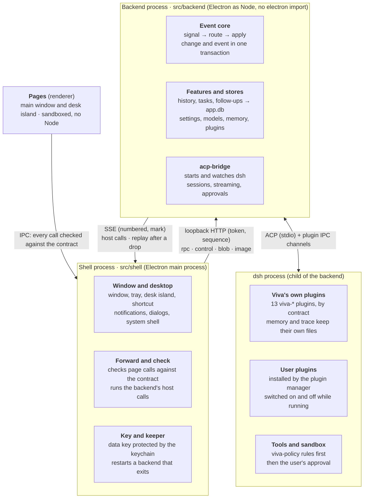

# System design

English | [简体中文](system-design.zh-CN.md)

> This describes the architecture as merged into main (PR #67, `bae89e6`). The split's plan and phase-by-phase notes are in the git history (`docs/backend-split-design.md`, removed after this document replaced it). Date: 2026-11-04.

## 1. Overview

Viva is a desktop AI assistant: an Electron app whose conversations are driven by embedded dsh (DeepSeek Harness) over ACP. The 2026-11 refactor split it into two processes, so the backend can evolve on its own and later move to the cloud.

The refactor has four goals:

- **Frontend/backend split:** the shell handles only the desktop; everything else runs in the backend process. The backend never touches Electron at run time and speaks one protocol to the outside.
- **Event-driven:** every input to the backend is a signal, and every state change is written in one transaction together with a numbered event.
- **Open plugins:** the in-house message sources are gone; Viva loads dsh plugins instead, so users reuse dsh's plugin ecosystem.
- **Room for the cloud:** pages, shell and backend pass content and ids, never local paths. The protocol runs over loopback with a token now; later it only needs HTTPS and an account token.

§2–4 cover the structure and its mechanisms, §5–8 data, plugins, security and fault tolerance, §9 how the code keeps these boundaries, and §10 what is not done yet and what comes next.

## 2. Overall structure

Viva has four parts, and each talks only to its neighbours. Pages reach the shell only over IPC, the shell reaches the backend only over the loopback protocol, and the backend reaches dsh only over ACP and the plugin channels.

- **Pages** (`src/renderer`): the main window and the desk island, sandboxed, with no Node. They only display and interact; their state is pushed by the backend.
- **Shell** (`src/shell`, the Electron main process): the app lifecycle, window, tray, desk island, shortcut, notifications, dialogs and the system keychain. It checks the pages' calls and forwards them to the backend, and does what the backend asks of the desktop.
- **Backend** (`src/backend`, a child process running Electron as Node): everything except the desktop. That is the event core, all features and stores (history, tasks, follow-ups, memory, settings, models, plugin management), and the acp-bridge that starts and watches dsh. It does not import `electron` at run time; it reaches the desktop only through `HostCapabilities` (`src/backend/host.ts`).
- **dsh** (a child of the backend): the agent that runs the conversation, loading Viva's 13 own plugins and the plugins the user installed.

The point of this split is that nothing in the backend is tied to the desktop. Moving it to the cloud later means replacing only the transport and authentication between the two ends (§10).

## 3. Inter-process communication

Shell and backend talk over loopback HTTP and SSE; only the start message uses the child process's IPC channel. The protocol is defined in `src/backend/wire.ts`; the shell's client is `src/shell/backend-client.ts`.

**Start.** The shell starts Electron as Node with `fork` (`ELECTRON_RUN_AS_NODE`), entered at `src/backend/server.ts`. The start message goes over the IPC channel: the token, the data key, the data paths, the locale, and the desktop state the backend reads without waiting (the mirror). None of it goes into the environment, because dsh is a child of the backend and inherits it. When ready, the backend answers `ready` with its port and the channels it registered.

**Endpoints.** The server listens only on `127.0.0.1`; every request carries a Bearer token, and the Host header must be the server's own address:

| Endpoint | Direction | Purpose |
| --- | --- | --- |
| `POST /rpc/<channel>` | shell → backend | A page's call on a channel, checked by the shell and forwarded |
| `POST /control/<op>` | shell → backend | The shell's own calls: start dsh, update the mirror, close, and so on |
| `POST /blob` | shell → backend | Bytes uploaded first (a pasted picture); the call then passes only an id |
| `GET /image?url=` | shell → backend | A `viva-image://` picture, read by the backend from the pictures folder |
| `GET /events?since=` | backend → shell (SSE) | What the backend asks of the desktop (host calls); on reconnect, the stored events after `since` come first |
| `POST /host/<id>` | shell → backend | The answer to a host call with an id (which file a dialog picked) |
| `POST /callback/<id>` | shell → backend | A callback that comes later, such as a notification being clicked |

**Encoding.** Arguments and answers are JSON. Bytes in an answer are written as `$bytes` (base64). An argument left out inside an array is written as an `$undefined` marker rather than `null`, or the backend's optional-argument checks would refuse it.

**Call order.** Every call carries a sequence number (`x-viva-seq`). The backend starts calls in the order the shell made them, without waiting for the previous one to finish, as `ipcMain` did in one process. A number that never arrives is skipped after 5 seconds. The server keeps idle connections open; when a reused connection has just closed, the client resends once with the same number.

**Order of pushes and answers.** Pushes travel over SSE and answers over another connection, so their arrival order is not guaranteed. The backend therefore numbers each host call (`n`), and every answer carries `mark`, the number of the last host call made when it answered. The shell runs the host calls up to `mark` before handing the answer to the page, waiting at most 5 seconds. A page never gets an answer before a push that was sent ahead of it.

Cost (macOS, local): a plain call's round trip p50 0.05 ms, p95 0.1 ms; a 266 KB answer p50 2.6 ms.

## 4. Event core

Every input to the backend is a signal, and every state change goes through `apply`: the change and a numbered event are written to `app.db` in one transaction. The implementation is `src/backend/event-core.ts`.

**Signals.** Signal kinds form a closed union. The routing table needs a handler for every kind; one missing fails the type check. The signals today:

| Signal | Comes from | Goes to |
| --- | --- | --- |
| `chat.said` | The user said something in the conversation (`agent:prompt`) | Straight into the dsh session, with no model classification |
| `user.command` | Any page action that is not a query (`src/backend/commands.ts`) | That channel's own handler |
| `agent.turn_ended`, `agent.task_ended` | A foreground turn or a background task ended | Gap detection; reporting the memories saved in the turn |
| `agent.followup_proposed` | The model proposed a follow-up through `viva-followups` | A suggestion card that waits for the user |
| `clock.reminder_due`, `clock.prepare_window` | The reminder timer, the background preparation timer | Notice planning, background preparation |
| `system.woke`, `system.user_returned` | The computer woke or was unlocked; the user came back after 15 minutes away | Catching up missed reminders; gaps |
| `window.foreground` | The window came to the front | Gaps (too frequent to record) |

**Commands and queries.** Each channel in the IPC contract is marked where it is defined if it is a query (`read(...)`, 35 today). A query goes straight to its handler. Every other channel is a command, recorded first as a `user.command` signal and then handed to its handler. A command that fails stays recorded: the user did do it.

**`apply` and the event table.** `apply(kind, data, write)` runs the write and inserts a row into `app_events` in one transaction; a write that throws leaves neither. Nested writes use savepoints, so an inner failure undoes only itself. Every push to the window carries a number: a stored event its own, a transient push (streamed text) the latest. The event table keeps the latest 100,000 events, and numbers are never reused.

**Store writes.** The follow-up, history and background-task stores are wrapped in `journaled` (`src/backend/journal.ts`): the listed writes go through `apply`, and reads pass straight through. A write that changed nothing (it returns `false`, `0` or `null`) records no event.

**Shapes, not contents.** Events never record what the user said or what a model wrote:

- Store writes record ids, numbers and flags. Other text is recorded only by its length, and lists only by their count. A string counts as an id if it is letters, digits and dashes, contains at least one digit, and is at least 6 characters long.
- Command signals record the channel and the type and length of each argument; text is always recorded by length only. `settings:save-key` carries the API key as its argument, and this rule keeps it out of the database.
- `chat.said` records only the number of characters and pictures.

## 5. Data storage

The backend's own data is in one `app.db`. Data written by plugins inside dsh's process stays in the plugins' own files. All files live in the app data folder (on macOS, `~/Library/Application Support/Viva`). SQLite is Electron's built-in `node:sqlite`, with WAL and `secure_delete` on.

| File | Contents | Written by | Events |
| --- | --- | --- | --- |
| `app.db` | `app_events`, `meta`; follow-ups (`followups`, `notices`, `events`); history (`conversations`, `messages` with its full-text index, `stars`); background tasks kept for the next launch (`background_tasks`) | Backend | In the same transaction as the write |
| `memory.db` | Profile, memories, synthesized profile, the context sent with each turn | The memory plugin (dsh's process) and the backend | The user's edits right after they are written; what the model saved, as `memory.learned` after the turn |
| `trace.db` | Each turn's tool calls and thinking | The trace plugin (dsh's process) | None |
| `settings.json`, `models.json`, `mcp-servers.json`, `preferences.json` | Key, model providers, MCP servers, preferences | Backend | None |
| `data-key.bin` | The data key that encrypts keys, itself encrypted by the system keychain | Shell | None |

**Why memory stays out of `app.db`.** Memory is mainly written by the memory plugin inside dsh's process, which does not go through the backend's `apply`. Merging it would mean letting the plugin open the whole app database, and the two `meta` tables would clash. The split's design decided so: plugin-written data enters the events as observed changes, not through `apply`.

**Key encryption.** The system keychain (Electron `safeStorage`: Keychain on macOS, DPAPI on Windows) is available only in the shell. The shell uses it to protect a random 32-byte data key and hands that key to the backend over the IPC channel at start. The backend encrypts with AES-256-GCM under it (`src/backend/envelope.ts`). If the keychain can no longer open the key file, the file is set aside and a new key made; keys encrypted under the old one must be entered again. Without a keychain, saving a key is refused rather than falling back to plain text.

**No compatibility.** Data from earlier versions is not read (decided): keys saved by an earlier version must be entered again, and `followups.db` and the older JSON history are not brought over.

## 6. dsh and plugins

Viva does not modify dsh; it customizes it only through plugins and configuration layers. dsh is a child of the backend, runs on the app's own Electron, and has its home under `dsh/` in the app data folder. The user's own `~/.dsh` is not read or written in normal use, only when the user explicitly imports from it.

**Viva's own plugins.** 13 `viva-*` plugins ship with the app (listed in `src/backend/app-plugins.ts`). Each declares a versioned contract, and the app checks the versions at start:

| Contract | What the plugin does |
| --- | --- |
| `memory` | Memory tools, the context sent with each turn, profile synthesis |
| `trace` | Records each turn's tool calls and thinking in `trace.db` |
| `followups` | Lets the model propose follow-ups; makes the tool-free model calls of background preparation |
| `tasks` | Read-only tools to query background tasks (`list_background_tasks`, `get_background_task`); the backend sets their scope by working folder and session, never the tool's arguments |
| `history` | Lets the model search earlier conversations |
| `stream` | Hands the answer's streamed content to the app |
| `questions` | Cards where the model asks the user a question |
| `steer` | Lets the user interject while a turn runs |
| `fork` | Goes back to an earlier point and starts again from there |
| `config` | Lets the model add MCP servers and create or install skills in the conversation, with the user's approval |
| `permission` | The permission level the user picked (full, automatic, workspace edits, read-only), applied to every session dsh opens |
| `policy` | Checks the app's rules inside dsh before a tool runs; a refused call goes back to the model as a tool error |
| `plugins` | The entry to dsh's plugin manager, used by the Plugins page in Settings |

Plugins and the app talk over the IPC channel opened when dsh starts; each contract has its own message format (for example `plugins/followups/lib/channel.ts`).

**Two configuration layers.** At every start the app rewrites `$DSH_HOME/viva.patch.yml` and layers it on top with `--patch`. It holds the persona, Viva's own plugins (loaded by the file URL of their entry file, not listed as profile dependencies), the plugins' configuration, and dsh-base's safety rows restated as they are. The profile's own `cordis.patch.yml` belongs to the user and dsh's plugin manager; the app only writes an empty `[]` when it is missing. Neither the bundles nor the user's layer can change the app's safety rows.

**User plugins.** Message sources are gone; external messages and other capabilities come from dsh plugins the user installs. The Plugins page in Settings installs, enables and removes plugins with the pnpm 11 bundled with the app. The model can also propose an install in the conversation, which the user approves on a permission card. `hmr` is on, so plugins switch on and off while dsh runs.

**What becomes a plugin.** Viva makes a capability one of its own plugins only when it needs the agent's internals: injection before each step, state bound to a session, native tools without approvals, reusing the model, or interception before execution. The rest stays in ACP or the app. dsh is still a 0.2.x release candidate and plugins use its own APIs, so every plugin raises the cost of switching ACP agents. This rule covers the app's own plugins; the plugins users install tie the app to dsh's ecosystem on purpose.

**Contract checks.** `APP_PLUGINS` lists each plugin's name, folder, contract and configuration; a plugin declares its contract in `package.json`, for example `"viva": { "contract": { "memory": 1 } }`. Before launch, `resolvePlugins` checks that the plugin exists, its `package.json` reads, the name matches, and the contract and dsh versions match exactly. A plugin that fails is left out of the profile, with the reason shown in Settings. Plugin databases record `meta.contract_version`; data written by a newer contract is refused rather than misread.

**The dsh interfaces each plugin uses.** `memory`: agent/pre-step, sessionProjections, tools.register, agent/turn-stopping, llm.stream; `trace`: agent/turn-stopping, session.eventAt; `policy`: tools/pre-execute (before approval, with a reason on refusal); `followups`: tools.register, llm.stream without tools; `stream`: agent/assistant-stream, session/event, agent/disposed; `plugins`: ctx.pluginManager. Plugin failures degrade: failed injection omits memories, failed recording omits the activity, and the conversation goes on.

**Session preparation.** A new topic shows an empty input at once; typing is allowed while it prepares, sending waits. At most one independent empty session is prepared ahead, with its own MCP processes, and it expires after 120 seconds unused. When a singleton MCP server refuses a second connection, that spare is discarded without changing the official MCP status. Sessions never share MCP clients, and cold MCP creation waits for the old session's resources to close. Timing: set `VIVA_SESSION_TIMING=1` for the backend and `localStorage.setItem('viva:session-timing', '1')` for the page; only stages, durations and outcomes are recorded, never prompts or MCP configuration.

**Recheck when upgrading dsh.**

- `viva-stream` depends on dsh's internal events, not a general ACP extension. dsh is pinned to `0.2.0-rc.2`, whose ACP adapter forwards only whole blocks. After an upgrade, rerun `test/stream-runtime.test.js` with real dsh and delayed SSE: the first text must arrive before the answer completes, and cancelling must keep the committed part. If the streaming channel fails mid-call, that call's provisional content is withdrawn before ACP's complete output is used.
- rc.2 has no plugin API for custom notifications, so after a turn the app reads `memory.db` every 2 seconds for 30 seconds. Once dsh offers ACP extension notifications, the polling can go.

**Settled choices.**

- The persona is a personal work assistant, not the ACP template's coding agent; tests check the request sent to the model.
- `dsh-time-context` is not used: under ACP there is no browser timezone, and it keeps asking the model to confirm dates. The memory plugin injects today's date.
- `viva-policy` refuses, before execution, MCP tools whose names contain send, reply, forward, post, publish, deliver or broadcast (in underscore and camelCase forms too). dsh does not ask approval for MCP tools, so this is the hard boundary against sending anything on the user's behalf.
- Other models reuse llm-pi-ai (OpenAI Chat Completions, OpenAI Responses, Anthropic Messages) rather than another plugin.

## 7. Security boundaries

Each layer gets only what it needs, and outside input is checked both where it enters and where it is used.

| Boundary | What is done | Code or tests that guard it |
| --- | --- | --- |
| Page → shell | Pages can use only the channels in the IPC contract; arguments are checked against zod schemas and refused in the shell when they do not fit. Pages run with `contextIsolation` and `sandbox`, without Node | `src/shared/ipc-contract.ts`, `test/ipc-contract.test.js` |
| Shell → backend | The backend checks against the same contract again, and handlers also check what values mean (an id that exists, a path inside the workspace) | `src/backend/server.ts`, the `*-ipc.ts` modules |
| Loopback endpoints | Listens only on `127.0.0.1`. A random 32-byte token is made at start and compared in constant time. The Host header check blocks DNS rebinding. JSON requests are capped at 32 MB and byte uploads at 64 MB | `src/backend/rpc-server.ts`, `test/backend-wire.test.ts` |
| System keychain | Used only in the shell. The backend gets only a data key, passed over the IPC channel and never put into the environment, so dsh cannot inherit it | `src/shell/data-key.ts`, `test/envelope.test.ts` |
| Backend and Electron | The backend does not import `electron` at run time and reaches the desktop only through `HostCapabilities`; it loads nothing from `src/shell` | `test/backend-boundary.test.ts` |
| Event table | Events record ids, numbers and text lengths; command arguments are always recorded by shape only, so an API key never reaches `app.db` | `test/commands.test.ts`, the memory smoke group (no key in `app.db` or its log file) |
| dsh's environment | dsh's environment drops every `DSH_*`, `DEEPSEEK_*`, `ELECTRON_*` and `VIVA_*` variable before the app's own values are set. Tools go through `viva-policy`'s rules inside dsh first | `src/backend/dsh-runtime.ts`, `plugins/policy` |
| Workspace files | Pages can only see files inside the workspace; `../`, absolute paths and links pointing outside it are refused | `src/backend/workspace-files.ts` |

A known gap: plugins the user installs run inside dsh's process with the user's file permissions. The sandbox covers tool calls, not the plugins themselves, so installing a plugin means trusting it.

## 8. Lifecycle and fault tolerance

Both the backend and dsh are restarted when they exit unexpectedly, after 1, 3, then 10 seconds; three exits within two minutes give up. Both use the same backoff function, in `src/shared/restart-delay.ts`.

**Start.**

1. The shell takes the single-instance lock; opening Viva again only brings back the existing window.
2. The shell reads or makes the data key, starts the backend process, and waits up to 60 seconds for `ready`.
3. The backend opens `app.db` and the event core, then the stores, registers its channels, connects the signal routes, and starts listening.
4. The shell connects to the event stream, forwards the channels, and creates the window.
5. Once the page has loaded, the shell has the backend start dsh.

**Backend exits unexpectedly.** `src/shell/backend-keeper.ts` handles it:

- The backend is started again with the backoff; a restart that cannot start counts as another crash.
- When the new backend is up, the window reloads, and dsh starts once the page has loaded, as at launch. The conversation is kept in `app.db`, so nothing is lost.
- A page's call made meanwhile waits up to 20 seconds; after that the page is told the backend is restarting.
- On giving up, an error box explains it and Viva quits.

**Event stream drops.** If the backend is still running but SSE dropped, the shell reconnects after 1 second with `since` set to the last number it saw, and the backend first replays the events stored after it. While no shell listens, the backend queues host calls in order (up to 10,000) and delivers them on reconnect. A first connection replays nothing.

**dsh exits unexpectedly.** The backend restarts dsh with the same backoff and resumes the current conversation; on giving up, it says why in the conversation. When the key or the models change, the old dsh exits fully before the new one starts, so two never write the same session.

**Quit.** In `before-quit` the shell asks the backend to close. The backend stops dsh (closing its input, then ending the whole process tree after 1.5 seconds, with `taskkill /T` on Windows), closes the databases, and exits. A backend still running after 10 seconds is killed. If the shell disconnects, the backend shuts itself down.

## 9. Source layout and guard tests

Folders match processes. Dependencies may point from the shell to the backend, never the other way, and tests enforce it rather than convention.

| Folder | Contents | Rule |
| --- | --- | --- |
| `src/shell` | The shell's 14 modules: the entry `main.ts`, window, tray, desk island, shortcut, the backend's client and keeper, the data key, the image scheme's registration | At run time it loads only the backend's `wire.ts` and `envelope.ts`; other backend modules only for their types |
| `src/backend` | The backend's entry `server.ts`, composition `compose.ts`, event core, stores and channels, acp-bridge and the rest | No `electron` import at run time; nothing from `src/shell` |
| `src/shared` | Code both processes and the pages use: the IPC contract, i18n, image ids, the restart backoff | No Node, so pages can run it |
| `src/shared/node` | Code both processes share that needs Node; today only the app's root folders | Left out of the pages' tsconfig |
| `src/renderer`, `src/preload` | Pages and preload scripts | State in `*-state.ts` (pure), IPC in `*-actions.ts`, DOM built with `h()`, never `innerHTML` |
| `plugins/*` | Viva's 13 own dsh plugins | Talk to the app by their contracts |

The tests that keep these boundaries:

- `test/backend-boundary.test.ts`: walks the backend's module tree from `src/backend/server.ts` and checks that it has no run-time `electron` import and no file from `src/shell`. It also checks that the shell loads only `wire.ts` and `envelope.ts`, and that `src/main` is gone.
- `test/ipc-contract.test.js`: the contract table, the preload scripts and the handlers the shell and backend register agree.
- `test/commands.test.ts`: a command is recorded as a signal before it is handled, by shape only; queries record no event.
- `test/event-core.test.ts`, `test/journal.test.ts`: a change and its event share one transaction; a routing table missing a signal fails the type check.
- `test/backend-wire.test.ts`, `test/backend-keeper.test.ts`: call order, the token, answers waiting for pushes, backend restart and giving up.
- The memory smoke group kills the backend process, then checks that a new backend is up, the conversation is still there, and the next question is answered. The packaged app runs this group too.

The repository has 793 unit tests and 7 smoke groups; CI runs them on macOS and Windows.

## 10. Known limits and direction

The boundaries are drawn so that the backend could later run elsewhere, but the two processes still assume one machine.

**Not done yet:**

- The 4 JSON settings files are not in `app.db`, and their writes carry no events. Merging them needs a design for the encrypted fields and file permissions.
- Memory events are not in the same transaction as the memory write, because the file belongs to the plugin.
- After a backend restart the page reloads instead of catching up. A draft that was never sent is lost, and a notification shown before the restart is only logged when clicked after it.
- Events serve recording and replay after a drop; nothing else consumes them yet.
- Interface string keys are still named after the old file paths (such as `main.history-db.*`). It only affects how the names read, so they were left as they are.

**Towards the cloud.** The split already keeps the two constraints from the remote workspace research: only content or ids cross the boundary, never local paths, and local capabilities (files, working folder, MCP) form their own group of interfaces. Moving the backend to the cloud roughly means:

1. Replace loopback with a launch token by HTTPS with an account token. The protocol itself (rpc, SSE, sequence numbers, `since` replay) stays.
2. Shell and backend no longer share a lifetime: reconnecting becomes the normal case, and pages need to catch up by sequence number instead of reloading.
3. Replace dsh's `fs-sandbox` and `subprocess` with remote implementations, putting the workspace on another virtual file system backend. This was validated with a spike and parked as long-term research; the record is in the git history (`docs/remote-workspace-research-20261104.md`).
4. The keychain stays on the desktop; keeping keys in the cloud needs its own design.

**Suggested next steps:**

- Background tasks and triggers, step by step, as planned in §11.
- Keep the composer draft across a backend restart (saved in `sessionStorage` before the page reloads); a small change.
- A separate PR for moving the JSON settings files into `app.db`.
- Let pages catch up by sequence number. This is the largest piece before the cloud.

## 11. Plan: background tasks and triggers

> Status: **plan decided, code not changed yet.** Once it is carried out, §4–8 and the features document are rewritten and this section goes. Date: 2026-11-04.

Two changes make one mechanism. Background tasks are managed by the backend, with four sources; proactive follow-ups are removed altogether, replaced by event-driven triggers whose action is to start a background task or remind the user.

### 11.1 Background tasks

**A background task is an independent dsh session that is kept.** It has its own session id, and its work is recorded in dsh's session log. The user can steer it, stop it and ask it again directly; after Viva restarts, asking again first reattaches the original session by id through ACP's `session/resume`, so no context is lost. Operations that need approval appear on the task's card.

**Managed by the backend.** A new task service creates tasks, collects what they say, stores it and pushes it; all four sources call it. Pages only display: on `task_created` (with its source) they draw a card, and they no longer call `task:save`. Today the page collects what a task says and saves it back, so nothing is saved while the window is not loaded or is reloading; that goes too. With `start_background_task`, `viva-tasks` no longer only queries, so the `tasks` contract goes from version 1 to 2.

| Source | When it starts | What the task starts from | User consent |
| --- | --- | --- | --- |
| The user taps "Do in background" | On the tap | The main conversation first spends one turn writing the user's words and the relevant context into a brief, then a fresh session starts | The user started it |
| The user taps "Move to background", or automatic handoff | On the tap; or when the turn has run 60 seconds, called a tool, and is not waiting on the user to approve or answer | The running turn: its session goes on as the task, and the main conversation goes on from a fork before that turn | After a handoff: "Moved to background · Undo" |
| The model creates it | The model calls `start_background_task` (`viva-tasks`) | A fresh session with the model's brief by default; `context: "fork"` when the model explicitly needs the whole conversation | Created at once; the card can stop or undo it |
| A trigger | The trigger's condition is met | A fresh session with the brief stored in the trigger | Given when the trigger was created |

**Rules:**

- At most 5 background tasks at once; a task's session cannot create tasks. This limits concurrency only: cost is not controlled for now, and is decided once the effect is clear.
- When all are taken: a task a trigger starts is queued in `app.db` and starts in order of its due time once one is free; "Do in background" queues the same way, the card showing "Queued"; "Move to background" is unavailable and says they are all taken; the model's `start_background_task` gets a "full" tool error; and there is no automatic handoff, the turn stays in the foreground.
- A brief stands on its own: the goal, the background it needs, file paths, errors, constraints, the output language. It shows on the card as the task's first message. What a task reports back is its own claim: for anything outward-facing it must return a handle that can be checked (a URL, an id, a path), checked before the user is told.
- The tool's description says: there is no choosing foreground or background, it always runs in the background; finish what does not depend on the result, give a one-line status and end the turn, never wait or poll.
- **Results come back to the main conversation:** when a task ends and the main conversation is idle, a turn started by the task's completion lets the model deal with the result; when the result is already on the card, it may say nothing. Such a turn never cuts into one in progress.
- Stuck detection follows progress, not time: a task with no new output for a long while, or stuck in one tool, is marked "may be stuck" on its card with a Stop; nothing is stopped just for running long.
- Permissions: tasks the user or the model creates follow the user's permission level; tasks a trigger starts run as read-only, every change waiting on the card for the user's approval; sending tools stay blocked before execution (`viva-policy`). The level is kept on each task, and `viva-permission` sets it per session; today it pins every dsh session to one global level, which cannot do this. After the user picks another level and dsh restarts, tasks the user or the model created take the new level, and triggered tasks stay read-only. dsh's read-only level is `approval: ask`, so a write asks the user first rather than being refused.
- MCP: a task's session brings the user's MCP servers like the main conversation, each session with its own processes (see §6). When a server that allows only one connection cannot connect in a task, the card says so, and the task runs on; that is not a failure.

**The main conversation after a handoff.** The main conversation goes on in a new session forked from before that turn; in the history it is still the same conversation, its record pointing at the new session id. What the user said in that turn, and its work, go with the task and show on its card; in the main conversation the turn shows as "Moved to background" with the card. Undo while the task is still running drops the fork and points the main conversation back at the original session: the turn comes back to the foreground and runs on, uninterrupted.

**dsh's sub-agents: within a turn only.** Sub-agents suit sub-work that would flood the context but whose result this turn needs (reading a batch of documents and handing back a conclusion, looking several things up in parallel): the material goes into the sub-agent's context only, and the main conversation gets the conclusion. Work that runs long, should be visible to the user, or may be asked about later goes to Viva tasks. In `viva.patch.yml`:

- `subagent` and `subagent_fork` stay, with the background mode off (`enableRunInBackground: false`): the main conversation waits for the sub-agent, whose result comes back as a tool result in the same turn; `maxDepth: 0`, so a sub-agent cannot delegate further.
- A sub-agent gets only read-only tools for looking things up: `toolFilter.allow` is `read`, `glob`, `grep`, `read_image`, `web_search`, `web_fetch`, `memory_recall`, `search_conversations`, `read_conversation`, `todo_write`. An allow list means tools that dsh or a plugin adds later are not given to sub-agents by default.
- `send_message`, `list_agents` and `interrupt_agent` (useful only in the background mode) are turned off; `job_*` (shell background jobs) stays.
- The persona's and the `viva-tasks` tool's reminders that "`list_agents` does not list Viva tasks" go, replaced by how the two divide the work (in `src/backend/app-plugins.ts` and `plugins/tasks/index.ts`).
- With the background mode off, `dsh-tool-subagent` still adds "continue useful work while they run" to the system prompt (it does not look at the switch). The persona says the main conversation waits for a sub-agent's result.
- dsh-base's `backgroundMode: continuable` for `subagent` does nothing with the background mode off, and goes too.
- `subagent_fork` is worth having because it reuses the parent's history and hits the KV cache; with an allow list its tools differ from the parent's, so the cache may no longer hit. Step 2 measures it once.

Tested with real dsh on 2026-11-04 (a script with a fake model): by default a sub-agent gets almost all of the main conversation's tools, including `ask_user_question`, `plugin_manager`, `viva_mcp_*`, `viva_skill_*`, `memory_remember`, `memory_forget`, `viva_followup_propose` and the delegation tools, so an allow list is required; it gets none of the user's MCP tools, so sending tools were never available to it. In the background mode the user cannot ask a sub-agent anything directly, it is gone after a restart, and operations that need approval are refused automatically; when it finishes, dsh wakes the main session, which writes an answer that belongs to no turn, so Viva neither shows it as working nor saves it in time. The foreground mode has none of these problems; operations that need approval are still refused, which is why it gets read-only tools only.

### 11.2 Triggers (replacing proactive follow-ups)

**A trigger is a condition and an action**, kept in a `triggers` table in `app.db`; creating, firing and cancelling one each record an event.

- **Conditions:** a time arrives, once or on a rule that repeats ("every Friday at 16:00"); a file changes and then stays still for 10 minutes; a background task ends. Later, signals from dsh plugins the user installs (a mail plugin's "a new message arrived"): where the "connectors" mentioned when message sources were removed land.
- **Actions:** start a background task (with a brief); or remind the user, optionally with a task's result. When that task has not ended or has failed by then, the reminder goes out all the same and says "still working" or "failed"; it does not wait.
- **Who creates them:** the model proposes one with a new tool (replacing `viva_followup_propose`); a card in the conversation says when, what, and which files it will read, and only the user's yes creates it. The user can see, change and delete triggers on the Background page.
- **Event core:** each trigger's next due time is kept in the `triggers` table, and one timer, set for the earliest, sends `clock.trigger_due` when it fires, routed to "fire". The file watch sends `file.changed`, which only moves that trigger's due time to 10 minutes after this change; it fires once that time comes. Due times are in the database, so they carry on across a restart or wake. Today's `file-watch.ts` already polls this way; it stays and is moved over to triggers.
- **No double firing:** "fire" first records a row in `trigger_fires`, unique on (trigger id, due time), then starts the task or sends the reminder, and the task's id goes on that row; after a restart the same due time never creates another task. At start and on wake, each overdue trigger fires once; a repeating trigger that missed several times also fires only once.
- **Notifications:** a reminder goes out at its time, and a finished task is announced. No more limits on timing or count: "only in your gaps", at most 3 a day, merging missed ones, and the home "Today" summary are removed; how much to interrupt is left to the system's Do Not Disturb.

**How the old feature maps:**

| Proactive follow-ups | Triggers |
| --- | --- |
| "Weekly report due Friday evening: draft it ahead and remind me" | Two triggers: Friday 16:00 starts a background task "draft the weekly report"; Friday 17:00 reminds, with that task's result |
| Preparation in chosen windows while the user is away, 30 calls a day | Removed; a task starts at its time. Cost is not controlled for now, and is decided once the effect is clear |
| A tool-free preparation call | Removed; a read-only background task that can read files and look things up, writes waiting for approval |
| "When this file changes, help me…" | A trigger whose condition is the file changing |
| Drafts waiting for you, "Continue" | The task's report card, which can be asked again |
| Weekly stats, the "Background preparation" settings, the sleeping look | Removed |

**Modules to remove:** `prepare-schedule`, `prepare-scheduler`, `prepare-materials`, `followup-notifier`, `notice-plan`, `followup-store`, `followup-stats`, `followups-ipc`, `followups-main`, `followup-channel`, the preparation call of `viva-followups`; in the pages, `followup-state`, `followup-actions`, `view/followups.ts`, `view/prepare-settings.ts` and the home "Today". `file-watch` stays and is moved over to triggers. No compatibility: old follow-up data is not migrated.

### 11.3 References

What [OpenClaw](https://docs.openclaw.ai/tools/subagents), [Hermes Agent](https://hermes-agent.nousresearch.com/docs/zh-Hans/guides/delegation-patterns) and [QwenPaw](https://github.com/agentscope-ai/QwenPaw/tree/main/src/qwenpaw/tool_calls) share: a child's result comes back as a new turn of the parent once it is idle (OpenClaw lets the parent stay silent). Hermes always runs top-level delegations in the background, at most 3 at once, and judges a stall by progress (450 seconds quiet, or 1200 seconds in one tool). QwenPaw moves a tool call past its deadline to the background, but background work must stay bounded. In all three a child cannot ask the user for approval by default; Viva's tasks keep that difference.

### 11.4 Order of work

1. The backend task service: the backend saves what tasks say, pages only display (a refactor).
2. Tasks the model creates, results back to the main conversation, stuck detection, dsh's sub-agents within a turn only (foreground, a read-only allow list, no further delegation).
3. Automatic handoff of long turns.
4. Triggers, and removing proactive follow-ups.
5. "Do in background" with the main conversation writing the brief.

Each step is its own commit and runs the smoke tests.
