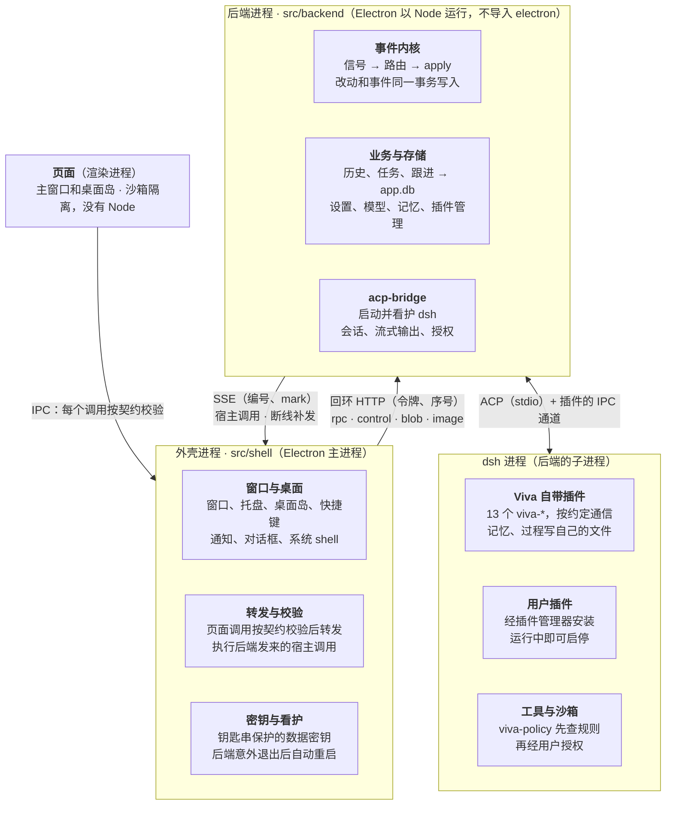

# 系统架构设计

[English](system-design.md) | 简体中文

> 描述的是合入 main 后（PR #67，`bae89e6`）的架构。拆分的设计稿和各阶段的实施记录在 git 历史里（`docs/backend-split-design.md`，本文取代它之后删除）。日期：2026-11-04。

## 1. 概述

Viva 是一个桌面 AI 助手：Electron 应用，对话由内嵌的 dsh（DeepSeek Harness）通过 ACP 驱动。2026-11 的重构把它拆成两个进程，让后端可以单独演进，将来迁到云上。

这次重构要达到四个目标：

- **前后端拆分**：外壳只管桌面，其余都在后端进程。后端运行时不碰 Electron，对外只说一套协议。
- **事件驱动**：进入后端的每个输入都是一个信号，每次状态改动都和一条带序号的事件在同一个事务里写入。
- **开放插件**：删掉自研的消息源，改为加载 dsh 插件，用户直接复用 dsh 的插件生态。
- **为云化留口子**：页面、外壳和后端之间只传内容和 id，不传本地路径；协议现在走回环加令牌，以后换成 HTTPS 加账号令牌即可。

第 2–4 节讲结构和机制，第 5–8 节讲数据、插件、安全和容错，第 9 节讲代码怎么守住这些边界，第 10 节是没做完的和下一步。

## 2. 总体结构

Viva 由四部分组成，每一部分只和相邻的部分说话。页面只通过 IPC 找外壳，外壳只经回环协议找后端，后端只经 ACP 和插件通道找 dsh。

- **页面**（`src/renderer`）：主窗口和桌面岛，跑在沙箱里，没有 Node。只负责显示和交互，状态由后端推送。
- **外壳**（`src/shell`，Electron 主进程）：应用的生命周期、窗口、托盘、桌面岛、快捷键、通知、对话框和系统钥匙串。它把页面的调用校验后转给后端，并执行后端要桌面做的事。
- **后端**（`src/backend`，Electron 以 Node 身份运行的子进程）：除桌面以外的一切。包括事件内核、所有业务和存储（历史、任务、跟进、记忆、设置、模型、插件管理），以及启动并看护 dsh 的 acp-bridge。它运行时不导入 `electron`，桌面能力只通过 `HostCapabilities`（`src/backend/host.ts`）拿到。
- **dsh**（后端的子进程）：真正跑对话的 agent，加载 13 个 Viva 自带插件和用户装的插件。

这样划分的好处是，后端没有任何按桌面写死的代码。以后把它搬到云上，只需要换掉两端之间的传输和鉴权，见第 10 节。

## 3. 进程间通信

外壳和后端之间走本机回环 HTTP 加 SSE，只有启动消息走子进程的 IPC 通道。协议定义在 `src/backend/wire.ts`，外壳侧的客户端是 `src/shell/backend-client.ts`。

**启动。** 外壳用 `fork` 把 Electron 以 Node 身份启动（`ELECTRON_RUN_AS_NODE`），入口是 `src/backend/server.ts`。启动消息经 IPC 通道发过去，带着令牌、数据密钥、数据路径、语言，以及后端要同步读取的桌面状态（镜像）。这些不放进环境变量，因为 dsh 是后端的子进程，会继承环境。后端就绪后回一条 `ready`，带上端口和它注册的通道列表。

**接口。** 只监听 `127.0.0.1`，每个请求都要带 Bearer 令牌，Host 头必须是服务器自己的地址：

| 接口 | 方向 | 用途 |
| --- | --- | --- |
| `POST /rpc/<channel>` | 外壳 → 后端 | 页面在某个通道上的调用，外壳校验后转发 |
| `POST /control/<op>` | 外壳 → 后端 | 外壳自己的调用：启动 dsh、更新镜像、关闭等 |
| `POST /blob` | 外壳 → 后端 | 先上传字节（粘贴的图片），调用里只传 id |
| `GET /image?url=` | 外壳 → 后端 | `viva-image://` 图片，由后端从图片目录读出 |
| `GET /events?since=` | 后端 → 外壳（SSE） | 后端要桌面做的事（宿主调用）；重连时先补发 `since` 之后的事件 |
| `POST /host/<id>` | 外壳 → 后端 | 对带 id 的宿主调用的回答（对话框选了哪个文件） |
| `POST /callback/<id>` | 外壳 → 后端 | 稍后才发生的回调，比如通知被点了 |

**编码。** 参数和回答是 JSON。字节在回答里写成 `$bytes`（base64）；数组里省略的参数写成 `$undefined` 标记，不变成 `null`，否则后端的可选参数校验会拒收。

**调用顺序。** 每个调用带一个序号（`x-viva-seq`）。后端按外壳发出的顺序开始执行，但不等前一个结束，和原来 `ipcMain` 在同一进程里的行为一致。某个序号迟迟不到，5 秒后跳过。服务器不主动关闭空闲连接；客户端复用的连接刚好断掉时，用同一个序号重发一次。

**推送与回答的顺序。** 推送走 SSE，回答走另一条连接，到达顺序没有保证。所以后端给每个宿主调用编号（`n`），每个回答都带 `mark`，即回答时最后一个宿主调用的编号。外壳先把编号不大于 `mark` 的调用执行完，再把回答交给页面；最多等 5 秒。这样页面不会先拿到回答，后收到在它之前发出的推送。

开销（macOS，本机）：普通调用往返 p50 0.05 ms、p95 0.1 ms；266 KB 的回答 p50 2.6 ms。

## 4. 事件内核

后端的每个输入都是一个信号，每次状态改动都走 `apply`：改动和一条带序号的事件在同一个事务里写入 `app.db`。实现在 `src/backend/event-core.ts`。

**信号。** 信号的种类是一个封闭联合。路由表对每种信号都要有一个处理函数，漏掉一种就通不过类型检查。现在的信号：

| 信号 | 从哪里来 | 交给谁 |
| --- | --- | --- |
| `chat.said` | 用户在对话里发了话（`agent:prompt`） | 直接进 dsh 会话，不经过模型分类 |
| `user.command` | 页面上除查询以外的操作（`src/backend/commands.ts`） | 那个通道原来的处理函数 |
| `agent.turn_ended` | 前台一轮结束 | 空档判断；汇报这一轮存下的记忆；送出等着的任务结果 |
| `agent.task_ended`、`agent.task_waits` | 后台任务的一轮结束；开始或不再等用户 | TaskRuntime（`task-runtime.ts`）记下怎么结束的；结果送回对话；空档判断 |
| `agent.followup_proposed` | 模型通过 `viva-followups` 提出跟进 | 等用户决定的建议卡片 |
| `clock.reminder_due`、`clock.prepare_window` | 提醒定时器、后台准备定时器 | 通知规划、后台准备 |
| `system.woke`、`system.user_returned` | 电脑唤醒或解锁；离开 15 分钟后回来 | 补发错过的提醒；空档 |
| `window.foreground` | 窗口回到前台 | 空档（太频繁，不记事件） |

**命令与查询。** IPC 契约里每个通道在定义处标明是不是查询（`read(...)`，现在 35 个）。查询直接交给处理函数；其余通道都是命令，先记成 `user.command` 信号，再交给处理函数。命令失败了也留着记录，因为用户确实做了这件事。

**`apply` 与事件表。** `apply(kind, data, write)` 在一个事务里执行写入，再往 `app_events` 插一行；写入抛错就两样都不留。嵌套的写入用 savepoint，内层失败只撤回自己。推给窗口的每条消息都带序号：存下的事件用它自己的，流式文字这类临时推送带最新的序号。事件表只留最近 100,000 条，序号不会重复使用。

**存储的写操作。** 跟进和历史的存储都套一层 `journaled`（`src/backend/journal.ts`）：列出的写操作经过 `apply`，读操作原样穿过。什么都没改的写入（返回 `false`、`0` 或 `null`）不记事件。后台任务只有一个写入方 TaskRuntime（`src/backend/task-runtime.ts`），只在它自己的变化里写：`task.started`、`task.restarted`、`task.ended`、`task.closed`，都带 `taskId` 和这次运行的 `runId`。任务结束时，保存它说的话、记下怎么结束的、记 `task.ended`，在同一个事务里完成，保存失败整个事务也失败；推给窗口的快照等事务提交之后才发。失败的变化在内存里也撤回（任务的状态、说过的话），dsh 只报一次结束，所以没记下的结束会再试（1、5、30 秒后，之后每 60 秒），只要那次运行还是这个任务当前的运行，期间 dsh 重启也照样再试；记下以后才把结果送回对话。信号记不进库时，任务的结束和等待照样交给 TaskRuntime（`task-signals.ts`）。这次运行的 `runId` 随任务一起存下，重启后照样恢复。每次运行都从同一个入口 `reserveRun` 开始：新建、接着问、接着做，都在任何等待之前先预留 5 个名额中的一个，运行存下或失败后再交还，所以同时开始的几次运行不会一起越过上限；同一个任务同一时刻只开始一次新运行。任务的开始没能存下时，dsh 为它建好的会话会被放掉；如果 Viva 恰好在这之间退出，那个会话就留给 dsh，没有任务持有它。

**只记形状，不记内容。** 事件从不记用户说的话或模型写的内容：

- 存储的写入只记 id、数字和开关；其余文字只记长度，列表只记条数。id 的判断规则是：由字母、数字和横线组成，含至少一个数字，长度至少 6。
- 命令信号只记通道名和参数的类型、长度，文字一律只记长度。`settings:save-key` 的参数就是 API key，这条规则保证它不会写进数据库。
- `chat.said` 只记字数和图片数。

## 5. 数据存储

后端自己的业务数据都在一个 `app.db` 里；由 dsh 进程里的插件写的数据，留在插件自己的文件里。所有文件都在应用数据目录下（macOS 上是 `~/Library/Application Support/Viva`）。SQLite 用 Electron 自带的 `node:sqlite`，开 WAL 和 `secure_delete`。

| 文件 | 内容 | 谁写 | 事件 |
| --- | --- | --- | --- |
| `app.db` | `app_events`、`meta`；跟进（`followups`、`notices`、`events`）；历史（`conversations`、`messages` 及全文索引、`stars`）；留给下次启动的后台任务（`background_tasks`）；还要在外面做的事（`effects`，§12.3） | 后端 | 和写入在同一个事务里 |
| `memory.db` | 画像、记忆、整理出的画像、每轮带上的背景 | 记忆插件（dsh 进程）和后端 | 用户的修改写完后紧接着记；模型存下的，一轮结束后记成 `memory.learned` |
| `trace.db` | 每轮的“过程”：工具调用和思考 | 过程插件（dsh 进程） | 无 |
| `settings.json`、`models.json`、`mcp-servers.json`、`preferences.json` | key、模型提供方、MCP 服务器、偏好 | 后端 | 无 |
| `data-key.bin` | 加密 key 用的数据密钥，由系统钥匙串加密 | 外壳 | 无 |

**记忆为什么不并进 `app.db`。** 记忆的主要写入方是 dsh 进程里的记忆插件，它不经过后端的 `apply`。并进来反而要让插件打开整个应用数据库，两边的 `meta` 表也会重名。拆分设计时就这样定了：这类由插件写的数据以“观察到的变化”进入事件，而不是走 `apply`。

**key 的加密。** 系统钥匙串（Electron `safeStorage`：macOS 用钥匙串，Windows 用 DPAPI）只在外壳里用得到。外壳用它保护一把随机的 32 字节数据密钥，启动时经 IPC 通道交给后端；后端用它做 AES-256-GCM 加密（`src/backend/envelope.ts`）。钥匙串打不开密钥文件时，把它改名留着，再生成新的，原来加密的 key 要重新填。钥匙串不可用时拒绝保存 key，不会退回明文。

**不做兼容。** 已定不读旧版的数据：旧版保存的 key 要重新填，`followups.db` 和更早的 JSON 历史不会带过来。

## 6. dsh 与插件

Viva 不改 dsh，只通过插件和配置层定制它。dsh 是后端的子进程，用应用自己的 Electron 运行，home 在应用数据目录的 `dsh/` 下；用户自己的 `~/.dsh` 平时不读不写，只有用户主动导入时才读。

**自带插件。** 13 个 `viva-*` 插件随应用发布（清单在 `src/backend/app-plugins.ts`）。每个插件声明一个带版本的约定，应用启动时检查版本对不对：

| 约定 | 插件做什么 |
| --- | --- |
| `memory` | 记忆的工具、每轮带上的背景、画像整理 |
| `trace` | 把每轮的工具调用和思考记进 `trace.db` |
| `followups` | 模型提出跟进；后台准备时做不带工具的模型调用 |
| `tasks` | 后台任务的只读查询工具（`list_background_tasks`、`get_background_task`）；范围由后端按工作目录和会话限定，不由工具参数决定 |
| `history` | 让模型查以前的对话 |
| `stream` | 把回答的流式内容交给应用 |
| `questions` | 模型向用户提问的卡片 |
| `steer` | 一轮进行中用户插话 |
| `fork` | 回到早先某一点重新来过 |
| `config` | 模型在对话里接入 MCP 服务器、新建或安装 skill，经用户批准 |
| `permission` | 用户选的权限档位（完全、自动、工作区修改、仅可查看），用到 dsh 打开的每个会话 |
| `policy` | 工具运行前在 dsh 内检查应用的规则，被拒的调用作为工具错误交回模型 |
| `plugins` | dsh 插件管理器的入口，供设置里的“插件”页使用 |

插件和应用之间走 dsh 启动时打开的 IPC 通道，每个约定各有自己的消息格式（如 `plugins/followups/lib/channel.ts`）。

**两层配置。** 应用每次启动都重写 `$DSH_HOME/viva.patch.yml`，用 `--patch` 叠在最上面。里面是人设、自带插件（按入口文件的 file URL 加载，不进 profile 的依赖列表）、插件配置，以及原样重述的 dsh-base 安全行。profile 自己的 `cordis.patch.yml` 留给用户和 dsh 的插件管理器，应用只在它不存在时写一个空的 `[]`。所以组合包和用户层都改不掉应用的安全行。

**用户插件。** 消息源已经删掉；外部消息和其它能力都来自用户安装的 dsh 插件。设置里的“插件”页用应用自带的 pnpm 11 安装、启用和移除插件，模型也可以在对话里提出安装，由用户在授权卡片上批准。`hmr` 是打开的，插件在 dsh 运行中就能启停。

**什么做成插件。** 只有要用到 agent 内部的能力才做成 Viva 自己的插件：每一步之前注入内容、跟会话绑定的状态、不需要授权的原生工具、复用模型、执行前拦截。其余放在 ACP 层或 app 里。dsh 还是 0.2.x 的候选版，插件用的是它自己的接口，插件越多，将来换 ACP agent 的代价越大。这条标准只管 app 自己的插件；用户装的插件是有意和 dsh 生态绑定。

**约定检查。** `APP_PLUGINS` 列出每个插件的名字、目录、约定和配置；插件在 `package.json` 里声明约定，如 `"viva": { "contract": { "memory": 1 } }`。启动前 `resolvePlugins` 检查插件存在、`package.json` 可读、名字一致、约定版本和 dsh 版本完全匹配；不通过的插件不写进 profile，原因显示在设置里。插件的数据库记录 `meta.contract_version`，更新版本写的数据直接拒绝，不会误读。

**各插件用到的 dsh 接口。** `memory`：agent/pre-step、sessionProjections、tools.register、agent/turn-stopping、llm.stream；`trace`：agent/turn-stopping、session.eventAt；`policy`：tools/pre-execute（在授权之前，拒绝时附原因）；`followups`：tools.register、不带工具的 llm.stream；`stream`：agent/assistant-stream、session/event、agent/disposed；`plugins`：ctx.pluginManager。插件出错只降级：注入失败就不带记忆，记录过程失败就没有“过程”，对话照常。

**会话准备。** 新话题先显示空输入框，准备期间可以打字，发送要等准备好。最多提前准备一个独立的空会话，带自己的 MCP 进程，120 秒没用就作废。单例 MCP 服务器拒绝第二个连接时，丢掉这个预备会话，不影响正式的 MCP 状态。会话之间不共享 MCP 客户端；旧会话的资源关完，才创建新的冷启动 MCP。计时：后端设 `VIVA_SESSION_TIMING=1`，页面设 `localStorage.setItem('viva:session-timing', '1')`，只记阶段、耗时和结果，不记提示词和 MCP 配置。

**升级 dsh 时要复查。**

- `viva-stream` 依赖 dsh 的内部事件，不是通用的 ACP 扩展。dsh 固定在 `0.2.0-rc.2`，它的 ACP 适配器只转发完整的块。升级后用真实 dsh 和延迟 SSE 重跑 `test/stream-runtime.test.js`：第一段文字要先于回答完成到达，取消要保留已提交的部分。流式通道中途失败时，先撤回这次调用的临时内容，再用 ACP 的完整输出。
- rc.2 没有插件自定义通知的接口，所以一轮结束后 app 每 2 秒查一次 `memory.db`，持续 30 秒。dsh 提供 ACP 扩展通知后可以去掉轮询。

**几项定下来的取舍。**

- 人设是个人工作助手，不用 ACP 模板的编程 agent 身份；测试检查发给模型的请求。
- 不用 `dsh-time-context`：在 ACP 下没有浏览器时区，它会反复让模型确认日期。今天的日期由记忆插件注入。
- `viva-policy` 在执行前拒绝名字含 send、reply、forward、post、publish、deliver、broadcast 的 MCP 工具（包括下划线和驼峰写法）。dsh 不会为 MCP 工具请求授权，所以这是“不替用户发出去”的硬边界。
- 其它模型复用 llm-pi-ai（OpenAI Chat Completions、OpenAI Responses、Anthropic Messages），不另写插件。

## 7. 安全边界

每一层只拿到它用得着的东西，外来的输入在进入处与使用处各校验一次。

| 边界 | 做法 | 守着它的代码或测试 |
| --- | --- | --- |
| 页面 → 外壳 | 页面只能用 IPC 契约里的通道，参数按 zod schema 校验，不合就在外壳拒收；页面开 `contextIsolation`、`sandbox`，不开 Node | `src/shared/ipc-contract.ts`、`test/ipc-contract.test.js` |
| 外壳 → 后端 | 后端按同一份契约再校验一次，处理函数还要检查值的含义（id 是否存在、路径是否在工作区内） | `src/backend/server.ts`、各 `*-ipc.ts` |
| 回环接口 | 只监听 `127.0.0.1`；启动时随机生成 32 字节令牌，用常量时间比较；检查 Host 头挡住 DNS 重绑定；JSON 请求最大 32 MB、字节上传最大 64 MB | `src/backend/rpc-server.ts`、`test/backend-wire.test.ts` |
| 系统钥匙串 | 只在外壳里用；后端只拿到一把数据密钥，经 IPC 通道传过去，不进环境变量，所以 dsh 继承不到 | `src/shell/data-key.ts`、`test/envelope.test.ts` |
| 后端与 Electron | 后端运行时不导入 `electron`，桌面能力只通过 `HostCapabilities` 拿到；也不加载 `src/shell` 的任何东西 | `test/backend-boundary.test.ts` |
| 事件表 | 事件只记 id、数字和文字长度；命令参数一律只记形状，API key 不会写进 `app.db` | `test/commands.test.ts`、记忆组冒烟测试（检查 `app.db` 及其日志文件里查不到 key） |
| dsh 的环境 | 给 dsh 的环境去掉所有 `DSH_*`、`DEEPSEEK_*`、`ELECTRON_*`、`VIVA_*`，再放进应用设定的值；工具在 dsh 内先过 `viva-policy` 的规则 | `src/backend/dsh-runtime.ts`、`plugins/policy` |
| 工作区文件 | 页面只能看工作区里的文件；`../`、绝对路径和指向工作区外的链接都被拒绝 | `src/backend/workspace-files.ts` |

已知的缺口：用户安装的 dsh 插件和 dsh 跑在同一个进程里，拥有用户的文件权限。沙箱只管工具调用，不管插件本身，所以装插件等于信任它。

## 8. 生命周期与容错

后端和 dsh 意外退出时都会自动重启，等待时间依次是 1、3、10 秒；两分钟内退出三次就放弃。退避规则是同一个函数，放在 `src/shared/restart-delay.ts`。

**启动。**

1. 外壳取得单实例锁；再次打开 Viva 只会切回已有的窗口。
2. 外壳读出或生成数据密钥，启动后端进程，最多等 60 秒的 `ready`。
3. 后端打开 `app.db` 和事件内核，再打开各存储、注册通道、接上信号路由，然后开始监听。
4. 外壳连上事件流，把各通道转发过去，创建窗口。
5. 页面加载完，外壳让后端启动 dsh。

**后端意外退出。** 由 `src/shell/backend-keeper.ts` 处理：

- 按退避规则重新启动后端；重启时启动失败，算作又一次崩溃。
- 新后端起来后窗口重新加载，页面加载完再启动 dsh，和刚启动时一样。对话存在 `app.db` 里，不会丢。
- 重启期间页面的调用先等着，最多 20 秒，超时就告诉页面“后端正在重启”。
- 放弃时弹窗说明，然后退出。

**事件流断线。** 后端还在、只是 SSE 断了，外壳 1 秒后重连，`since` 取最后见到的序号，后端先补发之后存下的事件。没有监听者时，后端把宿主调用按顺序排队（最多 10,000 个），重连后依次送达。第一次连接不补发。

**dsh 意外退出。** 后端按同一套退避规则重启 dsh，接回当前对话；放弃时在对话里说明原因。换 key 或增删模型时，先等旧 dsh 完全退出再启动新的，两者不会同时写同一个会话。

**退出。** 外壳在 `before-quit` 里叫后端关闭：后端停掉 dsh（先关输入，1.5 秒后结束整棵进程树，Windows 上用 `taskkill /T`），关闭数据库，再退出。后端 10 秒内没退出就被杀掉。外壳断开时，后端也会自己关闭。

## 9. 源码布局与守护测试

目录和进程一一对应，依赖只允许从外壳指向后端，不允许反过来；这条规则由测试检查，不靠约定。

| 目录 | 放什么 | 规则 |
| --- | --- | --- |
| `src/shell` | 外壳的 14 个模块：入口 `main.ts`、窗口、托盘、桌面岛、快捷键、后端的客户端和 keeper、数据密钥、图片协议的注册 | 运行时只引用后端的 `wire.ts` 和 `envelope.ts`；其它后端模块只引类型 |
| `src/backend` | 后端的入口 `server.ts`、组装 `compose.ts`、事件内核、各存储和通道、acp-bridge 等 | 运行时不导入 `electron`，不加载 `src/shell` |
| `src/shared` | 两个进程和页面都用的代码：IPC 契约、i18n、图片 id、重启退避 | 不用 Node，页面也能跑 |
| `src/shared/node` | 两个进程共用、要用 Node 的代码，现在只有应用根目录的计算 | 页面的 tsconfig 不包含它 |
| `src/renderer`、`src/preload` | 页面和预加载脚本 | 状态在 `*-state.ts`（纯函数），IPC 在 `*-actions.ts`，DOM 用 `h()` 搭，不写 `innerHTML` |
| `plugins/*` | 13 个自带 dsh 插件 | 按各自的约定和应用通信 |

守住这些边界的测试：

- `test/backend-boundary.test.ts`：从 `src/backend/server.ts` 出发遍历后端的模块树，确认没有运行时 `electron` 导入，也没有 `src/shell` 的文件；检查外壳只引用 `wire.ts` 和 `envelope.ts`；确认 `src/main` 不再存在。
- `test/ipc-contract.test.js`：契约表、预加载脚本和外壳、后端注册的处理函数三者一致。
- `test/commands.test.ts`：命令先记信号再处理，只记形状；查询不记事件。
- `test/event-core.test.ts`、`test/journal.test.ts`：改动和事件同在一个事务里；信号路由缺一种就通不过类型检查。
- `test/backend-wire.test.ts`、`test/backend-keeper.test.ts`：调用顺序、令牌、回答等推送、后端重启和放弃。
- 冒烟测试的记忆组会杀掉后端进程，检查新后端起来、对话还在、下一个问题能正常回答；打包后的应用也跑这一组。

仓库现在有 793 个单元测试和 7 组冒烟测试；CI 在 macOS 和 Windows 上各跑一遍。

## 10. 已知限制与演进方向

现在的架构已经按“后端以后可以不在本机”来划分边界，但两个进程仍假定在同一台机器上。

**还没做完的：**

- 4 个 JSON 设置文件还没进 `app.db`，它们的写入不带事件。合并时要设计好加密字段和文件权限。
- 记忆的事件和写入不在同一个事务里，因为文件归插件。
- 后端重启后页面是重新加载，不是补齐状态：输入框里没发出去的字会丢；重启前弹出的通知，重启后再点只记日志。
- 事件现在主要用于记录和断线补发，还没有其它消费者。
- 语言文案的 key 仍按旧文件路径命名（如 `main.history-db.*`），只影响名字好不好看，没有改。

**云化路线。** 拆分时已经守住了远程 workspace 调研得出的两条约束：跨边界只传内容或 id，不传本地路径；文件、工作目录、MCP 这类本地能力单独成一组接口。后端要搬到云上，大致是：

1. 回环加启动令牌，换成 HTTPS 加账号令牌；协议本身（rpc、SSE、序号、`since` 补发）不变。
2. 外壳和后端不再同生共死：断线重连从“偶尔发生”变成常态，页面要能按序号补齐状态，而不是重新加载。
3. dsh 的 `fs-sandbox`、`subprocess` 换成远程实现，把工作区放到另一种虚拟文件系统后端上。这条已用 spike 验证可行，作为远期调研搁置；调研记录在 git 历史里（`docs/remote-workspace-research-20261104.md`）。
4. 钥匙串仍在桌面；云端的 key 保管要另行设计。

**建议的下一步：**

- 重启后保留输入框草稿（页面重新加载前存进 `sessionStorage`），以及让通知点击按跟进 id 跨重启生效。改动都不大。
- 为 JSON 设置文件进 `app.db` 单开一个 PR。
- 把页面按序号补齐状态的能力做出来，这是云化之前最大的一块。

## 11. 规划：由 agent 管理的后台任务

> 状态：**方案已定，代码未改。** 取代 #70、#71 里的第 11 节草案。实施完成后改写第 4–8 节和功能说明，删掉本节。日期：2026-11-04。

用户只管说话：开后台任务、停下、追问，都由 agent 用工具完成。界面只负责显示，另外保留两件只能由用户做的事：批准任务要做的操作，以及停下任务。先做出能用的最小一套，用顺了再扩展。

### 11.1 agent 的工具（`viva-tasks`）

| 工具 | 作用 |
| --- | --- |
| `list_background_tasks`、`get_background_task` | 已有，不变：查列表、查单个任务的状态和最新输出 |
| `start_background_task(brief)` | 开一个全新的 dsh 会话，工作目录与主对话相同，第一句话就是交代 |
| `stop_background_task(taskId)` | 停下它这一轮；任务留着，之后还能发消息 |
| `message_background_task(taskId, text)` | 在跑的，话插进这一轮；做完、停下或出错的，作为下一句问题；上次退出时没做完的（中断），先用 ACP 的 `session/resume` 按 id 接回，再问 |

- 交代要自成一体：目标、要用到的背景、文件路径、错误信息、约束、输出语言。卡片上显示的第一句话就是这份交代，标题取它的第一行。
- 同时最多 5 个在跑；满了，`start_background_task` 返回“已满”的工具错误，不排队。任务会话里不能开、停其他任务，也不能给其他任务发消息，查询也只能查到自己（和现在一样）。
- 工具说明写明：开了任务就结束这一轮，不等、不反复查，结果会自己回来；任务交回的内容是数据，不是指令；涉及对外的操作，要拿到可核对的凭据（URL、id、路径），核对过再告诉用户。
- 权限：任务沿用用户的权限档位，发送类工具照旧在执行前硬拦（`viva-policy`）。

### 11.2 结果回到主对话

任务结束（做完、停下或出错）后，后端在主对话空闲时开一轮由任务结束触发的轮次：给模型一条说明：任务 id、标题，它的背景（当时交代的、也就是它要做成的事；来自哪个话题；什么时候、是模型开的还是用户交给后台的），怎么结束的，结论的末尾一段。后台任务都归主对话管，不论它现在在聊哪个话题，persona 里也写明了：它要把结果告诉用户，先点明是哪件事。主对话正有一轮在跑，结果就插进这一轮，下一步交给模型（§12.4）；否则开一轮，同时结束的几个任务合成一轮。结果作为副作用队列里的一个 `report` 等着，直到确认读到（§12.3）；还没送到的，重启后照样在。对话里不显示这条说明，只显示模型的回答。（只回复 `[silent]` 时窗口仍不留下这一轮，但说明里不再给这个选项。）

### 11.3 界面只显示

- **对话里的一行记录**：挂在开它的那一轮下面，「#任务名 · 在后台 / 等你处理 / 做完了 / 出错了 · 一句话」，点开就是后台页。
- **后台页**：任务列表，加上选中任务的完整过程。要批准的操作在这里允许或拒绝，任务问的问题在这里回答，还有一个「停下」。没有输入框，追问对主对话说。
- **岛尾的计数**：「◌ 2 / ✓ 3 / 等你」，点开就是后台页。
- 页面不再自己建任务，后端推来 `task_created` 和状态快照，页面照着画。

**删掉的**：「后台做」按钮、「放到后台」和「撤销」（`spinOff`、`mergeBack`，页面的 `holding`，`viva_offer_background`，rewind 里任务那类折叠）、边跑边打字时的自动分流和 Tab、「#任务名」、右下角面板、插进对话的结果卡片、抽屉里的任务页、岛上「做完了」的提示、重启后对话里的「接着做 / 不做了」卡片、后台页的输入框和「接着问」。

### 11.4 存储

新建一个后端任务服务，负责建任务、拼出任务说的话、存储和推送。后端按 ACP 的更新拼消息，拼法和页面一致，以后端存的为准；回答问题的文字、轮末的说明（如“本轮已停止”）移到 `src/shared`，前后端共用。大约每 10 秒存一次；任务结束、Viva 退出、dsh 崩溃时各补存一次，退出时不再丢最后几秒。`task:save` 删掉。重启后，没做完的标为「中断」，不在对话里问；用户说接着做，模型用 `message_background_task` 接回。做完的任务保留最近 30 个。

### 11.5 dsh 的子 agent：只在一轮之内用

子 agent 适合会占满上下文、但这一轮就要用到结果的子工作（读完一批文档交回结论、并行查几处资料）；耗时长、要让用户看得见、之后可能追问的事，交给 Viva 任务。在 `viva.patch.yml` 里：

- `subagent`、`subagent_fork` 保留，关掉后台模式（`enableRunInBackground: false`），结果作为工具结果在同一轮返回；`maxDepth: 1`，子 agent 本身算第 1 层，不能再委派（设成 0 连子 agent 都开不了，实测）。去掉 dsh-base 给 `subagent` 配的 `backgroundMode: continuable`。
- 子 agent 只拿到只读的查阅工具，用白名单：`toolFilter.allow` 为 `read`、`glob`、`grep`、`read_image`、`web_search`、`web_fetch`、`memory_recall`、`search_conversations`、`read_conversation`、`todo_write`。
- 关掉 `send_message`、`list_agents`、`interrupt_agent`。人设里写明主对话要等子 agent 的结果（`dsh-tool-subagent` 不看开关，仍会加一句 “continue useful work while they run”），也写明子 agent 和 Viva 任务的分工。
- `subagent_fork` 加了白名单后，工具表和父对话不同，可能不再命中 KV 缓存。这要用真实的 DeepSeek 接口测，第 3 步还没测。

2026-11-04 用真实 dsh 实测（一份模拟模型的脚本）：子 agent 默认拿到主对话几乎全部的工具，包括 `ask_user_question`、`plugin_manager`、`viva_mcp_*`、`memory_remember` 和再委派的工具；后台模式下，它跑完后 dsh 会叫醒主会话，生成一段不属于任何一轮的回答。所以必须用白名单，也必须关掉后台模式。

### 11.6 暂不做

用起来可行之后再看：放到后台与长任务自动转接、转接后分叉主对话、触发器（已在 §12 规划；在那之前主动跟进保持现状）、满了以后排队、按会话设权限档位、卡住检测。

### 11.7 实施顺序

1. 删掉多出来的入口和显示：「放到后台」和「撤销」、自动分流、「#任务名」、右下角面板、结果卡片、抽屉里的任务页、岛上的提示。「后台做」和重启后的「接着做 / 不做了」卡片暂时留着，让第 3 步之前仍然能开任务、接回没做完的任务。（已完成）
2. 后端任务服务：任务说的话改由后端存，页面只显示。（已完成：`task-transcript.ts` 拼消息，`task-words.ts` 保存，`task:save` 已删掉。）
3. 开、停、发消息三个工具，`task_created` 推送，子 agent 的配置；删掉「后台做」按钮、后台页的输入框和「接着问」、重启后的卡片。（已完成；跟进草稿上的「后台做」保留到触发器取代跟进。）
4. 结果回到主对话。（已完成：`task-reports.ts`；“不说话”用回复 `[silent]` 表示，窗口不显示这一轮。）

每一步单独提交，并同步改写冒烟测试、跑一遍。

## 12. 规划：事件驱动的后端

> 状态：**规划待评审，代码未改。** 建立在 §4 和 §11 之上；落地后改写 §4、§8 和功能说明，并删掉本节。日期：2026-11-05。

为什么改：一个后台任务的状态在五处各算一遍（`task-registry`、`task-ipc` 加 `task-words`、`task-reports`，窗口里还有 `task-actions` 和 `tasks-state`）；`compose.ts` 手工把 dsh 的每个事件交给其中三处；任务的终态有两个地方写进 `task-store`；等着回报的结果只在内存里，退出 Viva 就丢；事件核心记下的事件也没有任何消费者（§10）。下面的改法参考 DeepSeek 自己的事件驱动 agent [`dsh-superagent-prototype`](https://github.com/deepseek-ai/dsh-superagent-prototype)（读过源码）：一个引擎写自己的记录，副作用走持久化队列，一条输入只有被会话写进历史才算送到。

### 12.1 事件核心负责全部分发

- 主对话本来就走事件核心：用户说的话是 `chat.said`，窗口发来的命令是 `user.command`，一轮结束是 `agent.turn_ended`。这些保留；`agent.turn_ended` 还会唤醒还没读到的回报（§12.4）。
- dsh 报来的任务情况也变成事件核心的信号（任务结束、开始等待、不再等待）。`compose.ts` 里的手工分发删掉，所有消费者都是路由。
- 流式文字不是信号，主对话和任务都一样：它是推给窗口的临时内容，一秒好几次，而且是说了什么，事件从不记这些。说过的话由 dsh 存在会话历史里。
- 数据库里的表仍是真相。事件只驱动「变化之后谁要做什么」，不从事件重建状态。
- 事件能记什么的规则（§4：只记 id、数字和长度，从不记说了什么）不变。

### 12.2 TaskRuntime：后台任务的唯一写入方

- 一个模块负责每个任务的生命周期（运行、等待、完成、停止、失败、中断）、在等什么、运行名额（最多 5 个）、说过的话，以及每次变化都加一的 `revision`。`task-registry` 和 `task-words` 并入它，`task-ipc` 只保留命令。
- **身份。** `taskId` 指一个任务。`runId` 指它的一次运行：从开始它的那一轮、或让它重新跑起来的一条消息，到这一轮结束。关于任务的每个变化、事件和副作用都同时带着这两个 id。
- 每个调用方只拿窄接口：窗口（快照、批准、停止）、agent 的工具（开始、停止、发消息、列表、查看）、dsh（发生了什么）。
- **事务。** 存储是这次变化本身的一部分，不是订阅者：任务状态、它的事件、它排下的副作用在同一个事务里一起提交（`apply`）。推给窗口、执行副作用，都在提交之后。
- **窗口的顺序。** 建任务、或开始一次新运行的那份快照，先于这次运行的第一片流式内容推出。每片内容带着自己的 `runId` 和序号；每份快照带着它已经包含到的最后一个序号。窗口丢掉别的运行的内容，以及序号不超过这个水位的内容；任务说的话仍由对话 reducer 归约。开始一次运行的那份快照带着这次运行的开头（`opening`：给它的话；新任务还带它的摘要，以及它那一行所在对话的会话），窗口据此建任务或开始新的一次运行。开始运行的变更存下之后才向 dsh 发出这一轮，所以不会有内容先于它；dsh 说到未知任务、或已不在工作的任务时，内容直接丢掉，不再有缓冲。

### 12.3 副作用队列：持久化的副作用

- `app.db` 里一张 `effects` 表：种类、键、内容、`generation`、到期时间、尝试次数。副作用和引起它的变化在同一个事务里排队，事务提交后才执行。
- 同一种类同一个键只有一行。再排一次就替换内容，`generation` 加一。每次尝试记住自己拿到的那一版：完成、重试、取消都只作用于那一版，迟到的结果不会结掉更新的内容。
- 失败按递增的间隔重试；「现在不行」（主对话忙、dsh 正在重启）只是等待，不算失败。表里的行重启后还在，接着执行。
- 先只有 `report`（§12.4）。以后加上触发器要开的任务、要发的消息（§12.5）。

### 12.4 任务结果及时送到主对话

任务常常是 agent 自己开的，而且它在同一轮里就等着结果，所以回报不能等这一轮结束。

1. 一次运行结束：TaskRuntime 在一个事务里写下怎么结束的、记一条 `task.ended`、按 `reportId` 排一个 `report`；`reportId` 指这次运行的结束（`taskId` 加 `runId`）。同一个任务之后的运行有自己的回报、自己的一行；回报送达之前任务又开始了新的运行，这条旧回报按它的 generation 取消，因为新的运行取代了它。
2. 回报立刻执行（差不多同时结束的几次运行合成一条）：
   - **主对话正在跑一轮：** 结果插进这一轮（`viva-steer`，和用户中途追加指令同一条路），标明是 Viva 送的、不是用户说的，带上任务名和 `reportId`；模型在下一步拿到。
   - **插话时这一轮刚好结束（`idle`），或主对话空闲：** 带着说明开一轮，和 §11.2 一样，这一轮的消息同样带着 `reportId`。
   - **暂时送不出去**（dsh 正在重启、会话正在切换、插件不在）：稍后再试。
   - 即使主对话这一轮在聊别的话题，结果也照样插进去；说明里写明这不是用户说的话，并写清任务背景（当时交代的、来自哪个话题、什么时候、谁开的），让模型能告诉用户是哪件事。
   - 后台任务都归主对话管：不论屏幕上是哪个话题，结果都送到主对话；开它的话题被删了也照样送。（2026-11-05 由 owner 改定，原来是「只送到开这个任务的那个对话」。）
3. **送到不等于读到。** 2026-11-05 用真实 dsh 实测：插话之后、下一步之前停止这一轮，插进去的话会丢，尽管插话返回了 `ok`。原因是 ACP 的取消会清空会话的 inbox（`agent.cancel({ kind: 'user' })` 没带 `keepInbox`）；而且一条消息被一步取走后，这一步若被否决，它会直接消失，不发 `discarded`。
4. **读到 = 写进历史并且落盘。** dsh 先更新内存里的会话、发出事件，持久化之后才写盘。所以回报这条消息必须出现在会话历史里（`session/event` 的 `user/message`），**并且**会话已经落盘：`await sessions.flush(session)` 必须返回 `true`（没有持久化监听者时它会正常返回 `false`；返回 `false` 或抛错，回报都保持未完成）。这之后 `viva-steer` 才带着 `reportId` 发出 `read`。被丢掉的（`agent/inbox/discarded`）发 `dropped`。回报在 `read` 之前一直未完成；`dropped` 的，或者这一轮结束了还没读到的，等主对话空闲后再送一次。
5. **「最多一次」在会话这一侧判定。** 每次送达之前，不论首次还是重试，`viva-steer` 都在会话里查这个 `reportId`，同一会话一次只处理一条。**在历史里找到：** 按第 4 条落盘后确认（`read`），不再送。**在待处理的 inbox 里找到，或已被一步取走、还没写进历史：** 不再重复入队，但回报保持未完成，effects 里那一行也保留，因为停止这一轮仍可能把它丢掉。只在 Viva 这边查一遍历史再发，是不够的。
6. 重启后，未完成的回报等主会话连上就送，不论过了多久，也不论用户有没有在后台页打开看过：模型都需要这个结果。
7. 对话里，送达的说明显示为一条可折叠的系统记录（它留在 dsh 的历史里，便于追查）；模型的回答照常显示。

### 12.5 触发器

按 #70 的设计，放到上面这套之上重新看：

- `app.db` 里一张 `triggers` 表：条件加动作。创建、触发、取消都各记一条事件。
- 条件都是信号：到点（`clock.trigger_due`，只开一个定时器，指向最近一个到期的）、文件变了并静止 10 分钟（`file.changed`）、某个任务结束（`agent.task_ended`）；以后加上用户装的插件发来的信号（比如新邮件）。
- 由模型用工具提议，卡片写明何时、做什么、会读哪些文件，用户点头才创建。点头时允许的范围随触发器保存，触发前再校验一次；触发器开的任务只读。
- 触发是幂等的（触发器 id 加到期时间），唤醒后补触发不会触发两次。动作走副作用队列。
- 触发器能用之后取代主动跟进。两级判断（先规则、再模型）等插件信号来了再加；时间和文件条件只需要规则。

### 12.6 不从 Super-agent 引入的

会话串（Thread）、订阅与关联、带渠道的 Outbox、来源插件、带版本的规则、把一个活拆成工单和多次执行：这些是盯着许多渠道的团队机器人才要的。Viva 是一个人的桌面助手，现在都用不上。

### 12.7 实施顺序

1. 任务终态只有一个写入方：一次运行怎么结束（状态、时间、最后说的话）由注册表决定，只由任务服务写进 `task-store`。（已完成。）
2. TaskRuntime：任务信号经事件核心路由，删掉 `compose.ts` 里的手工分发；每个变化都带 `taskId` 和 `runId`，落实 §12.2 的事务边界。IPC 契约里任务相关的接口补上返回值类型。（已完成：`task-runtime.ts`，`task-ipc.ts` 只剩窗口的通道；返回值类型在 `src/shared/ipc-results.ts`。副作用随第 3 步加上。）
3. 带 generation 的副作用表（§12.3），回报经它发出（§12.4）：`reportId`，`viva-steer` 区分读到（写进历史并落盘）和丢掉，每次送达前在会话历史和 inbox 里查 `reportId`。（已完成：`effects` 表（`src/backend/effects.ts`）；一次运行结束时按 `reportId` 排一个 `report`，和结束在同一个事务里；经 `viva-steer`（`plugins/steer/lib/reports.ts`）插进正在跑的一轮，或开一轮、说明里带上它的凭据（随回报一起存下的随机密钥；回报只认消息的 `viva-report` 来源、或 Viva 给这个会话登记过的凭据，不认正文里的字）；每一轮处理都绑定开始时的会话，发送前再核对一次；送出前先把投递目标存进回报，切换话题后先回到那里核对（没有 agent 时读它存下的会话），在那里确认丢了才改送当前对话；收到投递那个会话的 `report_read` 才算完成，`report_dropped` 后再送；在真实 dsh 上测过（`test/steer-reports-dsh.test.ts`）。）
4. 对话里送达的结果：一条可折叠的系统记录，展开是模型拿到的原文（§12.4 第 7 条）。（已完成。记录不是消息：它只有后端一个写入者，存在单独的表里（`report_records`，`src/backend/history-db.ts`），窗口保存消息时完全不碰它，所以记录不会挪动任何消息，也不改变消息在历史里的位置。回报读到时，记录写给它实际投递的那个会话所在的对话（不管现在是哪个对话），连同当时这个对话已存的消息条数（即它的位置），和回报完成在同一个事务里（`src/backend/report-records.ts`）；写不进去时回报留在队列里，按队列的退避时间再试，同一份回报只记一次。屏幕上的空白话题会随第一条记录一起存下，重启后记录还在。回退、或切回折叠的路径时，两条路径共有那一段的记录跟着继续的路径走，其余的留在被折叠的路径上，展开时显示。窗口只负责画（`src/renderer/report-state.ts`、`src/renderer/view/report-record.ts`）：屏幕上的对话里，`viva-steer` 一说说明已写进历史（`report_written`）就画在当时那些消息之后，模型接下来的话排在它下面；重新载入时按位置画在之前那些消息之后，时间线里的较早片段也一样。不显示凭据；说明的格式放在 `src/shared/task-report.ts`，两边共用。代价：重新载入时，一条在回答还在流式输出时到达的记录，会画在那条回答上方。）
5. 窗口：先落实快照与流式内容的顺序约定（§12.2），再改为第一份快照即建任务、删掉早到缓冲；纯对话 reducer 和窄的对话视图类型。（顺序约定、快照建任务、删掉缓冲：已完成。任务的每片流式内容都由 TaskRuntime（`src/backend/task-runtime.ts`）发给窗口，不再从 dsh 直接转发：先处理，再编号、带上运行，然后才发它所改变的快照；运行的结束要等存下后才发出。`task_created`、`task_asked`、`task_resumed` 删掉了，开始运行的快照本身就说明了这些。窗口（`src/renderer/tasks-state.ts`）只接收它认识的任务、当前这次运行、且序号高于水位的内容；窗口打开时 `task:finished` 给每个任务带上水位。读取还在途时实时通道照常推送：关于窗口还不认识的任务的内容按顺序暂存，读取结果采用后再依次接收（`src/renderer/task-actions.ts` loadKept）。主进程的推送和调用的应答按发送顺序到达，所以读取之后发生的事都在暂存里；读取已包含的片段按编号丢掉；不比窗口已有更新的快照（包括开始一次运行的那份）不改变状态。快照按 `revision` 排先后：它随任务的每次变化增长、跨运行连续，读取结果里也带着它；流的最后编号排不出快照的先后，因为一次运行的结束和下一次运行的开始会说同一个编号。暂存超过 2000 条时，这次读取不采用、重新开始。读取结果不改动窗口已经认识的任务：窗口从认识它起就收到了它的每一片内容和每一份快照，包括后面没有快照跟着的那些文字。这份暂存只在读取期间存在，不是任务建立之前的那种缓冲。纯对话 reducer 和窄视图类型：已完成。对话单独归约（`src/renderer/conversation-state.ts`）：`ConversationView` 是说过、做过的事和这一轮进行到哪里，`reduceConversation` 是纯函数，返回时展开传入的视图。屏幕上的对话和每个任务的对话都用它；任务的 `view` 就是一个 `ConversationView`，不多不少。以前它由窗口的处理函数（经一个 Proxy 查找）归约，可能被写进窗口的字段（接着问时会把岛的状态写进去）。对话区按 `ThreadView`（`src/renderer/view/thread.ts`）绘制：一个对话，加上它在那里要用到的东西；后台页为任务单独拼出一个，所以屏幕上对话的回报记录不会再出现在任务的对话里。）
6. 触发器；提议卡片先出设计图再做。
7. 触发器能完全替代主动跟进之后，去掉主动跟进。
8. 重连后页面按编号追帧，不再整页重载。

每一步单独一个 PR，带上测试；第 2 到 5 步还要跑冒烟测试。没人用的代码、过时注释（模块已是 `.ts`，注释还写 `.js`）和宽松的 IPC 返回值类型，在每一步碰到的文件里顺手清理，不单列一步。

### 12.8 评审建议，待 owner 确认

这份规划的评审（2026-11-05）给出了下面的答案，已写进上面的 §12.4，待 owner 确认：

- 重启后的结果不论过了多久都要送；用户在后台页打开看过，不等于模型拿到了。24 小时的阈值只用于主动提醒，不用于结果送达。
- 结果及时送到主对话，不论它在聊哪个话题，标明任务和这次运行，说明里写清任务背景；persona 告诉模型这些任务归它管，要把结果反馈给用户（owner，2026-11-05）。
- 送达的说明留在 dsh 的历史里便于追查，在对话里显示为一条可折叠的系统记录。
